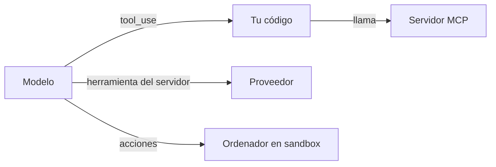

Un modelo solo genera texto. Las herramientas son el mecanismo con el que **pide a algo externo que actúe**: consultar una base de datos, buscar en la web, ejecutar código o mover el ratón. Este grupo documenta las cuatro formas de dárselas, de la más básica a la más arriesgada.

## Artículos

| Artículo | Quién ejecuta la herramienta | Para qué lo consultas |
|---|---|---|
| [[docs/herramientas/01-uso-de-herramientas]] | Tu código | Definir herramientas, el ciclo `tool_use` → `tool_result`, `tool_choice`, errores. |
| [[docs/herramientas/02-mcp]] | Un servidor MCP que tu aplicación conecta | Arquitectura, primitivas, transportes y cómo escribir un servidor. |
| [[docs/herramientas/03-herramientas-del-servidor]] | El proveedor de la API | Herramientas que ejecuta el proveedor, como la búsqueda web, y cómo se integran en tu bucle. |
| [[docs/herramientas/04-uso-del-ordenador]] | Tu código, sobre una máquina aislada | El modelo ve capturas y controla ratón y teclado. |

## Cómo se relaciona con el resto

- Para **aprender** el ciclo de herramientas con ejercicios, sigue [[roadmap/20-herramientas/index]].
- Para **diseñar** buenas herramientas (nombres, descripciones, granularidad), lee [[disciplinas/diseno-de-herramientas]].
- Las herramientas son la base del [[docs/agentes/01-el-bucle-agentico|bucle agéntico]].

> [!peligro] Cada herramienta amplía lo que puede salir mal
> Una herramienta que escribe, borra, paga o envía necesita permisos mínimos y, a menudo, aprobación humana. Ver [[docs/seguridad/02-permisos-y-minimo-privilegio]].
