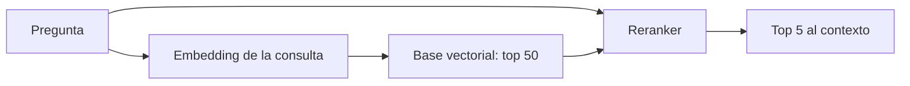

Un modelo de **[[glosario/embeddings|embeddings]]** convierte un texto en un vector para buscar por significado; un **[[glosario/reranking|reranker]]** recibe la pregunta y unos pocos candidatos y los vuelve a ordenar leyendo los dos textos juntos. Anthropic no ofrece modelo de embeddings, así que en un RAG con Claude esta pieza casi siempre es un modelo abierto. Aquí ves cómo usar los dos con `sentence-transformers` y con Ollama, qué licencias revisar y cómo elegir modelo con tus datos.

## Cuatro tipos de modelo

| Tipo | Qué produce | Cuándo | En `sentence-transformers` |
|---|---|---|---|
| **Denso** ([[glosario/bi-encoder|bi-encoder]]) | Un vector por texto | Primera etapa: buscar entre millones de fragmentos | `SentenceTransformer` |
| ***Sparse*** (SPLADE) | Un vector disperso del tamaño del vocabulario | Búsqueda léxica aprendida; híbrida sin BM25 aparte | `SparseEncoder` |
| **Multivector** ([[glosario/interaccion-tardia|interacción tardía]], tipo ColBERT) | Un vector por token | Más precisión que el denso, con más almacenamiento | `MultiVectorEncoder` |
| **Reranker** ([[glosario/cross-encoder|cross-encoder]]) | Una puntuación por par pregunta-documento | Segunda etapa: reordenar los 20–100 primeros | `CrossEncoder` |

El bi-encoder es rápido porque calcula los vectores de los documentos una vez, al indexar. El cross-encoder es más preciso porque ve pregunta y documento a la vez, pero tiene que ejecutarse en cada consulta y con cada candidato: por eso solo se aplica a unos pocos.



## sentence-transformers 6

[`sentence-transformers`](https://www.sbert.net) 6.2.0 (21 oct. 2026, Apache-2.0) agrupa los cuatro tipos con la misma API. Lo importante de la versión 6 es que separa la consulta del documento: `encode_query` y `encode_document`. Muchos modelos de recuperación son **asimétricos** y esperan un prefijo o instrucción distinta para cada lado. `encode_query` aplica la instrucción `"query"` que el modelo trae configurada; si usas `encode` a secas para las dos cosas, pierdes calidad sin ningún error.

```python nocheck title="embeddings_st.py"
from sentence_transformers import CrossEncoder, SentenceTransformer

EMBED_MODEL = "BAAI/bge-m3"               # multilingüe, 8192 tokens de contexto
RERANK_MODEL = "BAAI/bge-reranker-v2-m3"  # cross-encoder multilingüe

modelo = SentenceTransformer(EMBED_MODEL)
docs = ["Tienes 30 días desde la entrega para devolver un producto.",
        "El soporte atiende de 9 a 18 h, de lunes a viernes.",
        "Los reembolsos llegan en 5 días hábiles."]
v_docs = modelo.encode_document(docs)                   # al indexar
v_q = modelo.encode_query(["¿cuánto tiempo tengo para devolverlo?"])
print(modelo.similarity(v_q, v_docs))                   # matriz 1 × 3

reranker = CrossEncoder(RERANK_MODEL)
for r in reranker.rank("¿cuánto tiempo tengo para devolverlo?", docs, return_documents=True, top_k=2):
    print(r["corpus_id"], round(float(r["score"]), 2), r["text"])
```

Este bloque no se ha ejecutado aquí: necesita PyTorch y descargar los modelos de Hugging Face, y el entorno de pruebas no tenía acceso. Las firmas (`encode_query`, `encode_document`, `similarity`, `CrossEncoder.rank(query, documents, top_k=, return_documents=)`) están comprobadas en el código del paquete 6.2.0. `rank` devuelve una lista ordenada de diccionarios con `corpus_id`, `score` y, si lo pides, `text`.

Tres opciones más que conviene conocer:

- **`truncate_dim`** (en el constructor o en `encode_*`): recorta los vectores de modelos entrenados con Matryoshka. Menos dimensiones, índice más pequeño y búsqueda más rápida; mide cuánto recall pierdes antes de adoptarlo.
- **`SparseEncoder("naver/splade-cocondenser-ensembledistil")`**: vectores dispersos que puedes guardar como `sparse` en Qdrant o `sparsevec` en pgvector. El modelo del ejemplo de la documentación es inglés: busca uno que cubra tu idioma.
- **`MultiVectorEncoder("lightonai/GTE-ModernColBERT-v1")`**: nuevo en la serie 6, calcula la similitud MaxSim de interacción tardía. Para indexarlo a escala existe PyLate 1.6 (MIT) con su índice PLAID.

## Embeddings con Ollama

Si ya sirves el modelo de chat con [[herramientas/ollama|Ollama]], el mismo servidor genera embeddings y te ahorras PyTorch en tu aplicación. El cliente `ollama` 0.6.3 expone `embed`:

```python title="embeddings_ollama.py"
from ollama import embed

EMBED_MODEL = "bge-m3"    # también qwen3-embedding, embeddinggemma, nomic-embed-text…

def embed_textos(textos: list[str]) -> list[list[float]]:
    return embed(model=EMBED_MODEL, input=textos).embeddings

vectores = embed_textos(["Tienes 30 días para devolverlo.", "Horario de soporte"])
print(len(vectores), len(vectores[0]))   # nº de textos y dimensión: créala así en tu base
```

Necesita un servidor Ollama en marcha (`ollama pull bge-m3`), así que aquí solo se ha comprobado la firma del cliente, que acepta además `dimensions` y `truncate`. El servidor también responde en `/v1/embeddings` con formato OpenAI. Ojo con dos cosas: la API de Ollama **no aplica instrucciones de consulta por ti** (si el modelo las necesita, añádelas tú al texto de la pregunta) y la dimensión depende del modelo, así que léela del primer vector antes de crear la tabla.

## Modelos y licencias

Los tamaños salen de la biblioteca de Ollama y de las *model cards*. Las licencias de los **modelos** de embeddings no se pudieron confirmar en la fuente original para esta página: el código que los acompaña puede tener una licencia y los pesos otra. Antes de usarlos en producción, abre el `LICENSE` del repositorio del modelo.

| Modelo | Tamaño y contexto | Licencia | Notas |
|---|---|---|---|
| Qwen3-Embedding 0.6B / 4B / 8B | 32K–40K tokens; hasta 4096 dims, elegibles desde 32 | Revisa la *model card* | Más de 100 idiomas, instrucciones por tarea; tiene reranker hermano |
| bge-m3 (BAAI) | 567M; 8192 tokens | Revisa la *model card* (el código FlagEmbedding es MIT) | Denso, *sparse* y multivector en un modelo |
| EmbeddingGemma | ~300M; 2K tokens | Revisa la *model card* | Ollama ≥ 0.11.10 |
| nomic-embed-text v1.5 · mxbai-embed-large | 137M · 335M | Revisa la *model card* | Ligeros, en la biblioteca de Ollama |
| bge-reranker-v2-m3 | Cross-encoder multilingüe ligero | Revisa la *model card* | Para la segunda etapa |
| mxbai-rerank base-v2 (0.5B) / large-v2 (1.5B) | Rerankers | Paquete `mxbai-rerank` 0.1.6: Apache-2.0 | `MxbaiRerankV2(...).rank(query=, documents=)` |

> [!aviso] Familias con historial no comercial
> Algunas versiones de modelos de embeddings conocidos se han publicado con licencias no comerciales (las v3 y v4 de Jina, históricamente CC BY-NC). Que un modelo esté en Hugging Face o en Ollama no te dice si puedes usarlo en un producto. Sobre cómo leer una licencia de pesos, ver [[cursos/agentes-con-modelos-abiertos/01-pesos-abiertos-y-licencias]].

## MTEB con criterio

El [leaderboard de MTEB](https://huggingface.co/spaces/mteb/leaderboard) (paquete `mteb` 2.26, Apache-2.0) es el punto de partida habitual. Úsalo así:

1. **Filtra por tu idioma** (español o multilingüe) y por la tarea de **recuperación**. La media global mezcla clasificación, *clustering* y otras tareas que no son tu RAG.
2. **Mira tamaño, dimensiones y contexto.** Un modelo de 8B con 4096 dimensiones multiplica el coste del índice y la latencia de cada consulta frente a uno de 0,6B.
3. **Desconfía de diferencias pequeñas en los primeros puestos**: pueden reflejar ajuste a los conjuntos públicos más que mejor recuperación.
4. **Decide con tus datos.** Con 30–50 preguntas reales y el fragmento que debería salir, mide [[glosario/recall-at-k|recall@k]] de cada candidato sobre el mismo índice.

```python title="recall_at_k.py"
def recall_at_k(casos: list[dict], buscar, k: int = 5) -> float:
    """Proporción de preguntas cuyo fragmento correcto aparece entre los k primeros."""
    aciertos = sum(1 for c in casos if c["correcto"] in buscar(c["pregunta"])[:k])
    return aciertos / len(casos)

# tus preguntas reales, con el id del fragmento que debería salir
casos = [
    {"pregunta": "¿cuánto tiempo tengo para devolverlo?", "correcto": "dev-01"},
    {"pregunta": "horario de atención", "correcto": "sop-02"},
    {"pregunta": "me han cobrado dos veces", "correcto": "fac-07"},
]
# resultados de dos configuraciones (en tu caso, dos modelos de embeddings sobre el mismo índice)
modelo_a = {"¿cuánto tiempo tengo para devolverlo?": ["dev-01", "dev-03"],
            "horario de atención": ["fac-07", "sop-02"],
            "me han cobrado dos veces": ["dev-03", "sop-02"]}
modelo_b = {"¿cuánto tiempo tengo para devolverlo?": ["dev-03", "dev-01"],
            "horario de atención": ["sop-02", "fac-07"],
            "me han cobrado dos veces": ["fac-07", "dev-01"]}
for nombre, res in (("modelo A", modelo_a), ("modelo B", modelo_b)):
    print(nombre, "recall@1 =", round(recall_at_k(casos, res.get, 1), 2),
          "recall@2 =", round(recall_at_k(casos, res.get, 2), 2))
```

```text
modelo A recall@1 = 0.33 recall@2 = 0.67
modelo B recall@1 = 0.67 recall@2 = 1.0
```

En tu caso, `buscar` es la función que consulta tu base con cada modelo. Mide también con y sin reranker: si el reranker no mueve el recall@5 de tus preguntas, te ahorras su latencia. Más métricas en [[cursos/rag-a-fondo/10-evaluar-un-rag]].

## Errores frecuentes

| Error | Consecuencia | Arreglo |
|---|---|---|
| Indexar con un modelo y consultar con otro (o con otra versión) | Vectores de espacios distintos: resultados sin sentido | Guarda el nombre y la versión del modelo junto al índice; reindexa al cambiar |
| `encode` para consultas en un modelo asimétrico | Recall más bajo sin error visible | `encode_query` y `encode_document` |
| Reranker sobre 1000 candidatos | Latencia alta en cada consulta | Reordena 20–100 |
| Elegir por la media global de MTEB | Modelo bueno en tareas que no usas | Filtra por recuperación e idioma y mide con tus preguntas |
| Fragmentos más largos que el contexto del modelo | Se trunca el final y no se encuentra | Trocea por debajo del límite: [[recetas/trocear-documentos]] |

## Ver también

- [[docs/modelos-abiertos/05-bases-vectoriales]]: dónde guardar los vectores y cómo hacer híbrida.
- [[recetas/rag-local-con-pgvector]]: embeddings de Ollama en pgvector, paso a paso.
- [[recetas/busqueda-hibrida-con-qdrant]]: denso y *sparse* fusionados.
- [[cursos/rag-a-fondo/03-recuperar-bien]]: híbrida, reranking y recuperación contextual.
