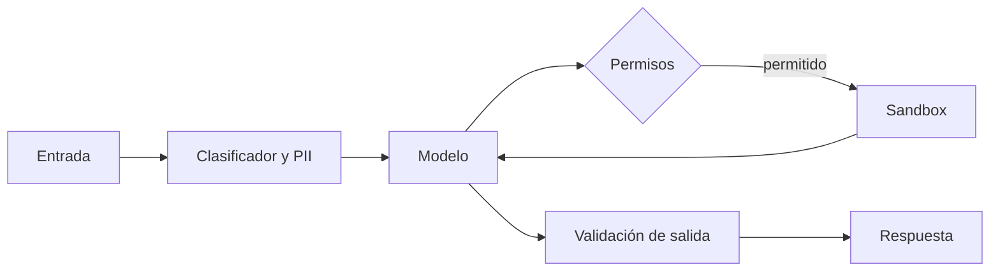

Los **[[glosario/guardrails|guardrails]]** son comprobaciones que se ejecutan antes o después del modelo: clasificar una entrada como peligrosa, quitar datos personales, validar que la salida cumple una regla. El **[[glosario/sandbox|sandbox]]** es otra cosa: el entorno aislado donde se ejecuta lo que el agente decide hacer (código, comandos). Los primeros reducen la probabilidad de que algo malo pase; el segundo limita el daño cuando pasa. Necesitas las dos capas, y ninguna sustituye a los permisos: un clasificador se puede engañar, un permiso que no existe no.

## Mapa de piezas abiertas

| Pieza | Versión · licencia | Protege | No protege |
|---|---|---|---|
| [[herramientas/llama-guard\|Llama Guard 4]] (12B, abr. 2025) | Llama 4 Community License | Clasifica entrada y salida en las categorías S1–S14 de MLCommons, también con imágenes | Inyección de prompt bien hecha (su propia card dice que puede ser vulnerable) |
| Llama Prompt Guard 2 (86M y 22M) | Licencia: revísala en la card | Detecta ataques de prompt; Meta lo recomienda junto a Llama Guard | Ataques nuevos o adaptativos |
| gpt-oss-safeguard (120b y 20b, oct. 2025) | Apache 2.0 | Clasifica con **tu propia política** escrita, con razonamiento visible | Lo que tu política no describe |
| NeMo Guardrails | 0.24.1 · Apache-2.0 | *Rails* programables de entrada, diálogo (Colang) y salida | Acciones del agente fuera del flujo de conversación |
| Guardrails AI | 0.11.0 · Apache-2.0 | Validadores de salida (formato, contenido) del Hub | La entrada y las herramientas |
| Presidio | 2.2.366 · MIT | Detecta y anonimiza datos personales | Datos que no siguen un patrón ni detecta el modelo NER |
| Contenedor endurecido | Docker | Aísla procesos, red y ficheros | Fugas por lo que montes o la red que abras |
| microsandbox | 0.7.11 · Apache-2.0 | MicroVM local (libkrun) desde imágenes OCI, con red configurable | Lo que permitas en su política de red o en volúmenes |

LLM Guard (0.3.16, MIT) no publica versión desde mayo de 2025 y no admite Python 3.13: no lo elijas para un proyecto nuevo. Versiones y licencias según PyPI y las *model cards* a 29 oct. 2026.



## Clasificadores de seguridad

**Llama Guard 4** recibe la conversación y devuelve `safe` o `unsafe` con la categoría (S14 es el abuso de intérprete de código, útil en agentes que ejecutan código). Lo ejecutas como cualquier modelo abierto, con [[herramientas/vllm|vLLM]] u [[herramientas/ollama|Ollama]], antes de la llamada principal (sobre la entrada) y después (sobre la salida). Revisa la licencia comunitaria de Llama 4: exige atribución y pide licencia aparte por encima de 700 M de usuarios activos mensuales.

**gpt-oss-safeguard** sirve cuando las categorías estándar no encajan con tu caso: le das tu política en el prompt de sistema («en este servicio no se dan consejos de inversión concretos…») y clasifica contra ella explicando por qué. Es Apache 2.0.

Lo que ningún clasificador resuelve: la [[glosario/inyeccion-de-prompt|inyección de prompt]] indirecta, la que llega dentro de un documento o del resultado de una herramienta. Un atacante que conoce el clasificador lo rodea. Trata el clasificador como un filtro de ruido, y diseña el agente para que una inyección que pase no pueda hacer daño: [[docs/seguridad/03-patrones-contra-inyeccion]].

## NeMo Guardrails

NeMo Guardrails monta una capa alrededor del modelo con tres tipos de *rails*: de entrada (antes del modelo), de diálogo (en Colang, un lenguaje para definir flujos de conversación) y de salida. La configuración vive en una carpeta con `config.yml` (modelos y *rails* activos), ficheros `.co` de Colang y, opcionalmente, `actions.py`:

```python nocheck title="rails.py"
from nemoguardrails import LLMRails, RailsConfig

config = RailsConfig.from_path("config")          # carpeta con config.yml y los .co
rails = LLMRails(config)
respuesta = rails.generate(messages=[{"role": "user", "content": "Hola"}])   # también generate_async
print(respuesta["content"])
```

API del README de la 0.24.1; no se ha ejecutado aquí porque necesita un modelo configurado. La interfaz de `generate` imita los mensajes de Chat Completions. Ten en cuenta que la librería envía telemetría anónima a NVIDIA al instanciar `LLMRails` (lo documenta su README; revisa allí cómo desactivarla). Encaja en asistentes conversacionales con flujos acotados; en un agente con muchas herramientas, los permisos y el sandbox te darán más.

## Datos personales con Presidio

Presidio separa la detección (`AnalyzerEngine`) de la anonimización (`AnonymizerEngine`). Para español necesitas dos cosas: un modelo spaCy en español para detectar nombres (NER) y los reconocedores por patrón configurados para `"es"`, porque casi todos vienen para inglés por defecto. Este ejemplo se ejecutó con Presidio 2.2.366 y spaCy 3.8 usando un modelo spaCy **vacío**, para ver qué detectan solo los patrones:

```python nocheck title="pii.py"
import spacy
from presidio_analyzer import AnalyzerEngine, RecognizerRegistry
from presidio_analyzer.nlp_engine import NlpEngineProvider
from presidio_analyzer.predefined_recognizers import (
    EmailRecognizer, EsNifRecognizer, IbanRecognizer, PhoneRecognizer)
from presidio_anonymizer import AnonymizerEngine
from presidio_anonymizer.entities import OperatorConfig

# En producción usa un modelo spaCy en español (p. ej. es_core_news_md) para detectar nombres.
# Aquí, un modelo vacío: solo funcionan los reconocedores por patrón.
spacy.blank("es").to_disk("modelo_es_vacio")
nlp = NlpEngineProvider(nlp_configuration={"nlp_engine_name": "spacy",
    "models": [{"lang_code": "es", "model_name": "modelo_es_vacio"}]}).create_engine()

registro = RecognizerRegistry(supported_languages=["es"])
for r in (EmailRecognizer(supported_language="es"), EsNifRecognizer(),
          IbanRecognizer(supported_language="es"), PhoneRecognizer(supported_language="es", supported_regions=["ES"])):
    registro.add_recognizer(r)

analizador = AnalyzerEngine(nlp_engine=nlp, registry=registro, supported_languages=["es"])
texto = "Soy Ana, mi DNI es 12345678Z, escribid a ana.lopez@example.com o al 612 345 678."
hallazgos = analizador.analyze(text=texto, language="es")
for h in hallazgos:
    print(h.entity_type, texto[h.start:h.end], round(h.score, 2))

anon = AnonymizerEngine().anonymize(text=texto, analyzer_results=hallazgos,
    operators={"DEFAULT": OperatorConfig("replace", {"new_value": "<DATO>"})})
print(anon.text)
```

```text
ES_NIF 12345678Z 1.0
EMAIL_ADDRESS ana.lopez@example.com 1.0
PHONE_NUMBER 612 345 678 0.4
Soy Ana, mi DNI es <DATO>, escribid a <DATO> o al <DATO>.
```

(`nocheck`: Presidio no está en el entorno común de comprobación; se ejecutó en un entorno propio.) Dos lecciones de esta salida. «Ana» **no** se detecta: sin modelo NER en español, los nombres pasan. Y el teléfono sale con 0,4 de confianza: si filtras con `score_threshold=0.5`, se escapa. Ajusta el umbral por tipo de dato con tus ejemplos, no con el valor por defecto. Úsalo antes de guardar trazas ([[docs/modelos-abiertos/07-observabilidad-abierta]]) y antes de mandar texto a un modelo externo; LangChain trae además `PIIMiddleware` para hacerlo dentro del agente.

## Sandbox para lo que ejecuta el agente

Si tu agente ejecuta código o comandos, hazlo fuera de tu máquina y de tu red. Dos opciones abiertas, de menos a más aislamiento.

**Contenedor endurecido.** Un contenedor comparte el núcleo con el anfitrión, así que el aislamiento depende de quitarle todo lo que no necesita. Sintaxis estándar de `docker run` (no ejecutado en este entorno, que no tenía Docker):

```bash
# sin red, sistema de ficheros de solo lectura, sin root, sin capacidades y con límites
docker run --rm \
  --network none \
  --read-only --tmpfs /tmp:rw,size=64m \
  --user 1000:1000 \
  --cap-drop ALL --security-opt no-new-privileges \
  --memory 512m --cpus 1 --pids-limit 128 \
  -v "$PWD/trabajo:/trabajo:rw" -w /trabajo \
  python:3.13-slim python script_del_agente.py
```

Monta solo la carpeta de la tarea. Lo que más se olvida: no montes el socket de Docker, ni tu `$HOME`, ni variables con secretos ([[recetas/proteger-secretos-del-agente]]).

**microsandbox.** Arranca microVMs locales (libkrun) desde imágenes OCI: cada sandbox tiene su propio núcleo, y la red se define por política. API del README de la 0.7.11, no ejecutada aquí (necesita virtualización):

```python nocheck title="sandbox.py"
import asyncio
from microsandbox import Network, Sandbox

async def ejecutar(codigo: str) -> str:
    async with await Sandbox.create("agente", image="python", network=Network.none(), replace=True) as sb:
        salida = await sb.exec("python3", ["-c", codigo], timeout=30.0)
        return salida.stdout_text            # al salir del bloque, se para y se borra

print(asyncio.run(ejecutar("print(1 + 1)")))
```

También admite listas de dominios denegados, secretos que solo se sustituyen para destinos permitidos, volúmenes con cuota, *snapshots* y *fork* de un sandbox en marcha. Como alternativa en la nube está e2b (SDK MIT, servicio gestionado). Inspect AI ejecuta las herramientas de sus evals en Docker con `sandbox=`.

> [!peligro] Una lista blanca de red es una capacidad
> Si el sandbox puede hablar con un dominio, el agente puede sacar datos por él. Sin red es el punto de partida; cada dominio que abras, justifícalo. Ver [[glosario/trifecta-letal]].

## Qué capa para qué riesgo

| Riesgo | Primera defensa | Capa extra |
|---|---|---|
| El agente borra, paga o envía algo por error | Permisos y aprobación humana: [[docs/seguridad/02-permisos-y-minimo-privilegio]] | Hooks que bloquean: [[recetas/hook-que-bloquea-comandos-peligrosos]] |
| Código generado que daña la máquina | Sandbox sin red | Límites de CPU, memoria y tiempo |
| Inyección indirecta desde documentos o herramientas | Diseño: [[docs/seguridad/03-patrones-contra-inyeccion]] | Clasificador (Prompt Guard 2, Llama Guard) |
| Contenido dañino en la respuesta | Clasificador de salida | Revisión humana en casos dudosos |
| Datos personales en logs o hacia terceros | Presidio antes de guardar o enviar | Retención limitada |

## Errores frecuentes

- **Creer que el clasificador te protege de la inyección.** Ayuda contra lo obvio; lo que protege es que el agente no tenga el permiso.
- **Presidio con la configuración por defecto en textos en español.** Los reconocedores son de inglés y los nombres no se detectan: configura `"es"` y un modelo spaCy en español.
- **Contenedor con `--privileged`, el socket de Docker o la red abierta.** Deja de ser un sandbox.
- **Validar solo la entrada.** La salida del modelo y los resultados de herramientas también son datos no fiables.

## Ver también

- [[cursos/seguridad-y-prompt-injection/04-permisos-y-sandbox]]: permisos y aislamiento paso a paso.
- [[docs/seguridad/01-prompt-injection]]: el ataque que más falla los guardrails.
- [[docs/seguridad/04-mcp-y-skills-de-terceros]]: cuando el riesgo viene del servidor o la skill.
- [[docs/modelos-abiertos/10-agentes-de-codigo-abiertos]]: agentes de código siempre en entorno aislado.
