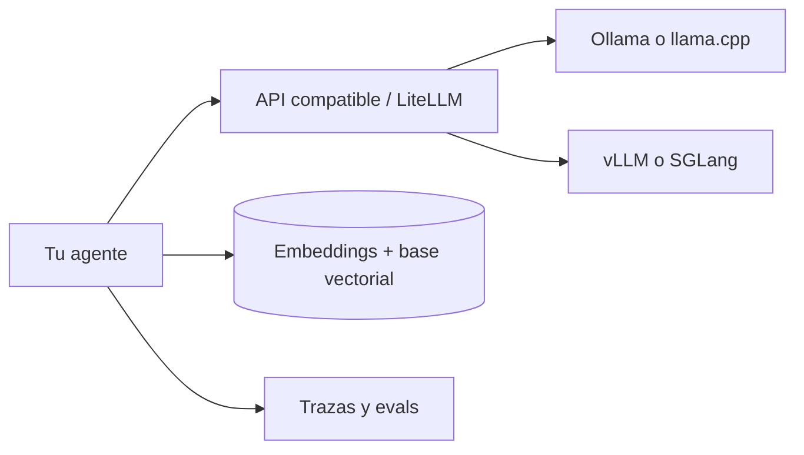

Este grupo documenta cómo construir agentes sin depender de una API propietaria: el modelo es de [[glosario/pesos-abiertos|pesos abiertos]] y lo sirves tú, en tu máquina o en tus servidores, junto con el resto de piezas abiertas que necesita un agente en producción. Las versiones, comandos y licencias están revisados a 29 de octubre de 2026; este ecosistema cambia cada pocas semanas, así que cada artículo dice qué comprobar.

## Artículos

| Artículo | Para qué lo consultas |
|---|---|
| [[docs/modelos-abiertos/01-ollama]] | Comandos, Modelfile, las tres APIs (nativa, OpenAI y Anthropic), `num_ctx`, `think`, `format` y variables de entorno. |
| [[docs/modelos-abiertos/02-vllm-y-llama-cpp]] | Servir en GPU con vLLM (`--tool-call-parser`, salidas estructuradas, CORS) y en CPU o Mac con `llama-server` y GGUF. |
| [[docs/modelos-abiertos/03-apis-compatibles-y-litellm]] | Qué significa «compatible con OpenAI» o «con Anthropic», qué campos se pierden y LiteLLM como SDK y pasarela. |
| [[docs/modelos-abiertos/04-embeddings-y-rerankers]] | Modelos de embeddings y rerankers abiertos, sentence-transformers y cómo leer MTEB con criterio. |
| [[docs/modelos-abiertos/05-bases-vectoriales]] | pgvector, Qdrant, LanceDB, Chroma y otras: híbrida, filtros y cuándo cada una. |
| [[docs/modelos-abiertos/06-ingesta-de-documentos]] | De PDF y Office a Markdown con Docling, PyMuPDF, marker o MinerU, con sus licencias. |
| [[docs/modelos-abiertos/07-observabilidad-abierta]] | Trazas con Langfuse, Phoenix y las convenciones GenAI de OpenTelemetry. |
| [[docs/modelos-abiertos/08-evals-abiertas]] | promptfoo, DeepEval, RAGAS e Inspect AI, y los riesgos de un juez local. |
| [[docs/modelos-abiertos/09-guardrails-y-sandbox]] | Clasificadores abiertos, NeMo Guardrails, Presidio y aislamiento para ejecutar código. |
| [[docs/modelos-abiertos/10-agentes-de-codigo-abiertos]] | OpenCode, Codex CLI, Cline y otros con modelos locales, y sus licencias. |

## Tres reglas para todo el grupo

- **Pesos abiertos no es open source.** La licencia del modelo es independiente de la del motor que lo sirve; lee el `LICENSE` de cada uno ([[glosario/open-source-ai]]).
- **«Compatible» no es «idéntico».** Cada motor implementa un subconjunto de la API que imita; el artículo 3 lista qué falta.
- **Local no es privado por defecto.** Los modelos `:cloud` de Ollama y los servidores expuestos sin autenticación sacan datos de tu red.

Para aprender con un proyecto guiado, sigue el curso [[cursos/agentes-con-modelos-abiertos/index]]. Para la memoria, la cuantización y el contexto, la guía [[modelos/12-inferencia-local]].
