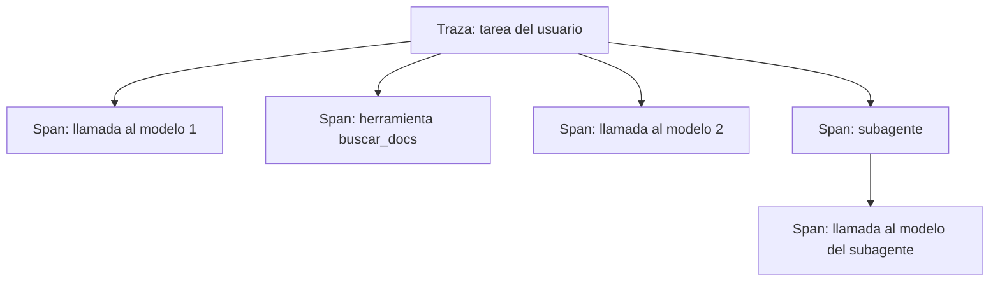

La **[[glosario/observabilidad|observabilidad]]** es la capacidad de entender qué hizo tu sistema a partir de lo que registra: qué entró, qué decidió el modelo, qué herramientas se ejecutaron, cuánto tardó y cuánto costó. En un agente importa más que en el software clásico, porque el camino cambia en cada ejecución. Si no lo registras, no puedes reproducirlo.

## Trazas y spans

La unidad de observabilidad de un agente es la **traza**: el registro completo de una tarea, de la petición del usuario a la respuesta final. Una traza se compone de **spans**, uno por operación: cada llamada al modelo, cada ejecución de herramienta, cada subagente.



Cada span lleva el identificador de la traza y el de su span padre. Con eso puedes reconstruir el árbol completo, incluso cuando hay [[docs/agentes/02-subagentes|subagentes]] en paralelo. Si ya usas OpenTelemetry u otra herramienta de trazas en tu empresa, mete aquí los spans del agente: no hace falta un sistema aparte.

## Qué registrar

### En cada llamada al modelo

| Campo | Por qué |
|---|---|
| `trace_id`, `span_id`, `parent_id` | Reconstruir el árbol. |
| Modelo y parámetros (`max_tokens`, `effort`, herramientas disponibles) | Saber qué configuración produjo el resultado. |
| Versión del prompt de sistema | Comparar antes y después de un cambio. Guarda un hash o un identificador, no hace falta repetir el texto. |
| `usage` completo | Coste y uso de caché: `input_tokens`, `output_tokens`, `cache_creation_input_tokens`, `cache_read_input_tokens`. |
| `stop_reason` | Detectar respuestas cortadas (`max_tokens`), rechazos (`refusal`) y pausas. |
| Latencia total y, con streaming, tiempo hasta el primer token | Ver [[docs/produccion/03-latencia]]. |
| Bloques `tool_use` (nombre y argumentos) | Ver qué decidió el modelo. |
| Error y código HTTP si falló | Distinguir 429, 529 y errores de tu petición. |

### En cada herramienta

Nombre, argumentos, resultado (o un resumen si es muy largo), `is_error`, duración. Si la herramienta llama a otro servicio, propaga el `trace_id` para enlazar sus logs.

### En la traza

Entrada del usuario, respuesta final, número de pasos, tokens totales, coste estimado, motivo de fin (terminó, límite de pasos, error, rechazo humano) y, si existe, la valoración del usuario.

> [!peligro] Los logs también son datos personales
> Las trazas contienen lo que escriben tus usuarios y lo que devuelven tus herramientas. Aplica la misma política que a tu base de datos: acceso restringido, retención limitada y enmascarado de datos sensibles antes de guardar.

## Ejemplo: un envoltorio que registra cada llamada

```python tab="Python" title="observabilidad.py"
import json, time, uuid, logging
import anthropic

MODEL = "claude-sonnet-5-5"
client = anthropic.Anthropic()
log = logging.getLogger("agente")
logging.basicConfig(level=logging.INFO, format="%(message)s")

def llamar(trace_id: str, parent_id: str | None, **kwargs):
    span_id = uuid.uuid4().hex[:16]
    inicio = time.perf_counter()
    registro = {"trace_id": trace_id, "span_id": span_id, "parent_id": parent_id,
                "tipo": "llm", "modelo": MODEL,
                "herramientas": [t["name"] for t in kwargs.get("tools", [])]}
    try:
        resp = client.messages.create(model=MODEL, **kwargs)
        registro.update({
            "stop_reason": resp.stop_reason,
            "usage": resp.usage.model_dump(),
            "tool_use": [{"name": b.name, "input": b.input} for b in resp.content if b.type == "tool_use"],
        })
        return resp, span_id
    except anthropic.APIStatusError as e:
        registro.update({"error": type(e).__name__, "status": e.status_code})
        raise
    finally:
        registro["ms"] = round((time.perf_counter() - inicio) * 1000)
        log.info(json.dumps(registro, ensure_ascii=False, default=str))

# uso dentro del bucle
trace_id = uuid.uuid4().hex
resp, span = llamar(trace_id, None, max_tokens=1024,
                    messages=[{"role": "user", "content": "Hola"}])
```

```ts tab="TypeScript" title="observabilidad.ts"
import Anthropic from "@anthropic-ai/sdk";
import { randomUUID } from "node:crypto";

const MODEL = "claude-sonnet-5-5";
const client = new Anthropic();

export async function llamar(
  traceId: string, parentId: string | null,
  params: Omit<Anthropic.MessageCreateParamsNonStreaming, "model">,
) {
  const spanId = randomUUID().slice(0, 16);
  const inicio = performance.now();
  const registro: Record<string, unknown> = { trace_id: traceId, span_id: spanId, parent_id: parentId, tipo: "llm", modelo: MODEL };
  try {
    const resp = await client.messages.create({ model: MODEL, ...params });
    registro.stop_reason = resp.stop_reason;
    registro.usage = resp.usage;
    registro.tool_use = resp.content
      .filter((b): b is Anthropic.ToolUseBlock => b.type === "tool_use")
      .map((b) => ({ name: b.name, input: b.input }));
    return { resp, spanId };
  } catch (e) {
    if (e instanceof Anthropic.APIError) registro.status = e.status;
    registro.error = String(e);
    throw e;
  } finally {
    registro.ms = Math.round(performance.now() - inicio);
    console.log(JSON.stringify(registro));
  }
}
```

```text
# salida de ejemplo
{"trace_id": "9f2c…", "span_id": "a41b…", "parent_id": null, "tipo": "llm", "modelo": "claude-sonnet-5-5", "herramientas": [], "stop_reason": "end_turn", "usage": {"input_tokens": 8, "output_tokens": 12, "cache_creation_input_tokens": 0, "cache_read_input_tokens": 0}, "tool_use": [], "ms": 812}
```

Una línea JSON por span es suficiente para empezar: cualquier sistema de logs la indexa y puedes filtrar por `trace_id`. Cuando crezcas, envía los mismos campos a tu plataforma de trazas.

## Métricas que mirar

Con los spans registrados, estas métricas salen solas:

| Métrica | Qué te dice |
|---|---|
| Tokens y coste por tarea (media y percentil alto) | Si una tarea típica es cara o si hay casos que se disparan. |
| Proporción de lectura de caché | Si tu [[glosario/prompt-caching|prompt caching]] funciona. |
| Pasos por tarea | Agentes que dan vueltas sin avanzar. |
| Distribución de `stop_reason` | Un aumento de `max_tokens` indica respuestas cortadas. |
| Tasa de errores de herramienta | Herramientas mal descritas o servicios caídos. |
| Errores 429 y 529 | Necesidad de más capacidad o mejor control de concurrencia. |
| Latencia p50 y p95 | La experiencia típica y la de los peores casos. |
| Valoración del usuario | Calidad percibida; crúzala con las anteriores. |

## De las trazas a las evals

Las trazas de producción son la mejor fuente de casos de prueba. Cuando una traza muestra un fallo, conviértela en un caso de tu conjunto de [[glosario/evals|evals]] para que no vuelva a pasar. Ver [[docs/evals/01-disenar-evals]].

## Errores frecuentes

- **Registrar solo la respuesta final**: cuando falle, no sabrás en qué paso.
- **Logs sin identificador de traza**: con tráfico concurrente las líneas se mezclan y no hay forma de separarlas.
- **No registrar la versión del prompt**: no podrás saber si una regresión vino de un cambio de prompt.
- **Guardar todo para siempre**: coste de almacenamiento y riesgo legal. Define una retención.

## Ver también

- [[roadmap/40-primer-agente/06-depurar-con-trazas]]: leer una traza para encontrar el fallo.
- [[disciplinas/observabilidad]]: la práctica en el día a día.
- [[docs/produccion/02-costes-y-limites]]: qué hacer con los números de `usage`.
- [[sistemas/investigacion-multiagente]]: trazas en un sistema con subagentes.
