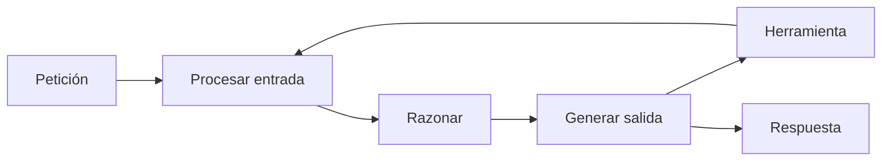

La **[[glosario/latencia|latencia]]** es el tiempo que pasa desde que el usuario envía su petición hasta que recibe la respuesta. En un sistema con modelos tiene dos medidas distintas: el **tiempo hasta el primer token** (cuánto tarda en empezar a aparecer algo) y el **tiempo total** (cuánto tarda en terminar). Optimizar una u otra requiere técnicas diferentes, y para el usuario a menudo pesa más la primera.

## De qué se compone

En una sola llamada:

- **Red y cola**: el viaje de la petición y la espera antes de procesarse.
- **Procesar la entrada**: crece con los tokens de entrada. El [[glosario/prompt-caching|prompt caching]] la reduce, porque el prefijo cacheado no se vuelve a procesar.
- **Razonamiento**, si está activado: tokens que el modelo genera antes de la respuesta visible.
- **Generar la salida**: crece con cada token de salida. Suele ser la parte dominante del tiempo total.

En un agente, multiplica: cada paso del bucle es una llamada completa, más el tiempo de ejecutar las herramientas.



## Medir antes de optimizar

Registra en cada llamada la latencia total y, con streaming, el tiempo hasta el primer token. Mira percentiles, no medias: la p50 es la experiencia típica y la p95 la de tus peores casos, que es la que genera quejas. Desglosa por paso en los agentes: a menudo una herramienta lenta o un paso innecesario explica la mayor parte del tiempo. El registro está en [[docs/produccion/01-observabilidad]].

## Técnicas, de más a menos impacto habitual

| Técnica | Qué mejora | Coste o contrapartida |
|---|---|---|
| Streaming | Primer token visible antes; percepción de rapidez. | Ninguno en tokens; algo más de código en el cliente. |
| Menos tokens de salida | Tiempo total. | Pide respuestas concisas, ajusta `max_tokens`. |
| Menos pasos en el agente | Tiempo total, de forma notable. | Diseñar mejor las herramientas o pasar a un workflow. |
| Herramientas en paralelo | Tiempo de pasos con varias herramientas independientes. | Solo para herramientas sin dependencias entre sí. |
| Modelo más rápido | Todo. | Puede bajar la calidad: mídelo con evals. |
| Menos razonamiento | Tiempo hasta la respuesta. | `effort` más bajo; peor en tareas difíciles. |
| Prompt caching | Procesar la entrada con prefijos largos repetidos. | Ninguno si el prefijo es estable. |

### Streaming

Con [[glosario/streaming|streaming]], el modelo envía la respuesta a medida que la genera. El tiempo total apenas cambia, pero el usuario empieza a leer casi enseguida. En cualquier interfaz con un humano esperando, úsalo por defecto.

```python tab="Python" title="streaming.py"
import time
import anthropic

MODEL = "claude-sonnet-5-5"
client = anthropic.Anthropic()

inicio = time.perf_counter()
primer_token = None
with client.messages.stream(
    model=MODEL, max_tokens=1024,
    messages=[{"role": "user", "content": "Explica en tres frases qué es un índice invertido."}],
) as stream:
    for texto in stream.text_stream:
        if primer_token is None:
            primer_token = time.perf_counter() - inicio
        print(texto, end="", flush=True)
    final = stream.get_final_message()

print(f"\nPrimer token: {primer_token:.2f}s · total: {time.perf_counter() - inicio:.2f}s · "
      f"stop_reason: {final.stop_reason}")
```

```ts tab="TypeScript" title="streaming.ts"
import Anthropic from "@anthropic-ai/sdk";

const MODEL = "claude-sonnet-5-5";
const client = new Anthropic();

const inicio = performance.now();
let primerToken: number | null = null;
const stream = client.messages.stream({
  model: MODEL, max_tokens: 1024,
  messages: [{ role: "user", content: "Explica en tres frases qué es un índice invertido." }],
});
stream.on("text", (texto) => {
  primerToken ??= performance.now() - inicio;
  process.stdout.write(texto);
});
const final = await stream.finalMessage();
console.log(`\nPrimer token: ${primerToken}ms · total: ${performance.now() - inicio}ms · ${final.stop_reason}`);
```

Aunque uses streaming, sigue comprobando `stop_reason` en el mensaje final. Una respuesta que llegó fluida puede estar cortada por `max_tokens`. Más detalle en [[docs/fundamentos/04-streaming]].

### Menos pasos

En agentes, cada paso que eliminas ahorra una llamada entera. Las fuentes habituales de pasos sobrantes:

- **Herramientas demasiado finas**: el modelo necesita tres llamadas para algo que una herramienta bien diseñada haría en una. Ver [[disciplinas/diseno-de-herramientas]].
- **Resultados demasiado grandes**: el modelo pide más páginas o vuelve a buscar porque el resultado no traía lo que necesitaba.
- **Pasos que no necesitan decisión**: si siempre se hace lo mismo, sácalo del agente y conviértelo en código previo. Un [[glosario/workflow|workflow]] es más rápido que un agente para tareas fijas.

### Modelo y razonamiento

Un modelo de tier más rápido responde antes y cuesta menos. El método para bajar de tier sin perder calidad está en [[modelos/05-elegir-modelo-por-tarea]]. Con razonamiento adaptativo, un `effort` más bajo reduce los tokens de pensamiento; úsalo para tareas sencillas y reserva los niveles altos para las difíciles. Ver [[modelos/04-dejar-pensar-al-modelo]].

## Latencia percibida

Lo que el usuario percibe se puede mejorar sin tocar la latencia real:

- **Mostrar progreso en agentes**: «Buscando en la documentación…», «Revisando el pedido…». Saber qué pasa hace la espera más llevadera que un spinner sin más.
- **Respuesta inmediata y trabajo en segundo plano**: para tareas largas, confirma que has empezado y avisa cuando termine.
- **Primero lo útil**: pide al modelo que empiece por la conclusión y deje el detalle para después.

Ideas de diseño en [[disciplinas/ux-de-agentes]].

> [!consejo] Latencia y coste suelen ir juntos
> Menos tokens de salida, menos pasos y un modelo más pequeño mejoran las dos cosas a la vez. El caché también. Las excepciones son el paralelismo (más rápido, mismo coste) y el procesamiento por lotes (más barato, mucho más lento).

## Errores frecuentes

- **Optimizar la media**: los usuarios se quejan de la p95.
- **Bajar de modelo sin evals**: ganas segundos y pierdes calidad sin enterarte.
- **No hacer streaming en interfaces de chat**: el sistema parece más lento de lo que es.
- **Herramientas lentas sin tiempo límite**: una API externa colgada congela todo el agente. Pon un *timeout* a cada herramienta y devuelve `is_error` si salta.

## Ver también

- [[recetas/streaming-de-respuestas]]: la receta paso a paso.
- [[roadmap/100-produccion/03-latencia]]: la lección guiada.
- [[docs/produccion/02-costes-y-limites]]: las palancas de coste.
- [[sistemas/agente-de-voz]]: un sistema donde la latencia es crítica.
