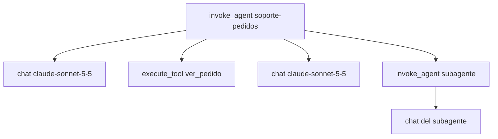

Las **[[glosario/convenciones-genai-otel|convenciones semánticas GenAI de OpenTelemetry]]** son los nombres estándar de spans y atributos (`gen_ai.*`) para registrar llamadas a modelos, agentes y herramientas en una traza de OpenTelemetry. Si tus trazas usan esos nombres, cualquier backend compatible (open source o comercial) sabe que un span es una llamada al modelo, cuántos tokens gastó y qué herramienta ejecutó, sin adaptadores propios. Este artículo explica el árbol de spans de un agente, los atributos que importan, el estado real de la especificación y un bucle agéntico instrumentado a mano con su salida.

> [!aviso] Estado Development: los nombres pueden cambiar
> Todas las convenciones `gen_ai.*` están en estado *Development*: ningún atributo propio es estable. Desde la versión 1.42.0 (junio de 2026) viven en su propio repositorio, [open-telemetry/semantic-conventions-genai](https://github.com/open-telemetry/semantic-conventions-genai), que todavía no publica versiones etiquetadas (su *Schema URL* figura como «TODO»). Fija la versión de tus instrumentaciones y revisa los cambios antes de actualizar.

## El árbol de spans de un agente

Una traza es el registro de una tarea; cada operación es un span con su padre. Para agentes, la convención define operaciones con nombre propio en `gen_ai.operation.name`:

| Operación | Qué representa | Nombre del span |
|---|---|---|
| `invoke_agent` | Una ejecución del agente, de la petición a la respuesta | `invoke_agent {agente}` |
| `chat` | Una llamada al modelo (también `generate_content` y `text_completion`) | `chat {modelo}` |
| `execute_tool` | Una ejecución de herramienta | `execute_tool {herramienta}` |

Hay más operaciones para otros pasos: `create_agent` (crear un agente en un servicio remoto), `invoke_workflow` (un flujo que coordina varios agentes), `embeddings`, `retrieval` y operaciones de memoria.

El árbol típico de un [[glosario/bucle-agentico|bucle agéntico]] tiene un span `invoke_agent` en la raíz y, debajo, un `chat` por cada vuelta al modelo y un `execute_tool` por cada herramienta. Un [[glosario/subagente|subagente]] es otro `invoke_agent` anidado.



## Los atributos que importan

| Atributo | Dónde | Para qué |
|---|---|---|
| `gen_ai.operation.name` | todos | Tipo de operación. Obligatorio. |
| `gen_ai.provider.name` | `chat`, `invoke_agent` | Proveedor (`anthropic`, `openai`, `aws.bedrock`…). Obligatorio en inferencia; sustituye a `gen_ai.system`. |
| `gen_ai.request.model`, `gen_ai.response.model` | `chat` | Modelo pedido y modelo que respondió. |
| `gen_ai.request.max_tokens` | `chat` | Parámetros de la petición. |
| `gen_ai.response.id`, `gen_ai.response.finish_reasons` | `chat` | Id del mensaje y motivo de parada (en Claude, el `stop_reason`). |
| `gen_ai.usage.input_tokens`, `gen_ai.usage.output_tokens` | `chat` (y agregado en el agente) | Coste y uso. Recomendados. |
| `gen_ai.usage.cache_read.input_tokens`, `gen_ai.usage.cache_write.input_tokens` | `chat` | Desglose de [[glosario/prompt-caching|caché]]: leídos y escritos. El total `input_tokens` debería incluirlos. |
| `gen_ai.agent.name`, `gen_ai.agent.id`, `gen_ai.agent.version` | `invoke_agent` | Qué agente y qué versión. |
| `gen_ai.conversation.id` | todos | Agrupar las trazas de una misma conversación. |
| `gen_ai.tool.name`, `gen_ai.tool.call.id`, `gen_ai.tool.type` | `execute_tool` | Qué herramienta y qué llamada (`tool_use.id`). |
| `error.type` | todos | Clase del error si falló. Es de los pocos atributos estables, heredado del núcleo de OTel. |

Renombres que verás en código antiguo: `gen_ai.system` pasó a `gen_ai.provider.name`, y `gen_ai.usage.prompt_tokens`/`completion_tokens` a `input_tokens`/`output_tokens`. Los atributos `gen_ai.prompt` y `gen_ai.completion` se eliminaron sin sustituto directo. Las métricas estándar son `gen_ai.client.operation.duration` y `gen_ai.client.token.usage`.

### El contenido es opt-in

Prompts, respuestas, argumentos y resultados de herramientas **no se capturan por defecto**, porque pueden llevar datos personales. Cuando los activas, van en `gen_ai.input.messages`, `gen_ai.output.messages`, `gen_ai.system_instructions`, `gen_ai.tool.call.arguments` y `gen_ai.tool.call.result`. Cómo se activa depende de cada instrumentación: no hay un interruptor común. Decide antes qué guardas, quién lo ve y cuánto tiempo, como en cualquier log con datos de usuarios ([[docs/produccion/01-observabilidad]]).

## Un bucle instrumentado a mano

Así se ve el mecanismo sin ninguna librería de instrumentación: el SDK de Anthropic, `opentelemetry-sdk` y un exportador de consola. Un span `invoke_agent` envuelve el bucle, cada llamada al modelo abre un `chat` y cada herramienta un `execute_tool`. El contenido solo se registra si activas una variable de entorno propia.

```python tab="Python" title="agente_otel.py"
import json
import os

import anthropic
from opentelemetry import trace
from opentelemetry.sdk.resources import Resource
from opentelemetry.sdk.trace import TracerProvider
from opentelemetry.sdk.trace.export import ConsoleSpanExporter, SimpleSpanProcessor
from opentelemetry.trace import SpanKind, Status, StatusCode

MODEL = "claude-sonnet-5-5"
AGENTE = "soporte-pedidos"
MAX_PASOS = 8
# El contenido (mensajes, argumentos, resultados) solo se registra si lo activas a propósito.
CAPTURAR_CONTENIDO = os.environ.get("AGENTE_CAPTURAR_CONTENIDO") == "1"

# En producción: BatchSpanProcessor + OTLPSpanExporter hacia tu colector.
proveedor = TracerProvider(resource=Resource.create({"service.name": "agente-soporte"}))
proveedor.add_span_processor(SimpleSpanProcessor(ConsoleSpanExporter()))
trace.set_tracer_provider(proveedor)
tracer = trace.get_tracer("agente-soporte", "0.1.0")

# El SDK 2.x emite su propio span por llamada; aquí lo apago porque el span `chat` lo pongo yo.
client = anthropic.Anthropic(open_telemetry=False)

TOOLS = [{
    "name": "ver_pedido",
    "description": "Devuelve el estado de un pedido por su identificador (p. ej. P-1001).",
    "input_schema": {"type": "object", "properties": {"pedido_id": {"type": "string"}}, "required": ["pedido_id"]},
}]

def ver_pedido(pedido_id: str) -> dict:
    pedidos = {"P-1001": {"estado": "enviado", "transportista": "correos"}}
    if pedido_id not in pedidos:
        raise KeyError(f"No existe el pedido {pedido_id}")
    return pedidos[pedido_id]

HERRAMIENTAS = {"ver_pedido": ver_pedido}

def entrada_total(u) -> int:
    """Anthropic separa la caché de input_tokens: sumamos para tener el total de entrada."""
    return u.input_tokens + (u.cache_read_input_tokens or 0) + (u.cache_creation_input_tokens or 0)

def llamar_modelo(messages: list) -> anthropic.types.Message:
    """Un span `chat` por llamada al modelo."""
    with tracer.start_as_current_span(f"chat {MODEL}", kind=SpanKind.CLIENT) as span:
        span.set_attribute("gen_ai.operation.name", "chat")
        span.set_attribute("gen_ai.provider.name", "anthropic")
        span.set_attribute("gen_ai.request.model", MODEL)
        span.set_attribute("gen_ai.request.max_tokens", 1024)
        if CAPTURAR_CONTENIDO:
            span.set_attribute("gen_ai.input.messages", json.dumps(messages, ensure_ascii=False))
        try:
            resp = client.messages.create(model=MODEL, max_tokens=1024, tools=TOOLS, messages=messages)
        except anthropic.APIError as e:
            span.set_attribute("error.type", type(e).__name__)
            span.set_status(Status(StatusCode.ERROR, str(e)))
            raise
        u = resp.usage
        cache_leida = u.cache_read_input_tokens or 0
        cache_escrita = u.cache_creation_input_tokens or 0
        span.set_attribute("gen_ai.response.id", resp.id)
        span.set_attribute("gen_ai.response.model", resp.model)
        span.set_attribute("gen_ai.response.finish_reasons", [resp.stop_reason])
        span.set_attribute("gen_ai.usage.input_tokens", entrada_total(u))   # y el desglose, aparte:
        span.set_attribute("gen_ai.usage.cache_read.input_tokens", cache_leida)
        span.set_attribute("gen_ai.usage.cache_write.input_tokens", cache_escrita)
        span.set_attribute("gen_ai.usage.output_tokens", u.output_tokens)
        if CAPTURAR_CONTENIDO:
            span.set_attribute("gen_ai.output.messages", resp.model_dump_json(include={"content"}))
        return resp

def ejecutar_herramienta(bloque) -> dict:
    """Un span `execute_tool` por herramienta; devuelve el tool_result."""
    with tracer.start_as_current_span(f"execute_tool {bloque.name}", kind=SpanKind.INTERNAL) as span:
        span.set_attribute("gen_ai.operation.name", "execute_tool")
        span.set_attribute("gen_ai.tool.name", bloque.name)
        span.set_attribute("gen_ai.tool.call.id", bloque.id)
        span.set_attribute("gen_ai.tool.type", "function")
        if CAPTURAR_CONTENIDO:
            span.set_attribute("gen_ai.tool.call.arguments", json.dumps(bloque.input, ensure_ascii=False))
        try:
            salida = json.dumps(HERRAMIENTAS[bloque.name](**bloque.input), ensure_ascii=False)
            error = False
        except Exception as e:
            salida, error = f"Error: {e}", True
            span.set_attribute("error.type", type(e).__name__)
            span.set_status(Status(StatusCode.ERROR, str(e)))
        if CAPTURAR_CONTENIDO:
            span.set_attribute("gen_ai.tool.call.result", salida)
        return {"type": "tool_result", "tool_use_id": bloque.id, "content": salida, "is_error": error}

def agente(pregunta: str, conversacion_id: str) -> str:
    """El span raíz `invoke_agent` envuelve todo el bucle."""
    with tracer.start_as_current_span(f"invoke_agent {AGENTE}", kind=SpanKind.INTERNAL) as span:
        span.set_attribute("gen_ai.operation.name", "invoke_agent")
        span.set_attribute("gen_ai.provider.name", "anthropic")
        span.set_attribute("gen_ai.agent.name", AGENTE)
        span.set_attribute("gen_ai.request.model", MODEL)
        span.set_attribute("gen_ai.conversation.id", conversacion_id)
        messages = [{"role": "user", "content": pregunta}]
        entrada = salida = 0
        for paso in range(1, MAX_PASOS + 1):
            resp = llamar_modelo(messages)
            entrada += entrada_total(resp.usage)
            salida += resp.usage.output_tokens
            if resp.stop_reason != "tool_use":
                break
            messages.append({"role": "assistant", "content": [b.model_dump() for b in resp.content]})
            resultados = [ejecutar_herramienta(b) for b in resp.content if b.type == "tool_use"]
            messages.append({"role": "user", "content": resultados})
        span.set_attribute("app.agente.pasos", paso)            # atributo propio, fuera de gen_ai.*
        span.set_attribute("app.agente.stop_reason", resp.stop_reason)
        span.set_attribute("gen_ai.usage.input_tokens", entrada)
        span.set_attribute("gen_ai.usage.output_tokens", salida)
        if resp.stop_reason not in ("end_turn", "stop_sequence"):   # refusal, max_tokens, sin pasos…
            span.set_status(Status(StatusCode.ERROR, f"fin anómalo: {resp.stop_reason}"))
        return "".join(b.text for b in resp.content if b.type == "text")

if __name__ == "__main__":
    print(agente("¿Dónde está mi pedido P-1001?", conversacion_id="conv-42"))
```

Tres detalles del código. Anthropic devuelve `input_tokens` **sin** los tokens leídos o escritos en caché, así que aquí se suman para que el total de entrada sea comparable entre proveedores, y el desglose va en sus propios atributos. El estado del span se marca como error si el agente acaba por algo distinto de `end_turn` (un `refusal`, `max_tokens` o el límite de pasos), y así puedes filtrar en tu backend las ejecuciones que no terminaron bien. Y lo que no tiene nombre estándar (número de pasos, motivo de fin) va en un espacio propio, `app.*`, para no inventar atributos `gen_ai.*`.

La salida real del exportador, ejecutado con `opentelemetry-sdk` 1.45.2 contra el simulador de la API (recortada: sin `resource`, `events` ni `links`, y con los cuatro spans en el orden en que terminan):

```text title="salida del ConsoleSpanExporter (recortada)"
{
    "name": "chat claude-sonnet-5-5",
    "context": {"trace_id": "0x5b204a2dbaa35aa84b746f15d3329891", "span_id": "0x149fb68e2a77f8d1"},
    "kind": "SpanKind.CLIENT",
    "parent_id": "0xcfef1bb8ec0264a1",
    "attributes": {
        "gen_ai.operation.name": "chat",
        "gen_ai.provider.name": "anthropic",
        "gen_ai.request.model": "claude-sonnet-5-5",
        "gen_ai.request.max_tokens": 1024,
        "gen_ai.response.id": "msg_0000",
        "gen_ai.response.model": "claude-sonnet-5-5",
        "gen_ai.response.finish_reasons": ["tool_use"],
        "gen_ai.usage.input_tokens": 412,
        "gen_ai.usage.cache_read.input_tokens": 0,
        "gen_ai.usage.cache_write.input_tokens": 0,
        "gen_ai.usage.output_tokens": 58
    }
}
{
    "name": "execute_tool ver_pedido",
    "context": {"trace_id": "0x5b204a2dbaa35aa84b746f15d3329891", "span_id": "0x3fad1954b5ed46db"},
    "kind": "SpanKind.INTERNAL",
    "parent_id": "0xcfef1bb8ec0264a1",
    "attributes": {
        "gen_ai.operation.name": "execute_tool",
        "gen_ai.tool.name": "ver_pedido",
        "gen_ai.tool.call.id": "toolu_01",
        "gen_ai.tool.type": "function"
    }
}
{
    "name": "chat claude-sonnet-5-5",
    "context": {"trace_id": "0x5b204a2dbaa35aa84b746f15d3329891", "span_id": "0x14570ad3efb562bd"},
    "parent_id": "0xcfef1bb8ec0264a1",
    "attributes": {"gen_ai.response.finish_reasons": ["end_turn"], "gen_ai.usage.input_tokens": 520, "gen_ai.usage.output_tokens": 31}
}
{
    "name": "invoke_agent soporte-pedidos",
    "context": {"trace_id": "0x5b204a2dbaa35aa84b746f15d3329891", "span_id": "0xcfef1bb8ec0264a1"},
    "kind": "SpanKind.INTERNAL",
    "parent_id": null,
    "attributes": {
        "gen_ai.operation.name": "invoke_agent",
        "gen_ai.provider.name": "anthropic",
        "gen_ai.agent.name": "soporte-pedidos",
        "gen_ai.request.model": "claude-sonnet-5-5",
        "gen_ai.conversation.id": "conv-42",
        "app.agente.pasos": 2,
        "app.agente.stop_reason": "end_turn",
        "gen_ai.usage.input_tokens": 932,
        "gen_ai.usage.output_tokens": 89
    }
}
```

Los cuatro spans comparten `trace_id` y los tres hijos apuntan con `parent_id` al `invoke_agent`. Los tokens del simulador son inventados; la estructura es la real. Con `AGENTE_CAPTURAR_CONTENIDO=1` aparecen además `gen_ai.input.messages`, `gen_ai.output.messages`, `gen_ai.tool.call.arguments` y `gen_ai.tool.call.result`. Aquí guardan el JSON de la API de Anthropic tal cual; la convención define un formato propio de mensajes por partes, así que si tu backend lo interpreta, conviértelos.

En producción cambia dos líneas: `BatchSpanProcessor` en lugar de `SimpleSpanProcessor` (exporta por lotes, sin bloquear cada llamada) y `OTLPSpanExporter` hacia tu colector o tu backend.

## El SDK de Anthropic ya emite su span

Al ejecutar el ejemplo sin `open_telemetry=False`, apareció un span más por llamada: el SDK `anthropic` 2.3.0 trae instrumentación propia. Si hay un `TracerProvider` registrado, cada llamada a la API emite un span `CLIENT` llamado `anthropic.messages.create` con atributos `gen_ai.*` y HTTP, y propaga el contexto de la traza en las cabeceras. Lo comprobé leyendo el módulo `anthropic/_tracing.py` del paquete instalado:

- Se apaga con `anthropic.Anthropic(open_telemetry=False)` o con la variable `ANTHROPIC_OPEN_TELEMETRY=false`.
- El contenido es opt-in: `open_telemetry={"traces": {"content_mode": "content"}}` o `ANTHROPIC_OPEN_TELEMETRY_TRACES_CONTENT_MODE=content`. Por defecto, solo metadatos.
- `open_telemetry={"propagation": False}` evita propagar el contexto dos veces si ya instrumentas el cliente HTTP.
- `open_telemetry={"conversation_id": "…"}` rellena `gen_ai.conversation.id`.

Sigue los mismos nombres `gen_ai.*` que tu `chat`, incluido el de la escritura de caché, y añade uno propio, `anthropic.message.stop_reason`. Tienes dos opciones razonables: quedarte con el span del SDK y poner tú solo `invoke_agent` y `execute_tool` (menos código), o apagarlo y emitir tu `chat` como en el ejemplo (control total de los nombres). Lo que no conviene es tener los dos sin saberlo: un backend que suma tokens por span de `chat` los contaría dos veces.

## Instrumentaciones existentes

No siempre tendrás que escribir los spans. Algunas opciones, con su licencia:

| Opción | Qué hace | Tipo |
|---|---|---|
| [[herramientas/langfuse]] | SDK de Python basado en OpenTelemetry, con decoradores para agentes y herramientas; ver [[recetas/trazas-con-langfuse]] | SDK open source (MIT); plataforma autoalojable o en la nube |
| OpenInference + [[herramientas/arize-phoenix]] | Instrumentadores por librería (`openinference-instrumentation-anthropic`, Apache-2.0) y `arize-phoenix-otel` (Apache-2.0) para registrarlos | Instrumentación open source; el servidor Phoenix es Elastic License 2.0 (código disponible, no OSI) |
| OpenLLMetry | `traceloop-sdk` y `opentelemetry-instrumentation-anthropic` (Apache-2.0); exporta a cualquier backend OTLP | Open source; la plataforma de Traceloop es comercial |
| SDK de Anthropic 2.x | El span por llamada descrito arriba | Incluido en el SDK |

Cada una implementa una versión concreta de las convenciones, y no todas en el mismo punto: compara los nombres que emiten con los que espera tu backend antes de mezclar dos. Las herramientas de código también emiten telemetría: según el [blog de OpenTelemetry (14 may. 2026)](https://opentelemetry.io/blog/2026/genai-observability/), VS Code Copilot emite trazas, métricas y eventos; Codex, eventos de log y métricas; y Claude Code, métricas y logs, con trazas en beta.

## Errores frecuentes

- **Un span por mensaje en lugar de por operación.** Un span `chat` por llamada a la API, no por bloque de contenido.
- **Contar tokens dos veces**: el span del SDK más el tuyo, o los tokens del agente sumados a los de sus `chat` en el mismo panel.
- **Capturar contenido por defecto** «para depurar» y olvidarlo en producción.
- **Inventar atributos `gen_ai.*`.** Lo que no está en la convención, en tu propio espacio (`app.*`); si mañana lo añaden con otro significado, no chocará.
- **Actualizar la instrumentación sin mirar el changelog.** En estado *Development*, un renombre rompe tus paneles sin dar error.

## Ver también

- [[docs/produccion/01-observabilidad]]: qué registrar de cada llamada y de cada paso.
- [[roadmap/40-primer-agente/06-depurar-con-trazas]]: leer una traza para encontrar el fallo.
- [[recetas/coste-por-subagente]]: medir el coste por rol a partir del `usage`.
- [[radar/2026-10-26-otel-genai-repositorio-propio]]: el traslado de las convenciones a su repositorio.
