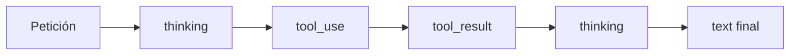

El [[glosario/razonamiento-extendido|razonamiento]] permite que el modelo **genere un razonamiento interno antes de la respuesta**, devuelto en bloques `thinking`. En los modelos 5.x funciona en modo **adaptativo** aunque no pongas nada: el propio modelo decide si necesita pensar y cuánto, según la dificultad de la petición. Tú orientas ese gasto con el [[glosario/esfuerzo|esfuerzo]] (`effort`) y lo limitas con `max_tokens`. En varios modelos no se puede desactivar.

Es la versión integrada en el modelo de la idea de la [[glosario/cadena-de-pensamiento|cadena de pensamiento]] (Wei et al., 2022, [*Chain-of-Thought Prompting Elicits Reasoning in LLMs*](https://arxiv.org/abs/2201.11903)): dar al modelo espacio para trabajar el problema antes de comprometerse con una respuesta.

## Parámetros

| Parámetro | Valores | Qué hace |
|---|---|---|
| `thinking` | `{"type": "adaptive"}` (con `display` opcional), `{"type": "between_tools"}`, `{"type": "disabled"}` | Modo de razonamiento. Sin el campo, en los 5.x es adaptativo. |
| `thinking.display` | `"omitted"` (por defecto), `"summarized"` | Si el bloque `thinking` trae texto. Con `"omitted"` llega vacío, solo con su `signature`. |
| `output_config.effort` | `"low"`, `"medium"`, `"high"`, `"xhigh"`, `"max"` | Orienta cuánto trabajo invierte el modelo. El valor por defecto depende del modelo. |
| `max_tokens` | entero | **Límite duro** de salida: razonamiento más respuesta. |
| `output_config.task_budget` | `{"type": "tokens", "total": N}` (beta) | Presupuesto orientativo para una tarea de varios turnos: el modelo ve una cuenta atrás, pero nada lo corta. |

El presupuesto manual con `{"type": "enabled", "budget_tokens": N}` **devuelve 400 en todos los modelos 5.x** (y en Opus 4.7 y 4.8). Si lo encuentras en código existente, cámbialo por `{"type": "adaptive"}` y un `effort`; el resto de cambios de la versión `2026-10-21` están en [[docs/fundamentos/05-versiones-de-api-y-sdks]].

### Qué admite cada modelo

| Modelo | Esfuerzo por defecto | ¿Se puede apagar el razonamiento? |
|---|---|---|
| Opus 5.5 | `medium` | No: `disabled` da 400. |
| Sonnet 5.5 | `high` | No; `{"type": "between_tools"}` quita el razonamiento previo a la respuesta y solo razona entre herramientas (hasta `high`). |
| Haiku 5.5 | `medium` | Sí, `disabled`, con esfuerzo hasta `high` (en `xhigh` y `max`, 400). |
| Fable 5.1 | `high` | No: `disabled` da 400. |

`xhigh` y `max` funcionan en los cuatro. Con esos niveles, la documentación recomienda `max_tokens` de al menos 64.000. Los datos son de octubre de 2026: compruébalos en la [documentación oficial](https://platform.claude.com/docs) antes de fijarlos en tu código, y mira el [[glosario/presupuesto-de-tarea|presupuesto de tarea]] si tu agente trabaja durante muchos turnos.

> [!aviso] `effort` orienta, `max_tokens` limita
> El esfuerzo es una indicación: el modelo puede gastar más o menos según la tarea. Si necesitas un tope de coste por llamada, ese tope es `max_tokens`.

## Elegir el nivel de esfuerzo

| Nivel | Cuándo | Efecto esperado |
|---|---|---|
| `low` | Clasificación, extracción sencilla, respuestas cortas, subagentes de búsqueda | Menos tokens y menos latencia |
| `medium` | Uso general cuando el coste importa | Equilibrio |
| `high` | Razonamiento en varios pasos, código, análisis | Más calidad en tareas difíciles |
| `xhigh` / `max` | Problemas muy difíciles donde la calidad pesa más que el coste | Máximo trabajo; más lento y caro |

No hay un nivel correcto en abstracto. **Mide**: ejecuta tu [[glosario/conjunto-de-evaluacion|conjunto de evaluación]] con dos niveles y compara calidad, tokens de salida y latencia. Ten en cuenta el valor por defecto del modelo: si no pones `effort`, Sonnet 5.5 trabaja en `high`, que para una clasificación es gasto de más.

### Esfuerzo por mensaje

Cambiar el `effort` de nivel superior entre llamadas invalida la caché. En beta (`mid-conversation-output-config-2026-07-01`) puedes cambiarlo a mitad de conversación con un mensaje de sistema que solo lleva `output_config`, sin tocar el prefijo:

```python nocheck
historial.append({"role": "system", "content": [], "output_config": {"effort": "low"}})
```

Ver [[docs/contexto/06-mensajes-de-sistema-a-mitad-de-conversacion]].

## Ejemplo completo

```python tab="Python" title="razonar.py"
import anthropic

MODEL = "claude-sonnet-5-5"
client = anthropic.Anthropic()

resp = client.messages.create(
    model=MODEL,
    max_tokens=16000,  # razonamiento + respuesta; deja margen
    thinking={"type": "adaptive", "display": "summarized"},  # por defecto "omitted": llegaría vacío
    output_config={"effort": "high"},
    messages=[{
        "role": "user",
        "content": "Un tren sale a las 9:40 y tarda 2 h 35 min con una parada de 12 min. "
                   "Si sale con 18 min de retraso, ¿a qué hora llega?",
    }],
)

for bloque in resp.content:
    if bloque.type == "thinking":
        print("[razonamiento]", bloque.thinking[:200], "...")
    elif bloque.type == "text":
        print(bloque.text)

if resp.stop_reason == "max_tokens":
    print("Aviso: se agotó max_tokens; la respuesta puede faltar o estar cortada.")
print("tokens de salida:", resp.usage.output_tokens)
```

```ts tab="TypeScript" title="razonar.ts"
import Anthropic from "@anthropic-ai/sdk";

const MODEL = "claude-sonnet-5-5";
const client = new Anthropic();

const resp = await client.messages.create({
  model: MODEL,
  max_tokens: 16000,
  thinking: { type: "adaptive", display: "summarized" },
  output_config: { effort: "high" },
  messages: [
    {
      role: "user",
      content:
        "Un tren sale a las 9:40 y tarda 2 h 35 min con una parada de 12 min. " +
        "Si sale con 18 min de retraso, ¿a qué hora llega?",
    },
  ],
});

for (const bloque of resp.content) {
  if (bloque.type === "thinking") console.log("[razonamiento]", bloque.thinking.slice(0, 200), "...");
  else if (bloque.type === "text") console.log(bloque.text);
}
if (resp.stop_reason === "max_tokens") console.warn("Aviso: se agotó max_tokens.");
console.log("tokens de salida:", resp.usage.output_tokens);
```

Los tokens de razonamiento **cuentan como salida** en `usage.output_tokens` y se facturan como tales, también con `display: "omitted"`: no ver el razonamiento no lo hace gratis. `"summarized"` devuelve un resumen, no el razonamiento completo.

## Razonamiento con herramientas

En un bucle de herramientas el modelo puede razonar antes de cada `tool_use` y después de recibir cada `tool_result`. La regla que no puedes saltarte: **reenvía los bloques `thinking` sin modificar** dentro del mensaje `assistant` mientras dura el ciclo. Llevan una firma que la API verifica; si los borras o los editas, la petición falla o el modelo pierde el hilo.

La forma más sencilla de cumplirla es añadir `resp.content` entero al historial, como en [[docs/herramientas/01-uso-de-herramientas]]. Vale igual para `redacted_thinking` y para los bloques vacíos de `display: "omitted"`. En Sonnet 5.5, además, los bloques de razonamiento quedan ligados a la cuenta que los generó: no los reutilices con otra clave.

Con `{"type": "enabled", "budget_tokens": …}` en los modelos que aún lo aceptan, `tool_choice` solo admite `auto` y `none`. En Opus 5.5, Sonnet 5.5 y Fable 5.1, forzar herramienta da 400 siempre; ver [[docs/herramientas/01-uso-de-herramientas]].



## Cuándo no compensa

- **Tareas simples.** Clasificar, extraer un campo o reformular no mejoran pensando más; solo cuestan más.
- **Latencia crítica.** En voz o autocompletado, el tiempo de razonamiento se nota. Usa esfuerzo bajo, `between_tools` en Sonnet 5.5, o Haiku 5.5 con el razonamiento desactivado.
- **Para obtener explicaciones.** Si quieres que el modelo explique su respuesta a la persona, pide una explicación breve en el prompt. No le pidas que vuelque su razonamiento paso a paso en la salida: la documentación avisa de que dispara rechazos de categoría `reasoning_extraction` (ver [[docs/fundamentos/06-motivos-de-parada-y-rechazos]]). Si necesitas leerlo, usa `display: "summarized"`. Ver [[modelos/04-dejar-pensar-al-modelo]].

## En modelos abiertos

Los modelos abiertos con razonamiento (familias Qwen, gpt-oss, DeepSeek…) lo activan o desactivan con parámetros propios del servidor: en Ollama, `think=False` en el cliente nativo o `reasoning=False` en `ChatOllama`; en vLLM, el *parser* de razonamiento que indique la *model card*. El razonamiento suele llegar en un campo aparte (`thinking`, `reasoning_content`) cuyo nombre cambia según el servidor. Ver [[docs/modelos-abiertos/01-ollama]] y [[docs/modelos-abiertos/02-vllm-y-llama-cpp]].

## Errores frecuentes

- **`max_tokens` pequeño con esfuerzo alto.** El razonamiento se come el presupuesto y la respuesta llega vacía o cortada (`stop_reason == "max_tokens"`). Recuerda que, aunque no pongas `thinking`, el modelo razona.
- **Copiar `budget_tokens` o `thinking: disabled` de código antiguo.** Da 400 en los modelos actuales (salvo `disabled` en Haiku 5.5).
- **Esperar texto en `bloque.thinking` sin pedir `display: "summarized"`.** Llega vacío.
- **Filtrar los bloques `thinking` del historial** en un ciclo de herramientas.
- **Subir el esfuerzo para arreglar un mal prompt.** Si las instrucciones son ambiguas, pensar más no las aclara.
- **Mostrar el razonamiento en bruto en la interfaz** sin decidirlo. Puede ser largo y confuso para la persona usuaria.
- **Pedir «piensa paso a paso» y además activar `thinking`.** Redundante: el modelo ya tiene espacio para razonar.

## Ver también

- [[modelos/04-dejar-pensar-al-modelo]]: cuándo ayuda y cuándo no.
- [[glosario/esfuerzo]] y [[glosario/razonamiento-extendido]].
- [[docs/produccion/02-costes-y-limites]]: el razonamiento en la factura.
- [[radar/2026-08-25-razonamiento-adaptativo]].
- [[docs/contexto/05-compactacion-y-limpieza-en-el-servidor]]: limpiar bloques de razonamiento antiguos con `clear_thinking_20251015`.
- [[glosario/modelo-de-razonamiento]].
