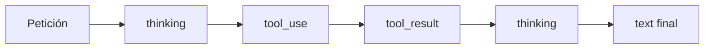

El [[glosario/razonamiento-extendido|razonamiento]] permite que el modelo **genere un razonamiento interno antes de la respuesta**, devuelto en bloques `thinking`. En los modelos actuales se activa en modo **adaptativo**: el propio modelo decide si necesita pensar y cuánto, según la dificultad de la petición. Tú orientas ese gasto con el [[glosario/esfuerzo|esfuerzo]] (`effort`) y lo limitas con `max_tokens`.

Es la versión integrada en el modelo de la idea de la [[glosario/cadena-de-pensamiento|cadena de pensamiento]] (Wei et al., 2022, [*Chain-of-Thought Prompting Elicits Reasoning in LLMs*](https://arxiv.org/abs/2201.11903)): dar al modelo espacio para trabajar el problema antes de comprometerse con una respuesta.

## Parámetros

| Parámetro | Valores | Qué hace |
|---|---|---|
| `thinking` | `{"type": "adaptive"}` | Activa el razonamiento adaptativo. |
| `output_config.effort` | `"low"`, `"medium"`, `"high"`, `"xhigh"`, `"max"` | Orienta cuánto trabajo invierte el modelo. No todos los modelos aceptan todos los niveles. |
| `max_tokens` | entero | **Límite duro** de salida: razonamiento más respuesta. |

El presupuesto manual con `budget_tokens` es el modo antiguo. Si lo encuentras en código existente, funciona en los modelos que lo admiten, pero en código nuevo usa el modo adaptativo.

> [!aviso] `effort` orienta, `max_tokens` limita
> El esfuerzo es una indicación: el modelo puede gastar más o menos según la tarea. Si necesitas un tope de coste por llamada, ese tope es `max_tokens`.

## Elegir el nivel de esfuerzo

| Nivel | Cuándo | Efecto esperado |
|---|---|---|
| `low` | Clasificación, extracción sencilla, respuestas cortas, subagentes de búsqueda | Menos tokens y menos latencia |
| `medium` | Uso general cuando el coste importa | Equilibrio |
| `high` | Razonamiento en varios pasos, código, análisis | Más calidad en tareas difíciles |
| `xhigh` / `max` | Problemas muy difíciles donde la calidad pesa más que el coste | Máximo trabajo; más lento y caro |

No hay un nivel correcto en abstracto. **Mide**: ejecuta tu [[glosario/conjunto-de-evaluacion|conjunto de evaluación]] con dos niveles y compara calidad, tokens de salida y latencia. Consulta qué niveles acepta cada modelo y cuál es su valor por defecto en la [documentación oficial](https://platform.claude.com/docs).

## Ejemplo completo

```python tab="Python" title="razonar.py"
import anthropic

MODEL = "claude-sonnet-5-5"
client = anthropic.Anthropic()

resp = client.messages.create(
    model=MODEL,
    max_tokens=16000,  # razonamiento + respuesta; deja margen
    thinking={"type": "adaptive"},
    output_config={"effort": "high"},
    messages=[{
        "role": "user",
        "content": "Un tren sale a las 9:40 y tarda 2 h 35 min con una parada de 12 min. "
                   "Si sale con 18 min de retraso, ¿a qué hora llega?",
    }],
)

for bloque in resp.content:
    if bloque.type == "thinking":
        print("[razonamiento]", bloque.thinking[:200], "...")
    elif bloque.type == "text":
        print(bloque.text)

if resp.stop_reason == "max_tokens":
    print("Aviso: se agotó max_tokens; la respuesta puede faltar o estar cortada.")
print("tokens de salida:", resp.usage.output_tokens)
```

```ts tab="TypeScript" title="razonar.ts"
import Anthropic from "@anthropic-ai/sdk";

const MODEL = "claude-sonnet-5-5";
const client = new Anthropic();

const resp = await client.messages.create({
  model: MODEL,
  max_tokens: 16000,
  thinking: { type: "adaptive" },
  output_config: { effort: "high" },
  messages: [
    {
      role: "user",
      content:
        "Un tren sale a las 9:40 y tarda 2 h 35 min con una parada de 12 min. " +
        "Si sale con 18 min de retraso, ¿a qué hora llega?",
    },
  ],
});

for (const bloque of resp.content) {
  if (bloque.type === "thinking") console.log("[razonamiento]", bloque.thinking.slice(0, 200), "...");
  else if (bloque.type === "text") console.log(bloque.text);
}
if (resp.stop_reason === "max_tokens") console.warn("Aviso: se agotó max_tokens.");
console.log("tokens de salida:", resp.usage.output_tokens);
```

Los tokens de razonamiento **cuentan como salida** en `usage.output_tokens` y se facturan como tales.

## Razonamiento con herramientas

En un bucle de herramientas el modelo puede razonar antes de cada `tool_use` y después de recibir cada `tool_result`. La regla que no puedes saltarte: **reenvía los bloques `thinking` sin modificar** dentro del mensaje `assistant` mientras dura el ciclo. Llevan una firma que la API verifica; si los borras o los editas, la petición falla o el modelo pierde el hilo.

La forma más sencilla de cumplirla es añadir `resp.content` entero al historial, como en [[docs/herramientas/01-uso-de-herramientas]].



## Cuándo no compensa

- **Tareas simples.** Clasificar, extraer un campo o reformular no mejoran pensando más; solo cuestan más.
- **Latencia crítica.** En voz o autocompletado, el tiempo de razonamiento se nota. Usa esfuerzo bajo o desactívalo.
- **Para obtener explicaciones.** Si quieres que el modelo explique su respuesta a la persona, pídelo en el prompt. El bloque `thinking` es material de trabajo, no una explicación pensada para mostrar. Ver [[modelos/04-dejar-pensar-al-modelo]].

## Errores frecuentes

- **`max_tokens` pequeño con esfuerzo alto.** El razonamiento se come el presupuesto y la respuesta llega vacía o cortada (`stop_reason == "max_tokens"`).
- **Filtrar los bloques `thinking` del historial** en un ciclo de herramientas.
- **Subir el esfuerzo para arreglar un mal prompt.** Si las instrucciones son ambiguas, pensar más no las aclara.
- **Mostrar el razonamiento en bruto en la interfaz** sin decidirlo. Puede ser largo y confuso para la persona usuaria.
- **Pedir «piensa paso a paso» y además activar `thinking`.** Redundante: el modelo ya tiene espacio para razonar.

## Ver también

- [[modelos/04-dejar-pensar-al-modelo]]: cuándo ayuda y cuándo no.
- [[glosario/esfuerzo]] y [[glosario/razonamiento-extendido]].
- [[docs/produccion/02-costes-y-limites]]: el razonamiento en la factura.
- [[radar/2026-08-25-razonamiento-adaptativo]].
