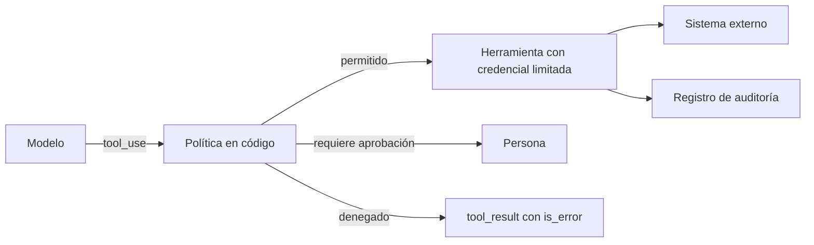

El **[[glosario/minimo-privilegio|mínimo privilegio]]** es el principio de dar a cada componente solo los permisos que necesita para su tarea, y nada más. En un agente se aplica a las herramientas que tiene, a las credenciales con las que esas herramientas actúan y al entorno donde se ejecutan. Es la defensa que limita el daño cuando todo lo demás falla: si el modelo se equivoca o sufre una [[docs/seguridad/01-prompt-injection|inyección de prompt]], solo puede hacer lo que sus permisos permiten.

## El modelo no es la frontera de seguridad

El modelo decide qué herramienta pedir. Tu código decide si se ejecuta. Cualquier regla que importe tiene que estar en el código que ejecuta la herramienta, porque es la única parte que no se puede convencer con texto.



## Cuatro niveles de permisos

### 1. Qué herramientas existen

La herramienta más segura es la que el agente no tiene. Antes de añadir una, pregunta si la tarea la necesita de verdad. Un agente de soporte que consulta pedidos no necesita una herramienta genérica `ejecutar_sql`; necesita `buscar_pedido(id)`.

| En lugar de | Mejor |
|---|---|
| `ejecutar_sql(consulta)` | `buscar_pedido(pedido_id)`, `listar_pedidos_cliente()` |
| `ejecutar_bash(comando)` | `ejecutar_tests()`, `leer_archivo(ruta)` dentro del repo |
| `peticion_http(url, metodo, cuerpo)` | `consultar_tiempo(ciudad)` contra una API concreta |
| `enviar_correo(para, asunto, cuerpo)` | `responder_ticket(ticket_id, cuerpo)` al cliente del ticket |

Las herramientas específicas son más seguras y además el modelo las usa mejor: tienen menos parámetros y su propósito está claro. Más en [[disciplinas/diseno-de-herramientas]].

### 2. Qué parámetros acepta

Valida en el código cada argumento contra lo permitido, no contra lo que el modelo dice que quiere. Si la herramienta lee archivos, comprueba que la ruta resuelta está dentro del directorio permitido. Si envía correo, que el destinatario es el cliente del ticket. Si reembolsa, que el importe no supera el del pedido.

### 3. Con qué credenciales actúa

La herramienta no debería usar tus credenciales de administrador, sino unas con el alcance justo:

- **Solo lectura** siempre que la tarea lo permita. En bases de datos, un usuario con permisos de lectura sobre las tablas necesarias.
- **Acotadas al usuario actual**: el agente que atiende a un cliente solo ve los datos de ese cliente. Aplica el filtro en la consulta, con el identificador de la sesión, no con un parámetro que elige el modelo.
- **Caducidad corta** cuando sea posible.
- **Separadas por herramienta**: si una se filtra, no da acceso a todo.

### 4. Dónde se ejecuta

Si el agente ejecuta código, navega o usa el ordenador, hazlo en un [[glosario/sandbox|sandbox]]: un contenedor o máquina virtual sin acceso a tu red interna, sin credenciales montadas y con salida a internet restringida a una lista de dominios. Para el [[glosario/uso-del-ordenador|uso del ordenador]] es obligatorio. Ver [[docs/herramientas/04-uso-del-ordenador]].

## Ejemplo: políticas en el código

```python tab="Python" title="politicas.py"
from dataclasses import dataclass
from pathlib import Path

RAIZ = Path("/srv/repo").resolve()

@dataclass
class Sesion:
    usuario_id: str
    rol: str  # "cliente" o "agente_soporte"

class Denegado(Exception):
    pass

def politica_leer_archivo(args: dict, s: Sesion) -> None:
    ruta = (RAIZ / args["ruta"]).resolve()
    if not ruta.is_relative_to(RAIZ):
        raise Denegado(f"Ruta fuera del repositorio: {args['ruta']}")

def politica_reembolsar(args: dict, s: Sesion) -> None:
    if s.rol != "agente_soporte":
        raise Denegado("Solo el personal de soporte puede reembolsar")
    if args["importe"] > 100:
        raise Denegado("Importe por encima del límite automático; requiere aprobación")

POLITICAS = {"leer_archivo": politica_leer_archivo, "reembolsar": politica_reembolsar}

def ejecutar(bloque, funciones: dict, sesion: Sesion) -> dict:
    try:
        if bloque.name not in funciones:
            raise Denegado(f"Herramienta no permitida: {bloque.name}")
        if bloque.name in POLITICAS:
            POLITICAS[bloque.name](bloque.input, sesion)
        salida = funciones[bloque.name](**bloque.input, usuario_id=sesion.usuario_id)
        return {"type": "tool_result", "tool_use_id": bloque.id, "content": str(salida)}
    except Denegado as e:
        return {"type": "tool_result", "tool_use_id": bloque.id, "content": f"Denegado: {e}", "is_error": True}
    except Exception as e:
        return {"type": "tool_result", "tool_use_id": bloque.id, "content": f"Error: {e}", "is_error": True}
```

```ts tab="TypeScript" title="politicas.ts"
import path from "node:path";
import Anthropic from "@anthropic-ai/sdk";

const RAIZ = path.resolve("/srv/repo");
type Sesion = { usuarioId: string; rol: "cliente" | "agente_soporte" };
class Denegado extends Error {}
type Politica = (args: any, s: Sesion) => void;

const POLITICAS: Record<string, Politica> = {
  leer_archivo: (args) => {
    const ruta = path.resolve(RAIZ, args.ruta);
    if (ruta !== RAIZ && !ruta.startsWith(RAIZ + path.sep)) throw new Denegado(`Ruta fuera del repositorio: ${args.ruta}`);
  },
  reembolsar: (args, s) => {
    if (s.rol !== "agente_soporte") throw new Denegado("Solo el personal de soporte puede reembolsar");
    if (args.importe > 100) throw new Denegado("Importe por encima del límite automático; requiere aprobación");
  },
};

export async function ejecutar(
  b: Anthropic.ToolUseBlock, funciones: Record<string, (a: any) => Promise<unknown>>, s: Sesion,
): Promise<Anthropic.ToolResultBlockParam> {
  try {
    if (!(b.name in funciones)) throw new Denegado(`Herramienta no permitida: ${b.name}`);
    POLITICAS[b.name]?.(b.input, s);
    const salida = await funciones[b.name]({ ...(b.input as object), usuarioId: s.usuarioId });
    return { type: "tool_result", tool_use_id: b.id, content: String(salida) };
  } catch (e) {
    const prefijo = e instanceof Denegado ? "Denegado" : "Error";
    return { type: "tool_result", tool_use_id: b.id, content: `${prefijo}: ${(e as Error).message}`, is_error: true };
  }
}
```

Fíjate en dos cosas. El `usuario_id` sale de la sesión, nunca de los argumentos que propone el modelo. Y la denegación vuelve al modelo como `is_error`, para que pueda explicárselo al usuario o pedir aprobación por la vía correcta ([[docs/agentes/03-humano-en-el-bucle]]).

## Auditoría

Registra cada ejecución de herramienta con sesión, argumentos, resultado y si se aprobó o denegó. Ante un incidente, es la única forma de saber qué hizo el agente y con qué permisos. El registro debe estar fuera del alcance del agente: que ninguna herramienta pueda escribir o borrar en él. Los detalles de qué registrar están en [[docs/produccion/01-observabilidad]].

> [!consejo] Revisa los permisos como revisas el código
> Cada herramienta nueva o cambio de credenciales debería pasar por revisión, igual que un cambio en el control de acceso de tu API. Una lista escrita con «herramienta, qué puede hacer, con qué credencial, quién lo aprobó» basta para empezar.

## Servidores MCP

Si conectas [[glosario/servidor-mcp|servidores MCP]], cada uno es un conjunto de herramientas con sus propios permisos. Revisa qué expone cada servidor antes de conectarlo, habilita solo las herramientas que necesitas y prefiere servidores de solo lectura. Ver [[recetas/servidor-mcp-de-solo-lectura]] y [[cursos/mcp-de-cero-a-servidor/04-seguridad-y-despliegue]].

## Errores frecuentes

- **Herramientas genéricas por comodidad**: `ejecutar_sql` convierte cualquier inyección en acceso total.
- **Identificadores elegidos por el modelo**: si el modelo pasa el `usuario_id`, puede pasar el de otro.
- **Una credencial para todo**: si se filtra, se filtra todo.
- **Sandbox con la red abierta**: el código malicioso no puede tocar tu disco, pero sí enviar datos fuera.
- **Permisos que solo crecen**: revisa cada cierto tiempo qué herramientas ya no se usan y quítalas.

## Ver también

- [[cursos/seguridad-y-prompt-injection/04-permisos-y-sandbox]]: la lección guiada.
- [[sistemas/asistente-de-datos-con-mcp]]: un sistema de solo lectura con límites.
- [[radar/2026-07-02-uso-del-ordenador-en-sandbox]]: por qué el aislamiento es obligatorio.
- [[docs/seguridad/index]]: el resto del grupo.
