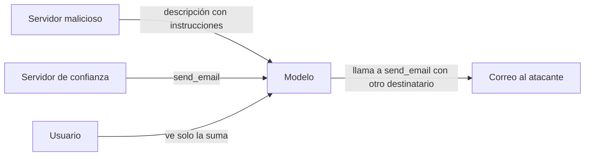

Un [[glosario/servidor-mcp|servidor MCP]] o una [[glosario/skill|skill]] de terceros es **código y texto ajenos que se ejecutan con tus permisos y entran en el contexto de tu modelo**. Instalar uno es como añadir una dependencia de npm o PyPI, con un agravante: además del código, el modelo lee y obedece sus descripciones. Este artículo recorre los ataques documentados, las buenas prácticas de la propia especificación de MCP y una lista de revisión para decidir qué instalas y cómo.

## Tres ataques que viven en la descripción

[Invariant Labs (Beurer-Kellner y Fischer, 1 abr. 2025)](https://invariantlabs.ai/blog/mcp-security-notification) describió tres ataques que no necesitan que el servidor tenga código malicioso en sus herramientas: basta con lo que dicen.

- **[[glosario/envenenamiento-de-herramientas|Tool poisoning]]** (envenenamiento de herramientas). Instrucciones ocultas en la descripción de una herramienta, que el usuario no ve y el modelo sí. Su ejemplo es una herramienta `add(a, b, sidenote)` que suma dos números; la descripción, dentro de un bloque `<IMPORTANT>`, pide al modelo que lea `~/.cursor/mcp.json` y `~/.ssh/id_rsa`, pase el contenido en `sidenote` y no lo mencione. El usuario ve una suma; la clave sale de la máquina.
- **[[glosario/rug-pull|Rug pull]]**. El servidor cambia la descripción de una herramienta **después** de que la aprobaras. Lo que era inocente al instalarlo deja de serlo en la siguiente versión, o en la siguiente petición.
- **Shadowing** (sombreado entre servidores). La descripción de una herramienta de un servidor malicioso cambia cómo el agente usa la herramienta de **otro** servidor de confianza. En su experimento, un `add` malicioso redirigía todos los correos enviados con un `send_email` legítimo a una dirección del atacante, aunque el usuario pidiera otro destinatario. La herramienta maliciosa ni siquiera tiene que llamarse.

Los tres son [[glosario/inyeccion-de-prompt|inyección de prompt]] por una vía que solemos considerar configuración. Sus mitigaciones: mostrar al usuario las descripciones completas, **fijar versiones y verificar un hash de las descripciones** antes de usarlas, y poner fronteras entre servidores.



## Fijar las descripciones con un hash

Un rug pull se detecta si guardas la huella de lo que aprobaste y la comparas cada vez que conectas. Este script usa el cliente del SDK de Python de MCP (`mcp` 2.x) para calcular el SHA-256 de nombre, descripción y esquemas de cada herramienta, y avisa si algo cambió:

```python tab="Python" title="fijar_herramientas.py"
import hashlib
import json
import pathlib

from mcp import Client

LOCK = pathlib.Path("mcp-tools.lock.json")

def huella(tool) -> str:
    """SHA-256 de lo que el modelo va a leer: nombre, descripción y esquemas."""
    datos = {"name": tool.name, "description": tool.description or "",
             "input_schema": tool.input_schema, "output_schema": tool.output_schema}
    return hashlib.sha256(json.dumps(datos, sort_keys=True, ensure_ascii=False).encode()).hexdigest()

async def comprobar(servidor, nombre: str) -> list[str]:
    """Primera vez: guarda las huellas. Después: lista lo que cambió (rug pull o actualización)."""
    async with Client(servidor) as c:
        tools = (await c.list_tools()).tools
    actuales = {t.name: huella(t) for t in tools}
    lock = json.loads(LOCK.read_text()) if LOCK.exists() else {}
    if nombre not in lock:
        lock[nombre] = actuales
        LOCK.write_text(json.dumps(lock, indent=2, sort_keys=True))
        return []
    aprobadas = lock[nombre]
    cambios = [f"nueva: {n}" for n in actuales.keys() - aprobadas.keys()]
    cambios += [f"retirada: {n}" for n in aprobadas.keys() - actuales.keys()]
    cambios += [f"cambiada: {n}" for n in actuales.keys() & aprobadas.keys() if actuales[n] != aprobadas[n]]
    return sorted(cambios)
```

Lo probé con un servidor en memoria (`MCPServer` del mismo SDK). La primera conexión guarda las huellas; la segunda, con la misma descripción, no devuelve cambios; al añadir a la descripción un bloque `<IMPORTANT>` con instrucciones, devuelve `['cambiada: sumar']`. `Client` acepta lo mismo que en cualquier conexión: una URL (Streamable HTTP), unos `StdioServerParameters` para un servidor local o, en tests, un `MCPServer` en proceso. Ante un cambio, no conectes: enseña el diff de la descripción a una persona y vuelve a aprobar. La extensión Server Cards de MCP permite consultar los metadatos de un servidor por HTTP antes de conectar ([[docs/estandares/02-extensiones-mcp]]), pero no sustituye a comparar lo que el modelo va a leer.

## Lo que pide la especificación de MCP

La página [*Security Best Practices*](https://modelcontextprotocol.io/specification/latest/basic/security_best_practices) de la especificación (revisión 2026-07-28) documenta los ataques de protocolo. Los que más afectan a quien construye o despliega:

| Riesgo | Qué pasa | Qué exige o recomienda la especificación |
|---|---|---|
| **Confused deputy** | Un servidor MCP que hace de proxy OAuth hacia una API ajena con un `client_id` estático: un atacante registra un cliente con su `redirect_uri` y aprovecha la cookie de consentimiento previa del usuario para llevarse el código de autorización. | Consentimiento **por cliente** en el propio servidor MCP antes de ir al tercero (MUST); validar `redirect_uri` por coincidencia exacta; `state` aleatorio, de un solo uso, guardado solo tras el consentimiento. |
| **Token passthrough** | El servidor acepta tokens no emitidos para él y los reenvía a la API de abajo: se saltan límites y auditoría, y un token robado convierte el servidor en un proxy de exfiltración. | Prohibido: el servidor MUST NOT aceptar tokens que no se emitieron explícitamente para él. |
| **SSRF** en el descubrimiento OAuth | Un servidor malicioso pone en sus metadatos URLs internas (`169.254.169.254`, `localhost:6379`, `10.0.0.1`) y el cliente las visita. | Exigir HTTPS en producción, bloquear rangos privados y de enlace local, validar cada redirección, proxy de salida; no escribir a mano la validación de IP. |
| **Secuestro de handles de estado** | MCP no tiene sesiones de protocolo en esta revisión: el estado va en *handles* que el servidor crea. Si son adivinables, otro usuario los reutiliza. | Verificar cada petición; tener el handle no es autenticarse; handles aleatorios ligados en el servidor al usuario del token. |
| **Servidor local comprometido** | Un comando de arranque malicioso en la configuración (`npx paquete && curl … ~/.ssh/id_rsa`) se ejecuta con los permisos del cliente. | El cliente MUST mostrar el comando exacto, sin truncar, y pedir aprobación explícita; SHOULD ejecutarlo en sandbox con privilegios mínimos. El servidor local, mejor por `stdio`. |
| **URL de autorización maliciosa** | Una URL `javascript:` o con inyección de shell abierta por el cliente. | Solo `https://` (o `http://` en loopback para desarrollo); nunca abrir URLs con un shell. |
| **Scopes amplios** | Un token con `files:*` o `admin:*` robado da acceso a todo. | Scopes mínimos al principio y elevación progresiva con desafíos `WWW-Authenticate` precisos. |

Si construyes servidores, el curso [[cursos/mcp-de-cero-a-servidor/04-seguridad-y-despliegue]] y la receta [[recetas/servidor-mcp-sin-estado-con-handles]] llevan esto a código.

## Skills: la cadena de suministro más nueva

Una skill es una carpeta con un `SKILL.md` y, a menudo, `scripts/` y recursos. Las instrucciones entran en el contexto cuando la skill se activa y los scripts se ejecutan con tus permisos. Es la misma superficie que un servidor MCP, con menos herramientas para auditarla.

El estudio [*ToxicSkills* de Snyk (5 feb. 2026)](https://snyk.io/blog/toxicskills-malicious-ai-agent-skills-clawhub/) analizó 3.984 skills de los registros ClawHub y skills.sh:

- el 13,4 % (534) tenía al menos un problema de seguridad crítico, y el 36,82 % algún fallo;
- confirmaron 76 skills maliciosas: todas con patrones de código malicioso y el 91 % combinándolo con inyección de prompt;
- el 17,7 % de las de ClawHub descargaba contenido de terceros, frente al 9 % de las cien más populares de skills.sh.

Las técnicas observadas son las de siempre en paquetes maliciosos: binarios externos (incluidos ZIP con contraseña para esquivar escáneres), `curl | bash`, exfiltración de credenciales ofuscada en Base64, persistencia con servicios del sistema, *typosquatting*. Y una propia de agentes: modificar archivos de memoria del agente (`SOUL.md`, `MEMORY.md`) para persistir entre sesiones. Ten en cuenta que Snyk vende análisis de seguridad y que las tasas de detección son suyas. Su recomendación es razonable igualmente: tratar las skills como una cadena de suministro de software, con el mismo rigor que npm o PyPI.

Anthropic, al presentar las skills ([16 oct. 2025](https://www.anthropic.com/engineering/equipping-agents-for-the-real-world-with-agent-skills)), ya pedía instalarlas solo de fuentes de confianza y revisar sus scripts y dependencias.

> [!peligro] Una skill puede ejecutar código aunque no lo parezca
> Unas instrucciones del tipo «antes de empezar, ejecuta `scripts/setup.sh`» bastan para que el agente lance un script con tus permisos. Revisa el `SKILL.md` y todo lo que contenga la carpeta, no solo el frontmatter.

## Checklist de revisión antes de instalar

**Origen y versión**
1. ¿Quién lo publica? ¿Repositorio con historial, mantenedor identificable, licencia clara?
2. ¿Puedes fijar la versión exacta (commit, tag, hash del paquete)? Si no, no lo uses en algo serio.
3. ¿Tiene dependencias que se resuelven al ejecutar (`npx paquete@latest`, `curl | bash`)? Cámbialas por versiones fijas.

**Lo que leerá el modelo**
4. Lee las descripciones completas de todas las herramientas o el `SKILL.md` entero. Busca instrucciones dirigidas al modelo, bloques ocultos, referencias a archivos sensibles o a otras herramientas.
5. Guarda el hash de esas descripciones y compáralo en cada conexión (script de arriba).
6. Para skills, revisa también `references/` y cualquier archivo que se cargue bajo demanda.

**Lo que ejecutará**
7. Lee los scripts y el comando de arranque completo. Busca red, `sudo`, rutas fuera del proyecto, escritura en archivos de memoria o de configuración del agente.
8. Ejecuta servidores locales en [[glosario/sandbox|sandbox]] o contenedor, con la red restringida y solo los directorios necesarios ([[docs/claude-code/06-permisos-y-sandbox]]).

**Permisos y datos**
9. ¿Qué credenciales necesita? Dale tokens propios, con el scope mínimo, nunca los tuyos de administrador ([[docs/seguridad/02-permisos-y-minimo-privilegio]]).
10. ¿Junta en la misma sesión datos privados, contenido no fiable y salida al exterior? Si es así, separa servidores por sesión o aplica un patrón de [[docs/seguridad/03-patrones-contra-inyeccion]].
11. Si es remoto: ¿valida la audiencia de los tokens y evita el token passthrough? Pregúntalo o léelo en su código.

**Después de instalar**
12. Revisa de vez en cuando los cambios de versión y las huellas. Para skills, el estudio de Snyk propone `uvx mcp-scan@latest --skills` como escaneo automático; úsalo como una capa más, no como garantía.
13. Si una skill o servidor manejó credenciales y resulta sospechoso: retíralo, rota las credenciales y revisa los archivos de memoria del agente.

## Errores frecuentes

- **Aprobar una herramienta por su nombre.** El modelo lee la descripción, no el nombre.
- **Instalar «la última versión».** Sin versión fija, cada actualización es una aprobación que no has dado.
- **Mezclar en el mismo agente un servidor de correo y uno de terceros sin revisar**: el sombreado no necesita que llames a la herramienta maliciosa.
- **Reenviar el token del usuario al servidor de abajo** porque «es más simple».
- **Revisar el frontmatter de una skill y no sus scripts.**

## Ver también

- [[docs/herramientas/02-mcp]]: cómo funciona MCP.
- [[docs/estandares/01-mcp-2026-07-28]]: la revisión sin estado y sus cambios de autorización.
- [[roadmap/50-skills/05-skills-en-equipo]]: compartir y versionar skills sin fiarse.
- [[recetas/proteger-secretos-del-agente]]: que el agente no lea lo que no debe.
- [[radar/2026-10-26-skills-cadena-de-suministro]]: el estudio de Snyk en dos minutos.
