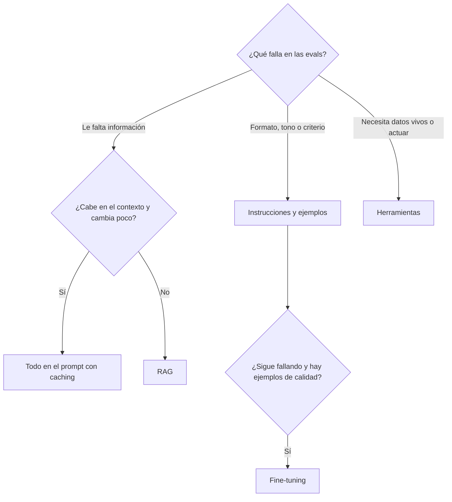

**Principio**: diagnostica primero qué falla. Si el modelo no sabe algo, dale conocimiento con RAG; si lo sabe pero no lo hace como quieres, ajusta las instrucciones; y recurre al fine-tuning solo cuando el comportamiento siga fallando tras agotar el prompt.

## Por qué funciona

Las tres palancas actúan en sitios distintos del sistema, y eso decide lo que cada una puede arreglar:

| Palanca | Dónde actúa | Arregla | Coste de iterar | Se actualiza |
|---|---|---|---|---|
| Prompting | La entrada de cada llamada | Instrucciones, formato, tono, criterio | Minutos | Editando el texto |
| [[glosario/rag\|RAG]] | La entrada, elegida por pregunta desde tus fuentes | Conocimiento privado, extenso o cambiante | Horas | Reindexando un documento |
| [[glosario/fine-tuning\|Fine-tuning]] | Los [[glosario/parametros\|parámetros]] del modelo | Comportamiento consistente a gran volumen | Días | Reentrenando |

Es el marco que propone OpenAI en [*Optimizing LLM Accuracy*](https://developers.openai.com/api/docs/guides/optimizing-llm-accuracy): separa los problemas de **contexto** (al modelo le falta información o la tiene desactualizada) de los de **comportamiento** (tiene la información y responde con mal formato, mal tono o mal razonamiento). Los primeros se arreglan con RAG; los segundos, con instrucciones y, si no basta, con fine-tuning. Antes de tocar nada, la misma guía pide un conjunto de evaluación con preguntas reales y su respuesta correcta, porque sin él no sabes qué tipo de fallo tienes.

### El fine-tuning no mete conocimiento de forma fiable

Entrenar ajusta los pesos para imitar los ejemplos. Lo que el modelo aprende con más facilidad es la forma: el formato, el tono, el tipo de respuesta. Los hechos concretos que aparecen pocas veces en el conjunto de entrenamiento los retiene de forma irregular, y nada te dice cuáles. El efecto más peligroso es que aprende a contestar con seguridad y con el estilo de la casa sobre temas en los que no recuerda bien los datos.

Además, el conocimiento entrenado no se puede citar (no hay fuente que enseñar), no se puede filtrar por usuario (todo el que usa el modelo lo «sabe») y caduca el día que cambia el documento. RAG resuelve esas tres cosas por diseño: el modelo lee el fragmento en el momento de la pregunta, lo cita y solo recibe lo que el usuario puede ver.

## El árbol de decisión



Dos detalles del árbol. El primero: si tu base de conocimiento es pequeña y estable, quizá no necesites RAG. Anthropic recomienda meterla entera en el prompt cuando ocupa menos de 200.000 tokens (unas 500 páginas) y usar [[glosario/prompt-caching|prompt caching]] para abaratar las consultas repetidas ([Contextual Retrieval, 2024](https://www.anthropic.com/news/contextual-retrieval)). El segundo: los datos que cambian cada minuto (un pedido, el stock) no son ni contexto estable ni documentos; se consultan con una [[glosario/tool-use|herramienta]].

## Síntomas y palanca

| Síntoma | Palanca | Por qué |
|---|---|---|
| Responde bien pero en otro formato | Prompt y [[glosario/salida-estructurada\|salida estructurada]] | Es comportamiento y el esquema lo fija |
| Inventa datos de tu empresa | RAG o contexto | Le falta información; no la tiene que adivinar |
| No sabe el estado de un pedido | Herramienta | Es un dato vivo |
| Mezcla tus categorías aunque se las expliques | Ejemplos [[glosario/few-shot\|few-shot]]; fine-tuning si las evals no mejoran | Comportamiento muy específico |
| Correcto pero caro o lento a mucho volumen | Modelo menor; fine-tuning o [[glosario/destilacion\|destilación]] | Trasladar el prompt largo a los pesos |
| Responde con información antigua | RAG con reindexado | El entrenamiento nunca se actualiza a tiempo |

## Combinaciones

Las palancas no se excluyen: los sistemas reales combinan varias.

- **Prompt + RAG**: el caso por defecto para cualquier asistente sobre documentación. El prompt fija cómo responder y citar; RAG, qué sabe en cada pregunta ([[sistemas/rag-con-citas]]).
- **RAG + herramientas**: conocimiento documental más datos vivos, como en [[sistemas/soporte-con-aprobacion-humana]].
- **Fine-tuning + RAG**: un modelo ajustado para un formato o un dominio que, además, recibe los documentos recuperados. El ajuste aporta la forma; RAG, los hechos.
- **Fine-tuning para ahorrar**: cuando un modelo grande con un prompt largo funciona bien pero cuesta demasiado a tu volumen, un modelo más pequeño ajustado con sus respuestas puede hacer lo mismo con menos tokens por llamada. Compruébalo con las mismas evals.

## Antes y después

```text title="Antes"
Plan: hacer fine-tuning con los 3.000 PDF de la intranet para que el asistente
conozca nuestros productos y responda con el tono de la marca.
Sin conjunto de evaluación. Sin plan para cuando cambie un PDF.
```

```text title="Después"
Evals: 40 preguntas reales con su respuesta y su fuente.
Conocimiento: RAG sobre los PDF, con metadatos de producto y permisos; respuestas citadas.
Tono: prompt de sistema con la guía de estilo y cinco ejemplos.
Pedidos y stock: herramientas de solo lectura.
Fine-tuning: aparcado; se reabre si las evals de tono fallan de forma
sistemática tras dos iteraciones del prompt.
```

## Cuándo no aplica

- **Cuando el fallo no es del modelo.** Un índice mal troceado, documentos contradictorios o un proceso mal definido no se arreglan cambiando de palanca. Si el RAG no encuentra el documento, revisa la recuperación ([[problemas/el-rag-no-encuentra-el-documento]]) antes de pensar en entrenar.
- **Reglas exactas.** Un plazo, un importe máximo o un cálculo fiscal no se enseñan con ninguna de las tres: se programan, y el modelo explica el resultado.
- **Sin acceso al fine-tuning.** Qué modelos se pueden ajustar depende del proveedor y cambia; consulta su documentación. Con modelos de [[glosario/pesos-abiertos|pesos abiertos]] puedes ajustarlos tú ([[modelos/11-modelos-abiertos]]).
- **Sin evals.** Si no tienes un conjunto de evaluación, no puedes diagnosticar el tipo de fallo ni saber si la palanca ha servido. Empieza por ahí ([[roadmap/80-evals/02-conjunto-de-prueba]]).

## Para seguir

- [[cursos/ia-en-la-empresa/02-la-piramide-de-personalizacion]]: la misma decisión vista desde el negocio, con coste y riesgo.
- [[modelos/07-documentos-largos]]: cuándo trocear y cuándo usar contexto largo.
- [[roadmap/00-fundamentos/06-como-se-entrena-un-llm]]: qué hace el entrenamiento por dentro.
