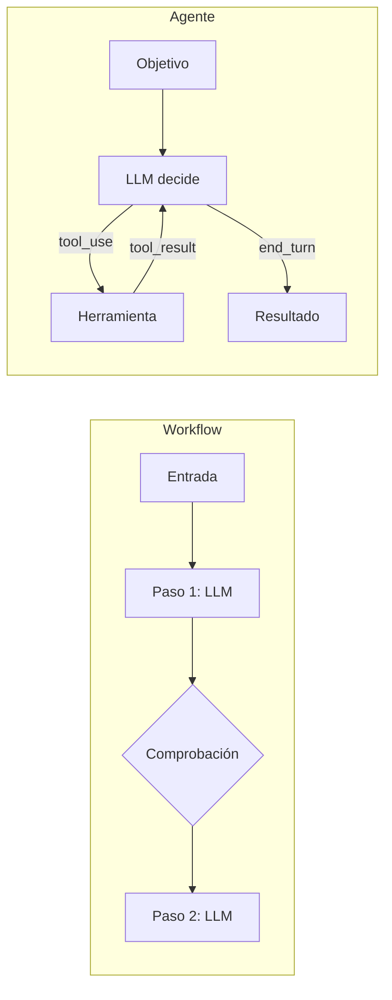

Esta página fija el vocabulario de toda la sección de patrones. Al terminar sabrás distinguir un [[glosario/workflow|workflow]] de un [[glosario/agente|agente]], colocar cualquier diseño en una escalera de complejidad y justificar por qué subes un peldaño. Todo parte del artículo [*Building effective agents*](https://www.anthropic.com/engineering/building-effective-agents) (Anthropic, diciembre de 2024), que sigue siendo la mejor referencia corta sobre el tema.

## Qué es

El artículo agrupa todo bajo el nombre de **sistemas agénticos** y distingue dos familias:

- **Workflow**: los LLM y las herramientas se coordinan a través de **rutas de código predefinidas**. Tú decides el orden de los pasos; el modelo hace bien cada paso.
- **Agente**: el LLM **dirige su propio proceso** y decide qué herramientas usar y cuándo, manteniendo el control sobre cómo completa la tarea. Tú das el objetivo, las herramientas y los límites.

La diferencia práctica es **quién escribe el flujo de control**. En un workflow, el `if`, el `for` y el orden de las llamadas están en tu código. En un agente, están dentro de un [[glosario/bucle-agentico|bucle]] donde cada iteración la decide el modelo según lo que le devuelve el entorno.



## La escalera de complejidad

Piensa en los diseños como peldaños. Cada uno añade capacidad y también coste, latencia y formas nuevas de fallar.

| Peldaño | Quién decide el flujo | Ejemplo | Página |
|---|---|---|---|
| 0. Una llamada | Nadie: entrada y salida | Resumir un correo | [[roadmap/00-fundamentos/04-primera-llamada-api]] |
| 1. Llamada aumentada | Tu código, con recuperación y herramientas | Responder con documentos propios | [[patrones/02-llamada-aumentada]] |
| 2. Workflow | Tu código, varias llamadas | Clasificar y responder tickets | [[patrones/03-encadenado]], [[patrones/04-enrutado]], [[patrones/05-paralelizacion]] |
| 3. Workflow dinámico | Un modelo reparte, tu código ejecuta | Cambios en varios archivos | [[patrones/06-orquestador-trabajadores]], [[patrones/07-evaluador-optimizador]] |
| 4. Agente | El modelo, en bucle | Resolver una incidencia de código | [[patrones/08-agente-autonomo]] |

La recomendación central del artículo es buscar **la solución más simple posible** y solo añadir complejidad cuando se demuestra necesaria. Los sistemas agénticos suelen cambiar latencia y coste por mejor rendimiento en la tarea. Ese intercambio tiene que compensar, y solo lo sabes midiendo con [[glosario/evals|evals]].

> [!consejo] Sube un peldaño solo con datos
> Escribe primero la versión más simple, mide su tasa de acierto en un [[glosario/conjunto-de-evaluacion|conjunto de evaluación]] y sube de peldaño únicamente si los fallos que ves los resuelve el siguiente.

## Cuándo usar cada familia

**Workflow** cuando la tarea está bien definida y puedes describir los pasos de antemano. Ganas previsibilidad: el mismo tipo de entrada recorre el mismo camino, las trazas se leen fácil y el coste por ejecución es estable.

**Agente** cuando el número de pasos no se puede predecir y no puedes programar una ruta fija. Por ejemplo, depurar un fallo cuya causa desconoces o investigar una pregunta abierta. Ganas flexibilidad a cambio de más coste, más latencia y errores que se acumulan entre pasos. El artículo insiste en dos condiciones: que confíes en la capacidad de decisión del modelo para esa tarea y que haya un entorno que dé *feedback* real en cada paso (resultados de herramientas, tests, ejecuciones).

## Cuándo no

No uses esta distinción como excusa para construir un agente "por si acaso". Muchas aplicaciones útiles se quedan en el peldaño 1: una buena llamada con recuperación y ejemplos. Y no montes un workflow de cinco pasos donde basta un *prompt* mejor escrito; lee antes [[modelos/01-principios-de-prompting]].

## Ejemplo concreto

Un equipo quiere automatizar respuestas de soporte.

1. **Peldaño 1**: una llamada con la política de devoluciones en el contexto. Resuelve las preguntas informativas.
2. **Peldaño 2**: un [[patrones/04-enrutado|enrutado]] que separa "informativa", "pedido" y "reclamación", con un flujo distinto para cada una. Mejora porque cada flujo tiene su propio *prompt* y sus herramientas.
3. **Peldaño 4**: solo las reclamaciones complejas, que requieren consultar pedidos, envíos y pagos en un orden imprevisible, pasan a un agente con [[glosario/humano-en-el-bucle|aprobación humana]]. Es el sistema que describe [[sistemas/soporte-con-aprobacion-humana]].

El sistema final mezcla peldaños. Es lo normal: los patrones se combinan.

## Esqueleto de código

La misma tarea, "contestar una consulta de pedido", escrita de las dos formas. Fíjate en dónde está el control.

```python title="workflow.py"
# El flujo está en tu código: siempre los mismos pasos, en el mismo orden.
def responder_workflow(consulta: str) -> str:
    pedido_id = extraer_id_pedido(consulta)          # paso 1: llamada al LLM
    if pedido_id is None:                            # comprobación en código
        return pedir_numero_de_pedido()
    pedido = buscar_pedido(pedido_id)                # tu código llama a la API
    return redactar_respuesta(consulta, pedido)      # paso 2: llamada al LLM
```

```python title="agente.py"
# El flujo lo decide el modelo: qué herramienta, cuántas veces y cuándo parar.
def responder_agente(consulta: str, max_pasos: int = 10) -> str:
    mensajes = [{"role": "user", "content": consulta}]
    for _ in range(max_pasos):
        resp = client.messages.create(model=MODEL, max_tokens=1024,
                                      tools=HERRAMIENTAS, messages=mensajes)
        if resp.stop_reason != "tool_use":
            return texto(resp)
        mensajes.append({"role": "assistant", "content": resp.content})
        mensajes.append({"role": "user", "content": ejecutar_herramientas(resp)})
    raise RuntimeError("Límite de pasos alcanzado")
```

El agente completo, con manejo de errores y de cada `stop_reason`, está en [[patrones/08-agente-autonomo]].

## Sobre los frameworks

El artículo recomienda empezar usando la API del modelo directamente: muchos patrones caben en pocas líneas. Los frameworks ayudan con la fontanería, pero añaden capas que ocultan los *prompts* y las respuestas, y eso complica depurar. Si usas uno, asegúrate de entender qué hace por debajo. Leer tus propias [[glosario/trayectoria|trayectorias]] es la mejor defensa; tienes cómo en [[roadmap/40-primer-agente/06-depurar-con-trazas]].

## Coste y latencia

Cada peldaño suele multiplicar las llamadas al modelo. Un workflow tiene un coste por ejecución acotado y predecible porque sabes cuántas llamadas hace. Un agente tiene un coste variable que depende de cuántas vueltas dé, así que necesita [[roadmap/40-primer-agente/03-condiciones-de-parada|condiciones de parada y presupuesto]].

## Patrones relacionados

- [[patrones/02-llamada-aumentada]]: el bloque con el que se construye todo lo demás.
- [[patrones/09-elegir-patron]]: árbol de decisión para elegir peldaño y patrón.
- [[patrones/08-agente-autonomo]]: el último peldaño, con sus salvaguardas.
- [[roadmap/60-multiagente/01-cuando-no-usar-multiagente]]: la misma prudencia aplicada a varios agentes.
