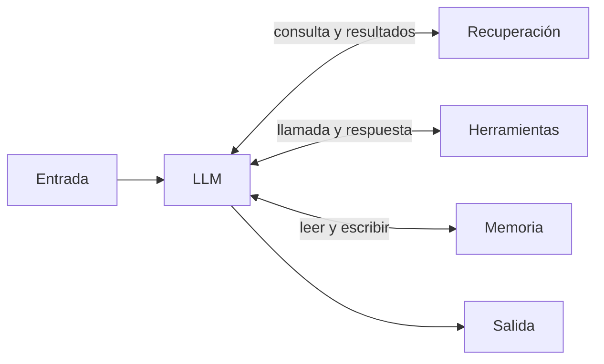

Un modelo solo sabe lo que aprendió en su entrenamiento y lo que pones en su [[glosario/ventana-de-contexto|ventana de contexto]]. La **llamada aumentada** le añade tres capacidades: buscar información, actuar mediante herramientas y recordar. *Building effective agents* ([Anthropic, 2024](https://www.anthropic.com/engineering/building-effective-agents)) la presenta como el bloque con el que se construyen todos los demás patrones. Aquí verás sus piezas, cómo encajan y un esqueleto que puedes reutilizar.

## Qué es

Una llamada al modelo a la que tu aplicación da acceso a:

- **Recuperación**: el modelo genera consultas y recibe fragmentos relevantes de tus documentos. Es la base del [[glosario/rag|RAG]].
- **Herramientas**: funciones que el modelo puede pedir ejecutar, con el ciclo [[glosario/tool-use|tool_use]] → [[glosario/tool-result|tool_result]].
- **Memoria**: información que persiste entre conversaciones y que el modelo puede leer o escribir. Lo ves en [[glosario/memoria]].

Los modelos actuales usan estas capacidades por iniciativa propia: deciden qué buscar, qué herramienta llamar y qué guardar. Tu trabajo es dárselas con una interfaz clara.



## Las dos reglas del artículo

El artículo pide dos cosas al implementar este bloque:

1. **Adaptar las capacidades a tu caso de uso**. Pocas herramientas, cada una con un propósito claro, mejor que un catálogo genérico.
2. **Dar una interfaz fácil y bien documentada**. Nombres claros, descripciones que expliquen cuándo usar cada herramienta y qué devuelve, y parámetros difíciles de usar mal. Lo desarrolla [[disciplinas/diseno-de-herramientas]].

Para conectar herramientas y datos de forma estándar, el artículo menciona el [[glosario/mcp|Model Context Protocol]]: un servidor MCP expone *tools*, *resources* y *prompts* que cualquier cliente compatible puede usar. Empieza en [[docs/herramientas/02-mcp]].

## Cuándo usarlo

- Cuando la respuesta depende de datos privados o recientes: tus documentos, tu base de datos, el estado de un pedido.
- Cuando el modelo tiene que hacer algo fuera del texto: consultar una API, calcular con precisión, crear un registro.
- Cuando el usuario espera continuidad entre sesiones: preferencias, decisiones anteriores, contexto de un proyecto.

## Cuándo no

- Si toda la información cabe en el *prompt* y no cambia, pásala directamente. Una recuperación innecesaria añade latencia y puede traer fragmentos irrelevantes.
- Si una herramienta solo envuelve algo que el modelo hace bien con texto (reformular, resumir), sobra.
- Memoria que nadie lee es ruido que paga tokens. Guarda poco y con propósito.

## Ejemplo concreto

Un asistente interno responde preguntas sobre vacaciones. Tiene una herramienta `buscar_politicas` (recuperación sobre el manual de RR. HH.), una herramienta `dias_disponibles` (consulta al sistema de nómina) y una nota de memoria con las preferencias del empleado. Ante «¿Puedo coger cinco días en agosto?», el modelo busca la política de verano, consulta los días del empleado y responde citando el apartado del manual.

## Esqueleto de código

El esqueleto inyecta la memoria en el [[glosario/prompt-de-sistema|prompt de sistema]], ofrece dos herramientas y resuelve las rondas de herramientas que el modelo pida.

```python title="llamada_aumentada.py"
import anthropic

MODEL = "claude-sonnet-5-5"
client = anthropic.Anthropic()

HERRAMIENTAS = [
    {
        "name": "buscar_politicas",
        "description": "Busca en el manual de RR. HH. y devuelve los 3 fragmentos más relevantes "
                       "con su apartado. Úsala para cualquier pregunta sobre normas internas.",
        "input_schema": {
            "type": "object",
            "properties": {"consulta": {"type": "string", "description": "Pregunta en lenguaje natural"}},
            "required": ["consulta"],
        },
    },
    {
        "name": "dias_disponibles",
        "description": "Devuelve los días de vacaciones que le quedan al empleado este año.",
        "input_schema": {
            "type": "object",
            "properties": {"empleado_id": {"type": "string"}},
            "required": ["empleado_id"],
        },
    },
]

def ejecutar(nombre: str, args: dict) -> str:
    if nombre == "buscar_politicas":
        return buscar_en_indice(args["consulta"])     # tu recuperación (RAG)
    if nombre == "dias_disponibles":
        return str(consultar_nomina(args["empleado_id"]))
    raise ValueError(f"Herramienta desconocida: {nombre}")

def preguntar(pregunta: str, empleado_id: str, memoria: str, max_rondas: int = 5) -> str:
    system = (
        "Eres el asistente de RR. HH. Responde solo con información del manual o de las herramientas "
        f"y cita el apartado.\n<empleado id='{empleado_id}'>\n{memoria}\n</empleado>"
    )
    mensajes = [{"role": "user", "content": pregunta}]
    for _ in range(max_rondas):
        resp = client.messages.create(model=MODEL, max_tokens=1024, system=system,
                                      tools=HERRAMIENTAS, messages=mensajes)
        if resp.stop_reason != "tool_use":
            return "".join(b.text for b in resp.content if b.type == "text")
        mensajes.append({"role": "assistant", "content": resp.content})
        resultados = []
        for bloque in resp.content:
            if bloque.type != "tool_use":
                continue
            try:
                contenido, error = ejecutar(bloque.name, bloque.input), False
            except Exception as e:
                contenido, error = f"Error: {e}", True
            resultados.append({"type": "tool_result", "tool_use_id": bloque.id,
                               "content": contenido, "is_error": error})
        mensajes.append({"role": "user", "content": resultados})
    raise RuntimeError("Demasiadas rondas de herramientas")
```

Si el modelo pide varias herramientas a la vez, todas sus respuestas van juntas en un único mensaje `user`, un `tool_result` por cada `tool_use`. Los detalles están en [[docs/herramientas/01-uso-de-herramientas]] y el manejo de errores en [[roadmap/20-herramientas/03-errores-e-is-error]].

> [!aviso] Lo recuperado también es entrada no confiable
> Un documento o un resultado de herramienta puede contener instrucciones maliciosas. Trátalo como datos, delimítalo con etiquetas y no le des permisos que no necesita. Lee [[glosario/inyeccion-de-prompt]].

## Coste y latencia

Es el patrón más barato después de una llamada simple: una llamada si el modelo no necesita herramientas y una más por cada ronda de herramientas. El coste crece con lo que metes en contexto, así que limita los fragmentos recuperados y las descripciones largas. El *prompt* de sistema y las herramientas son un prefijo estable: cachéalos con [[glosario/prompt-caching|prompt caching]].

## Patrones relacionados

- [[patrones/01-workflows-vs-agentes]]: dónde encaja este bloque en la escalera.
- [[patrones/08-agente-autonomo]]: la misma llamada aumentada repetida en bucle sin límite fijo de rondas.
- [[sistemas/rag-con-citas]]: un sistema completo construido sobre la parte de recuperación.
- [[docs/contexto/03-rag]] y [[docs/contexto/04-memoria]]: referencia de cada pieza.
