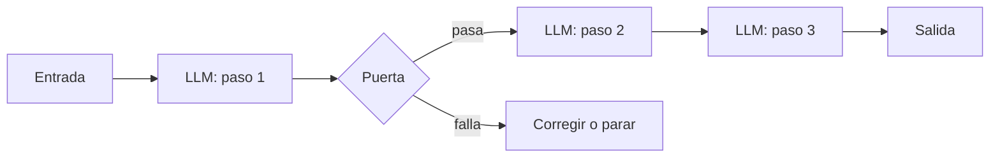

El **encadenado de prompts** convierte una tarea grande en una secuencia de llamadas pequeñas: cada una procesa la salida de la anterior y hace una sola cosa. Entre paso y paso puedes meter **comprobaciones programáticas** (el artículo las llama *gates*, puertas) que detienen o corrigen el flujo antes de que un error se propague. Es el [[glosario/workflow|workflow]] más simple de *Building effective agents* ([Anthropic, 2024](https://www.anthropic.com/engineering/building-effective-agents)) y, a menudo, el que más rinde.

## Qué es

Cambias latencia por precisión. Cada llamada recibe una tarea más estrecha, con su propio *prompt* y sus propios ejemplos, y eso la hace más fácil de acertar y de probar por separado. El orden de los pasos lo fija tu código: el modelo nunca decide qué viene después.



## Cuándo usarlo

- La tarea tiene **fases naturales** que podrías describir a una persona: extraer, luego transformar, luego redactar.
- Una sola llamada mezcla objetivos y falla en alguno. Por ejemplo, escribe bien pero se salta requisitos de formato.
- Quieres **puntos de control** donde validar con código: que el JSON sea válido, que el esquema tenga los apartados exigidos, que una cifra cuadre.

Ejemplos del artículo: generar un texto de marketing y después traducirlo; escribir el esquema de un documento, comprobar que cumple los criterios y redactar el documento a partir del esquema.

## Cuándo no

- **Pasos que dependen de la entrada**. Si para unos casos hacen falta tres pasos y para otros siete distintos, necesitas [[patrones/06-orquestador-trabajadores]] o un [[patrones/08-agente-autonomo|agente]].
- **Pasos independientes entre sí**. Si el paso 2 no usa la salida del 1, lánzalos en paralelo: [[patrones/05-paralelizacion]].
- **Cadenas largas sin medir**. Cada eslabón suma latencia y una probabilidad de fallo. Si no tienes [[glosario/evals|evals]] por paso, no sabrás cuál rompe la cadena.

## Ejemplo concreto

Convertir la transcripción de una reunión en un acta con tareas asignadas:

1. **Extraer**: el modelo lista decisiones y tareas con su responsable, en JSON.
2. **Puerta**: el código valida el JSON y comprueba que cada responsable aparece en la lista de asistentes. Si falla, reintenta el paso 1 con el error como contexto.
3. **Redactar**: el modelo escribe el acta en el formato de la empresa a partir del JSON validado, sin volver a leer la transcripción.

Separar extracción y redacción tiene una ventaja concreta: puedes evaluar la extracción con código (¿están todas las tareas?) y la redacción con un [[glosario/modelo-juez|modelo juez]]. Tienes la receta completa en [[recetas/resumen-de-reuniones-con-acciones]].

## Esqueleto de código

```python title="encadenado.py"
import json
import anthropic

MODEL = "claude-sonnet-5-5"
client = anthropic.Anthropic()

def llm(prompt: str, system: str | None = None, max_tokens: int = 2048) -> str:
    extra = {"system": system} if system else {}
    resp = client.messages.create(model=MODEL, max_tokens=max_tokens,
                                  messages=[{"role": "user", "content": prompt}], **extra)
    if resp.stop_reason == "max_tokens":
        raise RuntimeError("Respuesta truncada: sube max_tokens o acorta el paso")
    return "".join(b.text for b in resp.content if b.type == "text")

def extraer(transcripcion: str, error_previo: str = "") -> dict:
    aviso = f"\nEl intento anterior falló: {error_previo}. Corrígelo." if error_previo else ""
    salida = llm(
        "Extrae decisiones y tareas de esta reunión. Devuelve solo JSON con la forma "
        '{"decisiones": [str], "tareas": [{"tarea": str, "responsable": str}]}.'
        f"{aviso}\n<transcripcion>\n{transcripcion}\n</transcripcion>"
    )
    return json.loads(salida)

def puerta(datos: dict, asistentes: set[str]) -> str | None:
    """Devuelve None si todo está bien, o el motivo del fallo."""
    for t in datos.get("tareas", []):
        if t["responsable"] not in asistentes:
            return f"'{t['responsable']}' no está entre los asistentes {sorted(asistentes)}"
    return None

def acta(transcripcion: str, asistentes: set[str], reintentos: int = 2) -> str:
    error = ""
    for _ in range(reintentos + 1):
        try:
            datos = extraer(transcripcion, error)
        except json.JSONDecodeError as e:
            error = f"JSON inválido ({e})"
            continue
        error = puerta(datos, asistentes)
        if error is None:
            break
    else:
        raise ValueError(f"La extracción no pasa la puerta: {error}")
    return llm(
        "Redacta el acta en Markdown con secciones Decisiones y Tareas a partir de estos datos. "
        f"No añadas nada que no esté en ellos.\n{json.dumps(datos, ensure_ascii=False)}"
    )
```

Para asegurar el JSON sin reintentos puedes usar salidas estructuradas con esquema; lo explica [[docs/prompting/03-salida-estructurada]]. Aun así, la puerta con reglas de negocio sigue siendo tuya.

> [!consejo] Cada eslabón, su propio test
> Guarda entradas y salidas intermedias. Cuando la salida final falla, mirar qué devolvió cada paso te dice en segundos qué eslabón arreglar.

## Con LangGraph

El mismo encadenado como [[glosario/grafo-de-estado|grafo de estado]] en LangGraph (MIT). Cada paso es un nodo que recibe el estado y devuelve lo que cambia; la puerta es una arista condicional que manda a redactar, de vuelta a extraer o al final. Necesitas `pip install langgraph langchain langchain-anthropic`.

```python title="encadenado_langgraph.py"
import json
from typing import TypedDict

from langchain.chat_models import init_chat_model
from langgraph.graph import END, START, StateGraph

MODEL = "anthropic:claude-sonnet-5-5"
MAX_INTENTOS = 3


class Estado(TypedDict, total=False):
    transcripcion: str
    asistentes: list[str]
    datos: dict
    error: str        # vacío = la puerta pasa
    intentos: int
    acta: str


def construir(modelo=None):
    llm = modelo or init_chat_model(MODEL, max_tokens=2048)

    def extraer(state: Estado):
        aviso = f"\nEl intento anterior falló: {state['error']}. Corrígelo." if state.get("error") else ""
        r = llm.invoke('Extrae decisiones y tareas. Devuelve solo JSON {"decisiones": [str], '
                       '"tareas": [{"tarea": str, "responsable": str}]}.'
                       f"{aviso}\n<transcripcion>\n{state['transcripcion']}\n</transcripcion>")
        intentos = state.get("intentos", 0) + 1
        try:
            datos = json.loads(r.text)
        except json.JSONDecodeError as e:
            return {"error": f"JSON inválido ({e})", "intentos": intentos}
        fuera = [t["responsable"] for t in datos["tareas"] if t["responsable"] not in state["asistentes"]]
        error = f"{fuera} no están entre los asistentes" if fuera else ""
        return {"datos": datos, "error": error, "intentos": intentos}

    def puerta(state: Estado):                     # la comprobación en código decide la arista
        if not state["error"]:
            return "redactar"
        return END if state["intentos"] >= MAX_INTENTOS else "extraer"

    def redactar(state: Estado):
        r = llm.invoke("Redacta el acta en Markdown con secciones Decisiones y Tareas. "
                       f"No añadas nada que no esté en estos datos:\n{json.dumps(state['datos'], ensure_ascii=False)}")
        return {"acta": r.text}

    g = StateGraph(Estado)
    g.add_node("extraer", extraer)
    g.add_node("redactar", redactar)
    g.add_edge(START, "extraer")
    g.add_conditional_edges("extraer", puerta, ["redactar", "extraer", END])
    g.add_edge("redactar", END)
    return g.compile()


if __name__ == "__main__":
    out = construir().invoke({"transcripcion": "…", "asistentes": ["Ana", "Luis"]})
    print(out.get("acta") or f"A revisión humana: {out['error']}")
```

Si el grafo termina sin `acta`, la puerta no pasó en tres intentos y el caso va a revisión humana. Para pasos lineales también tienes la Functional API (`@entrypoint` y `@task`), que se escribe como funciones normales y guarda cada tarea en el *checkpointer*.

**Qué esconde el framework**: aquí, poco. Te da trazas por nodo (`stream_mode="updates"`) y, con un *checkpointer*, reanudar a mitad de cadena; a cambio, para dos o tres pasos las funciones de arriba se leen mejor. Más en [[docs/frameworks/05-langgraph]].

## Coste y latencia

Coste medio: tantas llamadas como pasos, aunque cada una suele ser más corta que una llamada única que lo hiciera todo. La latencia se suma en serie, y eso es lo que más se nota: tres pasos son tres esperas. Para recortarla, usa un modelo más rápido en los pasos sencillos (consulta [[modelos/05-elegir-modelo-por-tarea]]) y haz *streaming* solo del último paso, que es el que ve el usuario.

## Patrones relacionados

- [[patrones/04-enrutado]]: elige qué cadena ejecutar según la entrada.
- [[patrones/05-paralelizacion]]: cuando los pasos no dependen unos de otros.
- [[patrones/07-evaluador-optimizador]]: una puerta que, en lugar de validar con código, critica con un modelo y pide mejoras.
- [[sistemas/extraccion-documental]]: un encadenado de extracción y validación en producción.
