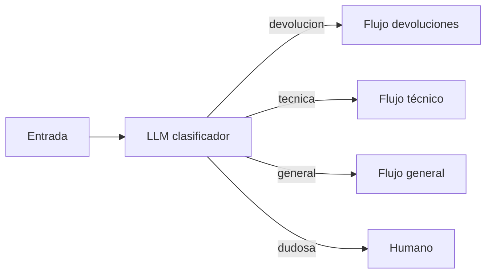

El **enrutado** añade un paso de clasificación delante de todo lo demás: una llamada decide de qué tipo es la entrada y tu código la manda al flujo preparado para ese tipo. Así cada flujo tiene un *prompt* corto y específico, y mejorar uno no estropea los otros. Es el segundo [[glosario/workflow|workflow]] de *Building effective agents* ([Anthropic, 2024](https://www.anthropic.com/engineering/building-effective-agents)).

## Qué es

Sin enrutado, un único *prompt* intenta atender devoluciones, dudas técnicas y quejas a la vez. Cada regla que añades para un caso puede empeorar otro. Con enrutado, **separas responsabilidades**: el clasificador solo clasifica y cada ruta solo resuelve su tipo de caso.



La clasificación puede hacerla un LLM o un modelo clásico entrenado con tus datos. El artículo admite las dos opciones. El LLM gana cuando no tienes datos etiquetados o las categorías cambian a menudo.

## Cuándo usarlo

- Hay **categorías distintas** que se tratan mejor por separado, y puedes clasificar con precisión.
- Quieres mandar **lo fácil a un modelo pequeño y rápido** y lo difícil a uno más capaz. El artículo lo cita como uso típico para ajustar coste y velocidad; tienes el método en [[modelos/05-elegir-modelo-por-tarea]].
- Cada categoría necesita **herramientas o permisos diferentes**. El flujo de facturación puede consultar pagos; el general, no. Es una forma sencilla de aplicar [[glosario/minimo-privilegio|mínimo privilegio]].

## Cuándo no

- Las categorías no están claras ni para un humano. Si dos personas etiquetarían distinto el mismo caso, el clasificador también dudará.
- Solo hay una o dos variantes que un *prompt* bien escrito resuelve con un ejemplo de cada una.
- El coste de un error de ruta es alto y no tienes salida para los casos dudosos. Añade siempre una categoría "dudosa" que vaya a un humano o a un flujo general seguro.

## Ejemplo concreto

Una tienda online recibe correos de clientes. El clasificador devuelve `devolucion`, `incidencia_tecnica`, `consulta_general` o `dudosa`, más una frase de motivo. Las devoluciones pasan a un flujo con acceso a pedidos y a la política de devoluciones. Las incidencias técnicas, a otro con la base de conocimiento del producto. Las consultas generales las responde un modelo rápido. Las dudosas van a la cola de un agente humano. La receta paso a paso está en [[recetas/clasificar-y-enrutar-tickets]].

## Esqueleto de código

El clasificador usa [[glosario/salida-estructurada|salida estructurada]] con un `enum`, así la ruta siempre es uno de los valores válidos.

```python title="enrutado.py"
import json
import anthropic

MODEL = "claude-sonnet-5-5"
client = anthropic.Anthropic()

RUTAS = ["devolucion", "incidencia_tecnica", "consulta_general", "dudosa"]

ESQUEMA = {
    "type": "object",
    "properties": {
        "ruta": {"type": "string", "enum": RUTAS},
        "motivo": {"type": "string"},
    },
    "required": ["ruta", "motivo"],
    "additionalProperties": False,
}

def clasificar(mensaje: str) -> dict:
    resp = client.messages.create(
        model=MODEL, max_tokens=256,
        system=("Clasifica el mensaje del cliente. Usa 'dudosa' si encaja en más de una ruta "
                "o en ninguna. Ejemplos:\n- 'Quiero devolver las zapatillas' → devolucion\n"
                "- 'La app se cierra al pagar' → incidencia_tecnica"),
        messages=[{"role": "user", "content": f"<mensaje>\n{mensaje}\n</mensaje>"}],
        output_config={"format": {"type": "json_schema", "schema": ESQUEMA}},
    )
    texto = next(b.text for b in resp.content if b.type == "text")
    return json.loads(texto)

def atender(mensaje: str) -> str:
    decision = clasificar(mensaje)
    manejadores = {
        "devolucion": flujo_devoluciones,          # con herramientas de pedidos
        "incidencia_tecnica": flujo_tecnico,       # con la base de conocimiento
        "consulta_general": flujo_general,         # candidato a un modelo más rápido
        "dudosa": enviar_a_humano,
    }
    registrar(mensaje, decision)                   # para medir la precisión del router
    return manejadores[decision["ruta"]](mensaje)
```

Cada `flujo_*` puede ser una [[patrones/02-llamada-aumentada|llamada aumentada]], un [[patrones/03-encadenado|encadenado]] o incluso un agente. El router no necesita saberlo.

> [!consejo] Evalúa el router por separado
> Etiqueta a mano unos cientos de mensajes reales y mide la precisión por categoría. Un error de ruta contamina todo lo que viene después, y es el fallo más barato de detectar. Tienes cómo montarlo en [[roadmap/80-evals/02-conjunto-de-prueba]].

## Coste y latencia

El clasificador es una llamada corta con poca salida, así que su coste es bajo. A cambio añade una espera en serie antes de cada respuesta. Hay dos formas de compensarla: usar un modelo rápido para clasificar y aprovechar que las rutas sencillas pueden ir a modelos más baratos. Si el *prompt* del clasificador lleva muchos ejemplos, cachéalo con [[glosario/prompt-caching|prompt caching]].

## Patrones relacionados

- [[patrones/03-encadenado]]: cada ruta suele ser una cadena de pasos.
- [[patrones/05-paralelizacion]]: varios clasificadores que votan cuando la ruta es delicada.
- [[patrones/06-orquestador-trabajadores]]: cuando la entrada no se clasifica sino que se descompone en varias subtareas.
- [[sistemas/soporte-con-aprobacion-humana]]: un sistema de soporte que combina enrutado y agente.
