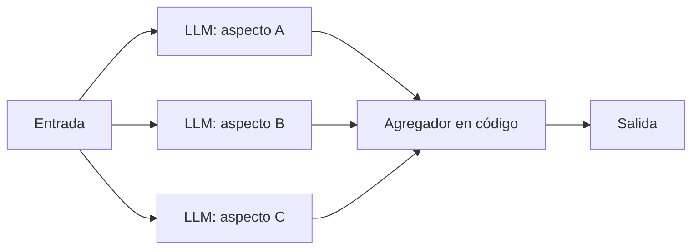

La **paralelización** ejecuta varias llamadas al modelo al mismo tiempo y junta sus salidas con código. *Building effective agents* ([Anthropic, 2024](https://www.anthropic.com/engineering/building-effective-agents)) distingue dos variantes: el **seccionado**, que reparte una tarea en partes independientes, y la **votación**, que repite la misma tarea varias veces para obtener respuestas diversas. Las dos son [[glosario/workflow|workflows]]: las subtareas y la forma de combinarlas las decides tú antes de ejecutar.

## Qué es



- **Seccionado**: cada llamada se ocupa de un aspecto. Los modelos rinden mejor cuando cada consideración recibe una llamada propia y atención completa.
- **Votación**: las llamadas hacen lo mismo, a veces con *prompts* distintos, y una regla agrega los votos (mayoría, unanimidad, umbral).

## Cuándo usarlo

Seccionado:

- **Guardarraíles en paralelo**: una llamada responde al usuario mientras otra revisa si la consulta es inapropiada. El artículo señala que separar ambas funciona mejor que pedir a una sola llamada que haga las dos. Lo amplía [[glosario/guardrails]].
- **Evaluaciones por aspectos**: cada llamada puntúa un criterio de la rúbrica (exactitud, tono, formato). Lo verás en [[recetas/modelo-juez-con-rubrica]].
- **Documentos largos por partes**: resumir capítulos independientes a la vez.

Votación:

- **Revisar código en busca de vulnerabilidades** con varios *prompts* distintos y marcar el fragmento si alguno encuentra un problema.
- **Moderación con umbrales**: decidir si un contenido es inapropiado según cuántas llamadas lo marcan, equilibrando falsos positivos y negativos.

La votación es pariente de la autoconsistencia de [Wang et al., 2022](https://arxiv.org/abs/2203.11171): muestrear varios razonamientos y quedarse con la respuesta más votada.

## Cuándo no

- Cuando una llamada necesita la salida de otra: eso es [[patrones/03-encadenado|encadenado]].
- Cuando no sabes de antemano en qué partes dividir: eso es [[patrones/06-orquestador-trabajadores]].
- Cuando la agregación es difusa. Si "combinar" significa "que otro modelo lo arregle", estás añadiendo un paso de síntesis que también hay que evaluar.
- Cuando el límite de tasa de tu cuenta no admite la ráfaga de peticiones. Prevé reintentos; lo explica [[recetas/reintentos-y-limites-de-tasa]].

## Ejemplo concreto

Antes de publicar respuestas generadas en un foro de clientes, un sistema lanza en paralelo tres comprobaciones sobre el borrador: ¿contiene datos personales?, ¿promete algo fuera de la política?, ¿el tono es correcto? Cada una devuelve `ok` o `problema` con motivo. Si cualquiera devuelve `problema`, el borrador va a revisión humana. Es seccionado (tres aspectos) con una regla de agregación estricta.

## Esqueleto de código

Las dos variantes con el cliente asíncrono y `asyncio.gather`.

```python title="paralelizacion.py"
import asyncio
import anthropic

MODEL = "claude-sonnet-5-5"
client = anthropic.AsyncAnthropic()

async def llm(prompt: str, system: str) -> str:
    resp = await client.messages.create(
        model=MODEL, max_tokens=512, system=system,
        messages=[{"role": "user", "content": prompt}],
    )
    return "".join(b.text for b in resp.content if b.type == "text").strip()

# Seccionado: un aspecto por llamada
ASPECTOS = {
    "datos_personales": "¿El texto contiene datos personales de terceros?",
    "promesas": "¿El texto promete reembolsos, plazos o condiciones fuera de la política?",
    "tono": "¿El tono es grosero, condescendiente o poco profesional?",
}

async def revisar_borrador(borrador: str) -> dict[str, bool]:
    system = "Respondes solo 'ok' o 'problema'. Nada más."
    tareas = [llm(f"{pregunta}\n<texto>\n{borrador}\n</texto>", system)
              for pregunta in ASPECTOS.values()]
    respuestas = await asyncio.gather(*tareas)
    return {aspecto: r.lower().startswith("problema")
            for aspecto, r in zip(ASPECTOS, respuestas)}

# Votación: misma tarea, varios enfoques, regla de agregación
ENFOQUES = [
    "Revisa este código buscando inyección SQL.",
    "Revisa este código buscando datos de usuario sin validar que llegan a una consulta.",
    "Actúa como auditor de seguridad y busca cualquier vulnerabilidad explotable.",
]

async def es_vulnerable(codigo: str, umbral: int = 1) -> bool:
    system = "Responde 'vulnerable' o 'limpio' en la primera línea y luego una frase de motivo."
    votos = await asyncio.gather(*[llm(f"{e}\n<codigo>\n{codigo}\n</codigo>", system)
                                   for e in ENFOQUES])
    positivos = sum(v.lower().startswith("vulnerable") for v in votos)
    return positivos >= umbral   # umbral bajo: prefieres falsos positivos a dejar pasar fallos

async def main():
    problemas = await revisar_borrador("Te devolvemos el doble del importe mañana mismo.")
    if any(problemas.values()):
        print("A revisión humana:", [a for a, p in problemas.items() if p])

asyncio.run(main())
```

Para salidas tan cortas, el formato libre con `startswith` funciona; si necesitas motivo y veredicto separados, usa salidas estructuradas ([[docs/prompting/03-salida-estructurada]]).

> [!aviso] El umbral es una decisión de producto
> En la votación, elegir "basta un voto" o "hace falta mayoría" cambia el equilibrio entre falsos positivos y falsos negativos. Decídelo con datos etiquetados, no a ojo.

## Coste y latencia

La latencia es la de la llamada más lenta, no la suma: por eso es el workflow con mejor latencia cuando hay varias comprobaciones. El coste, en cambio, se multiplica por el número de llamadas. Si todas comparten un contexto largo (el mismo documento), ponlo al principio y cachéalo con [[glosario/prompt-caching|prompt caching]] para pagar menos en cada rama. Mide cuánto aporta cada voto extra: a partir de cierto número, más llamadas solo suben la factura.

## Patrones relacionados

- [[patrones/06-orquestador-trabajadores]]: seccionado en el que un modelo decide las secciones sobre la marcha.
- [[patrones/07-evaluador-optimizador]]: usa la evaluación por aspectos como crítica para mejorar.
- [[patrones/04-enrutado]]: varios clasificadores pueden votar la ruta en casos delicados.
- [[roadmap/60-multiagente/04-paralelismo]]: el mismo principio aplicado a subagentes.
