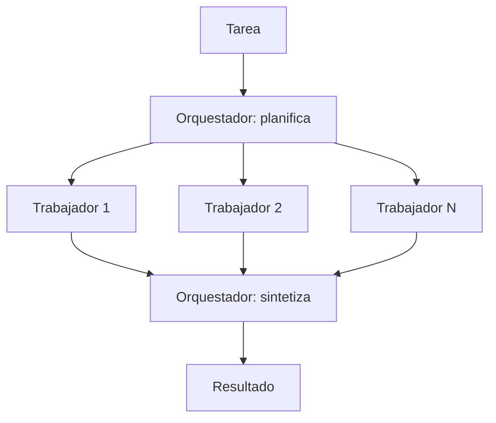

En el patrón **orquestador y trabajadores**, un LLM central (el [[glosario/orquestador|orquestador]]) recibe la tarea, decide en qué subtareas dividirla, las reparte entre trabajadores y combina sus resultados. Se parece a la [[patrones/05-paralelizacion|paralelización]], con una diferencia clave que subraya *Building effective agents* ([Anthropic, 2024](https://www.anthropic.com/engineering/building-effective-agents)): **las subtareas no están predefinidas**, las decide el orquestador según la entrada.

## Qué es



Hay tres momentos con responsabilidades distintas:

1. **Planificar**: el orquestador produce una lista de subtareas, cada una con objetivo, contexto necesario y formato de respuesta esperado.
2. **Ejecutar**: tu código lanza los trabajadores, en paralelo si son independientes. Cada trabajador puede ser una llamada simple, una [[patrones/02-llamada-aumentada|llamada aumentada]] o un agente con herramientas propias (un [[glosario/subagente|subagente]]).
3. **Sintetizar**: el orquestador recibe los resultados y produce la salida final. A veces decide lanzar otra ronda.

Sigue siendo un workflow porque tu código controla la estructura: un plan, una ejecución, una síntesis. Cuando el orquestador puede lanzar trabajadores cuando quiera y en bucle, te acercas a un sistema multiagente con un agente al mando.

## Cuándo usarlo

- **No puedes predecir las subtareas**. El artículo pone dos ejemplos: productos de código que tienen que tocar varios archivos (cuántos y cuáles depende del cambio pedido) y tareas de búsqueda que reúnen información de varias fuentes.
- Las subtareas son **independientes** entre sí una vez definidas, así que se pueden ejecutar sin que los trabajadores se coordinen.
- Cada subtarea **gana con un contexto limpio**. Un trabajador que solo ve su parte no se distrae con el resto, y su contexto no se llena con lo que hacen los demás.

## Cuándo no

- Las subtareas son siempre las mismas: usa seccionado ([[patrones/05-paralelizacion]]), que es más barato y predecible.
- Los trabajadores necesitan compartir mucho contexto o decisiones que se toman a medio camino. Si tienes que pasar todo el estado a cada uno, pierdes la ventaja y multiplicas tokens. Lo argumenta [[roadmap/60-multiagente/01-cuando-no-usar-multiagente]].
- La tarea es pequeña. Planificar y sintetizar cuestan dos llamadas aunque solo haya una subtarea.

## Ejemplo concreto

Un usuario pide: «Compara las condiciones de teletrabajo de los convenios de estas tres empresas». El orquestador planifica una subtarea por empresa, cada una con la instrucción de extraer días permitidos, compensaciones y requisitos, y citar el artículo del convenio. Tres trabajadores leen cada convenio en paralelo. El orquestador recibe tres fichas con el mismo formato y redacta la comparativa en tabla. Si el usuario hubiera mencionado cinco empresas, el plan tendría cinco subtareas sin cambiar una línea de código.

## Esqueleto de código

```python title="orquestador.py"
import asyncio
import json
import anthropic

MODEL = "claude-sonnet-5-5"
client = anthropic.AsyncAnthropic()

PLAN = {
    "type": "object",
    "properties": {
        "subtareas": {
            "type": "array",
            "items": {
                "type": "object",
                "properties": {
                    "objetivo": {"type": "string"},
                    "contexto": {"type": "string"},
                    "formato_respuesta": {"type": "string"},
                },
                "required": ["objetivo", "contexto", "formato_respuesta"],
                "additionalProperties": False,
            },
        }
    },
    "required": ["subtareas"],
    "additionalProperties": False,
}

async def texto(prompt: str, system: str, max_tokens: int = 2048, **extra) -> str:
    resp = await client.messages.create(model=MODEL, max_tokens=max_tokens, system=system,
                                        messages=[{"role": "user", "content": prompt}], **extra)
    if resp.stop_reason == "max_tokens":
        raise RuntimeError("Salida truncada")
    return "".join(b.text for b in resp.content if b.type == "text")

async def planificar(tarea: str, max_subtareas: int = 6) -> list[dict]:
    salida = await texto(
        f"<tarea>\n{tarea}\n</tarea>",
        system=(f"Divide la tarea en como mucho {max_subtareas} subtareas independientes. "
                "Cada una debe poder resolverse sin ver las demás. Indica qué contexto necesita "
                "y en qué formato debe responder."),
        output_config={"format": {"type": "json_schema", "schema": PLAN}},
    )
    return json.loads(salida)["subtareas"][:max_subtareas]   # el límite lo impone tu código

async def trabajar(sub: dict) -> str:
    return await texto(
        f"Objetivo: {sub['objetivo']}\n<contexto>\n{sub['contexto']}\n</contexto>\n"
        f"Formato de respuesta: {sub['formato_respuesta']}",
        system="Resuelve solo esta subtarea. Si te falta información, dilo en lugar de suponer.",
    )

async def orquestar(tarea: str) -> str:
    subtareas = await planificar(tarea)
    resultados = await asyncio.gather(*[trabajar(s) for s in subtareas], return_exceptions=True)
    informe = "\n\n".join(
        f"<resultado objetivo='{s['objetivo']}'>\n"
        f"{r if not isinstance(r, Exception) else f'FALLÓ: {r}'}\n</resultado>"
        for s, r in zip(subtareas, resultados)
    )
    return await texto(
        f"<tarea>\n{tarea}\n</tarea>\n{informe}",
        system="Sintetiza los resultados en una respuesta final. Señala qué subtareas fallaron.",
        max_tokens=4096,
    )
```

`return_exceptions=True` evita que un trabajador caído tire toda la ejecución: el orquestador recibe el fallo y puede decirlo en la síntesis.

> [!consejo] Delegar bien es medio patrón
> Un trabajador solo sabe lo que el orquestador le escribe. Pide en el plan objetivo, contexto, límites y formato de respuesta. El artículo de Anthropic sobre su [sistema de investigación multiagente](https://www.anthropic.com/engineering/multi-agent-research-system) cuenta que instrucciones de delegación vagas producían trabajo duplicado y huecos. Lo desarrolla [[roadmap/60-multiagente/03-pasar-contexto-entre-agentes]].

## Con LangGraph

El orquestador encaja con `Send` de LangGraph (MIT): el plan decide cuántas ramas se lanzan, y cada trabajador recibe solo su subtarea. Es un *map-reduce* con un modelo en cada extremo. Necesitas `pip install langgraph langchain langchain-anthropic`.

```python title="orquestador_langgraph.py"
import operator
from typing import Annotated, TypedDict

from langchain.chat_models import init_chat_model
from langgraph.graph import END, START, StateGraph
from langgraph.types import Send
from pydantic import BaseModel

MODEL = "anthropic:claude-sonnet-5-5"
MAX_SUBTAREAS = 6


class Subtarea(BaseModel):
    objetivo: str
    contexto: str
    formato_respuesta: str


class Plan(BaseModel):
    subtareas: list[Subtarea]


class Estado(TypedDict, total=False):
    tarea: str
    subtareas: list[Subtarea]
    resultados: Annotated[list[str], operator.add]   # cada trabajador añade el suyo
    respuesta: str


def construir(modelo=None):
    llm = modelo or init_chat_model(MODEL, max_tokens=2048)
    planificador = llm.with_structured_output(Plan, method="json_schema")

    def planificar(state: Estado):
        plan = planificador.invoke(f"Divide la tarea en como mucho {MAX_SUBTAREAS} subtareas independientes, "
                                   f"con el contexto y el formato de cada una.\n<tarea>\n{state['tarea']}\n</tarea>")
        return {"subtareas": plan.subtareas[:MAX_SUBTAREAS]}      # el límite lo impone tu código

    def repartir(state: Estado):                                  # tantas ramas como diga el plan
        return [Send("trabajador", {"subtarea": s}) for s in state["subtareas"]]

    def trabajador(state: dict):
        s: Subtarea = state["subtarea"]
        r = llm.invoke(f"Resuelve solo esta subtarea.\nObjetivo: {s.objetivo}\n"
                       f"<contexto>\n{s.contexto}\n</contexto>\nFormato de respuesta: {s.formato_respuesta}")
        return {"resultados": [f"<resultado objetivo='{s.objetivo}'>\n{r.text}\n</resultado>"]}

    def sintetizar(state: Estado):
        r = llm.invoke(f"<tarea>\n{state['tarea']}\n</tarea>\n" + "\n\n".join(state["resultados"])
                       + "\nSintetiza los resultados en una respuesta final.")
        return {"respuesta": r.text}

    g = StateGraph(Estado)
    g.add_node("planificar", planificar)
    g.add_node("trabajador", trabajador)
    g.add_node("sintetizar", sintetizar)
    g.add_edge(START, "planificar")
    g.add_conditional_edges("planificar", repartir, ["trabajador"])
    g.add_edge("trabajador", "sintetizar")                        # espera a todos los trabajadores
    g.add_edge("sintetizar", END)
    return g.compile()


if __name__ == "__main__":
    out = construir().invoke({"tarea": "Compara las condiciones de teletrabajo de los convenios de A, B y C."},
                             {"max_concurrency": 4})                # tope de trabajadores a la vez
    print(out["respuesta"])
```

El plan usa `method="json_schema"` por la misma razón que en el [[patrones/04-enrutado|enrutado]]: con Claude Sonnet 5.5 no se puede forzar una herramienta. Si un trabajador debe ser un agente con herramientas, sustituye el nodo por un subgrafo o por `create_agent`.

**Qué esconde el framework**: el reparto en paralelo, la espera a todos los trabajadores y la unión de resultados con el reductor `operator.add`. A diferencia del `return_exceptions=True` de arriba, aquí un trabajador que lanza una excepción detiene el grafo: captúrala dentro del nodo o configura una `RetryPolicy`. Para trabajadores que son agentes completos, mira [[docs/frameworks/10-deep-agents]] y [[cursos/langchain-y-langgraph/08-multiagente-con-langgraph]].

## Coste y latencia

Es de los patrones más caros: una llamada de plan, una por trabajador y una de síntesis, y la síntesis recibe todos los resultados como entrada. Si los trabajadores son agentes con herramientas, el gasto sube bastante más. La latencia es plan + trabajador más lento + síntesis, mejor que hacerlo todo en serie. Pon un tope de subtareas en código y mide si la calidad compensa frente a una sola llamada con más contexto; lo detalla [[roadmap/60-multiagente/05-coste-de-multiplicar-agentes]].

## Patrones relacionados

- [[patrones/05-paralelizacion]]: la versión con subtareas fijas.
- [[patrones/08-agente-autonomo]]: cuando el orquestador pasa a ser un agente que delega en bucle.
- [[patrones/07-evaluador-optimizador]]: para revisar la síntesis antes de entregarla.
- [[sistemas/investigacion-multiagente]] y [[sistemas/agente-de-codigo]]: los dos casos del artículo, como sistemas completos.
