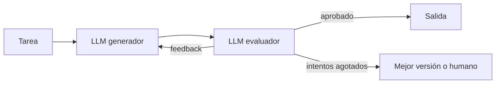

El **evaluador-optimizador** monta un bucle entre dos papeles: un generador produce una respuesta y un evaluador la juzga contra criterios explícitos y devuelve *feedback* accionable. El generador reescribe con ese *feedback* y el ciclo se repite hasta que el evaluador aprueba o se acaban los intentos. *Building effective agents* ([Anthropic, 2024](https://www.anthropic.com/engineering/building-effective-agents)) lo compara con el proceso de un escritor que corrige un texto varias veces.

## Qué es



Los dos papeles pueden ser el mismo modelo con *prompts* distintos. Lo importante es que el evaluador tenga **una rúbrica** y devuelva dos cosas separadas: un veredicto que tu código pueda leer (aprobado o no) y un *feedback* que el generador pueda usar.

El patrón aplica en tiempo de ejecución la misma idea que [[glosario/modelo-juez|un modelo juez]] en tus [[glosario/evals|evals]]. Si ya tienes una rúbrica para evaluar tu sistema, tienes medio evaluador hecho.

## Cuándo usarlo

El artículo da dos señales de que encaja:

1. Las respuestas **mejoran de forma demostrable** cuando una persona les da *feedback* concreto.
2. El modelo es **capaz de dar ese *feedback*** por sí mismo.

Ejemplos que cita: traducción literaria, donde el traductor puede pasar por alto matices que un evaluador detecta, y búsquedas complejas que necesitan varias rondas en las que el evaluador decide si hace falta buscar más.

Otros casos donde funciona bien: textos con requisitos verificables (longitud, términos obligatorios, estilo de la casa), código que tiene que pasar tests (aquí el evaluador puede ser el propio test) y respuestas que deben citar solo lo que está en las fuentes.

## Cuándo no

- **No puedes escribir el criterio de aprobado**. "Que quede mejor" no es una rúbrica, y un evaluador sin criterio aprueba casi todo o nunca aprueba.
- **La primera versión ya es buena casi siempre**. Pagas al menos el doble para mejorar pocos casos. Mide primero.
- **El criterio se comprueba con código**. Si "aprobado" es "el JSON valida" o "los tests pasan", usa esa comprobación: es más barata y fiable. Eso es una puerta de [[patrones/03-encadenado|encadenado]] con reintento.
- **El evaluador comparte los puntos ciegos del generador**. Si ambos fallan en lo mismo, el bucle solo confirma el error. Cambia el *prompt* del evaluador, dale información que el generador no tenía o usa un evaluador humano en los casos críticos.

## Ejemplo concreto

Fichas de producto para una tienda. La rúbrica exige: menos de 80 palabras, mencionar material y medidas, no usar superlativos sin dato, tono de la marca. El generador escribe la ficha a partir de los datos técnicos. El evaluador devuelve `aprobado: false` con «Falta la medida del asa; "el mejor bolso" es un superlativo sin dato». El generador corrige. Tras como mucho tres vueltas, la ficha se publica o pasa a revisión de una persona con el último *feedback* adjunto.

La longitud se comprueba en código antes de llamar al evaluador: ahorras una llamada cuando el fallo es obvio.

## Esqueleto de código

```python title="evaluador_optimizador.py"
import json
import anthropic

MODEL = "claude-sonnet-5-5"
client = anthropic.Anthropic()

RUBRICA = """1. Menciona material y medidas.
2. No usa superlativos sin un dato que los respalde.
3. Tono cercano y frases cortas."""

VEREDICTO = {
    "type": "object",
    "properties": {
        "aprobado": {"type": "boolean"},
        "feedback": {"type": "string"},
    },
    "required": ["aprobado", "feedback"],
    "additionalProperties": False,
}

def llamar(system: str, prompt: str, **extra) -> str:
    resp = client.messages.create(model=MODEL, max_tokens=1024, system=system,
                                  messages=[{"role": "user", "content": prompt}], **extra)
    return "".join(b.text for b in resp.content if b.type == "text")

def generar(datos: str, feedback: str | None) -> str:
    previo = f"\n<feedback>\n{feedback}\n</feedback>\nCorrige todo lo señalado." if feedback else ""
    return llamar(f"Escribes fichas de producto. Criterios:\n{RUBRICA}",
                  f"<datos>\n{datos}\n</datos>{previo}")

def evaluar(datos: str, ficha: str) -> dict:
    salida = llamar(
        f"Evalúas fichas de producto contra estos criterios:\n{RUBRICA}\n"
        "Aprueba solo si cumple todos. Si no, explica qué falla y cómo arreglarlo.",
        f"<datos>\n{datos}\n</datos>\n<ficha>\n{ficha}\n</ficha>",
        output_config={"format": {"type": "json_schema", "schema": VEREDICTO}},
    )
    return json.loads(salida)

def ficha_producto(datos: str, max_vueltas: int = 3) -> tuple[str, bool]:
    feedback = None
    for _ in range(max_vueltas):
        ficha = generar(datos, feedback)
        if len(ficha.split()) > 80:                  # comprobación barata en código
            feedback = "Supera las 80 palabras. Acorta sin perder material ni medidas."
            continue
        veredicto = evaluar(datos, ficha)
        if veredicto["aprobado"]:
            return ficha, True
        feedback = veredicto["feedback"]
    return ficha, False                              # a revisión humana con el último feedback
```

El evaluador recibe también los datos de origen: así puede detectar que la ficha inventa algo que no estaba en ellos. Sin esa referencia solo juzgaría la forma.

> [!aviso] Pon siempre un tope de vueltas
> Sin `max_vueltas`, un evaluador exigente y un generador que no sabe arreglar el fallo pueden girar indefinidamente. Decide qué pasa al agotar los intentos: entregar la mejor versión, marcarla o escalar a una persona.

## Con LangGraph

En LangGraph (MIT) el bucle es un ciclo: `generar → evaluar` y una arista condicional que vuelve a `generar` o termina. El tope de vueltas vive en el estado. Necesitas `pip install langgraph langchain langchain-anthropic`.

```python title="evaluador_langgraph.py"
from typing import TypedDict

from langchain.chat_models import init_chat_model
from langgraph.graph import END, START, StateGraph
from pydantic import BaseModel

MODEL = "anthropic:claude-sonnet-5-5"
MAX_VUELTAS = 3
RUBRICA = """1. Menciona material y medidas.
2. No usa superlativos sin un dato que los respalde.
3. Tono cercano y frases cortas."""


class Veredicto(BaseModel):
    aprobado: bool
    feedback: str


class Estado(TypedDict, total=False):
    datos: str
    ficha: str
    feedback: str
    aprobado: bool
    vueltas: int


def construir(modelo=None):
    llm = modelo or init_chat_model(MODEL, max_tokens=1024)
    juez = llm.with_structured_output(Veredicto, method="json_schema")

    def generar(state: Estado):
        previo = f"\n<feedback>\n{state['feedback']}\n</feedback>\nCorrige todo lo señalado." if state.get("feedback") else ""
        r = llm.invoke(f"Escribes fichas de producto. Criterios:\n{RUBRICA}\n<datos>\n{state['datos']}\n</datos>{previo}")
        return {"ficha": r.text, "vueltas": state.get("vueltas", 0) + 1}

    def evaluar(state: Estado):
        if len(state["ficha"].split()) > 80:                      # comprobación barata en código
            return {"aprobado": False, "feedback": "Supera las 80 palabras. Acorta sin perder material ni medidas."}
        v = juez.invoke(f"Evalúa la ficha contra estos criterios:\n{RUBRICA}\nAprueba solo si cumple todos.\n"
                        f"<datos>\n{state['datos']}\n</datos>\n<ficha>\n{state['ficha']}\n</ficha>")
        return {"aprobado": v.aprobado, "feedback": v.feedback}

    def seguir(state: Estado):                                    # la arista de vuelta, con tope
        if state["aprobado"] or state["vueltas"] >= MAX_VUELTAS:
            return END
        return "generar"

    g = StateGraph(Estado)
    g.add_node("generar", generar)
    g.add_node("evaluar", evaluar)
    g.add_edge(START, "generar")
    g.add_edge("generar", "evaluar")
    g.add_conditional_edges("evaluar", seguir, ["generar", END])
    return g.compile()


if __name__ == "__main__":
    out = construir().invoke({"datos": "Bolso de piel, 30 × 20 cm, asa de 60 cm."})
    print(out["ficha"], "| aprobado:", out["aprobado"], "| vueltas:", out["vueltas"])
```

El juez usa `with_structured_output(..., method="json_schema")`, así que el veredicto llega validado por Pydantic. Si quieres que una persona apruebe en lugar del juez cuando se agotan las vueltas, añade un nodo con `interrupt()` como en [[patrones/08-agente-autonomo]].

**Qué esconde el framework**: el bucle y el registro de cada vuelta en el estado (con un *checkpointer*, puedes ver la historia con `get_state_history`). El criterio, la rúbrica y el tope siguen siendo tuyos: sin `MAX_VUELTAS`, el ciclo solo pararía al llegar al `recursion_limit`.

## Coste y latencia

Es el patrón con peor latencia entre los workflows: cada vuelta suma una generación y una evaluación en serie. El coste mínimo ya es el doble de una llamada simple y crece con cada vuelta. Para contenerlo: comprueba con código todo lo que puedas antes del evaluador, deja la rúbrica como prefijo estable para cachearla y registra cuántas vueltas necesita cada caso. Si casi todo se aprueba a la primera, quizá baste con evaluar sin bucle; si casi nada se aprueba, el problema está en el *prompt* del generador.

## Patrones relacionados

- [[patrones/03-encadenado]]: una puerta en código es un evaluador barato y determinista.
- [[patrones/05-paralelizacion]]: varios evaluadores en paralelo, uno por criterio.
- [[patrones/08-agente-autonomo]]: un agente que comprueba su trabajo con tests aplica este bucle con *feedback* del entorno.
- [[recetas/modelo-juez-con-rubrica]]: cómo escribir una rúbrica que discrimine.
