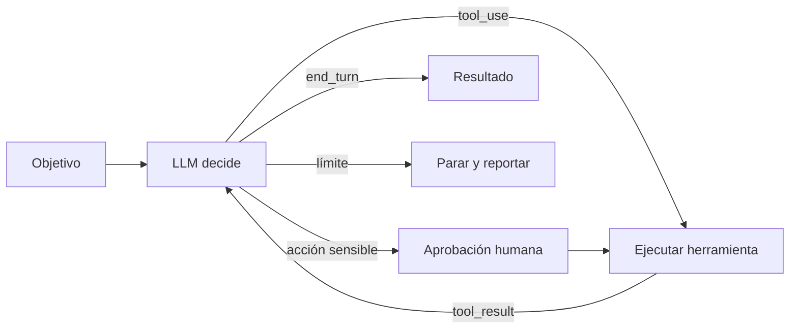

Un **agente autónomo** recibe un objetivo, unas herramientas y unos límites, y decide por sí mismo qué hacer en cada paso. Ejecuta una herramienta, lee el resultado, decide el siguiente paso y repite hasta terminar. Según *Building effective agents* ([Anthropic, 2024](https://www.anthropic.com/engineering/building-effective-agents)), suele ser poco más que **un LLM usando herramientas en bucle según el *feedback* del entorno**. Lo difícil está en diseñar bien las herramientas, los límites y las salvaguardas.

## Qué es

El artículo describe el ciclo de vida así:

1. Empieza con una orden o una conversación con una persona que aclara la tarea.
2. El agente planifica y opera de forma independiente.
3. En cada paso obtiene **información real del entorno** (resultados de herramientas, salida de código, tests) para evaluar su progreso.
4. Puede **pausar para pedir *feedback* humano** en puntos de control o cuando se bloquea.
5. Termina al completar la tarea o al alcanzar una **condición de parada**, como un máximo de iteraciones.



Es el [[glosario/bucle-agentico|bucle agéntico]] que construyes paso a paso en [[roadmap/40-primer-agente/02-el-bucle-agentico]]. La idea de alternar razonamiento y acción viene de [[glosario/react|ReAct]] ([Yao et al., 2022](https://arxiv.org/abs/2210.03629)).

## Cuándo usarlo

- **Problemas abiertos**: no puedes prever cuántos pasos harán falta ni cuáles. Depurar un fallo, investigar una pregunta, resolver una incidencia que toca varios sistemas.
- **Hay *feedback* verificable**: los tests pasan o no, la consulta devuelve filas o error, la página carga o no. Sin esa señal el agente avanza a ciegas.
- **Confías en el modelo para decidir en ese dominio**, porque lo has medido con [[glosario/evals|evals]] y [[glosario/trayectoria|trayectorias]] reales.

El artículo destaca dos dominios donde los agentes ya aportan: [[sistemas/agente-de-codigo|agentes de código]], porque las soluciones se verifican con tests, y [[sistemas/soporte-con-aprobacion-humana|soporte al cliente]], porque combina conversación con acciones concretas y criterios de éxito claros.

## Cuándo no

- Si puedes escribir el flujo, escríbelo: un [[patrones/03-encadenado|encadenado]] o un [[patrones/04-enrutado|enrutado]] será más barato, más rápido y más fácil de depurar.
- Si los errores son caros y no hay forma de deshacerlos, la autonomía multiplica el riesgo. La autonomía implica más coste y errores que se acumulan entre pasos.
- Si no puedes ejecutarlo en un entorno aislado. El artículo recomienda probar extensamente en *sandbox* con [[glosario/guardrails|guardarraíles]] adecuados; lee [[glosario/sandbox]].

## Ejemplo concreto

Un agente de operaciones recibe «El informe diario de ventas no se generó hoy, averigua por qué». Tiene tres herramientas de lectura: `leer_log`, `estado_tarea` y `consultar_bd`, y una de escritura, `relanzar_tarea`, que requiere aprobación. Lee el log, ve un error de conexión, comprueba el estado de la base de datos, encuentra que una migración bloqueó la tabla durante la ventana del informe, y propone relanzar la tarea. Una persona aprueba. El agente relanza, verifica que el informe existe y resume la causa. Nadie le dijo esa secuencia: la construyó leyendo resultados.

## Esqueleto de código

El bucle maneja todos los `stop_reason`, devuelve un `tool_result` por cada `tool_use` en un único mensaje y separa herramientas que necesitan aprobación.

```python title="agente.py"
import anthropic

MODEL = "claude-sonnet-5-5"
client = anthropic.Anthropic()

HERRAMIENTAS = [...]                         # definiciones con input_schema
REQUIEREN_APROBACION = {"relanzar_tarea"}    # acciones con efectos

def ejecutar(nombre: str, args: dict) -> str:
    ...                                      # tu implementación; lanza excepción si falla

def aprobar(nombre: str, args: dict) -> bool:
    respuesta = input(f"¿Ejecutar {nombre} con {args}? [s/N] ")
    return respuesta.strip().lower() == "s"

def agente(objetivo: str, max_pasos: int = 20) -> str:
    system = ("Eres un agente de operaciones. Investiga con las herramientas antes de concluir. "
              "Explica tu plan antes de actuar. Si no puedes avanzar, dilo y para.")
    mensajes = [{"role": "user", "content": objetivo}]
    for paso in range(max_pasos):
        resp = client.messages.create(model=MODEL, max_tokens=4096, system=system,
                                      tools=HERRAMIENTAS, messages=mensajes)
        mensajes.append({"role": "assistant", "content": resp.content})

        if resp.stop_reason == "end_turn":
            return "".join(b.text for b in resp.content if b.type == "text")
        if resp.stop_reason == "pause_turn":
            continue                         # el servidor pausó un turno largo: reenvía para seguir
        if resp.stop_reason == "max_tokens":
            # un tool_use cortado no se puede ejecutar ni responder: para y sube el límite
            return "Respuesta truncada por max_tokens. Sube el límite o divide la tarea."
        if resp.stop_reason == "refusal":
            return "El modelo se negó a continuar con esta tarea."
        if resp.stop_reason != "tool_use":
            return f"Parada inesperada: {resp.stop_reason}"

        resultados = []
        for b in resp.content:
            if b.type != "tool_use":
                continue
            if b.name in REQUIEREN_APROBACION and not aprobar(b.name, b.input):
                contenido, error = "Una persona rechazó esta acción. Propón otra vía o para.", True
            else:
                try:
                    contenido, error = ejecutar(b.name, b.input), False
                except Exception as e:
                    contenido, error = f"Error al ejecutar {b.name}: {e}", True
            resultados.append({"type": "tool_result", "tool_use_id": b.id,
                               "content": contenido, "is_error": error})
        mensajes.append({"role": "user", "content": resultados})

    return f"Límite de {max_pasos} pasos alcanzado sin terminar. Revisa la traza."
```

Fíjate en tres decisiones. El rechazo humano vuelve al modelo como `tool_result` con `is_error`, así puede buscar otra vía. Los errores de herramienta tampoco rompen el bucle: el modelo los lee y se corrige. Y el límite de pasos devuelve control a una persona en lugar de seguir gastando. En [[roadmap/40-primer-agente/03-condiciones-de-parada]] añades presupuesto de tokens y tiempo.

> [!peligro] Herramientas con efectos irreversibles
> Borrar, pagar, enviar o desplegar exige aprobación humana o límites en el código de la herramienta, nunca solo una instrucción en el *prompt*. El texto que lee el agente puede contener [[glosario/inyeccion-de-prompt|inyección de prompt]]. Lo cubre [[recetas/aprobacion-humana-antes-de-actuar]].

## Los tres principios del artículo

1. **Simplicidad** en el diseño: pocas herramientas, un bucle legible.
2. **Transparencia**: que el agente muestre su plan y sus pasos; te permite depurar y al usuario confiar. Ver [[roadmap/40-primer-agente/04-planificar-antes-de-actuar]].
3. **Cuidar la interfaz agente-ordenador** (lo que el artículo llama ACI): documentar y probar las herramientas con el mismo cuidado que una interfaz para personas. El artículo recomienda diseñarlas para que sea difícil usarlas mal; por ejemplo, pedir rutas absolutas en lugar de relativas. Lo amplía [[disciplinas/diseno-de-herramientas]].

## Coste y latencia

Coste y latencia altos y, sobre todo, **variables**: cada paso es una llamada que reenvía todo el historial, que además crece. Dos ejecuciones de la misma tarea pueden costar muy distinto. Controla el gasto con `max_pasos`, `max_tokens`, [[glosario/prompt-caching|prompt caching]] del prefijo (herramientas y sistema) y [[glosario/compactacion|compactación]] en tareas largas. Registra cada traza para saber dónde se van los pasos: [[roadmap/100-produccion/01-observabilidad-y-trazas]].

## Patrones relacionados

- [[patrones/02-llamada-aumentada]]: el bloque que el agente repite en bucle.
- [[patrones/06-orquestador-trabajadores]]: un agente puede delegar en subagentes con contexto propio.
- [[patrones/07-evaluador-optimizador]]: los tests y comprobaciones del entorno hacen de evaluador.
- [[patrones/09-elegir-patron]]: para confirmar que necesitas este peldaño.
