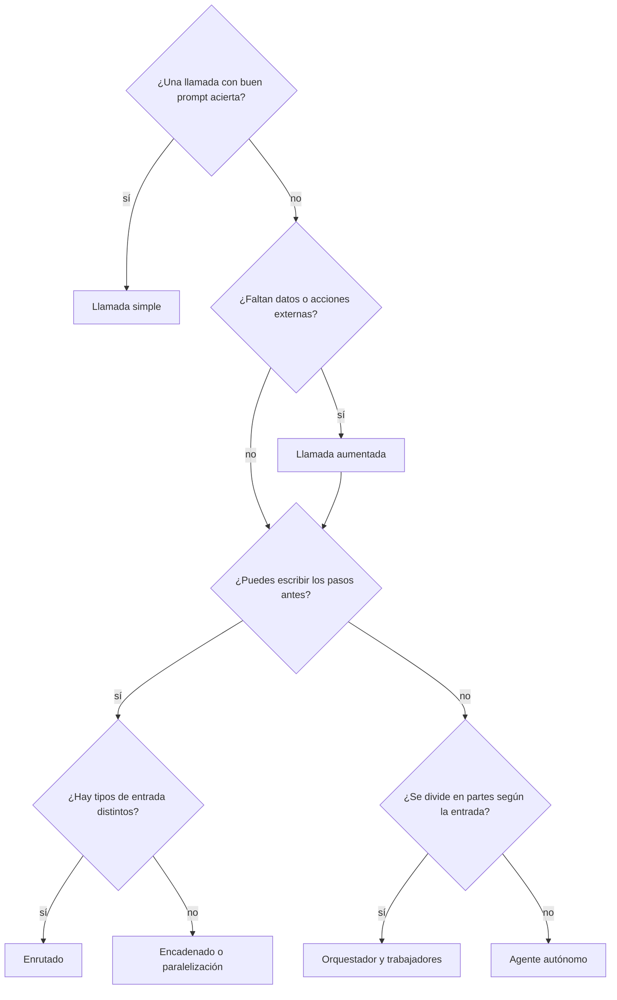

Esta página condensa la sección en una herramienta de decisión. La regla que la guía viene de *Building effective agents* ([Anthropic, 2024](https://www.anthropic.com/engineering/building-effective-agents)): **elige la solución más simple que funcione y añade complejidad solo cuando demuestre que mejora el resultado**. El árbol te lleva al patrón candidato; la tabla te dice qué pagas por él; las señales del final te dicen cuándo cambiar.

## Qué es

Un recorrido de preguntas en orden. Cada respuesta "no" te deja en un peldaño más bajo de la [[patrones/01-workflows-vs-agentes|escalera de complejidad]], que es donde quieres quedarte si puedes.



Dos preguntas transversales se aplican sobre cualquier hoja:

- **¿Hay un criterio claro de calidad y una crítica mejora el resultado?** Añade un bucle de [[patrones/07-evaluador-optimizador|evaluador-optimizador]] alrededor del paso que falla.
- **¿Hay aspectos independientes o necesitas más confianza?** Añade [[patrones/05-paralelizacion|paralelización]], por seccionado o por votación.
- **¿Casi todos los pasos son mecánicos y solo unos pocos piden un modelo grande?** Usa un [[patrones/13-ejecutor-y-asesor|ejecutor y asesor]].
- **¿El trabajo dura más que una ventana de contexto?** Mira los patrones de larga duración: [[patrones/10-inicializador-y-agente-de-trabajo]], [[patrones/11-planificador-generador-evaluador]] y [[patrones/12-bucle-ralph]].

## Tabla comparativa

| Patrón | Quién decide el flujo | Coste | Latencia | Úsalo para |
|---|---|---|---|---|
| [[patrones/02-llamada-aumentada]] | Tu código | Bajo | Baja | Responder con datos propios o una acción puntual |
| [[patrones/03-encadenado]] | Tu código, en serie | Medio | Media | Fases fijas con validación entre ellas |
| [[patrones/04-enrutado]] | Tu código, según una clasificación | Bajo | Media | Categorías que se atienden mejor por separado |
| [[patrones/05-paralelizacion]] | Tu código, en paralelo | Medio | Baja | Aspectos independientes o votación |
| [[patrones/06-orquestador-trabajadores]] | Un modelo planifica; tu código ejecuta | Alto | Media | Subtareas que dependen de la entrada |
| [[patrones/07-evaluador-optimizador]] | Tu código, en bucle con tope | Alto | Alta | Calidad con rúbrica clara |
| [[patrones/08-agente-autonomo]] | El modelo, en bucle | Alto y variable | Alta y variable | Problemas abiertos con *feedback* del entorno |
| [[patrones/10-inicializador-y-agente-de-trabajo]] | Agentes en sesiones, con estado en archivos | Muy alto | Horas | Tareas de muchas funcionalidades comprobables |
| [[patrones/11-planificador-generador-evaluador]] | Tres agentes con papeles separados | Muy alto | Horas | Construir algo que se pueda probar como un usuario |
| [[patrones/12-bucle-ralph]] | El mismo *prompt* en bucle, el plan en disco | Muy alto | Horas | Spec clara con verificador automático fuerte |
| [[patrones/13-ejecutor-y-asesor]] | Un modelo barato que consulta a uno capaz | Medio | Media | Tareas largas con pocas decisiones difíciles |

Coste y latencia son relativos entre patrones, para la misma tarea y el mismo modelo. Las cifras reales dependen de tus *prompts*, del modelo y del tamaño del contexto: mídelas con [[roadmap/00-fundamentos/05-coste-y-latencia]].

## Cuándo usarlo

- Al **diseñar desde cero**: recorre el árbol con tres o cuatro entradas reales delante, no con la idea general del producto.
- Cuando **un sistema falla**: identifica el tipo de fallo antes de añadir piezas. La tabla de señales de abajo te ayuda.
- Para **explicar una decisión** al equipo: la tabla da un vocabulario común para justificar por qué no hace falta un agente.

## Cuándo no

El árbol es una heurística. Si ya tienes un [[glosario/conjunto-de-evaluacion|conjunto de evaluación]] y puedes probar dos diseños, la medición manda. Tampoco lo uses para elegir un único patrón para todo el producto: lo normal es combinar varios, cada uno donde encaja.

## Ejemplo concreto

Un asistente para un despacho de abogados que responde consultas sobre contratos de clientes.

1. ¿Una llamada basta? No: el modelo no conoce los contratos.
2. ¿Faltan datos? Sí: llamada aumentada con recuperación sobre los contratos. Se convierte en [[sistemas/rag-con-citas]].
3. ¿Pasos fijos? Sí para las consultas sobre una cláusula: recuperar, responder, verificar citas. Eso es un encadenado.
4. ¿Tipos distintos? Sí: "consulta de cláusula" frente a "comparar varios contratos". Enrutado delante.
5. La ruta "comparar varios contratos" se divide según cuántos contratos se mencionen: orquestador y trabajadores.

Resultado: enrutado → (encadenado | orquestador-trabajadores), todo sobre llamadas aumentadas. Ningún agente autónomo, porque ningún flujo requiere decidir pasos imprevisibles.

## Señales para cambiar de patrón

| Lo que ves en las trazas | Qué probar |
|---|---|
| Un único *prompt* cumple unas reglas y olvida otras | Divide la tarea en pasos: [[patrones/03-encadenado]] |
| Un arreglo para un tipo de caso estropea otro | Separa los casos: [[patrones/04-enrutado]] |
| Tu cadena tiene ramas `if` que crecen sin parar | Plantéate un orquestador o un agente: [[patrones/06-orquestador-trabajadores]] |
| El resultado es aceptable pero mejora cuando lo criticas a mano | Añade un bucle de crítica: [[patrones/07-evaluador-optimizador]] |
| El agente repite siempre la misma secuencia de herramientas | Bájalo a workflow: ya conoces los pasos |
| El agente gasta muchos pasos en lo mismo | Mejora las herramientas antes que el *prompt*: [[disciplinas/diseno-de-herramientas]] |

> [!consejo] Baja de peldaño tan a gusto como subes
> Si las trazas de tu agente muestran que siempre hace lo mismo, conviértelo en workflow. Ahorrarás coste y latencia y ganarás previsibilidad; confirma con tus evals que la calidad se mantiene. Aprende a leerlas en [[roadmap/40-primer-agente/06-depurar-con-trazas]].

## Esqueleto de código

No hay un esqueleto propio: cada patrón tiene el suyo en su página, con el SDK y, del 3 al 8, también con LangGraph. Elegir patrón y elegir framework son decisiones distintas: cualquier patrón se escribe con el SDK a mano, y un framework solo compensa cuando te ahorra fontanería que de verdad necesitas (persistencia, pausas largas, paralelismo); lo discute [[docs/frameworks/01-elegir-framework]]. Lo que sí conviene es un **arnés común** para comparar diseños con los mismos casos. Así la decisión sale de datos.

```python title="comparar_disenos.py"
import time

def comparar(disenos: dict, casos: list[dict], evaluar) -> None:
    """disenos: {"encadenado": funcion, "agente": funcion}; casos: [{"entrada", "esperado"}]"""
    for nombre, sistema in disenos.items():
        aciertos, tiempos = 0, []
        for caso in casos:
            inicio = time.perf_counter()
            salida = sistema(caso["entrada"])
            tiempos.append(time.perf_counter() - inicio)
            aciertos += evaluar(salida, caso["esperado"])
        tiempos.sort()
        print(f"{nombre}: {aciertos}/{len(casos)} aciertos · "
              f"mediana {tiempos[len(tiempos) // 2]:.1f} s")
```

Añade el coste sumando `resp.usage` en cada sistema. Tienes evaluadores listos en [[roadmap/80-evals/03-codigo-o-modelo-juez]].

## Patrones relacionados

- [[patrones/01-workflows-vs-agentes]]: las definiciones que usa el árbol.
- [[patrones/02-llamada-aumentada]]: el punto de partida de casi cualquier rama.
- [[patrones/08-agente-autonomo]]: la hoja a la que conviene llegar solo cuando las demás no sirven.
- [[sistemas/index]]: sistemas completos donde verás estas combinaciones aplicadas.
- [[sistemas/agente-de-larga-duracion]]: los patrones de larga duración montados en un sistema.
