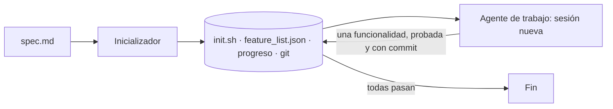

Un agente que trabaja horas sobre un repositorio choca con un límite sencillo: cada sesión empieza con la [[glosario/ventana-de-contexto|ventana de contexto]] vacía y no recuerda la anterior. El patrón **inicializador y agente de trabajo** resuelve eso sacando la memoria del modelo y poniéndola en archivos y en git. Lo describe Justin Young en [*Effective harnesses for long-running agents*](https://www.anthropic.com/engineering/effective-harnesses-for-long-running-agents) (Anthropic, 26 de noviembre de 2025).

Los patrones 10 a 13 de este catálogo amplían los de *Building effective agents* ([Anthropic, 2024](https://www.anthropic.com/engineering/building-effective-agents)), que cubre los workflows y el [[patrones/08-agente-autonomo|agente autónomo]] dentro de una sola ventana. Estos cuatro tratan lo que pasa cuando el trabajo dura más que una ventana o cuando conviene repartirlo entre modelos.

## Qué es



Hay dos papeles, y en el artículo los dos comparten el mismo *prompt* de sistema, las mismas herramientas y el mismo [[glosario/harness|harness]]. Solo cambia el primer mensaje.

- **El inicializador** trabaja una vez. Lee la especificación y deja el entorno preparado: un `init.sh` que arranca el servidor de desarrollo y hace una prueba básica, un archivo de progreso (`claude-progress.txt`), un primer commit y una **lista de funcionalidades en JSON**. Cada entrada tiene `category`, `description`, `steps` (acciones y comprobaciones de un usuario) y `passes`, que empieza en `false`. En el ejemplo del artículo, un clon de claude.ai, la lista pasaba de 200 entradas.
- **El agente de trabajo** arranca en cada sesión siguiente con el mismo guion: `pwd`, leer git log y el progreso, elegir la funcionalidad pendiente de más prioridad, ejecutar `init.sh` y una prueba de extremo a extremo, implementar **una sola** funcionalidad, probarla, hacer commit y anotar el progreso. Debe dejar el repositorio en «estado limpio»: código que se podría fusionar sin arreglos.

Dos reglas sostienen el patrón. El agente **solo puede cambiar `passes`**; el *prompt* del artículo dice que borrar o editar pruebas es inaceptable porque dejaría funcionalidad sin construir o con errores. Y la lista va en **JSON** porque el modelo tiende menos a reescribir un JSON que un Markdown.

La prueba de extremo a extremo importa más de lo que parece. El artículo cuenta que el agente verificaba mal hasta que se le pidió probar con automatización de navegador (el servidor MCP de Puppeteer), como lo haría un usuario. Los tests unitarios o un `curl` dejaban pasar fallos visibles.

## Cuándo usarlo

El artículo enumera cuatro fallos de los agentes largos y la pieza que corrige cada uno:

| Fallo | Qué lo evita |
|---|---|
| Da el proyecto por terminado antes de tiempo | La lista de funcionalidades, todas en `false` al principio |
| Deja errores o progreso sin documentar | Git, el archivo de progreso y la prueba al empezar cada sesión |
| Marca como hecho algo que no ha probado | La regla de marcar `passes` solo tras probar de extremo a extremo |
| Pierde tiempo averiguando cómo arrancar la app | `init.sh` |

Úsalo cuando reconozcas esos fallos: una aplicación que se construye en decenas de sesiones, una migración larga, cualquier trabajo que se pueda trocear en comportamientos verificables.

## Cuándo no

- **La tarea cabe en una ventana.** El protocolo de arranque de cada sesión cuesta tokens y tiempo. Para un cambio de una tarde basta un [[patrones/08-agente-autonomo|agente]] con buenos límites.
- **No puedes comprobar cada funcionalidad.** Si `passes` depende solo de que el agente diga que funciona, la lista se llena de `true` falsos.
- **Las funcionalidades no son independientes.** Si cada una obliga a rediseñar las anteriores, una por sesión genera retrabajo. Ahí ayuda más un [[patrones/11-planificador-generador-evaluador|planificador]] que piense el conjunto.

## Ejemplo concreto

Una aplicación de reservas de salas descrita en dos páginas de `spec.md`. El inicializador escribe 48 funcionalidades: «crear una reserva desde el calendario», «impedir dos reservas solapadas», «cancelar y liberar la sala»… La sesión 12 lee en el progreso que la anterior terminó «cancelar reserva». Ejecuta `init.sh` y la prueba básica, y descubre que el formulario de alta ya no guarda: la sesión 11 rompió una validación. La arregla primero, hace commit y solo entonces empieza «impedir reservas solapadas». Sin la prueba al inicio, ese error se habría enterrado bajo tres funcionalidades nuevas.

## Esqueleto de código

El bucle de sesiones con el SDK. En el artículo el agente marca `passes` y el *prompt* le prohíbe tocar lo demás; aquí, además, **el harness lo comprueba en código** tras cada sesión y restaura la lista si se ha editado algo más. Las entradas llevan un `id` para poder comparar versiones.

```python title="harness_largo.py"
import json
import subprocess
from pathlib import Path

import anthropic

MODEL = "claude-sonnet-5-5"
REPO = Path("app")                       # el repositorio de trabajo, dentro de un contenedor
LISTA = REPO / "feature_list.json"
client = anthropic.Anthropic()

SISTEMA = """Trabajas en una aplicación web a lo largo de muchas sesiones y no recuerdas las anteriores.
Lo que se sabe está en git, en claude-progress.txt y en feature_list.json.
- En feature_list.json solo puedes cambiar "passes" de false a true. Es inaceptable borrar o editar
  funcionalidades: dejaría funcionalidad sin construir o con errores.
- Marca una funcionalidad como hecha solo después de probarla de extremo a extremo, como un usuario.
- Termina cada sesión con el repositorio limpio: código que se podría fusionar sin arreglos."""

INICIALIZADOR = """Primera sesión. Lee spec.md y prepara el entorno, sin implementar funcionalidades:
1. Escribe init.sh: instala dependencias, arranca el servidor de desarrollo y hace una prueba básica.
2. Escribe feature_list.json: una lista con una entrada por comportamiento verificable, con
   "id", "category", "description", "steps" (acciones y comprobaciones de usuario) y "passes": false.
3. Crea claude-progress.txt y haz el commit inicial."""

TRABAJO = """Nueva sesión de trabajo. En este orden:
1. pwd; git log --oneline -20; lee claude-progress.txt.
2. Lee feature_list.json y elige la funcionalidad pendiente de más prioridad.
3. Ejecuta ./init.sh y una prueba básica de extremo a extremo. Si algo está roto, arréglalo primero.
4. Implementa SOLO esa funcionalidad y pruébala como un usuario.
5. Si pasa: pon su "passes" a true, haz commit y anota en claude-progress.txt qué hiciste y qué queda."""

HERRAMIENTAS = [{
    "name": "bash",
    "description": "Ejecuta un comando de shell en la raíz del repositorio. Devuelve el código de "
                   "salida, stdout y stderr (recortados). Tiempo máximo: 5 minutos.",
    "input_schema": {"type": "object", "properties": {"comando": {"type": "string"}},
                     "required": ["comando"], "additionalProperties": False},
}]


def bash(comando: str) -> tuple[str, bool]:
    try:
        r = subprocess.run(comando, shell=True, cwd=REPO, capture_output=True, text=True, timeout=300)
    except subprocess.TimeoutExpired:
        return "Tiempo agotado (5 min).", True
    return f"exit={r.returncode}\n{r.stdout[-8000:]}\n{r.stderr[-4000:]}", r.returncode != 0


def sesion(primer_mensaje: str, max_pasos: int = 80) -> str:
    """Una sesión es una ventana de contexto nueva: mismo sistema y herramientas, otro primer mensaje."""
    mensajes = [{"role": "user", "content": primer_mensaje}]
    for _ in range(max_pasos):
        resp = client.messages.create(model=MODEL, max_tokens=16000, system=SISTEMA,
                                      tools=HERRAMIENTAS, messages=mensajes)
        mensajes.append({"role": "assistant", "content": resp.content})
        if resp.stop_reason != "tool_use":
            return resp.stop_reason      # end_turn, max_tokens, refusal, model_context_window_exceeded…
        resultados = []
        for b in resp.content:
            if b.type == "tool_use":
                salida, error = bash(b.input["comando"])
                resultados.append({"type": "tool_result", "tool_use_id": b.id,
                                   "content": salida, "is_error": error})
        mensajes.append({"role": "user", "content": resultados})
    return "max_pasos"


def leer_lista() -> list[dict]:
    return json.loads(LISTA.read_text(encoding="utf-8"))


def cambios_prohibidos(antes: list[dict], despues: list[dict]) -> list[str]:
    """La única edición válida de la lista: passes de false a true."""
    a, d = {f["id"]: f for f in antes}, {f["id"]: f for f in despues}
    errores = [f"ids añadidos o borrados: {sorted(a.keys() ^ d.keys())}"] if a.keys() != d.keys() else []
    for i in a.keys() & d.keys():
        sin_passes = lambda f: {k: v for k, v in f.items() if k != "passes"}
        if sin_passes(a[i]) != sin_passes(d[i]):
            errores.append(f"{i}: cambió la descripción o los pasos")
        if a[i]["passes"] and not d[i]["passes"]:
            errores.append(f"{i}: pasó de true a false")
    return errores


def ejecutar(max_sesiones: int = 50) -> None:
    if not LISTA.exists():
        print("inicializador:", sesion(INICIALIZADOR))
    for n in range(1, max_sesiones + 1):
        antes = leer_lista()
        pendientes = [f["id"] for f in antes if not f["passes"]]
        if not pendientes:
            print("Todas las funcionalidades pasan.")
            return
        motivo = sesion(TRABAJO)
        try:
            errores = cambios_prohibidos(antes, leer_lista())
        except (json.JSONDecodeError, KeyError) as e:
            errores = [f"feature_list.json ilegible: {e}"]
        if errores:                      # el harness restaura la lista: la regla no depende del modelo
            LISTA.write_text(json.dumps(antes, ensure_ascii=False, indent=2), encoding="utf-8")
            bash("git commit -am 'harness: restaura feature_list.json'")
        hechas = sum(f["passes"] for f in leer_lista())
        print(f"sesión {n}: {motivo} · {hechas}/{len(antes)} pasan · {errores or 'lista válida'}")
        if motivo == "refusal":
            return
    print("Límite de sesiones alcanzado.")


if __name__ == "__main__":
    ejecutar()
```

Probado con el simulador de la API sobre un repositorio git temporal. En la segunda sesión simulada el «agente» cambió la descripción de una funcionalidad y la marcó como hecha, y el harness la restauró antes de la siguiente.

```text
inicializador: end_turn
sesión 1: end_turn · 1/2 pasan · lista válida
sesión 2: end_turn · 1/2 pasan · ['F2: cambió la descripción o los pasos']
sesión 3: end_turn · 2/2 pasan · lista válida
Todas las funcionalidades pasan.
```

En producción el agente de trabajo suele ser Claude Code en modo *headless* o el [[herramientas/claude-agent-sdk|Claude Agent SDK]], que ya traen lectura, edición y bash. Lo que no cambia es la lógica de fuera: lista, comprobación y bucle de sesiones. Lo desarrolla [[sistemas/agente-de-larga-duracion]].

> [!consejo] Que `stop_reason` termine la sesión, no el trabajo
> Si una sesión acaba por `max_tokens` o `model_context_window_exceeded`, no pasa nada grave: lo hecho está en git y la siguiente sesión arranca de ahí. Por eso el patrón aguanta ventanas que se llenan. Un `refusal` sí debe parar el bucle y avisar a una persona.

## Coste y latencia

Caro y lento por diseño: cada sesión relee git, el progreso y la lista, arranca la aplicación y repite una prueba de extremo a extremo antes de escribir una línea. A cambio, una sesión que falla cuesta una sesión y no el proyecto. Controla el gasto con un número máximo de sesiones, un presupuesto por sesión y un *prompt* de sistema estable que aproveche el [[glosario/prompt-caching|prompt caching]]. Registra en cada sesión tokens, tiempo y funcionalidades cerradas: es la métrica que te dice si el harness compensa.

## En el harness del autor

El [[sistemas/harness-sdd-claude-code|harness SDD del autor]] aplica las mismas ideas con más estructura. Su `feature_list.json` es el catálogo de funcionalidades con prioridad y estado, y solo lo escribe una herramienta (`feature.py`), nunca el modelo. El estado de cada funcionalidad vive en disco y cambia solo por transiciones de una [[cursos/harness-engineering/06-el-flujo-como-maquina-de-estados|máquina de estados]]. La skill `feature-resume` hace el papel del arranque de sesión: antes de lanzar ningún agente reconcilia estado, eventos, bloqueo y artefactos. Y `new-session` escribe un traspaso con lo que no está en disco cuando el contexto se agota. Lo cuenta [[cursos/harness-engineering/11-sesiones-largas]].

## Patrones relacionados

- [[patrones/11-planificador-generador-evaluador]]: la evolución, con un planificador y un evaluador separado.
- [[patrones/12-bucle-ralph]]: la versión mínima, un solo *prompt* en bucle.
- [[patrones/08-agente-autonomo]]: lo que ocurre dentro de cada sesión.
- [[sistemas/agente-de-larga-duracion]]: el sistema completo, con contenedor, evaluador y trazas.
