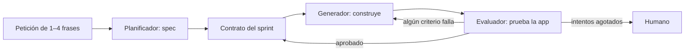

El patrón **planificador, generador y evaluador** reparte un trabajo de horas entre tres agentes con papeles que no se mezclan: uno decide qué construir, otro lo construye y un tercero lo prueba sin fiarse del segundo. Es el diseño que describe Prithvi Rajasekaran en [*Harness design for long-running application development*](https://www.anthropic.com/engineering/harness-design-long-running-apps) (Anthropic, 24 de marzo de 2026), como evolución del [[patrones/10-inicializador-y-agente-de-trabajo|inicializador y agente de trabajo]]. Igual que los patrones 10, 12 y 13, amplía el catálogo de *Building effective agents* ([Anthropic, 2024](https://www.anthropic.com/engineering/building-effective-agents)).

Se parece al [[patrones/07-evaluador-optimizador|evaluador-optimizador]], pero a otra escala: cada vuelta del bucle es una sesión de agente con herramientas, no una llamada, y el evaluador no lee un texto, prueba una aplicación en marcha.

## Qué es



- **Planificador.** Convierte una petición breve en una especificación de producto. El artículo le pide ambición en el alcance y que no baje a detalles técnicos finos, porque un error en la spec se arrastra a todo lo que viene después.
- **Generador.** Construye por *sprints*, una funcionalidad cada vez, con git. Se autoevalúa al terminar el sprint antes de pasar a QA.
- **Evaluador.** Usa el servidor MCP de Playwright para recorrer la aplicación como un usuario: interfaz, endpoints y estado de la base de datos. Puntúa cada criterio, cada uno con un umbral, y el sprint suspende si cualquiera queda por debajo.

Antes de cada sprint, generador y evaluador firman un **contrato de sprint**: el generador propone qué va a construir y cómo se comprobará, el evaluador lo revisa y repiten hasta ponerse de acuerdo. Se comunican **por archivos**: uno escribe y el otro responde en ese archivo o en otro.

### Por qué un evaluador aparte

El artículo cuenta que, de serie, el modelo era mal QA: encontraba problemas reales y luego se convencía de aprobar, y probaba por encima. El autor leyó los registros del evaluador, buscó dónde su juicio se separaba del suyo y ajustó el *prompt* en varias rondas. Su conclusión: **es mucho más manejable afinar un evaluador independiente para que sea escéptico** que conseguir que el generador critique su propio trabajo.

Cognition llega a algo parecido en [*Multi-Agents: What's Actually Working*](https://cognition.com/blog/multi-agents-working) (Walden Yan, 22 de abril de 2026): su revisor funciona mejor cuando **no comparte contexto previo** con el agente que escribe. Lee el diff sin el historial acumulado, razona desde el código y puede cuestionar decisiones que el autor dio por buenas.

### Context reset o compactación

Con horas de trabajo, la ventana se llena. Hay dos salidas:

- **Context reset**: se cierra la sesión y arranca otra vacía con un traspaso estructurado (spec, contrato, progreso, *feedback*). Pierde continuidad, gana una pizarra limpia.
- **[[glosario/compactacion|Compactación]]**: se resume el historial dentro de la misma sesión. Conserva el hilo, pero arrastra lo acumulado.

El artículo vio en Sonnet 4.5 una «ansiedad de contexto»: cerraba el trabajo antes de tiempo al acercarse al límite que percibía, y la compactación no bastaba. Los *resets* eran necesarios. Con Opus 4.5 ese comportamiento casi desapareció y pasaron a una sesión continua con compactación automática. Con Opus 4.6 quitaron también los sprints y el evaluador pasó a una sola pasada final; el planificador se quedó, porque sin él el generador se quedaba corto de alcance.

La lección del artículo sirve para cualquier harness: **cada pieza codifica una suposición sobre lo que el modelo no sabe hacer solo**, y esas suposiciones caducan cuando el modelo mejora. Vuelve a medir cada vez que cambies de modelo.

## Cuándo usarlo

El artículo lo resume así: el evaluador compensa **cuando la tarea está más allá de lo que el modelo actual hace bien en solitario**. Encaja con aplicaciones completas a partir de una idea, productos donde la calidad tiene criterios explícitos (diseño, funcionalidad, profundidad) y cualquier trabajo cuyo resultado se pueda probar desde fuera.

## Cuándo no

- **El modelo ya lo hace bien solo.** El artículo dice que, dentro de ese rango, el evaluador solo añade gasto. Compruébalo antes con unas cuantas ejecuciones en solitario.
- **No hay nada que probar desde fuera.** Si el evaluador solo puede leer código, comparte los puntos ciegos del generador. Dale herramientas reales: navegador, tests, base de datos.
- **No puedes escribir los criterios.** Sin criterios comprobables el contrato es un acuerdo vacío.

## Ejemplo concreto

«Una web para reservar pistas de pádel con pago y lista de espera.» El planificador produce una spec con ocho funcionalidades. Sprint 3, «lista de espera»: el generador propone criterios («al cancelar una reserva, el primero de la lista recibe la pista»); el evaluador exige añadir «si nadie confirma en 15 minutos, pasa al siguiente», porque sin él no puede comprobar el caso límite. Firmado el contrato, el generador construye. El evaluador abre dos sesiones de navegador, reserva, cancela, espera y encuentra que la pista se queda bloqueada. Suspende el sprint con esa evidencia y el generador, en una sesión nueva, recibe solo el contrato, el progreso y el fallo.

## Esqueleto de código

Las tres piezas con el SDK. Cada `agente()` arranca con la ventana vacía (el *reset*), el contrato y el veredicto son JSON con [[glosario/salida-estructurada|salida estructurada]] y **el umbral lo aplica tu código**: aprueba solo si todos los criterios del contrato aparecen y se cumplen. Para que el evaluador no «arregle» lo que prueba, el harness descarta cualquier cambio que deje en el repositorio. En el artículo el evaluador usa Playwright MCP; aquí lo sustituye un `bash` desde el que lanzas tus pruebas de extremo a extremo.

```python tab="Python" title="pge.py"
import json
import subprocess
from pathlib import Path

import anthropic

MODEL = "claude-sonnet-5-5"
REPO = Path("app")
SPRINTS = Path("sprints")                # contratos fuera del repo: se comunican por archivo
client = anthropic.Anthropic()

SPEC = {"type": "object", "additionalProperties": False, "required": ["resumen", "funcionalidades"],
        "properties": {"resumen": {"type": "string"},
                       "funcionalidades": {"type": "array", "items": {"type": "string"}}}}
CONTRATO = {"type": "object", "additionalProperties": False, "required": ["alcance", "criterios"],
            "properties": {"alcance": {"type": "string"},
                           "criterios": {"type": "array", "items": {"type": "string"}}}}
REVISION = {"type": "object", "additionalProperties": False, "required": ["acepta", "cambios"],
            "properties": {"acepta": {"type": "boolean"}, "cambios": {"type": "string"}}}
VEREDICTO = {"type": "object", "additionalProperties": False, "required": ["criterios"],
             "properties": {"criterios": {"type": "array", "items": {
                 "type": "object", "additionalProperties": False,
                 "required": ["criterio", "cumple", "evidencia"],
                 "properties": {"criterio": {"type": "string"}, "cumple": {"type": "boolean"},
                                "evidencia": {"type": "string"}}}}}}

PLANIFICADOR = ("Conviertes una petición breve en una especificación de producto. Sé ambicioso en el "
                "alcance y no fijes detalles técnicos finos: un error aquí se arrastra a todo lo demás.")
GENERADOR = ("Construyes la aplicación de app/ funcionalidad a funcionalidad. Al acabar cada sprint, "
             "pruébalo tú, haz commit y resume en progreso.md qué hiciste.")
EVALUADOR = ("Eres QA escéptico. Pruebas la aplicación en marcha como un usuario, contra el contrato. "
             "No modificas código. Un criterio solo se cumple si lo has comprobado tú; si dudas, no se cumple.")
BASH = [{"name": "bash", "description": "Ejecuta un comando de shell en app/ (máx. 5 min).",
         "input_schema": {"type": "object", "properties": {"comando": {"type": "string"}},
                          "required": ["comando"], "additionalProperties": False}}]


def bash(comando: str) -> tuple[str, bool]:
    try:
        r = subprocess.run(comando, shell=True, cwd=REPO, capture_output=True, text=True, timeout=300)
    except subprocess.TimeoutExpired:
        return "Tiempo agotado.", True
    return f"exit={r.returncode}\n{r.stdout[-6000:]}\n{r.stderr[-3000:]}", r.returncode != 0


def json_llamada(system: str, prompt: str, esquema: dict) -> dict:
    resp = client.messages.create(model=MODEL, max_tokens=8000, system=system,
                                  messages=[{"role": "user", "content": prompt}],
                                  output_config={"format": {"type": "json_schema", "schema": esquema}})
    if resp.stop_reason != "end_turn":
        raise RuntimeError(f"Sin JSON completo: {resp.stop_reason}")
    return json.loads(next(b.text for b in resp.content if b.type == "text"))


def agente(system: str, prompt: str, max_pasos: int = 60) -> str:
    """Sesión nueva con bash: cada llamada empieza con la ventana vacía (context reset)."""
    mensajes = [{"role": "user", "content": prompt}]
    for _ in range(max_pasos):
        resp = client.messages.create(model=MODEL, max_tokens=16000, system=system,
                                      tools=BASH, messages=mensajes)
        mensajes.append({"role": "assistant", "content": resp.content})
        if resp.stop_reason != "tool_use":
            return "".join(b.text for b in resp.content if b.type == "text")
        resultados = []
        for b in resp.content:
            if b.type == "tool_use":
                salida, error = bash(b.input["comando"])
                resultados.append({"type": "tool_result", "tool_use_id": b.id,
                                   "content": salida, "is_error": error})
        mensajes.append({"role": "user", "content": resultados})
    return "Límite de pasos."


def contratar(spec: dict, funcionalidad: str, n: int, max_rondas: int = 3) -> dict:
    """Generador y evaluador acuerdan qué se construye y cómo se comprueba, por archivo."""
    base = f"<spec>{json.dumps(spec, ensure_ascii=False)}</spec>\nSprint {n}: {funcionalidad}"
    contrato = json_llamada(GENERADOR, base + "\nPropón el alcance y criterios comprobables desde fuera.", CONTRATO)
    for _ in range(max_rondas):
        rev = json_llamada(EVALUADOR, f"{base}\n<contrato>{json.dumps(contrato, ensure_ascii=False)}</contrato>\n"
                           "¿Cada criterio se puede comprobar usando la app? Si no, pide cambios.", REVISION)
        if rev["acepta"]:
            break
        contrato = json_llamada(GENERADOR, f"{base}\nRehaz el contrato con estos cambios: {rev['cambios']}", CONTRATO)
    SPRINTS.mkdir(exist_ok=True)
    (SPRINTS / f"contrato-{n}.json").write_text(json.dumps(contrato, ensure_ascii=False, indent=2))
    return contrato


def evaluar(contrato: dict) -> tuple[bool, str]:
    hallazgos = agente(EVALUADOR, f"<contrato>{json.dumps(contrato, ensure_ascii=False)}</contrato>\n"
                       "Arranca la app con ./init.sh y comprueba cada criterio. Anota la evidencia.")
    git = subprocess.run(["git", "status", "--porcelain"], cwd=REPO, capture_output=True, text=True)
    if git.stdout.strip():               # el evaluador no escribe código: se descarta lo que tocó
        subprocess.run(["git", "stash", "-u"], cwd=REPO)
    v = json_llamada(EVALUADOR, f"<contrato>{json.dumps(contrato, ensure_ascii=False)}</contrato>\n"
                     f"<hallazgos>{hallazgos}</hallazgos>\nEmite un veredicto por criterio.", VEREDICTO)
    vistos = {c["criterio"] for c in v["criterios"]}
    fallos = [c for c in v["criterios"] if not c["cumple"]]
    aprobado = not fallos and vistos == set(contrato["criterios"])   # el umbral lo decide tu código
    return aprobado, "\n".join(f"- {c['criterio']}: {c['evidencia']}" for c in fallos)


def ejecutar(peticion: str, max_intentos: int = 3) -> dict:
    spec = json_llamada(PLANIFICADOR, peticion, SPEC)
    for n, funcionalidad in enumerate(spec["funcionalidades"], 1):
        contrato = contratar(spec, funcionalidad, n)
        feedback = ""
        for _ in range(max_intentos):
            agente(GENERADOR, f"Lee progreso.md y git log.\n<contrato>{json.dumps(contrato, ensure_ascii=False)}"
                   f"</contrato>\n<feedback_qa>{feedback}</feedback_qa>\nConstruye este sprint.")
            aprobado, feedback = evaluar(contrato)
            if aprobado:
                break
        else:
            return {"estado": "bloqueado", "sprint": n, "fallos": feedback}
    return {"estado": "terminado", "sprints": len(spec["funcionalidades"])}
```
```python tab="LangGraph" title="pge_langgraph.py"
import sqlite3
import subprocess
from typing import TypedDict

from langchain.agents import create_agent
from langchain_anthropic import ChatAnthropic
from langchain_core.tools import tool
from langgraph.checkpoint.sqlite import SqliteSaver
from langgraph.graph import END, START, StateGraph
from pydantic import BaseModel

MODEL = "claude-sonnet-5-5"
modelo = ChatAnthropic(model=MODEL, max_tokens=16000)


class Spec(BaseModel):
    resumen: str
    funcionalidades: list[str]


class Contrato(BaseModel):
    alcance: str
    criterios: list[str]


class Criterio(BaseModel):
    criterio: str
    cumple: bool
    evidencia: str


class Veredicto(BaseModel):
    criterios: list[Criterio]


class Estado(TypedDict, total=False):
    peticion: str
    spec: dict
    sprint: int
    contrato: dict
    intentos: int
    feedback: str
    aprobado: bool


@tool
def bash(comando: str) -> str:
    """Ejecuta un comando de shell en app/ (máx. 5 min) y devuelve código de salida y salida."""
    try:                          # una excepción en la herramienta rompería el agente
        r = subprocess.run(comando, shell=True, cwd="app", capture_output=True, text=True, timeout=300)
    except subprocess.TimeoutExpired:
        return "Tiempo agotado (5 min)."
    return f"exit={r.returncode}\n{r.stdout[-6000:]}\n{r.stderr[-3000:]}"


def estructurado(esquema):        # json_schema: los modelos 5.5 no admiten forzar una herramienta
    return modelo.with_structured_output(esquema, method="json_schema")


def planificar(e: Estado) -> Estado:
    spec = estructurado(Spec).invoke(f"Convierte en especificación de producto: {e['peticion']}")
    return {"spec": spec.model_dump(), "sprint": 0, "intentos": 0, "feedback": ""}


def contratar(e: Estado) -> Estado:
    funcionalidad = e["spec"]["funcionalidades"][e["sprint"]]
    c = estructurado(Contrato).invoke(f"Sprint: {funcionalidad}. Propón alcance y criterios comprobables.")
    return {"contrato": c.model_dump(), "intentos": 0, "feedback": ""}


def construir(e: Estado) -> Estado:
    generador = create_agent(modelo, tools=[bash], system_prompt="Construyes el sprint y haces commit.")
    generador.invoke({"messages": [("user", f"Contrato: {e['contrato']}\nFeedback de QA: {e['feedback']}")]})
    return {"intentos": e["intentos"] + 1}


def evaluar(e: Estado) -> Estado:
    qa = create_agent(modelo, tools=[bash], system_prompt="QA escéptico: pruebas, no modificas código.")
    traza = qa.invoke({"messages": [("user", f"Comprueba cada criterio de: {e['contrato']}")]})
    v = estructurado(Veredicto).invoke(f"Contrato: {e['contrato']}\nHallazgos: {traza['messages'][-1].content}")
    fallos = [c for c in v.criterios if not c.cumple]
    aprobado = not fallos and {c.criterio for c in v.criterios} == set(e["contrato"]["criterios"])
    return {"aprobado": aprobado, "feedback": "\n".join(f"{c.criterio}: {c.evidencia}" for c in fallos)}


def siguiente(e: Estado) -> str:
    if not e["aprobado"]:
        return "construir" if e["intentos"] < 3 else END        # tres intentos y a revisión humana
    return "avanzar"


def avanzar(e: Estado) -> Estado:
    return {"sprint": e["sprint"] + 1}


grafo = StateGraph(Estado)
for nombre, nodo in [("planificar", planificar), ("contratar", contratar), ("construir", construir),
                     ("evaluar", evaluar), ("avanzar", avanzar)]:
    grafo.add_node(nombre, nodo)
grafo.add_edge(START, "planificar")
grafo.add_edge("planificar", "contratar")
grafo.add_edge("contratar", "construir")
grafo.add_edge("construir", "evaluar")
grafo.add_conditional_edges("evaluar", siguiente, ["construir", "avanzar", END])
grafo.add_conditional_edges("avanzar", lambda e: "contratar" if e["sprint"] < len(e["spec"]["funcionalidades"]) else END,
                            ["contratar", END])

# El checkpointer guarda el estado tras cada nodo: si el proceso cae en el sprint 4, se reanuda ahí.
app = grafo.compile(checkpointer=SqliteSaver(sqlite3.connect("pge.db", check_same_thread=False)))

if __name__ == "__main__":
    config = {"configurable": {"thread_id": "reservas-padel"}, "recursion_limit": 200}
    print(app.invoke({"peticion": "Una web para reservar pistas de pádel"}, config))
```

La versión con [[herramientas/langgraph|LangGraph]] (open source, MIT) esconde el bucle en un grafo: los nodos devuelven cambios de estado y las aristas condicionales deciden si se repite el sprint, se pasa al siguiente o se para. Lo que aporta de verdad en una tarea de horas es el [[glosario/checkpointer|checkpointer]]: guarda el estado tras cada nodo y, si el proceso cae en el sprint 4, `invoke` con el mismo `thread_id` sigue desde ahí. Usa `method="json_schema"` en `with_structured_output`: el método por defecto intenta forzar una herramienta y los modelos 5.5 no lo admiten. La versión simplifica la negociación del contrato a una sola propuesta.

Las dos versiones se probaron sin red: la del SDK con el simulador de la API (un sprint suspendido por un criterio, reconstruido con el *feedback* y aprobado), y la de LangGraph con modelos falsos de `langchain_core` (dos sprints, un reintento, 13 *checkpoints* guardados).

> [!aviso] Pon tope a los intentos y al gasto
> Un evaluador exigente y un generador que no sabe arreglar el fallo pueden girar sin fin. Limita intentos por sprint y presupuesto total, y decide qué pasa al agotarlos: en el esqueleto, la ejecución se para y deja el sprint y los fallos para una persona.

## Coste y latencia

Es de los patrones más caros. En el artículo, con Opus 4.5, la ejecución en solitario tardó 20 minutos y costó 9 dólares, y el harness completo, 6 horas y 200 dólares: más de 20 veces, con un resultado mucho más funcional (en la versión en solitario la funcionalidad central no funcionaba). La versión simplificada con Opus 4.6 construyó una estación de audio digital en 3 horas y 50 minutos por 124,70 dólares. Mide el coste por sprint y por intento, y retira piezas (sprints, contratos, evaluación por sprint) en cuanto tus evals digan que el modelo ya no las necesita.

## En el harness del autor

El [[sistemas/harness-sdd-claude-code|harness SDD del autor]] usa la misma separación de papeles con otros nombres: un *designer* escribe la spec y una aceptación ejecutable, el humano la aprueba y la congela, un *builder* implementa y un *reviewer* que no carga `CLAUDE.md` ni comparte historial revisa el diff y ejecuta la aceptación. El reviewer emite un veredicto estructurado y solo hay **una** reparación automática; después decide una persona. Lo explican [[cursos/harness-engineering/07-spec-congelada-y-aceptacion]] y [[cursos/harness-engineering/08-veredictos-y-reparacion-acotada]].

## Patrones relacionados

- [[patrones/07-evaluador-optimizador]]: el mismo bucle a escala de una llamada.
- [[patrones/10-inicializador-y-agente-de-trabajo]]: el patrón anterior, sin evaluador separado.
- [[patrones/06-orquestador-trabajadores]]: el planificador como orquestador.
- [[sistemas/agente-de-larga-duracion]]: el sistema completo, con trazas y presupuesto.
