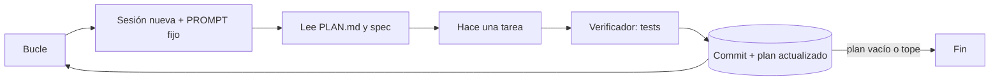

El **[[glosario/bucle-ralph|bucle Ralph]]** es la forma más simple de que un agente trabaje horas: un *prompt* fijo que se lanza una y otra vez, cada vuelta con la ventana de contexto vacía. En cada vuelta el agente lee el plan, elige una tarea, la implementa y termina; el bucle vuelve a empezar. El estado no está en la conversación, está en el plan, en el código y en git. La idea es que, vuelta a vuelta, el código **converja a la especificación**.

El Technology Radar vol. 34 de Thoughtworks ([15 de abril de 2026](https://www.thoughtworks.com/es-cl/radar/techniques/ralph-loop)) lo sitúa en el anillo **Assess** (merece explorarse para entender cómo te afectaría) y menciona que a veces se llama *Wiggum loop*. La técnica se atribuye a Geoffrey Huntley, cuyo texto enlaza el propio radar. Como los patrones 10, 11 y 13, queda fuera del catálogo original de *Building effective agents* ([Anthropic, 2024](https://www.anthropic.com/engineering/building-effective-agents)).

## Qué es



Tres piezas y nada más:

1. **Un *prompt* fijo**, el mismo en todas las vueltas: lee el plan, haz la primera tarea pendiente, verifica, marca y haz commit.
2. **Un plan en disco** (`PLAN.md`, una lista de tareas) que el propio agente va marcando y ampliando cuando descubre trabajo nuevo.
3. **Un verificador** que decide si una tarea está hecha sin preguntarle al agente: tests, compilador, *linter*, una implementación de referencia.

La ventaja que señala el radar es la ventana limpia: cada vuelta empieza sin el historial acumulado, así que no sufre la degradación por contexto largo ([[glosario/context-rot|context rot]]). El inconveniente, que ese reinicio tiene **un coste de tokens importante**: cada vuelta vuelve a leer el plan, la spec y el código que necesita.

### En qué se diferencia del inicializador

El [[patrones/10-inicializador-y-agente-de-trabajo|inicializador y agente de trabajo]] es la versión con más estructura del mismo principio: dos primeros mensajes distintos, una lista de funcionalidades que el agente no puede editar salvo `passes`, una prueba de extremo a extremo al empezar cada sesión. El bucle Ralph lo reduce al mínimo: un solo *prompt* y un plan que el agente gestiona. Eso lo hace fácil de montar y también más frágil: toda la disciplina depende del verificador.

## Cuándo usarlo

- **El verificador es casi perfecto.** Nicholas Carlini lanzó Claude Code en un bucle bash infinito dentro de un contenedor para que un equipo de agentes escribiera un compilador de C ([*Building a C compiler with a team of parallel Claudes*](https://www.anthropic.com/engineering/building-c-compiler), febrero de 2026). Su lección principal: el verificador tiene que ser casi perfecto, porque si no el agente resuelve el problema equivocado.
- **La spec está clara y el plan se trocea en tareas pequeñas.** Migraciones mecánicas, portar un módulo, subir cobertura de tests, implementar una especificación con batería de pruebas.
- **El entorno es desechable.** Un contenedor sin secretos donde el agente puede trabajar sin pedir permiso.

## Cuándo no

- **No hay verificador fiable.** Sin él, el bucle marca tareas como hechas y sigue: converge a lo que el agente cree, no a la spec.
- **La spec es ambigua.** Cada vuelta la interpreta de cero y el código oscila.
- **Las tareas dependen de decisiones de diseño previas.** El agente olvida por qué se decidió algo; si no está escrito en el plan o en el código, lo deshará.
- **El presupuesto es ajustado o hay efectos irreversibles.** Es un patrón de gasto alto y sin supervisión por vuelta.

## Ejemplo concreto

Migrar 120 tests de `unittest` a `pytest`. `PLAN.md` tiene una línea por archivo de test; el *prompt* dice: «elige el primer archivo sin marcar, migra, ejecuta `pytest -q`, si todo pasa márcalo y haz commit; si no sabes arreglarlo, anota el motivo y termina». Cada vuelta toca un archivo con la ventana limpia, y `pytest` decide. Si tres vueltas seguidas no producen ni commit ni cambio en el plan, el bucle para: una persona lee las notas y desbloquea.

## Esqueleto de código

Con Claude Code en modo *headless*, el bucle cabe en un script de bash. `--bare` ignora hooks, skills, MCP y `CLAUDE.md`, así que el *prompt* tiene que llevar todo lo necesario ([[docs/claude-code/08-modo-headless-y-ci]]). Se probó la lógica del script con un `claude` falso en el `PATH` que marca una tarea por vuelta.

```bash title="ralph.sh"
#!/usr/bin/env bash
# ralph.sh: el mismo PROMPT.md en bucle, una sesión nueva de Claude Code por vuelta.
# Solo dentro de un contenedor desechable, sin secretos ni credenciales montadas.
set -uo pipefail
MAX_VUELTAS=${MAX_VUELTAS:-30}
for ((n = 1; n <= MAX_VUELTAS; n++)); do
  grep -q '^- \[ \]' PLAN.md || { echo "Plan completado en $((n - 1)) vueltas"; exit 0; }
  antes=$(git rev-parse HEAD)
  claude -p "$(cat PROMPT.md)" --bare --output-format json \
    --permission-mode bypassPermissions --max-budget-usd 3 >> ralph.log.jsonl
  [ "$(git rev-parse HEAD)" = "$antes" ] && echo "vuelta $n: sin commit"
done
echo "Límite de $MAX_VUELTAS vueltas: revisa PLAN.md y ralph.log.jsonl"; exit 1
```

> [!peligro] `bypassPermissions` solo en un contenedor
> Sin aprobaciones, el agente ejecuta lo que decida. Úsalo solo en un entorno desechable, sin credenciales, claves ni red abierta, y con el repositorio clonado (no tu copia de trabajo). Ver [[docs/claude-code/06-permisos-y-sandbox]].

Lo mismo con el SDK de la API, para ver el mecanismo y controlar el gasto. El bucle exterior para por tres motivos: plan completado, presupuesto de tokens agotado o tres vueltas sin avances (ni commit ni cambio en el plan). Probado con el simulador de la API: una vuelta que marca una tarea y varias que no avanzan, hasta la parada por estancamiento.

```python title="ralph.py"
import re
import subprocess
from pathlib import Path

import anthropic

MODEL = "claude-sonnet-5-5"
REPO = Path("repo")
PLAN = REPO / "PLAN.md"                 # el estado: una lista «- [ ] tarea» que el agente va marcando
client = anthropic.Anthropic()

PROMPT = """Lee PLAN.md y spec.md. Elige la PRIMERA tarea sin marcar («- [ ]») y haz solo esa:
impleméntala, ejecuta `pytest -q` y, si todo pasa, márcala «- [x]» y haz commit.
Si descubres trabajo nuevo, añádelo al final de PLAN.md como tarea sin marcar.
Si los tests no pasan y no sabes arreglarlo, anota el motivo debajo de la tarea y termina."""
SISTEMA = "Trabajas en repo/. No recuerdas iteraciones anteriores: el estado está en PLAN.md y en git."
BASH = [{"name": "bash", "description": "Ejecuta un comando de shell en repo/ (máx. 5 min).",
         "input_schema": {"type": "object", "properties": {"comando": {"type": "string"}},
                          "required": ["comando"], "additionalProperties": False},
         "cache_control": {"type": "ephemeral"}}]     # sistema + herramientas: prefijo idéntico en cada vuelta


def bash(comando: str) -> tuple[str, bool]:
    try:
        r = subprocess.run(comando, shell=True, cwd=REPO, capture_output=True, text=True, timeout=300)
    except subprocess.TimeoutExpired:
        return "Tiempo agotado.", True
    return f"exit={r.returncode}\n{r.stdout[-6000:]}\n{r.stderr[-3000:]}", r.returncode != 0


def iteracion(max_pasos: int = 40) -> tuple[str, int]:
    """Una vuelta: ventana nueva, el mismo PROMPT. Devuelve el motivo de parada y los tokens gastados."""
    mensajes, tokens = [{"role": "user", "content": PROMPT}], 0
    for _ in range(max_pasos):
        resp = client.messages.create(model=MODEL, max_tokens=16000, system=SISTEMA,
                                      tools=BASH, messages=mensajes)
        u = resp.usage
        tokens += u.input_tokens + u.cache_read_input_tokens + u.cache_creation_input_tokens + u.output_tokens
        mensajes.append({"role": "assistant", "content": resp.content})
        if resp.stop_reason != "tool_use":
            return resp.stop_reason, tokens
        resultados = []
        for b in resp.content:
            if b.type == "tool_use":
                salida, error = bash(b.input["comando"])
                resultados.append({"type": "tool_result", "tool_use_id": b.id,
                                   "content": salida, "is_error": error})
        mensajes.append({"role": "user", "content": resultados})
    return "max_pasos", tokens


def pendientes() -> int:
    return len(re.findall(r"^- \[ \]", PLAN.read_text(encoding="utf-8"), re.M))


def ralph(max_vueltas: int = 30, max_tokens: int = 3_000_000, max_estancadas: int = 3) -> None:
    gastado, estancadas = 0, 0
    for n in range(1, max_vueltas + 1):
        antes = (pendientes(), bash("git rev-parse HEAD")[0])
        if antes[0] == 0:
            break
        motivo, tokens = iteracion()
        gastado += tokens
        despues = (pendientes(), bash("git rev-parse HEAD")[0])
        estancadas = estancadas + 1 if despues == antes else 0     # ni commit ni cambio en el plan
        print(f"vuelta {n}: {motivo} · pendientes {despues[0]} · {gastado:,} tokens")
        if motivo == "refusal" or gastado > max_tokens or estancadas >= max_estancadas:
            print("Parada: rechazo, presupuesto agotado o sin avances. Revisa PLAN.md.")
            return
    tests_ok = not bash("pytest -q")[1]
    print("Plan completado." if tests_ok and pendientes() == 0 else "Fin de vueltas: revisa el estado.")


if __name__ == "__main__":
    ralph()
```

Un detalle a favor del patrón: como el sistema, las herramientas y el primer mensaje son idénticos en cada vuelta, el [[glosario/prompt-caching|prompt caching]] aprovecha ese prefijo de una vuelta a la siguiente, siempre que no pase más tiempo que la duración de la caché.

## Coste y latencia

Alto en tokens y en tiempo, y sin techo natural: el bucle no se cansa. Pon siempre tres topes: vueltas, presupuesto (`--max-budget-usd` por sesión, tokens acumulados en tu código) y vueltas sin avance. La latencia por tarea es la de una sesión completa con su arranque. A cambio, montarlo cuesta una tarde, y si el verificador es bueno, avanza sin que nadie mire.

## Variantes

- **Revisión entre vueltas.** El radar cuenta que goose implementa el patrón y en algunos casos añade revisión con otro modelo entre iteraciones: un paso del [[patrones/11-planificador-generador-evaluador|evaluador separado]] dentro del bucle mínimo.
- **Varios bucles en paralelo.** Carlini lanzó 16 agentes, cada uno con su clon del repositorio, que se reservaban tareas con archivos de bloqueo. Funciona cuando el verificador permite que cada agente ataque un fallo distinto; lo cuenta [[sistemas/agente-de-larga-duracion]].
- **Con `/goal`.** En Claude Code, `/goal` mantiene una sesión trabajando hasta que un modelo pequeño juzga cumplida la condición: es un bucle dentro de una sola ventana, sin reinicio de contexto.

## Patrones relacionados

- [[patrones/10-inicializador-y-agente-de-trabajo]]: el mismo principio con reglas más estrictas.
- [[patrones/08-agente-autonomo]]: lo que pasa dentro de cada vuelta.
- [[patrones/07-evaluador-optimizador]]: añade crítica explícita entre vueltas.
