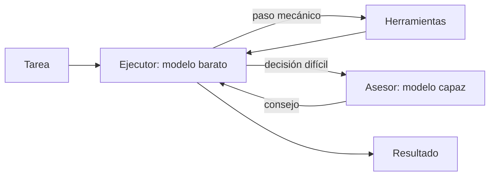

En el patrón **ejecutor y asesor**, un modelo rápido y barato (el ejecutor) lleva el trabajo de principio a fin y, cuando lo necesita, consulta a un modelo más capaz (el asesor). El asesor no actúa: lee el contexto y devuelve un consejo. Así pagas la tarifa del modelo grande solo en los pocos momentos en que aporta.

Hay dos formas de montarlo: la herramienta *advisor* de la API de Claude (en beta), donde el servidor hace la consulta dentro de la misma petición, o una herramienta propia que llama a otro modelo, que funciona con cualquier proveedor. Cognition describe el mismo patrón como **«amigo listo»** (*smart friend*) en [*Multi-Agents: What's Actually Working*](https://cognition.com/blog/multi-agents-working) (Walden Yan, 22 de abril de 2026). Como los patrones 10 a 12, amplía el catálogo de *Building effective agents* ([Anthropic, 2024](https://www.anthropic.com/engineering/building-effective-agents)).

## Qué es



Se diferencia del [[patrones/04-enrutado|enrutado]] en quién decide y cuándo. El enrutado elige un modelo **antes** de empezar, según la entrada. Aquí el ejecutor decide **durante** la tarea, paso a paso, si necesita ayuda. Y es un workflow con un solo actor: el asesor no tiene herramientas ni escribe nada. Encaja con la regla de Cognition para multiagente: las escrituras siguen en un solo hilo y los demás modelos aportan inteligencia, no acciones.

### Con la herramienta advisor

Según la [documentación de la herramienta](https://platform.claude.com/docs/en/agents-and-tools/tool-use/advisor-tool), se declara en `tools` con su tipo, `name: "advisor"` y el modelo asesor, y necesita la cabecera beta `advisor-tool-2026-03-01`:

- El ejecutor la llama como cualquier herramienta, con un bloque `server_tool_use` de entrada vacía. **El servidor construye por sí mismo el contexto del asesor**: le pasa la transcripción completa del ejecutor (sistema, herramientas, turnos y resultados). El asesor no tiene herramientas y su razonamiento se descarta; solo vuelve el consejo.
- El resultado llega en un bloque `advisor_tool_result`. Con asesores como Opus 5.5 o Sonnet 5.5 llega **cifrado** (`advisor_redacted_result`): el ejecutor lo lee en el servidor, tú no. Reenvía el bloque tal cual en el historial. Para leer el consejo hace falta un asesor que lo devuelva en claro (`advisor_result`, p. ej. Opus 4.8), y los ejecutores Sonnet 5.5, Opus 5.5 y Fable 5.1 solo se emparejan con asesores que cifran: con ellos no puedes leerlo. Un ejecutor Haiku sí admite asesores en claro.
- `max_uses` limita las consultas **por petición** (no por conversación) y `max_tokens` (mínimo 1.024) el tamaño de cada consejo. Para un tope por conversación, cuenta tú las consultas y quita la herramienta de `tools` al llegar al límite.
- `caching` (opcional, `{"type": "ephemeral"}`) cachea la transcripción del asesor entre consultas; la documentación sitúa el punto de equilibrio en unas tres consultas por conversación y pide no activarlo y desactivarlo a mitad.
- El asesor debe ser Sonnet 4.6 o posterior y **al menos tan capaz como el ejecutor**; una pareja no válida da 400.
- Se factura a la tarifa del asesor y aparece aparte en `usage.iterations`, con entradas `advisor_message`. Los campos de nivel superior de `usage` **solo suman al ejecutor**: si miras solo esos, subestimas el coste.
- Una consulta pendiente puede cerrar la respuesta con `pause_turn`: reenvía el contenido del asistente sin cambios, con la misma herramienta y la misma cabecera.

No intentes forzar la consulta con `tool_choice`: los ejecutores 5.5 rechazan `any` y `tool`. Si consulta poco, dilo en el *prompt* de sistema (cuándo sí y cuándo no).

## Cuándo usarlo

La documentación lo recomienda para tareas agénticas largas, como agentes de código, uso del ordenador o investigación en varios pasos, donde **casi todos los turnos son mecánicos pero planificar importa**. También para dar un salto de capacidad a un ejecutor Haiku: cuesta más que Haiku solo y menos que pasar a un ejecutor más grande.

Cognition añade la variante de enrutar por capacidad: con dos modelos frontera de proveedores distintos, delegar cada subtarea al que mejor la resuelve (depurar, razonamiento visual, tests) en vez de usar el asesor solo para lo difícil.

## Cuándo no

- **Preguntas de un solo turno.** No hay pasos mecánicos que abaratar.
- **Casi todos los pasos necesitan al modelo grande.** Usa el modelo grande como ejecutor.
- **El ejecutor no sabe cuándo preguntar.** Es el fallo que documenta Cognition: con un ejecutor débil, el techo de calidad lo pone el ejecutor, porque no reconoce sus límites ni formula bien la pregunta. Proponen forzar al menos una consulta (por *prompt*), afinar el *prompt* y reglas de dominio («consulta siempre ante un conflicto de fusión»).
- **El producto deja elegir modelo al usuario.** La documentación lo marca como mal encaje: el usuario ya decide coste y calidad.

## Ejemplo concreto

Un agente arregla tests que fallan en CI. Lee el log, localiza el test, ejecuta la batería, prueba un cambio: trabajo mecánico que hace Sonnet 5.5. Al ver que `test_reembolso_parcial` falla por un redondeo, y antes de tocar la lógica de pagos, consulta al asesor. Opus 5.5 recibe toda la transcripción y responde con la estrategia (redondear al final con decimales, no en cada línea). El ejecutor la aplica y verifica. Una consulta de unos cientos de tokens de salida en una sesión de decenas de turnos.

## Esqueleto de código

```python tab="Python" title="asesor.py"
from collections import defaultdict

import anthropic

MODEL = "claude-sonnet-5-5"            # ejecutor: hace casi todo el trabajo
ASESOR = "claude-opus-5-5"             # asesor: solo se consulta en los puntos difíciles
BETA = "advisor-tool-2026-03-01"
client = anthropic.Anthropic()

HERRAMIENTAS = [
    {"type": "advisor_20260301", "name": "advisor", "model": ASESOR,
     "max_uses": 3,                    # por petición, no por conversación
     "max_tokens": 2048},              # tope de cada consejo (mínimo 1024)
    {"name": "ejecutar_tests", "description": "Ejecuta la batería de tests y devuelve los fallos.",
     "input_schema": {"type": "object", "properties": {"ruta": {"type": "string"}},
                      "required": ["ruta"], "additionalProperties": False}},
]
SISTEMA = ("Arreglas tests que fallan. Haz tú el trabajo mecánico (leer fallos, ejecutar tests). "
           "Consulta al asesor antes de decidir la estrategia de un arreglo no trivial y cuando "
           "lleves dos intentos sin avanzar. No lo consultes para cosas rutinarias.")


def ejecutar_tests(ruta: str) -> str:
    return "FAILED tests/test_pagos.py::test_reembolso_parcial - assert 50 == 45"   # tu implementación


def tokens_por_modelo(usage) -> dict:
    """El usage de nivel superior solo suma al ejecutor; el asesor va en usage.iterations."""
    total = defaultdict(lambda: defaultdict(int))
    for it in usage.iterations or [usage]:              # sin consultas no hay iterations
        modelo = it.model if getattr(it, "type", "") == "advisor_message" else MODEL
        for campo in ("input_tokens", "cache_read_input_tokens", "cache_creation_input_tokens", "output_tokens"):
            total[modelo][campo] += getattr(it, campo) or 0
    return {m: dict(v) for m, v in total.items()}


def agente(tarea: str, max_pasos: int = 30) -> str:
    mensajes = [{"role": "user", "content": tarea}]
    for _ in range(max_pasos):
        resp = client.beta.messages.create(model=MODEL, max_tokens=8000, betas=[BETA], system=SISTEMA,
                                           tools=HERRAMIENTAS, messages=mensajes)
        print(tokens_por_modelo(resp.usage))           # multiplica cada modelo por su tarifa oficial
        # el consejo puede llegar cifrado (advisor_redacted_result): se reenvía tal cual
        mensajes.append({"role": "assistant", "content": resp.content})
        if resp.stop_reason == "pause_turn":           # consulta pendiente: reenvía con las mismas tools
            continue
        if resp.stop_reason != "tool_use":
            return "".join(b.text for b in resp.content if b.type == "text")
        resultados = [{"type": "tool_result", "tool_use_id": b.id, "content": ejecutar_tests(**b.input)}
                      for b in resp.content if b.type == "tool_use"]   # server_tool_use no lleva tool_result
        mensajes.append({"role": "user", "content": resultados})
    return "Límite de pasos."
```

Probado con el simulador de la API: una consulta con resultado cifrado, una herramienta propia en el mismo turno y un `pause_turn` reanudado. `tokens_por_modelo` separa el ejecutor del asesor; con el ejemplo de `usage` de la documentación devuelve 1.760/531 tokens de entrada y salida para el ejecutor y 823/1.612 para el asesor.

### Variante casera

Sin la herramienta beta: el asesor es otra llamada, a cualquier modelo. Cognition propone como solución 80/20 **bifurcar el contexto completo** del ejecutor y añadir la pregunta, y recomienda preguntas amplias, dejando que el asesor decida qué importa. Dos detalles: el historial bifurcado contiene bloques `tool_use` que hacen referencia a las herramientas del ejecutor, así que se le pasan las mismas `tools` con `tool_choice={"type": "none"}` para que responda en texto (`none` sí está permitido en los modelos 5.5). Y la pregunta se añade al último mensaje `user` en lugar de crear otro.

```python title="asesor_casero.py"
import anthropic

MODEL = "claude-haiku-5-5"             # ejecutor barato
ASESOR = "claude-sonnet-5-5"           # cualquier modelo más capaz, también de otro proveedor
client = anthropic.Anthropic()

CONSULTAR = {"name": "consultar_asesor",
             "description": "Pide consejo a un modelo más capaz cuando la decisión es difícil o llevas "
                            "dos intentos sin avanzar. Haz una pregunta amplia: el asesor ve todo tu contexto.",
             "input_schema": {"type": "object", "properties": {"pregunta": {"type": "string"}},
                              "required": ["pregunta"], "additionalProperties": False}}
HERRAMIENTAS = [CONSULTAR]             # más las herramientas de trabajo del ejecutor


def consultar_asesor(sistema: str, mensajes: list, pregunta: str) -> tuple[str, dict]:
    """Bifurca el contexto completo del ejecutor (el «80/20» de Cognition) y añade la pregunta."""
    historial = mensajes[:-1]                       # sin el turno que contiene esta tool_use
    consulta = {"type": "text", "text": f"<consulta_del_ejecutor>{pregunta}</consulta_del_ejecutor>\n"
                "Aconseja en menos de 150 palabras. Si te falta información, di qué debe investigar."}
    ultimo = historial[-1]
    contenido = ultimo["content"] if isinstance(ultimo["content"], list) else [{"type": "text", "text": ultimo["content"]}]
    historial = historial[:-1] + [{"role": "user", "content": contenido + [consulta]}]
    resp = client.messages.create(model=ASESOR, max_tokens=2048, system=sistema, messages=historial,
                                  tools=HERRAMIENTAS, tool_choice={"type": "none"})   # responde en texto
    return "".join(b.text for b in resp.content if b.type == "text"), resp.usage.model_dump()


def agente(sistema: str, tarea: str, max_pasos: int = 30, max_consultas: int = 3) -> str:
    mensajes, consultas = [{"role": "user", "content": tarea}], 0
    for _ in range(max_pasos):
        resp = client.messages.create(model=MODEL, max_tokens=8000, system=sistema,
                                      tools=HERRAMIENTAS, messages=mensajes)
        mensajes.append({"role": "assistant", "content": resp.content})
        if resp.stop_reason != "tool_use":
            return "".join(b.text for b in resp.content if b.type == "text")
        resultados = []
        for b in resp.content:
            if b.type != "tool_use":
                continue
            if b.name == "consultar_asesor" and consultas < max_consultas:
                consultas += 1
                consejo, uso = consultar_asesor(sistema, mensajes, b.input["pregunta"])
                print(f"consulta {consultas}: {uso['input_tokens']} in / {uso['output_tokens']} out ({ASESOR})")
                resultados.append({"type": "tool_result", "tool_use_id": b.id, "content": consejo})
            elif b.name == "consultar_asesor":
                resultados.append({"type": "tool_result", "tool_use_id": b.id, "is_error": True,
                                   "content": "Sin consultas disponibles: decide tú."})
            else:
                resultados.append({"type": "tool_result", "tool_use_id": b.id,
                                   "content": "…"})       # aquí despachas tus otras herramientas
        mensajes.append({"role": "user", "content": resultados})
    return "Límite de pasos."
```

Ganas control: lees el consejo, decides qué contexto pasas, mezclas proveedores o usas un modelo de pesos abiertos como ejecutor. Pierdes que todo ocurra en una petición, y la latencia de cada consulta es una llamada completa.

## Coste y latencia

La documentación da como salida típica del asesor unos 400–700 tokens de texto (1.400–1.800 con razonamiento) por consulta. El coste total depende de cuántas veces consulta el ejecutor: mide consultas por tarea y tokens por modelo en tus trazas, y compara con dos líneas base, el ejecutor solo y el asesor como ejecutor. Para contenerlo: `max_tokens` en la herramienta, un tope de consultas por conversación y el *prompt* que diga cuándo no preguntar. La latencia sube en cada consulta (el subagente asesor no hace *streaming*: la respuesta se pausa hasta que llega el consejo entero).

## Patrones relacionados

- [[patrones/04-enrutado]]: elegir modelo antes de empezar en lugar de durante.
- [[patrones/11-planificador-generador-evaluador]]: otro reparto de papeles, con un evaluador que sí actúa sobre la aplicación.
- [[patrones/08-agente-autonomo]]: el bucle del ejecutor.
- [[modelos/05-elegir-modelo-por-tarea]]: cómo decidir qué modelo hace cada cosa.
