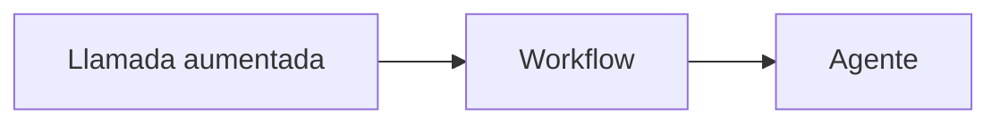

Los patrones son **formas probadas de organizar llamadas a un modelo**. Esta sección sigue la clasificación de [Building effective agents](https://www.anthropic.com/engineering/building-effective-agents) (Anthropic, 2024), que distingue entre [[glosario/workflow|workflows]], donde tu código decide los pasos, y [[glosario/agente|agentes]], donde los decide el modelo.

## La regla: empieza por lo más simple

Cada paso hacia la derecha añade coste, latencia y formas de fallar. Súbelo solo cuando tengas pruebas de que el anterior no basta.

## Los patrones

**Fundamentos**

- [[patrones/01-workflows-vs-agentes]]: la diferencia y la escalera de complejidad. Léelo primero.
- [[patrones/02-llamada-aumentada]]: el bloque básico, un modelo con recuperación, herramientas y memoria.

**Workflows**

- [[patrones/03-encadenado]]: pasos fijos con comprobaciones entre ellos.
- [[patrones/04-enrutado]]: clasificar la entrada y mandarla al flujo adecuado.
- [[patrones/05-paralelizacion]]: dividir en partes independientes o votar entre varias respuestas.
- [[patrones/06-orquestador-trabajadores]]: un modelo divide la tarea sobre la marcha y delega.
- [[patrones/07-evaluador-optimizador]]: generar, criticar con un criterio claro y mejorar.

**Agentes**

- [[patrones/08-agente-autonomo]]: el modelo elige pasos y herramientas en un bucle.

**Agentes de larga duración y varios modelos**

Estos cuatro amplían el catálogo del artículo con lo que se ha aprendido desde entonces sobre trabajos que duran más que una ventana de contexto o que conviene repartir entre modelos.

- [[patrones/10-inicializador-y-agente-de-trabajo]]: una tarea de horas repartida en sesiones, con la memoria en archivos y en git.
- [[patrones/11-planificador-generador-evaluador]]: un agente planifica, otro construye por sprints y un evaluador escéptico lo prueba.
- [[patrones/12-bucle-ralph]]: el mismo prompt en bucle, con ventana nueva en cada vuelta y el plan como estado.
- [[patrones/13-ejecutor-y-asesor]]: un modelo barato trabaja y consulta a uno más capaz solo en los puntos difíciles.

**Para decidir**

- [[patrones/09-elegir-patron]]: árbol de decisión y tabla comparativa.

## Cómo leer cada patrón

Cada página explica qué es, muestra un diagrama, dice cuándo usarlo y cuándo no, da un ejemplo concreto y un esqueleto de código, y puntúa de 1 a 3 su coste y su latencia. Al final enlaza los patrones relacionados y los [[sistemas/index|sistemas]] que lo usan.

El esqueleto está escrito primero con el SDK de Anthropic, a mano, para que veas el mecanismo. Los workflows y el agente autónomo (del 3 al 8) incluyen después una sección **«Con LangGraph»** con el mismo patrón como [[glosario/grafo-de-estado|grafo de estado]] (open source, licencia MIT), probado con modelos simulados, y una frase sobre lo que el framework hace por ti. Si no sabes si te conviene un framework, lee antes [[docs/frameworks/01-elegir-framework]]; el curso [[cursos/langchain-y-langgraph/index]] lo enseña desde cero.
