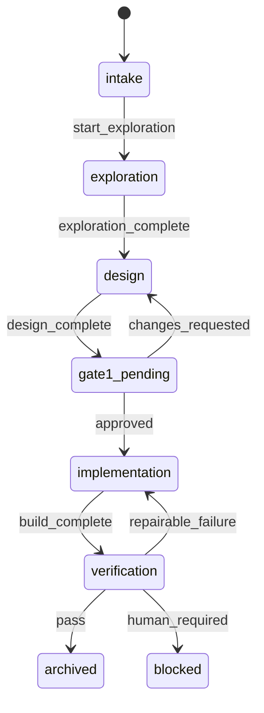

Un agente no recuerda en qué punto estaba cuando se compacta el contexto, se corta la sesión o abres otra mañana. `state.yaml` guarda ese punto fuera de la conversación: en qué **fase** está la feature, cuántos builds y verificaciones lleva, qué decidió el humano y con qué texto, desde qué commit se compara el diff y qué toca hacer después. Junto a él, `event.log` registra cada transición, una línea por evento. Con los dos, cualquier sesión nueva reanuda la feature sin reconstruir la conversación.

## Cuándo usarla

- En un flujo por fases con puerta humana ([[glosario/puerta-humana]]) donde el orden de los pasos importa y quieres que lo haga cumplir código, no el modelo.
- Cuando las features duran varias sesiones o varios días.
- Cuando quieres medir: pasar a la primera, repairs, bloqueos, coste por feature.

La regla de oro: **este archivo solo lo escribe el motor de estado** (en el harness del autor, `feature.py`). Ni el orquestador ni los subagentes lo editan a mano: el modelo decide qué evento aplicar y el código decide si es legal.

## La plantilla

```yaml title="state.yaml"
# Estado de una feature. Solo lo escribe el motor de estado; nunca un agente ni una persona a mano.
# phase: intake | exploration | design | gate1_pending | implementation | verification | blocked | archived | cancelled
# status (se deriva de phase): in_progress | blocked | archived | cancelled
# attempts.build = 1 + repairs + reintentos humanos desde la aprobación de la puerta humana.
# base_commit / base_dirty: foto de git al aprobar la puerta humana; el revisor compara su diff contra ella.
version: 1
feature_id: null
title: null
status: in_progress
phase: intake
phase_entered_at: null
created_at: null
updated_at: null
attempts:
  build: 0
  verification: 0
  repair: 0
  human_retries: 0
gate1:
  status: pending                  # pending | approved | changes_requested
  decided_by: null                 # human, o el modo automático que tenga delegada la aprobación
  decided_at: null
  response: null                   # texto literal de la decisión humana
  rationale: null                  # regla aplicada si la aprobación fue delegada
last_verdict: null                 # último veredicto del revisor
blocked_reason: null
base_commit: null
base_dirty: []                     # archivos ya modificados antes de aprobar: no son del builder
budget:                            # opcional: solo si tu harness no guarda el presupuesto en otro archivo
  limit_usd: null
  spent_usd: null
lock:
  active: false                    # true mientras una sesión trabaja en la feature
  since: null
next_action: null                  # instrucción literal para la siguiente sesión
```

Cada transición añade una línea JSON a `event.log`, en la misma carpeta:

```json title="event.log"
{"ts": "2026-10-29T09:12:03+00:00", "feature_id": "<PREFIJO-NNN>", "event": "transition", "transition": "approved", "from": "gate1_pending", "to": "implementation", "by": "human", "response": "<texto literal de la decisión>"}
```

## Cómo rellenarla

No la rellenas: la copia el motor al iniciar la feature y la mantiene. Lo que sí decides es qué significa cada campo en tu harness. Las fases y los eventos que las cambian vienen de la máquina de estados (`workflow.toml` en el harness del autor):



Además, `escalate` lleva cualquier fase de trabajo a `blocked`, y desde `blocked` solo salen decisiones humanas (`replan`, `retry_exploration`, `retry_build`, `retry_verification`, `cancel`).

- **`phase`** y **`status`**: los cambia una transición, nunca una edición. Si la transición no cumple sus *guards* (falta un artefacto, se superó el presupuesto, la spec cambió), no se escribe nada.
- **`attempts`**: `build` y `verification` alimentan las cabeceras de los subagentes y deben coincidir con el [[plantillas/veredicto-de-revision|veredicto]]; `repair` limita el repair automático a uno.
- **`gate1`**: la aprobación con el **texto literal** de quien decide. «Vale» o el silencio no son una aprobación; «apruebo FAC-012» sí.
- **`base_commit`** y **`base_dirty`**: la foto de git en el momento de aprobar. El revisor hace `git diff <base_commit>` y no atribuye al builder lo que ya estaba en `base_dirty`.
- **`budget`**: en el harness del autor el límite vive en la configuración (`limit_usd`) y en cada feature del backlog (`budget_usd`), y el gasto se calcula de los transcripts de los subagentes. Si tu harness es más simple, guárdalo aquí y haz que las transiciones que lanzan trabajo nuevo fallen al superarlo.
- **`lock`**: evita que dos sesiones trabajen la misma feature. Un lock antiguo sin actividad puede ser una sesión muerta: pregunta antes de liberarlo.
- **`next_action`**: una frase ejecutable. Es lo primero que lee una sesión que reanuda.

## Ejemplo

`FAC-012` justo después de que el revisor conceda el repair.

```yaml title="state.yaml"
version: 1
feature_id: FAC-012
title: Exportar facturas a CSV
status: in_progress
phase: implementation
phase_entered_at: "2026-10-29T10:45:30+00:00"
created_at: "2026-10-28T16:02:11+00:00"
updated_at: "2026-10-29T10:45:30+00:00"
attempts:
  build: 2
  verification: 1
  repair: 1
  human_retries: 0
gate1:
  status: approved
  decided_by: human
  decided_at: "2026-10-29T09:12:03+00:00"
  response: "apruebo FAC-012"
  rationale: null
last_verdict: FAIL_REPAIRABLE
blocked_reason: null
base_commit: "4e1c2a9"
base_dirty: []
budget:
  limit_usd: null
  spent_usd: null
lock:
  active: true
  since: "2026-10-29T09:12:03+00:00"
next_action: "Lanza el builder (PHASE: implementation, ATTEMPT: 2, MODE: repair)"
```

## Errores típicos

- **Editarlo a mano «para desbloquear».** Rompe la trazabilidad y, en el harness del autor, la guardia lo impide. Si algo está mal, se usa una transición humana (`replan`, `retry_*`).
- **Guardar el estado solo en la conversación.** Tras una compactación el modelo «recuerda» una fase que no es; el archivo manda.
- **Reescribir `event.log`.** El registro es de solo añadir: si algo salió mal, que quede escrito.
- **Inferir aprobaciones.** `gate1.response` debe contener lo que el humano escribió, no un resumen del orquestador.
- **Hashes y fechas sin comillas.** Un hash corto formado solo por dígitos (`1234567`) se lee como número y deja de coincidir con git. Entrecomilla `base_commit` y las fechas.
- **Presupuesto sin efecto.** Un `limit_usd` que nadie comprueba es decoración: el motor debe rechazar el trabajo nuevo al superarlo ([[recetas/coste-por-subagente]]).

## Relacionadas

- [[cursos/harness-engineering/06-el-flujo-como-maquina-de-estados]]: el flujo como máquina de estados.
- [[recetas/maquina-de-estados-con-guards]]: un motor mínimo que escribe este archivo.
- [[cursos/harness-engineering/10-coste-y-presupuesto]]: el presupuesto por feature.
- [[recetas/puerta-humana-con-comandos]]: cómo se registra la aprobación.
- [[plantillas/peticion-de-reparacion]] · [[plantillas/veredicto-de-revision]]
