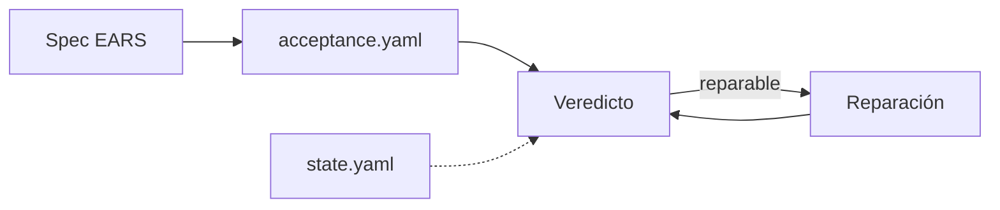

Aquí están los archivos que se escriben una y otra vez al trabajar con agentes, listos para copiar: configuraciones de agentes de código, especificaciones, criterios de aceptación, prompts y checklists. Salen sobre todo del harness del autor (un flujo SDD multiagente para Claude Code que usa a diario) y de su práctica, generalizados: sin nombres propios, sin precios y con marcadores `<…>` donde rellenas tú.

## Cómo usarlas

Cada página tiene la misma estructura: para qué sirve, cuándo usarla, **la plantilla en un solo bloque** (cópiala entera), cómo rellenarla campo a campo, un ejemplo breve, errores típicos y enlaces a las lecciones donde se explica el porqué. Sustituye todos los `<…>`, borra lo que no aplique y versiona el resultado con tu proyecto.

## Configurar un agente de código

- [[plantillas/agents-md]] · [[plantillas/claude-md]] · [[plantillas/subagente]] · [[plantillas/skill]]

## Especificar y verificar

Las cinco piezas del flujo con especificación, con un mismo ejemplo de principio a fin:

- [[plantillas/spec-con-ears]] · [[plantillas/criterios-de-aceptacion]] · [[plantillas/veredicto-de-revision]] · [[plantillas/peticion-de-reparacion]] · [[plantillas/estado-de-feature]]

## Planificar un proyecto entero

- [[plantillas/prompt-plan-de-implementacion]] · [[plantillas/plan-de-olas]]

## Prompts y checklists

- [[plantillas/prompt-de-sistema-de-agente]] · [[plantillas/checklist-de-rag]] · [[plantillas/prompt-apuntes-de-video]]

## Licencia

Las plantillas son contenido de MoreContext y se publican con CC BY-SA 4.0 ([[paginas/licencia]]): puedes copiarlas, adaptarlas y usarlas en proyectos comerciales. Si publicas una versión adaptada como plantilla, atribuye con una línea y compártela con la misma licencia. ¿Tienes una que uses a diario? Propónla en [[paginas/contribuir]].
