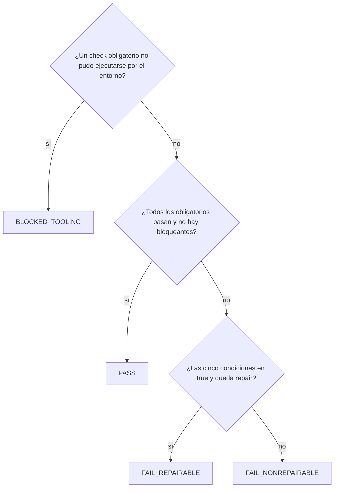

Un revisor que contesta «tiene buena pinta» no sirve para automatizar nada. `verification-result.yaml` obliga a que la revisión termine en un **[[glosario/veredicto|veredicto]] cerrado** (cuatro valores posibles), con la evidencia de las inspecciones, los hallazgos clasificados y cinco condiciones que deciden si el fallo admite una reparación automática. El motor de estado lo lee como *guard*: un `PASS` archiva la feature, un `FAIL_REPAIRABLE` concede el único repair y cualquier otra cosa devuelve la decisión al humano.

## Cuándo usarla

- Cuando un agente revisor (o tú) verifica lo que construyó otro agente y el resultado debe decidir el siguiente paso sin interpretación.
- En un bucle evaluador-optimizador acotado ([[patrones/07-evaluador-optimizador]]): el veredicto es la señal que lo cierra o lo repite una vez.
- Cuando quieres métricas del flujo: cuántas features pasan a la primera, cuántas necesitan repair, cuántas se bloquean.

## La plantilla

```yaml title="verification-result.yaml"
# Veredicto estructurado de una verificación. Lo escribe el revisor; el motor de estado lo lee como guard.
# build_attempt y verification_attempt deben coincidir con los contadores de state.yaml.
# verdict: PASS | FAIL_REPAIRABLE | FAIL_NONREPAIRABLE | BLOCKED_TOOLING (PENDING mientras no hay decisión)
# repairability: cada campo en true significa «se cumple esta condición para un repair automático».
version: 1
feature_id: "<PREFIJO-NNN>"
build_attempt: 1
verification_attempt: 1
verdict: PENDING
acceptance_run_at: null            # fecha ISO 8601 de la ejecución de la aceptación que respalda el veredicto
checks: []                         # opcional: solo si ningún runner guarda la evidencia de los checks ejecutables
inspections: []                    # una entrada por check de tipo inspection: id, status (pass | fail), evidence
review:
  blocking_issues: []              # "ruta:línea · qué falla · qué requisito incumple"
  non_blocking_issues: []          # estilo, mejoras y deuda: no impiden cerrar
repairability:
  reproducible: false              # el fallo se reproduce siempre con un comando
  in_approved_scope: false         # el arreglo cae dentro de los archivos y tareas aprobados
  design_unchanged: false          # se arregla sin cambiar el diseño
  acceptance_unchanged: false      # se arregla sin cambiar acceptance.yaml
  no_irreversible_side_effect: false  # no hubo ni habrá efectos irreversibles (datos reales, servicios externos)
failure_summary: null              # 1-3 frases: qué falla y por qué; null con PASS
next_action: null                  # pass | repairable_failure | human_required
```

## Cómo rellenarla

- **`build_attempt`** y **`verification_attempt`**: cópialos de `state.yaml` ([[plantillas/estado-de-feature]]). Si no coinciden, el motor rechaza el veredicto: así un informe viejo no puede cerrar un build nuevo.
- **`acceptance_run_at`**: la hora de la ejecución de la aceptación que hiciste **tú**, en esta verificación. Nunca reutilices los resultados del builder: la evidencia tiene que ser fresca.
- **`checks`**: en el harness del autor, la evidencia de los checks `command` y `file` la guarda el runner en `acceptance-results.json`, así que esta lista queda vacía. Si no tienes runner, rellénala con el mismo formato que `inspections`.
- **`inspections`**: una entrada por cada check `inspection` de `acceptance.yaml`, con `id`, `status` y `evidence`. La evidencia es lo que viste («el mensaje dice X»), no una valoración («correcto»). Una inspección obligatoria sin evidencia impide el `PASS`.
- **`review.blocking_issues`**: lo que incumple un requisito o una regla de `AGENTS.md`, con `ruta:línea`. **`non_blocking_issues`**: el resto. Las preferencias de estilo que `AGENTS.md` no exige nunca bloquean.
- **`repairability`**: sé honesto. Cada `true` es una afirmación que el builder tendrá que cumplir en el repair.
- **`verdict`**: decídelo con esta regla, en este orden:



- **`failure_summary`**: qué falla y la causa probable, en una a tres frases. Es lo que lee el humano si la feature se bloquea.
- **`next_action`**: el evento que propones al orquestador. Debe corresponder al veredicto.

## Ejemplo

La feature `FAC-012` de [[plantillas/criterios-de-aceptacion]]: el test de rectificativas falla, el arreglo es pequeño y está dentro del alcance aprobado.

```yaml title="verification-result.yaml"
version: 1
feature_id: FAC-012
build_attempt: 1
verification_attempt: 1
verdict: FAIL_REPAIRABLE
acceptance_run_at: "2026-10-29T10:42:07+00:00"
checks: []
inspections:
  - id: AC-004
    status: pass
    evidence: "Salida: «--desde: fecha inválida 31-02-2026, usa AAAA-MM-DD»."
review:
  blocking_issues:
    - "src/facturas/exportar.py:58 · las rectificativas salen con importe positivo · incumple FR-02"
  non_blocking_issues:
    - "src/facturas/exportar.py:12 · import sin usar"
repairability:
  reproducible: true
  in_approved_scope: true
  design_unchanged: true
  acceptance_unchanged: true
  no_irreversible_side_effect: true
failure_summary: "AC-002 falla en test_rectificativas: formatear_importe usa abs() y pierde el signo."
next_action: repairable_failure
```

## Errores típicos

- **`PASS` sin ejecutar la aceptación** o con los resultados del builder. Es el fallo que esta plantilla existe para impedir ([[disciplinas/verificar-antes-de-dar-por-hecho]]).
- **Llamar reparable a lo que exige rediseñar.** Si el arreglo cambia `design.md` o un check, `design_unchanged` o `acceptance_unchanged` es `false` y el veredicto es `FAIL_NONREPAIRABLE`.
- **Evidencia vaga.** «Funciona bien» no se puede auditar. Copia la salida o describe exactamente lo que viste.
- **El revisor arregla el código.** Si lo arregla, ya no hay nadie que revise el arreglo. Describe qué falla y dónde; el repair lo hace el builder.
- **Bloquear por gustos.** Un nombre de variable que no te convence va a `non_blocking_issues`.
- **Confundir `BLOCKED_TOOLING` con un fallo.** Si falta una herramienta o un servicio está caído, el producto no ha fallado: arregla el entorno y repite la verificación.

## Relacionadas

- [[cursos/harness-engineering/08-veredictos-y-reparacion-acotada]]: veredictos y repair, explicados.
- [[plantillas/peticion-de-reparacion]]: lo que escribe el revisor con `FAIL_REPAIRABLE`.
- [[cursos/agentes-de-codigo/04-revisar-y-confiar]]: revisar el trabajo de un agente.
- [[recetas/maquina-de-estados-con-guards]]: el motor que lee este archivo.
- [[glosario/veredicto]]
