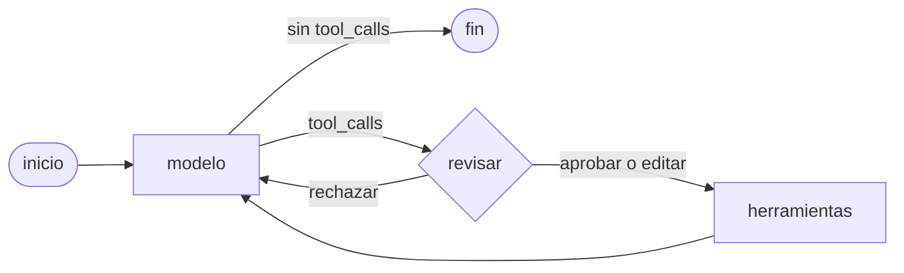

## Problema

Tu agente puede reembolsar dinero y quieres que una persona revise cada reembolso antes de que ocurra. Con el bucle a mano ([[recetas/aprobacion-humana-antes-de-actuar]]) basta un `input()`, pero en una aplicación real la persona contesta minutos u horas después, desde otra petición HTTP. Necesitas **pausar** el agente, guardar dónde estaba, liberar el proceso y **reanudarlo** con la decisión: aprobar, aprobar con otros argumentos o rechazar con un motivo que el modelo pueda leer.

En [[herramientas/langgraph|LangGraph]] eso son tres piezas: `interrupt()` para pausar, un [[glosario/checkpointer|checkpointer]] que guarda el estado con un `thread_id`, y `Command(resume=…)` para continuar.

## Ingredientes

- Python 3.10 o superior: `pip install langgraph "langchain[anthropic]"` (langgraph 1.2, langchain 1.4).
- `ANTHROPIC_API_KEY` para la versión real; las pruebas no la necesitan.
- Saber qué es un [[glosario/grafo-de-estado|grafo de estado]] ([[cursos/langchain-y-langgraph/05-langgraph-estado-nodos-y-aristas]]).

## Pasos

1. **Dibuja el grafo.** El bucle de siempre (modelo → herramientas → modelo) con un nodo `revisar` en medio. Si el modelo pide una herramienta sensible, `revisar` pausa; si no, pasa directo.



2. **Escribe el nodo de revisión con `interrupt()`.** `interrupt(valor)` detiene el grafo y entrega `valor` al llamante. Cuando reanudas, **el nodo se ejecuta otra vez desde el principio** e `interrupt()` devuelve lo que pasaste en `Command(resume=…)`. Por eso no pongas nada con efectos (un email, un cobro) antes del `interrupt()`. La lista de herramientas sensibles la decide tu código, nunca el modelo.

```python title="grafo_aprobacion.py"
import json

from langchain.chat_models import init_chat_model
from langchain.messages import AIMessage, SystemMessage, ToolMessage
from langchain.tools import tool
from langgraph.checkpoint.memory import InMemorySaver
from langgraph.graph import END, START, MessagesState, StateGraph
from langgraph.prebuilt import ToolNode
from langgraph.types import Command, interrupt

MODEL = "anthropic:claude-sonnet-5-5"
SENSIBLES = {"reembolsar"}            # lo decide tu código, nunca el modelo
PEDIDOS = {"P-1001": {"estado": "entregado", "importe_eur": 49.90}}


@tool
def ver_pedido(pedido_id: str) -> str:
    """Devuelve estado e importe de un pedido por su id (formato P-NNNN)."""
    return json.dumps(PEDIDOS.get(pedido_id, "No existe ese pedido"), ensure_ascii=False)


@tool
def reembolsar(pedido_id: str, importe_eur: float) -> str:
    """Emite un reembolso. Acción irreversible: solo tras confirmar el pedido con ver_pedido."""
    maximo = PEDIDOS[pedido_id]["importe_eur"]
    if not 0 < importe_eur <= maximo:          # el límite duro vive en la herramienta
        raise ValueError(f"Importe no válido: máximo {maximo} €")
    return f"Reembolso de {importe_eur} € emitido para {pedido_id}."


TOOLS = [ver_pedido, reembolsar]
SYSTEM = SystemMessage("Eres un agente de soporte. Antes de reembolsar, comprueba el pedido con ver_pedido.")


def construir(modelo=None, checkpointer=None):
    llm = (modelo or init_chat_model(MODEL, max_tokens=2048)).bind_tools(TOOLS)

    def llamar_modelo(state: MessagesState):
        return {"messages": [llm.invoke([SYSTEM, *state["messages"]])]}

    def enrutar(state: MessagesState):
        return "revisar" if state["messages"][-1].tool_calls else END

    def revisar(state: MessagesState):
        # Al reanudar, este nodo se ejecuta otra vez desde el principio: nada con efectos antes de interrupt().
        ultimo = state["messages"][-1]
        pendientes = [c for c in ultimo.tool_calls if c["name"] in SENSIBLES]
        if not pendientes:
            return Command(goto="herramientas")
        decisiones = interrupt({"pendientes": [{"id": c["id"], "name": c["name"], "args": c["args"]} for c in pendientes]})

        # decisiones = {tool_call_id: {"tipo": "aprobar" | "editar" | "rechazar", ...}}
        def decision(c):                       # sin decisión explícita = rechazo (falla en cerrado)
            if c["name"] not in SENSIBLES:
                return {"tipo": "aprobar"}
            return decisiones.get(c["id"], {"tipo": "rechazar", "motivo": "sin decisión"})

        if any(decision(c)["tipo"] not in ("aprobar", "editar") for c in ultimo.tool_calls):
            # Un rechazo anula el turno entero: un ToolMessage de error por CADA tool_call, también las no sensibles.
            avisos = []
            for c in ultimo.tool_calls:
                d = decision(c)
                texto = (f"Rechazado por un humano: {d.get('motivo', '')}. No lo repitas sin cambios."
                         if d["tipo"] == "rechazar" else "No ejecutado: otra acción de este turno fue rechazada.")
                avisos.append(ToolMessage(content=texto, tool_call_id=c["id"], name=c["name"], status="error"))
            return Command(goto="modelo", update={"messages": avisos})

        # Aprobadas o editadas: se reescribe el AIMessage con los argumentos finales (mismo id => lo reemplaza).
        llamadas = [{**c, "args": decision(c)["args"]} if decision(c)["tipo"] == "editar" else c
                    for c in ultimo.tool_calls]
        corregido = AIMessage(content=ultimo.content, tool_calls=llamadas, id=ultimo.id)
        return Command(goto="herramientas", update={"messages": [corregido]})

    g = StateGraph(MessagesState)
    g.add_node("modelo", llamar_modelo)
    g.add_node("revisar", revisar, destinations=("herramientas", "modelo"))
    g.add_node("herramientas", ToolNode(TOOLS, handle_tool_errors=True))   # True: cualquier excepción vuelve al modelo
    g.add_edge(START, "modelo")
    g.add_conditional_edges("modelo", enrutar, ["revisar", END])
    g.add_edge("herramientas", "modelo")
    return g.compile(checkpointer=checkpointer or InMemorySaver())


def pedir_decision(pendiente: dict) -> dict:
    print(f"\n¿Ejecutar {pendiente['name']} con {pendiente['args']}?")
    r = input("[a]probar · [e]ditar importe · [r]echazar: ").strip().lower()
    if r == "a":
        return {"tipo": "aprobar"}
    if r == "e":
        return {"tipo": "editar", "args": {**pendiente["args"], "importe_eur": float(input("Nuevo importe: "))}}
    return {"tipo": "rechazar", "motivo": input("Motivo: ") or "sin motivo"}


if __name__ == "__main__":
    grafo = construir()
    config = {"configurable": {"thread_id": "ticket-123"}, "recursion_limit": 25}   # mismo thread_id para reanudar
    out = grafo.invoke({"messages": [("user", "Devolvedme el pedido P-1001, llegó roto.")]}, config, version="v2")
    while out.interrupts:                                      # el grafo está en pausa, con el estado guardado
        pendientes = out.interrupts[0].value["pendientes"]
        decisiones = {p["id"]: pedir_decision(p) for p in pendientes}
        out = grafo.invoke(Command(resume=decisiones), config, version="v2")
    print(out.value["messages"][-1].content)
```

3. **Entiende las tres decisiones.**
   - **Aprobar**: `revisar` sigue a `herramientas` y se ejecuta lo que pidió el modelo.
   - **Editar**: reescribes el `AIMessage` con los argumentos nuevos y el **mismo `id`**. El reductor `add_messages` lo reemplaza en lugar de añadirlo, así el historial cuenta lo que de verdad se ejecutó. Con Claude esto importa: `ChatAnthropic` construye el bloque `tool_use` a partir de `tool_calls`, así que el modelo ve el importe editado (comprobado en el *payload*).
   - **Rechazar**: devuelves un `ToolMessage` con `status="error"` por **cada** `tool_call` del turno y vuelves al modelo. Si dejas una llamada sin respuesta, la siguiente petición a Claude falla con un 400 ([[problemas/tool-result-sin-tool-use]]).

4. **Fija el `thread_id` y un tope.** El `thread_id` es la clave con la que el checkpointer guarda y recupera el estado: si lo cambias entre la pausa y la reanudación, LangGraph empieza un hilo nuevo. `recursion_limit` va explícito porque el valor por defecto de LangGraph 1.2 es tan alto que no limita nada.

5. **Cambia `InMemorySaver` por un checkpointer persistente en producción.** `InMemorySaver` vive en el proceso: si el servidor se reinicia, la aprobación pendiente se pierde. Con `SqliteSaver` o `PostgresSaver` el mismo código sobrevive a un reinicio; lo tienes paso a paso en [[recetas/reanudar-un-agente-tras-un-reinicio]].

## Cómo comprobar que funciona

Lo ejecuté con un [[glosario/modelo-simulado|modelo simulado]] (`GenericFakeChatModel` con `bind_tools` como no-op, ver [[recetas/probar-agentes-sin-api]]) que pide `ver_pedido`, luego `reembolsar` por 49,90 € y luego responde. Para cada decisión, la prueba pausa, mira el estado y reanuda con `Command(resume={"c2": decisión})`. Salida real (langgraph 1.2.18), con las líneas repetidas recortadas:

```text
[aprobar] pausa: {'pendientes': [{'id': 'c2', 'name': 'reembolsar', 'args': {'pedido_id': 'P-1001', 'importe_eur': 49.9}}]} | siguiente nodo: ('revisar',)
   tool: ('reembolsar', 'success', 'Reembolso de 49.9 € emitido para P-1001.')
[editar] pausa: … | siguiente nodo: ('revisar',)
   tool: ('reembolsar', 'success', 'Reembolso de 20.0 € emitido para P-1001.')
   args en el historial: {'pedido_id': 'P-1001', 'importe_eur': 20.0} | final: Listo. | next: ()
[rechazar] pausa: … | siguiente nodo: ('revisar',)
   tool: ('reembolsar', 'error', 'Rechazado por un humano: ofrece primero un reembolso parcial')
[editar 500] ('reembolsar', 'error', "Error: ValueError('Importe no válido: máximo 49.9 €')\n Please fix your")
```

Qué mirar:

- Durante la pausa, `grafo.get_state(config).next` vale `('revisar',)`: el estado está guardado y espera.
- Al editar, el historial guarda el importe nuevo, no el que propuso el modelo.
- Un importe imposible aprobado por una persona lo para la herramienta, no la aprobación.
- `ver_pedido` nunca pausa.

## Variaciones

- **Sin escribir el grafo.** `create_agent` con `HumanInTheLoopMiddleware(interrupt_on={"reembolsar": {"allowed_decisions": ["approve", "edit", "reject"]}, "ver_pedido": False})` y un checkpointer hace lo mismo. Reanudas con `Command(resume={"decisions": [{"type": "approve"}]})`; también hay `{"type": "edit", "edited_action": {...}}` y `{"type": "reject", "message": "…"}`. Lo cuenta [[cursos/langchain-y-langgraph/04-middleware]].
- **Interfaz web.** Guarda `thread_id` y `out.interrupts[0].value` en tu cola de revisión, responde al cliente «pendiente de aprobación» y, cuando la persona decida, llama a `invoke(Command(resume=…), config)` desde otra petición.
- **Umbral.** Pausa solo si `c["args"]["importe_eur"] > 20`. El umbral también vive en código.
- **Varias interrupciones a la vez.** Si dos nodos en paralelo llaman a `interrupt()`, reanuda con un dict `{interrupt.id: valor}`.
- **Otros frameworks.** `needs_approval=True` en el OpenAI Agents SDK y `requires_approval=True` en Pydantic AI resuelven lo mismo ([[docs/frameworks/02-equivalencias]]).

## Errores típicos

- **Efectos antes del `interrupt()`.** El nodo se repite entero al reanudar: lo que haya antes se ejecuta dos veces.
- **`interrupt()` dentro de un `try/except` genérico.** Funciona lanzando una excepción interna; si la capturas, el grafo no se pausa.
- **Sin checkpointer o con otro `thread_id`.** Sin checkpointer no hay pausa posible; con otro `thread_id`, reanudas un hilo vacío. Síntomas y arreglo en [[problemas/langgraph-no-reanuda-tras-interrupt]].
- **Saltarse un `ToolMessage` al rechazar.** Cada `tool_call` necesita su respuesta, también las que no eran sensibles.
- **Dejar que el modelo marque qué es sensible.** «Pide permiso si crees que es arriesgado» falla justo cuando el modelo se equivoca o lo manipulan ([[glosario/humano-en-el-bucle]]).
- **Excepciones de herramienta sin capturar.** Por defecto `ToolNode` solo devuelve al modelo los errores de argumentos; con `handle_tool_errors=True` vuelve cualquier excepción.
