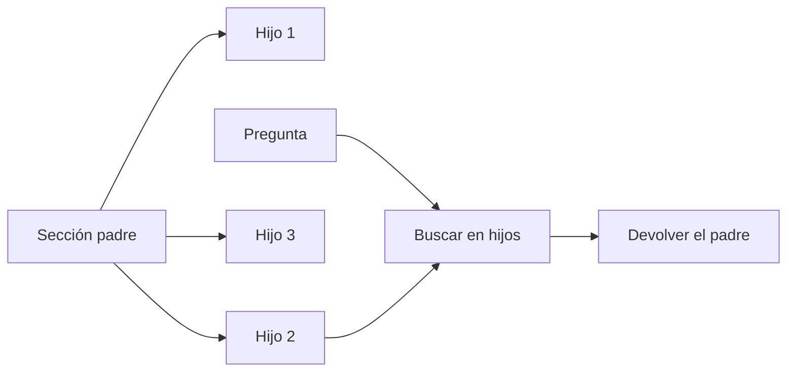

## Problema

El tamaño del fragmento te obliga a elegir. Con fragmentos pequeños (una o dos frases) la búsqueda es precisa: el vector representa una sola idea y se parece mucho a la pregunta. Pero al modelo le llega una frase suelta, sin las condiciones ni las excepciones que la rodean. Con fragmentos grandes (una sección entera) el modelo tiene contexto, pero el vector mezcla varias ideas y la búsqueda pierde precisión.

La técnica **padre-hijo** separa las dos decisiones: **buscas con el hijo y respondes con el padre**. Los hijos son trozos pequeños que llevan el id de su padre; el padre es la sección completa, que no se vectoriza. Es lo que en LangChain se conoce como *parent document retrieval*.



## Ingredientes

- Python 3.10 o superior, `pip install numpy` (y `qdrant-client` para la variante nativa).
- Documentos en Markdown con encabezados. Si vienen de PDF, extrae la estructura primero ([[cursos/rag-a-fondo/06-el-corpus-manda]]).
- La función `embed()` de juguete de [[recetas/rag-minimo-viable]] como `embed.py`, o un modelo real ([[docs/modelos-abiertos/04-embeddings-y-rerankers]]).

## Pasos

1. **Define el padre por la estructura del documento.** Una sección con su ruta de encabezados es la unidad natural: tiene un tema y se entiende sola. Si una sección es enorme, usa la subsección; el padre tiene que caber holgado en el contexto.
2. **Parte cada padre en hijos pequeños** agrupando frases hasta unas 25 palabras. Cada hijo guarda `padre`. Los ids son estables (`manual§4.2`): sirven para citar y para reindexar.
3. **Vectoriza solo los hijos.** Los padres se guardan en un almacén clave-valor (aquí, un diccionario; en producción, una tabla o el *payload*).
4. **Al buscar, recupera más hijos de los que necesitas** (8, por ejemplo) y sube a sus padres. Varios hijos del mismo padre cuentan una vez; para cuando llegues al número de padres o al presupuesto de palabras.

```python title="padre_hijo.py"
import re

import numpy as np

from embed import embed      # el embed() de juguete de la receta de RAG mínimo


def secciones(md: str, doc_id: str) -> list[dict]:
    """Padres: una sección de Markdown completa, con su ruta de encabezados."""
    padres, ruta, buffer = [], [], []

    def cerrar():
        texto = "\n".join(buffer).strip()
        if texto:
            padres.append({"id": f"{doc_id}§{len(padres) + 1}", "ruta": " > ".join(ruta), "texto": texto})
        buffer.clear()

    for linea in md.splitlines():
        m = re.match(r"^(#{1,6})\s+(.*)", linea)
        if m:
            cerrar()
            ruta[:] = ruta[: len(m.group(1)) - 1] + [m.group(2).strip()]
        else:
            buffer.append(linea)
    cerrar()
    return padres


def hijos(padre: dict, max_palabras: int = 25) -> list[dict]:
    """Hijos: grupos de frases cortos, cada uno con el id de su padre."""
    frases = re.split(r"(?<=[.!?])\s+", padre["texto"].replace("\n", " "))
    grupos, actual = [], []
    for frase in frases:
        if actual and len(" ".join(actual + [frase]).split()) > max_palabras:
            grupos.append(" ".join(actual))
            actual = []
        actual.append(frase)
    if actual:
        grupos.append(" ".join(actual))
    return [{"id": f"{padre['id']}.{i}", "padre": padre["id"], "texto": t}
            for i, t in enumerate(grupos, start=1)]


class IndicePadreHijo:
    def __init__(self, documentos: dict[str, str]):
        self.padres = {p["id"]: p for doc_id, md in documentos.items() for p in secciones(md, doc_id)}
        self.hijos = [h for p in self.padres.values() for h in hijos(p)]
        # se indexan SOLO los hijos; el padre se guarda aparte, sin vector
        self.vectores = np.array(embed([h["texto"] for h in self.hijos]), dtype=np.float32)

    def buscar(self, consulta: str, k_hijos: int = 8, max_padres: int = 2,
               presupuesto_palabras: int = 400) -> list[dict]:
        q = np.array(embed([consulta])[0], dtype=np.float32)
        sims = self.vectores @ q
        elegidos, palabras = [], 0
        for i in np.argsort(-sims)[:k_hijos]:
            hijo = self.hijos[i]
            if any(e["id"] == hijo["padre"] for e in elegidos):
                continue                           # varios hijos del mismo padre: el padre va una vez
            padre = self.padres[hijo["padre"]]
            n = len(padre["texto"].split())
            if palabras + n > presupuesto_palabras:
                break                              # respeta el presupuesto de contexto
            elegidos.append({**padre, "hijo": hijo["id"], "score": round(float(sims[i]), 3)})
            palabras += n
            if len(elegidos) == max_padres:
                break
        return elegidos


if __name__ == "__main__":
    indice = IndicePadreHijo({"manual": open("manual.md", encoding="utf-8").read()})
    print(f"{len(indice.padres)} padres · {len(indice.hijos)} hijos indexados")
    for r in indice.buscar("¿Cuántos días me dan por mudanza?"):
        print(f"{r['score']}  hijo {r['hijo']} -> padre {r['id']} ({r['ruta']})")
        print("   ", r["texto"][:90], "…")
```

```text
4 padres · 7 hijos indexados
0.389  hijo manual§4.2 -> padre manual§4 (Política de vacaciones 2026 > Permisos retribuidos)
    Por matrimonio o pareja de hecho corresponden 15 días naturales. Por nacimiento de un hijo …
0.219  hijo manual§2.1 -> padre manual§2 (Política de vacaciones 2026 > Solicitud)
    Las vacaciones se solicitan en el portal de RRHH con al menos 15 días de antelación. El re …
```

El hijo que coincide es «Por mudanza corresponde 1 día laborable…», pero al modelo le llega la sección entera de permisos, con la condición de justificarlo en 10 días. Esa condición estaba en otra frase: con fragmentos de una frase no habría llegado.

## Cómo comprobar que funciona

- **Mide la búsqueda con los hijos y la respuesta con los padres.** Para el [[glosario/recall-at-k|recall@k]], marca como relevante el padre: un acierto es que el padre correcto esté entre los devueltos, sea cual sea el hijo que lo trajo.
- **Compara con una sola granularidad.** Ejecuta las mismas 30 preguntas con fragmentos del tamaño del hijo y con fragmentos del tamaño del padre. Si padre-hijo no gana a los dos en tu banco ([[cursos/rag-a-fondo/10-evaluar-un-rag]]), no compensa la complejidad.
- **Cuenta tokens enviados.** Un padre puede ser diez veces más largo que un hijo. Vigila el coste y que el presupuesto se respete en las preguntas que tocan muchas secciones.

## Variaciones

- **Agrupación nativa en Qdrant.** `query_points_groups` agrupa los resultados por un campo del *payload* y devuelve el mejor hijo de cada padre. Ejecutado en modo local:

```python title="qdrant_grupos.py"
from qdrant_client import QdrantClient, models

from embed import embed
from padre_hijo import hijos, secciones

padres = {p["id"]: p for p in secciones(open("manual.md", encoding="utf-8").read(), "manual")}
todos = [h for p in padres.values() for h in hijos(p)]

client = QdrantClient(":memory:")
client.create_collection("hijos", vectors_config=models.VectorParams(size=512, distance=models.Distance.COSINE))
client.upsert("hijos", points=[
    models.PointStruct(id=i, vector=v, payload={"padre": h["padre"], "texto": h["texto"]})
    for i, (h, v) in enumerate(zip(todos, embed([h["texto"] for h in todos])))
])

grupos = client.query_points_groups(
    "hijos", query=embed(["¿Cuántos días me dan por mudanza?"])[0],
    group_by="padre",      # agrupa los hijos por su padre
    group_size=1,          # el mejor hijo de cada padre
    limit=2,               # dos padres distintos
)
for g in grupos.groups:
    print(g.id, round(g.hits[0].score, 3), padres[g.id]["ruta"])
```

```text
manual§4 0.389 Política de vacaciones 2026 > Permisos retribuidos
manual§2 0.219 Política de vacaciones 2026 > Solicitud
```

  En pgvector, el equivalente es `DISTINCT ON (padre_id)` sobre los mejores hijos y un `JOIN` con la tabla de secciones ([[herramientas/pgvector]]).
- **Ventana de frases.** En vez de la sección, devuelve el hijo con las N frases de antes y de después. Sirve en textos sin encabezados (transcripciones, correos).
- **Tres niveles.** Documento, sección y párrafo. Busca en párrafos, responde con secciones y usa el documento solo para el filtro y la cita.
- **Con frameworks.** LangChain tiene `ParentDocumentRetriever` en `langchain-classic`; LlamaIndex lo resuelve con nodos jerárquicos. Por debajo es este mismo diccionario de padres.

## Errores típicos

- **Vectorizar también los padres en el mismo índice.** Compiten con sus hijos y vuelves a mezclar granularidades.
- **No deduplicar.** Tres hijos del mismo padre meten tres copias de la sección en el prompt.
- **Padres sin límite.** Un capítulo entero de padre se come el contexto. Pon un tope de palabras o tokens y baja de nivel si se supera.
- **Hijos que no se entienden solos.** «Corresponde 1 día» no se parece a nada. Antepón la ruta de encabezados al texto del hijo o aplica [[glosario/recuperacion-contextual|recuperación contextual]].
- **Citar el hijo.** Cita el padre (o el hijo dentro del padre): es lo que el modelo leyó.
