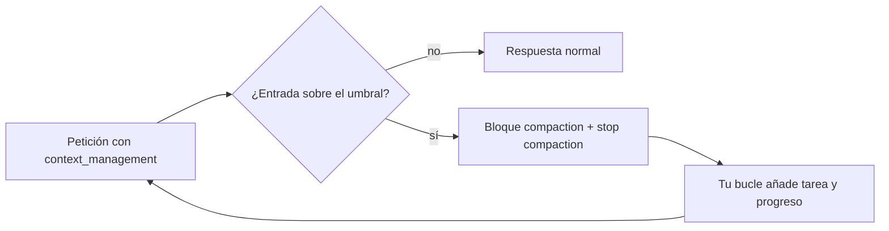

## Problema

Tu agente diagnostica incidencias leyendo logs: cientos de llamadas a herramientas, cada una con 200 líneas de resultado. A la hora de trabajo la conversación pasa de cien mil [[glosario/token|tokens]]. Cada paso es más caro y más lento, el modelo empieza a perder detalles enterrados en medio ([[glosario/context-rot]]) y, si sigues, acabas en `model_context_window_exceeded`.

La [[glosario/compactacion|compactación]] casera (resumir tú los mensajes viejos con otra llamada) funciona, pero te obliga a elegir dónde cortar sin romper parejas `tool_use`/`tool_result`, a mantener el prompt de resumen y a pagar y esperar una llamada aparte. La API de Claude lo hace dentro de la misma petición: cuando la entrada supera un umbral, resume lo anterior y devuelve el resumen como un bloque `compaction` que tú reenvías.

## Ingredientes

- Python 3.10 o superior y `pip install "anthropic>=2"`.
- La variable de entorno `ANTHROPIC_API_KEY`.
- Un modelo compatible: todos salvo Claude Haiku 4.5, Opus 4.5 y Sonnet 4.5.
- La beta `compact-2026-01-12`, que se activa usando `client.beta.messages` con `betas=[…]`.
- Un estado del agente fuera del contexto: aquí, un fichero `progreso.md` que el propio agente rellena con una herramienta (el patrón de [[sistemas/agente-de-larga-duracion]]).

## Pasos

1. **Declara la edición de compactación.** Va en `context_management.edits` con `type: "compact_20260112"`. El disparador por defecto es de 150 000 tokens de entrada y el mínimo, 50 000 ([documentación de compactación](https://platform.claude.com/docs/en/build-with-claude/compaction-threshold)). `instructions` sustituye por completo al prompt de resumen por defecto: si lo usas, pide tú las etiquetas `<summary></summary>` y lo que debe conservarse.

2. **Prohíbe herramientas durante el resumen.** Con herramientas definidas, el modelo a veces llama a una en lugar de resumir, y el bloque llega con `content: null`. La documentación recomienda decirlo en `instructions`.

3. **Reenvía `resp.content` tal cual.** La respuesta empieza por `{"type": "compaction", "content": "…"}`. Cuando la API recibe ese bloque, ignora todo lo anterior a él, así que lo más sencillo es seguir añadiendo mensajes a la misma lista. Usa `client.beta.messages` y pasa los objetos del SDK sin tocarlos: si los serializas tú con `model_dump()` en vez de `to_dict()` o `model_dump(exclude_none=True)`, el bloque lleva `text: null` y la API responde 400.

4. **Para tras compactar y reinyecta el estado.** Con `pause_after_compaction: True`, la respuesta trae solo el bloque y `stop_reason: "compaction"` (existe solo en el tipo beta `BetaStopReason`). Es tu momento de añadir lo que no puede depender de un resumen escrito por el modelo: la tarea literal y el fichero de progreso.

5. **Mide con `usage.iterations`.** La compactación es un muestreo más que se factura. Con la beta activa, cada respuesta trae `usage.iterations`; los `input_tokens` y `output_tokens` de nivel superior excluyen la iteración de compactación. Para el total facturado, suma las iteraciones.

6. **Mantén el `system` en caché.** Pon `cache_control` al final del prompt de sistema: tras cada compactación solo se escribe en caché el resumen nuevo.

```python title="agente_largo.py"
from pathlib import Path

import anthropic

MODEL = "claude-sonnet-5-5"
BETA = "compact-2026-01-12"
client = anthropic.Anthropic()

SISTEMA = [{"type": "text", "cache_control": {"type": "ephemeral"},  # el system sigue en caché tras compactar
            "text": "Eres un agente de diagnóstico. Lee los logs que haga falta y anota cada hallazgo con anotar."}]

COMPACTAR = {
    "type": "compact_20260112",
    "trigger": {"type": "input_tokens", "value": 150_000},  # por defecto 150 000; mínimo 50 000
    "pause_after_compaction": True,                          # para y te deja inyectar estado
    # sustituye por completo al prompt de resumen por defecto
    "instructions": ("Resume la transcripción dentro de <summary></summary>. Incluye lo necesario para seguir "
                     "la tarea: objetivo, hallazgos, ficheros revisados y qué falta. No llames a ninguna "
                     "herramienta mientras resumes; responde solo con texto."),
}

HERRAMIENTAS = [
    {"name": "leer_log", "description": "Devuelve 200 líneas de un fichero de log a partir de una línea.",
     "input_schema": {"type": "object", "properties": {"fichero": {"type": "string"}, "desde": {"type": "integer"}},
                      "required": ["fichero", "desde"]}},
    {"name": "anotar", "description": "Guarda un hallazgo en el fichero de progreso. Úsalo en cuanto confirmes algo.",
     "input_schema": {"type": "object", "properties": {"nota": {"type": "string"}}, "required": ["nota"]}},
]

PROGRESO = Path("progreso.md")


def leer_log(fichero: str, desde: int) -> str:
    lineas = Path(fichero).read_text(encoding="utf-8").splitlines()
    return "\n".join(lineas[desde:desde + 200]) or "(fin del fichero)"


def anotar(nota: str) -> str:
    with PROGRESO.open("a", encoding="utf-8") as f:
        f.write(f"- {nota}\n")
    return "anotado"


FUNCIONES = {"leer_log": leer_log, "anotar": anotar}


def ejecutar(u) -> dict:
    try:
        return {"type": "tool_result", "tool_use_id": u.id, "content": FUNCIONES[u.name](**u.input)}
    except Exception as e:
        return {"type": "tool_result", "tool_use_id": u.id, "content": f"Error: {e}", "is_error": True}


def tokens_facturados(usage) -> tuple[int, int]:
    """Con la beta activa, usage.iterations trae cada muestreo; el nivel superior excluye la compactación."""
    its = usage.iterations or []
    if not its:
        return usage.input_tokens, usage.output_tokens
    return sum(i.input_tokens for i in its), sum(i.output_tokens for i in its)


def agente(tarea: str, max_pasos: int = 300) -> str:
    messages = [{"role": "user", "content": tarea}]
    compactaciones, entrada, salida = 0, 0, 0
    for _ in range(max_pasos):
        resp = client.beta.messages.create(
            betas=[BETA], model=MODEL, max_tokens=8192, system=SISTEMA,
            tools=HERRAMIENTAS, messages=messages,
            context_management={"edits": [COMPACTAR]},
        )
        e, s = tokens_facturados(resp.usage)
        entrada, salida = entrada + e, salida + s
        # reenvía el contenido tal cual: el bloque compaction incluido
        messages.append({"role": "assistant", "content": resp.content})

        if resp.stop_reason == "compaction":
            compactaciones += 1
            if resp.content[0].content is None:      # el modelo llamó a una herramienta en vez de resumir
                print("aviso: compactación sin resumen")
            estado = PROGRESO.read_text(encoding="utf-8") if PROGRESO.exists() else "(sin hallazgos aún)"
            # el resumen lo escribe el modelo: reinyecta lo que no puede perderse
            messages.append({"role": "user", "content":
                             f"<tarea>{tarea}</tarea>\n<progreso>\n{estado}</progreso>\nSigue donde lo dejaste."})
            continue
        if resp.stop_reason == "pause_turn":
            continue
        if resp.stop_reason == "tool_use":
            usos = [b for b in resp.content if b.type == "tool_use"]
            messages.append({"role": "user", "content": [ejecutar(u) for u in usos]})
            continue
        print(f"compactaciones: {compactaciones} | tokens facturados: {entrada} entrada, {salida} salida")
        if resp.stop_reason == "end_turn":
            return "".join(b.text for b in resp.content if b.type == "text")
        return f"[parada: {resp.stop_reason}]"
    return "[límite de pasos alcanzado]"


if __name__ == "__main__":
    print(agente("Encuentra la causa de los errores 502 de anoche en logs/nginx.log y logs/app.log."))
```



## Cómo comprobar que funciona

No hace falta llenar 150 000 tokens para probar el bucle. Con el simulador de la API del proyecto, la tercera respuesta es un bloque `compaction` con `stop_reason: "compaction"` y un `usage.iterations` como el que documenta la API; las cifras de tokens son inventadas para la prueba. Después el script inspecciona lo que el código envió. Salida real:

```text
compactaciones: 1 | tokens facturados: 162440 entrada, 2460 salida
Causa: el pool de conexiones de la app se agota y nginx devuelve 502.
peticiones: 5 | todas con compact_20260112: True
petición 4 reenvía: {"content": "<summary>Objetivo: causa de los 502. Revisado nginx.log 0-200: upstream 502.  …
claves del bloque: ['content', 'type']
estado inyectado: ['<progreso>', '- nginx: 502 de upstream desde las 23:10']
system con cache_control: True
```

- La petición siguiente a la compactación lleva el bloque `compaction` con solo `type` y `content` (sin `text: null`) y, detrás, el estado reinyectado.
- Con la API real, comprueba el tamaño efectivo: `client.beta.messages.count_tokens(betas=[BETA], …, context_management=…)` aplica los bloques de compactación existentes (no dispara compactaciones nuevas) y trae `context_management.original_input_tokens` para comparar.
- En la traza de cada paso ([[disciplinas/observabilidad]]), registra cuándo hubo compactación y su coste. Si compactas cada pocos pasos, el umbral está demasiado bajo o los resultados de herramientas son demasiado grandes.

## Variaciones

- **Bajo demanda.** Con la beta `compact-2026-09-04` decides tú cuándo: una petición con `compaction={"type": "summarize"}` (sin `context_management`) devuelve solo el bloque firmado, que luego va el primero en `messages` en lugar de lo que resume. La documentación la recomienda donde esté disponible; la forma y sus reglas están en [[docs/contexto/05-compactacion-y-limpieza-en-el-servidor]].
- **Sin pausa.** Con `pause_after_compaction: False` (el valor por defecto), la misma respuesta trae el bloque `compaction` y la continuación. Es más simple, pero pierdes el punto en el que reinyectar el estado: úsalo cuando el resumen por defecto te baste.
- **Recortar la lista local.** La API ignora lo anterior al bloque, pero tu proceso sigue guardándolo y enviándolo. Puedes descartar los mensajes compactados y quedarte del bloque en adelante.
- **Limpiar en vez de resumir.** Si lo que crece son resultados de herramientas ya usados, la limpieza de contexto (`clear_tool_uses_20250919`) borra los antiguos sin resumir nada. Cuándo conviene cada una está en [[docs/contexto/05-compactacion-y-limpieza-en-el-servidor]].
- **Presupuesto total.** Cuenta compactaciones y, al pasar de un tope, pide al agente que cierre con un mensaje `user`. Para la cuenta atrás que ve el modelo existe `output_config.task_budget` (beta), que es orientativo; el tope duro sigue siendo tu bucle y `max_tokens`.
- **Compactación casera.** Sigue siendo la opción con modelos abiertos, con otros proveedores y cuando necesitas resumir con un modelo más barato: la del servidor usa siempre el modelo de la petición. Compara:

| | En el servidor | Casera |
|---|---|---|
| Quién decide cuándo | El umbral de `trigger` | Tu código |
| Dónde se corta | La API, sin romper parejas `tool_use`/`tool_result` | Tú, con cuidado |
| Modelo que resume | El de la petición | El que elijas |
| Llamadas extra | Ninguna (un muestreo más en la misma petición) | Una por resumen |
| Portabilidad | Solo API de Claude, en beta | Cualquier proveedor ([[cursos/context-engineering/03-compactacion-y-memoria]]) |

## Errores típicos

- **No reenviar el bloque `compaction`.** Si guardas solo el texto de la respuesta, la siguiente petición vuelve a llevar toda la historia y se compacta otra vez: pagas el resumen en cada paso.
- **Serializar a mano con `model_dump()`.** Añade `text: null` y `citations: null` al bloque y la API lo rechaza con `Extra inputs are not permitted`.
- **Reinsertar bloques de razonamiento antiguos.** En los modelos 5.1 y posteriores, los bloques `thinking` de antes de la compactación no se arrastran, y si reinsertas turnos del asistente con razonamiento detrás del bloque fallan la comprobación de prefijo. Quítalos de esos turnos.
- **`instructions` sin las reglas del resumen por defecto.** Sustituye el prompt entero: si no pides `<summary>` ni prohíbes herramientas, puede llegar un resumen vacío.
- **Confiar el estado al resumen.** El resumen es del modelo y puede omitir lo que más te importa. El objetivo, las restricciones y el progreso viven en tu `progreso.md` y se reinyectan.
- **Tratar `stop_reason == "compaction"` como un final.** Si tu bucle solo distingue `tool_use` y `end_turn`, devolverá una respuesta vacía. Trata todas las paradas ([[docs/fundamentos/06-motivos-de-parada-y-rechazos]]).
