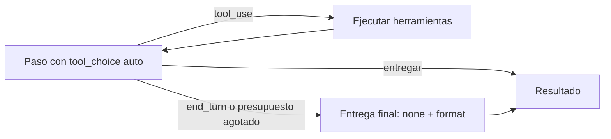

## Problema

Tienes un [[glosario/subagente|subagente]] que investiga con herramientas y termina llamando a `entregar`, una herramienta con esquema estricto que devuelve al orquestador datos en vez de prosa. Para no quedarte sin nada cuando se agota el presupuesto de pasos, en el último paso forzabas la entrega con [[glosario/tool-choice|tool_choice]]. Es el patrón de [[cursos/sistemas-multiagente/02-disenar-subagentes]] y [[roadmap/60-multiagente/03-pasar-contexto-entre-agentes]]:

```python nocheck title="antes (fragmento)"
resp = await client.messages.create(
    model=MODEL, max_tokens=4096, system=system_de(b), messages=messages,
    tools=tools + [ENTREGAR],
    tool_choice={"type": "tool", "name": "entregar"} if ultimo else {"type": "auto"})
```

Con `MODEL = "claude-sonnet-5-5"`, esa llamada falla. La documentación de razonamiento lo dice sin matices: Claude Opus 5.5, Sonnet 5.5, Fable 5.1 y Mythos 5.1 **rechazan el uso forzado de herramientas con un 400 en todas las peticiones**, tanto `{"type": "any"}` como `{"type": "tool", …}` ([Building with extended thinking](https://platform.claude.com/docs/en/build-with-claude/thinking)). Solo `auto` y `none` siguen valiendo. Y en los modelos que aún lo aceptan, la respuesta forzada empieza directamente por la llamada y no trae bloque de razonamiento: justo en el paso en que el subagente tiene que sintetizar todo lo que encontró.

La solución no es buscar otra forma de obligar. Es separar dos cosas: **qué forma tiene la entrega** (eso lo garantiza un esquema) y **cuándo toca entregar** (eso lo decide tu bucle).

## Ingredientes

- Python 3.10 o superior y `pip install "anthropic>=2"` (SDK 2.x, API `2026-10-21`).
- La variable de entorno `ANTHROPIC_API_KEY`.
- Un subagente con bucle de herramientas ([[docs/agentes/02-subagentes]]) y un esquema de entrega compatible con [[docs/prompting/03-salida-estructurada|salidas estructuradas]]: `additionalProperties: false`, sin `minimum`/`maximum` ni `minLength`/`maxLength`.

## Pasos

1. **Escribe el esquema de entrega una sola vez.** La herramienta `entregar` (con `strict: True`) y la entrega final usan el mismo `ESQUEMA_ENTREGA`. Así el orquestador recibe la misma estructura venga por donde venga.

2. **Deja `tool_choice` en `auto` en todos los pasos normales.** El prompt de sistema dice que termine con `entregar`, y la mayoría de las veces lo hará por su cuenta. Si lo hace, la conversación acaba ahí: no hace falta devolverle un `tool_result` porque no habrá más turnos.

3. **Detecta los dos casos en que no entrega**: se agota el presupuesto o termina con texto (`end_turn`) sin llamar a `entregar`. En ambos, sal del bucle y haz una entrega final.

4. **En la entrega final, prohíbe herramientas y fija el formato.** Misma lista de `tools` (cambiarla invalidaría toda la [[glosario/prompt-caching|caché]], porque las herramientas van primero en el prefijo), `tool_choice={"type": "none"}` y `output_config.format` con el esquema. La respuesta llega como un bloque `text` con JSON que cumple el esquema. Antes, añade un [[glosario/mensaje-de-sistema-intermedio|mensaje de sistema intermedio]] (GA en los modelos 5.x salvo Sonnet 5) que diga qué pasa; debe ir justo después de un turno `user`, que en tu bucle siempre existe.

5. **Trata las paradas de la entrega final.** `refusal` y `max_tokens` pueden dejar un JSON que no cumple el esquema ([[problemas/respuesta-cortada-por-max-tokens]]): compruébalo antes de hacer `json.loads`.

```python title="subagente.py"
import json
from dataclasses import dataclass

import anthropic

MODEL = "claude-sonnet-5-5"
client = anthropic.AsyncAnthropic()

ESQUEMA_ENTREGA = {
    "type": "object",
    "properties": {
        "hallazgos": {"type": "array", "items": {
            "type": "object",
            "properties": {"afirmacion": {"type": "string"},
                           "evidencia": {"type": "string"},
                           "fuente": {"type": "string"}},
            "required": ["afirmacion", "evidencia", "fuente"],
            "additionalProperties": False}},
        "lagunas": {"type": "string", "description": "Qué no pudiste verificar"},
    },
    "required": ["hallazgos", "lagunas"],
    "additionalProperties": False,
}

# el mismo esquema sirve para la herramienta y para la entrega final
ENTREGAR = {
    "name": "entregar",
    "description": "Entrega el resultado final. Llámala una sola vez, cuando termines.",
    "strict": True,
    "input_schema": ESQUEMA_ENTREGA,
}


@dataclass
class Brief:
    objetivo: str
    limites: str
    parada: str
    max_pasos: int = 12


class SubagenteRechazado(Exception):
    pass


def system_de(b: Brief) -> str:
    return (f"Eres un subagente de investigación.\n<objetivo>{b.objetivo}</objetivo>\n"
            f"<limites>{b.limites}</limites>\n<parada>{b.parada}</parada>\n"
            "Cuando termines, llama a la herramienta entregar.")


async def ejecutar(u, handlers: dict) -> dict:
    try:
        return {"type": "tool_result", "tool_use_id": u.id, "content": await handlers[u.name](**u.input)}
    except Exception as e:
        return {"type": "tool_result", "tool_use_id": u.id, "content": f"Error: {e}", "is_error": True}


async def entrega_final(b: Brief, tools: list[dict], messages: list) -> dict:
    """Último paso sin forzar herramienta: tool_choice none + output_config.format."""
    messages.append({"role": "system",
                     "content": "Último paso: responde solo con la entrega en el formato pedido. "
                                "Lo que no hayas podido verificar va en lagunas."})
    resp = await client.messages.create(
        model=MODEL, max_tokens=4096, system=system_de(b), messages=messages,
        tools=tools + [ENTREGAR],        # las mismas herramientas: el prefijo de tools y system no cambia
        tool_choice={"type": "none"},    # en esta llamada no puede usar ninguna
        output_config={"format": {"type": "json_schema", "schema": ESQUEMA_ENTREGA}},
    )
    if resp.stop_reason == "refusal":
        raise SubagenteRechazado(resp.stop_details.category if resp.stop_details else None)
    if resp.stop_reason != "end_turn":   # max_tokens: el JSON puede venir cortado
        raise RuntimeError(f"Entrega final incompleta: {resp.stop_reason}")
    return json.loads(next(x.text for x in resp.content if x.type == "text"))


async def ejecutar_subagente(b: Brief, tools: list[dict], handlers: dict) -> dict:
    messages = [{"role": "user", "content": "Empieza."}]
    for _ in range(b.max_pasos):
        resp = await client.messages.create(
            model=MODEL, max_tokens=4096, system=system_de(b), messages=messages,
            tools=tools + [ENTREGAR])    # tool_choice auto (por defecto)
        messages.append({"role": "assistant", "content": resp.content})
        usos = [x for x in resp.content if x.type == "tool_use"]
        entrega = next((u for u in usos if u.name == "entregar"), None)
        if entrega:
            return entrega.input         # strict: cumple ESQUEMA_ENTREGA
        if resp.stop_reason == "refusal":
            raise SubagenteRechazado(resp.stop_details.category if resp.stop_details else None)
        if resp.stop_reason == "pause_turn":
            continue
        if resp.stop_reason != "tool_use":
            # terminó sin entregar (end_turn, max_tokens…): pídeselo como turno de usuario
            messages.append({"role": "user", "content": "Entrega el resultado."})
            break
        messages.append({"role": "user", "content": [await ejecutar(u, handlers) for u in usos]})
    return await entrega_final(b, tools, messages)
```



## Cómo comprobar que funciona

Probado con `anthropic` 2.3.0 y el simulador de la API del proyecto, ampliado para que responda 400 a un `tool_choice` forzado en los modelos de la lista, como dice la documentación. Cuatro casos: la llamada antigua, presupuesto agotado (dos pasos de búsqueda), entrega por iniciativa propia y fin con texto sin entregar. Salida real:

```text
antes: BadRequestError 400
presupuesto agotado: 3 llamadas | última: tool_choice {'type': 'none'} | format json_schema | último mensaje system | tools ['buscar', 'entregar']
  entrega: La API 2026-10-21 elimina temperature | lagunas: No comprobé Bedrock
  ninguna petición fuerza herramienta: True
entrega propia: 2 llamadas | lagunas: No comprobé Bedrock
fin sin entregar: 2 llamadas | roles al final: ['assistant', 'user', 'system']
```

- Con la API real, la llamada antigua devuelve `anthropic.BadRequestError` con estado 400. Busca en tu código `"type": "tool"` y `"type": "any"` dentro de `tool_choice`: cada aparición con un modelo 5.5 es un fallo seguro.
- En la entrega final, `tools` es idéntica a la de los pasos anteriores; cambian `tool_choice` y `output_config`. Mira `usage` en esa llamada: cambiar `tool_choice` invalida la caché de `messages`, no la de `tools` ni la de `system`.
- Valida el resultado contra el esquema en tu código antes de pasárselo al orquestador, aunque la API lo garantice.

## Variaciones

- **Aviso de sistema de un solo turno (beta).** Si quieres que la entrega siga pasando por la herramienta `entregar` y no tocar `tool_choice` ni `output_config` (la caché queda entera), añade en el último paso un mensaje de sistema con `clear_at: "next_user_message"`. Se ve en ese turno y deja de contar en cuanto llega otro mensaje `user`, así que no se acumula si el bucle sigue. Es una sugerencia, no una obligación: si aun así no entrega, cae a `entrega_final`. Redáctalo como un hecho («te queda un paso»), que la documentación de [[docs/contexto/06-mensajes-de-sistema-a-mitad-de-conversacion|mensajes de sistema intermedios]] recomienda frente a órdenes.

```python title="variante_b.py"
import anthropic

MODEL = "claude-sonnet-5-5"
BETAS = ["mid-conversation-system-clear-at-2026-08-21"]
client = anthropic.AsyncAnthropic()

AVISO = {"role": "system", "clear_at": "next_user_message",
         "content": "Te queda un paso del presupuesto. Llama a entregar con lo que tengas; lo pendiente va en lagunas."}


async def paso(system: str, tools: list[dict], messages: list, ultimo: bool):
    if ultimo:
        messages.append(AVISO)  # va justo después del mensaje user con los tool_result
    # todas las llamadas con las mismas betas: el conjunto de cabeceras también cuenta para la caché
    return await client.beta.messages.create(
        betas=BETAS, model=MODEL, max_tokens=4096, system=system, tools=tools, messages=messages)
```

- **Dejar solo `entregar` disponible.** Con la beta `inline-tools-2026-09-15`, un mensaje de sistema con bloques `{"type": "tool_removal", "tool": {"type": "tool_reference", "name": "buscar"}}` retira las herramientas de trabajo desde ese punto sin editar `tools`. Va en un mensaje de sistema aparte (los de `clear_at` solo admiten texto) y no se acepta justo después de un turno en pausa (`pause_turn`).
- **Un modelo que admite forzar.** Con un modelo fuera de la lista (por ejemplo, Opus 5) el código antiguo sigue funcionando. Es la salida más rápida para un sistema heredado, pero te ata a ese modelo y pierdes el razonamiento del último paso. Compruébalo en la página del modelo antes de contar con ello.
- **Con LangChain o LangGraph.** El mismo principio vale con `ChatAnthropic(model=MODEL)`: no pases un `tool_choice` forzado a `bind_tools` con estos modelos. Para la entrega final, usa `with_structured_output(Esquema, method="json_schema")`, que va por salidas estructuradas. En `langchain-anthropic` 1.7.7 el método por defecto (`function_calling`) no fuerza la herramienta en Opus 5.5, Sonnet 5.5 ni Fable 5.1, pero avisa y lanza `OutputParserException` si el modelo no la llama: no es una entrega garantizada.

## Errores típicos

- **Cambiar `tool_choice="any"` por `"tool"` (o al revés).** Las dos formas fuerzan y las dos dan 400.
- **Quitar `tools` en la entrega final.** Funciona como idea, pero rompe la caché de todo el prefijo. Usa `tool_choice: none` con las mismas herramientas.
- **Meter el aviso en un mensaje de sistema entre un `tool_use` y su `tool_result`.** Da 400. Va después del mensaje `user` con los resultados.
- **Pedir el razonamiento dentro del esquema** (un campo `razonamiento` o `pasos`). Puede disparar rechazos de categoría `reasoning_extraction`; pide evidencias breves, como `evidencia` aquí ([[recetas/fallback-ante-rechazos]]).
- **Hacer `json.loads` sin mirar `stop_reason`.** Con `max_tokens` o `refusal` la salida puede no cumplir el esquema.
- **Olvidar el orquestador.** Si el orquestador también forzaba herramientas para sintetizar, tiene el mismo problema: revisa todos los `tool_choice` del sistema, no solo el del subagente.
