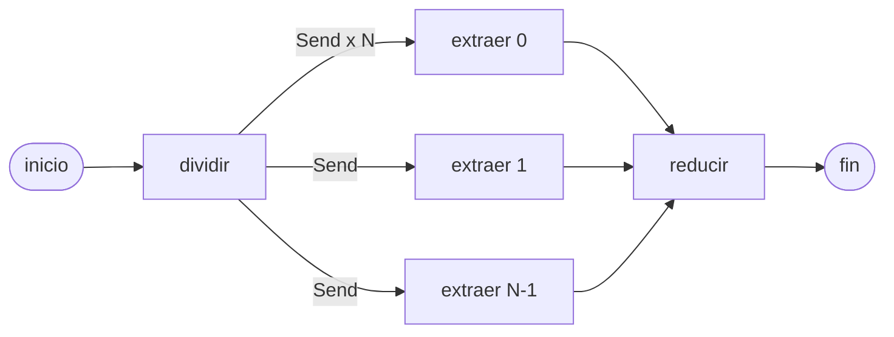

## Problema

Tienes que responder una pregunta sobre un contrato de 200 páginas («¿qué penalizaciones por retraso hay?»). Meterlo entero en una llamada es caro y el modelo se pierde en el medio ([[glosario/lost-in-the-middle]]). Procesarlo trozo a trozo en serie es lento. La salida clásica es **map-reduce**: troceas, haces la misma extracción sobre cada trozo en paralelo (*map*) y combinas los parciales en una respuesta (*reduce*).

En LangGraph el *map* se hace con `Send`: un nodo devuelve una lista de `Send("nodo", entrada)` y LangGraph lanza una tarea por cada uno en el mismo superpaso, cada una con su propia entrada. Es la [[patrones/05-paralelizacion|paralelización]] por secciones, con un número de ramas que solo se conoce en tiempo de ejecución.

## Ingredientes

- Python 3.10 o superior: `pip install langgraph "langchain[anthropic]"`.
- `ANTHROPIC_API_KEY` para la versión real (o cualquier modelo de LangChain, también local).
- El documento ya en texto. Si viene en PDF, conviértelo antes ([[recetas/pdf-a-markdown-con-docling]]).

## Pasos

1. **Trocea en código, no con el modelo.** Si el reparto es mecánico (párrafos, páginas, filas), hazlo con una función: es gratis, determinista y comprobable. Deja al modelo la planificación solo cuando las subtareas dependen del contenido ([[patrones/06-orquestador-trabajadores]]).

2. **Declara un reductor en el campo donde escriben los trabajadores.** Los trabajadores corren en el mismo superpaso y escriben en el mismo campo del estado. Sin `Annotated[list, operator.add]`, LangGraph no sabe combinar las escrituras y falla; con él, concatena.

3. **Pon los topes en tu código.** Un tope de trozos (el coste máximo es conocido: N llamadas de *map* + 1 de *reduce*), un tope de concurrencia para no chocar con el límite de tasa ([[problemas/error-429-limite-de-tasa]]) y reintentos por trozo para que un fallo transitorio no tumbe todo.



```python title="map_reduce.py"
import operator
from typing import Annotated, TypedDict

from langchain.chat_models import init_chat_model
from langgraph.graph import END, START, StateGraph
from langgraph.types import RetryPolicy, Send

MODEL = "anthropic:claude-sonnet-5-5"
TAM_TROZO = 4000          # caracteres por trozo
MAX_TROZOS = 20           # tope de coste: como mucho 20 llamadas de map + 1 de reduce
MAX_CONCURRENCIA = 4      # tope de llamadas simultáneas (límite de tasa del proveedor)


class Estado(TypedDict):
    pregunta: str
    documento: str
    trozos: list[str]
    parciales: Annotated[list[tuple[int, str]], operator.add]   # reductor: cada trabajador AÑADE
    respuesta: str


class Encargo(TypedDict):          # lo único que recibe cada trabajador vía Send
    indice: int
    trozo: str
    pregunta: str


def trocear(texto: str, tam: int) -> list[str]:
    parrafos, trozos, actual = texto.split("\n\n"), [], ""
    for p in parrafos:                     # corta por párrafos, sin partir frases
        if actual and len(actual) + len(p) > tam:
            trozos.append(actual)
            actual = ""
        actual += p + "\n\n"
    return trozos + ([actual] if actual.strip() else [])


def construir(modelo=None):
    llm = modelo or init_chat_model(MODEL, max_tokens=1024)

    def dividir(state: Estado):
        trozos = trocear(state["documento"], TAM_TROZO)
        if len(trozos) > MAX_TROZOS:       # el límite lo impone tu código, no el modelo
            raise ValueError(f"{len(trozos)} trozos supera el máximo de {MAX_TROZOS}")
        return {"trozos": trozos}

    def repartir(state: Estado):           # una tarea por trozo, todas en el mismo superpaso
        return [Send("extraer", {"indice": i, "trozo": t, "pregunta": state["pregunta"]})
                for i, t in enumerate(state["trozos"])]

    def extraer(encargo: Encargo):
        r = llm.invoke(
            f"Pregunta: {encargo['pregunta']}\n<fragmento>\n{encargo['trozo']}\n</fragmento>\n"
            "Extrae solo los datos del fragmento que respondan a la pregunta, en viñetas. "
            "Si no hay ninguno, responde exactamente: NADA")
        return {"parciales": [(encargo["indice"], r.text)]}

    def reducir(state: Estado):
        utiles = [f"<parcial n='{i}'>\n{t}\n</parcial>" for i, t in sorted(state["parciales"]) if t.strip() != "NADA"]
        r = llm.invoke(f"Pregunta: {state['pregunta']}\n" + "\n".join(utiles)
                       + "\nCombina los parciales en una respuesta única, sin repetir datos.")
        return {"respuesta": r.text}

    g = StateGraph(Estado)
    g.add_node("dividir", dividir)
    g.add_node("extraer", extraer, retry_policy=RetryPolicy(max_attempts=3))   # reintenta solo el trozo que falla
    g.add_node("reducir", reducir)
    g.add_edge(START, "dividir")
    g.add_conditional_edges("dividir", repartir, ["extraer"])
    g.add_edge("extraer", "reducir")       # reducir espera a que terminen TODOS los extraer
    g.add_edge("reducir", END)
    return g.compile()


if __name__ == "__main__":
    with open("contrato.txt", encoding="utf-8") as f:
        documento = f.read()
    out = construir().invoke({"pregunta": "¿Qué penalizaciones por retraso hay?", "documento": documento},
                             {"max_concurrency": MAX_CONCURRENCIA})
    print(out["respuesta"])
```

4. **Fíjate en lo que recibe cada trabajador.** `extraer` no ve el estado global: recibe solo el `Encargo` que le pasó `Send`. Es la ventaja de contexto del map-reduce: cada llamada lleva un trozo y la pregunta, nada más. El índice viaja con el resultado para que `reducir` ordene los parciales igual que el documento.

5. **Filtra antes de reducir.** Los trozos sin nada útil devuelven `NADA` y no llegan a la síntesis. Así la llamada de *reduce* no crece con ruido y su coste depende de lo encontrado, no del tamaño del documento.

## Cómo comprobar que funciona

Lo ejecuté con un [[glosario/modelo-simulado|modelo simulado]] que tarda 0,2 s por llamada, sobre un documento de 12 cláusulas (4 con penalizaciones) troceado en 8 partes, variando `max_concurrency`. Salida real (langgraph 1.2.18):

```text
max_concurrency=1: 8 trozos · 9 llamadas · 1.84 s · hilos 2 · orden [0, 1, 2, 3, 4, 5, 6, 7]
max_concurrency=2: 8 trozos · 9 llamadas · 1.02 s · hilos 3 · orden [0, 1, 2, 3, 4, 5, 6, 7]
max_concurrency=6: 8 trozos · 9 llamadas · 0.63 s · hilos 7 · orden [0, 1, 2, 3, 4, 5, 6, 7]
respuesta: Respuesta final con 4 parciales
tope: 8 trozos supera el máximo de 3
```

Qué te dice:

- Las llamadas son siempre N + 1 (8 de *map* y 1 de *reduce*): el **coste** no cambia con la concurrencia; la **latencia**, sí.
- `max_concurrency` limita de verdad las tareas simultáneas: con 1 va en serie (unos 8 × 0,2 s más la síntesis).
- Solo los 4 trozos con penalizaciones llegan a `reducir`.
- Con `MAX_TROZOS = 3`, el grafo se niega a empezar en lugar de gastar.

Con el modelo real, compara la respuesta con una lectura humana de 2 o 3 contratos antes de confiar en ella: el *map* pierde datos que solo se entienden cruzando trozos (una cláusula que remite a otra).

## Variaciones

- **Plan con el modelo.** Si las subtareas no salen de un corte mecánico, un nodo `planificar` con `llm.with_structured_output(Plan, method="json_schema")` genera la lista (con Claude, pasa `method="json_schema"`: sin él, LangChain fuerza una herramienta y `claude-sonnet-5-5` lo rechaza) y `repartir` envía un `Send` por subtarea. Pon igualmente el tope en código: `plan.subtareas[:MAX]`.
- **Modelo barato en el *map*.** El *map* es repetitivo y acotado: usa un modelo más pequeño o uno local ([[recetas/agente-local-con-ollama]]) y deja el modelo mayor para `reducir`.
- **Reducción en dos niveles.** Con cientos de parciales, agrupa de 10 en 10 con otra ronda de `Send` antes de la síntesis final, para que la llamada de *reduce* no se desborde.
- **Trabajadores agénticos.** El destino de `Send` puede ser un subgrafo con herramientas en lugar de una llamada. Así se monta un [[glosario/orquestador|orquestador]] con [[glosario/subagente|subagentes]]; el coste se multiplica, así que mídelo ([[recetas/coste-por-subagente]]).
- **Mismo patrón sin LangGraph.** Con el SDK, `asyncio.gather` con un `asyncio.Semaphore(MAX_CONCURRENCIA)` hace lo mismo; LangGraph añade reintentos por nodo, *streaming* de progreso y checkpoints.

## Errores típicos

- **Olvidar el reductor.** Sin `Annotated[..., operator.add]`, varios trabajadores escriben en el mismo campo en un superpaso y LangGraph lanza `InvalidUpdateError: At key 'parciales': Can receive only one value per step`.
- **Dejar que el modelo decida cuántas ramas.** Un plan con 80 subtareas son 80 llamadas. El tope va en código.
- **Sin `max_concurrency`.** Con muchos trozos lanzas todas las peticiones a la vez y el proveedor responde 429.
- **Pasar el estado entero a cada trabajador.** Si `Send` lleva el documento completo, pierdes la ventaja de contexto y pagas N veces el documento.
- **Confiar en el orden de llegada.** Lleva un índice en cada parcial y ordena en `reducir`.
- **Cortar a mitad de frase o de tabla.** Trocea por unidades con sentido ([[recetas/trocear-documentos]]); un dato partido entre dos trozos no lo ve ningún trabajador.
