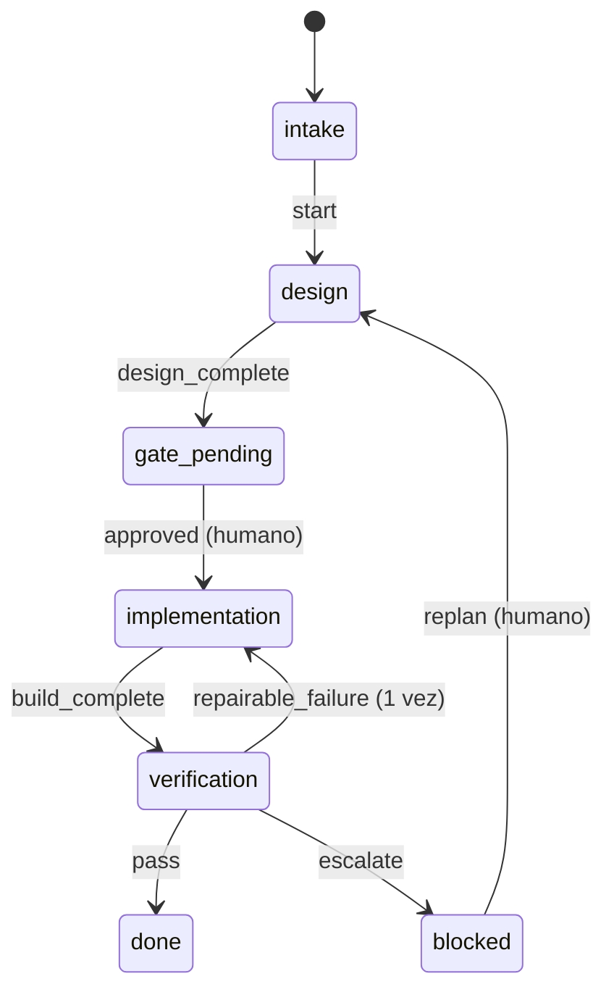

## Problema

Tu orquestador encadena fases: diseñar, esperar aprobación, construir, verificar. Mientras el flujo vive en el prompt («cuando termine el diseño, pide aprobación y luego construye»), el modelo puede saltarse un paso, repetir una reparación tres veces o dar por cerrada una tarea sin veredicto. Y cuando algo sale mal, no hay registro de qué pasó ni en qué orden.

La salida del harness del autor es sacar el flujo del prompt a un **contrato**: una máquina de estados en TOML con fases, eventos, actores y guards. Un motor determinista es el único que puede cambiar el estado; la IA propone el evento y el motor decide si es válido. Si una guard falla, la transición no escribe nada. Esta receta es la versión reducida de `workflow.toml`, `feature.py` y `validate_harness.py`.

## Ingredientes

- Python 3.11 o superior (`tomllib`, biblioteca estándar).
- Tu flujo dibujado en papel: fases, qué evento lleva de una a otra y quién puede dispararlo.

## Pasos

1. **Dibuja el flujo.** Fases de trabajo, una puerta humana, un bloqueo con salida humana y dos finales.



2. **Escríbelo como contrato.** Cada transición dice desde qué fase (o fases), con qué evento, hacia dónde, qué actor puede dispararla y qué guards deben pasar. El contrato es la fuente de verdad del motor y del validador: cambiar el flujo es cambiar este archivo, no un prompt.

```toml title="workflow.toml"
# Máquina de estados de una tarea. Fuente de verdad del motor y del validador.
version = 1

[workflow]
phases = ["intake", "design", "gate_pending", "implementation", "verification", "blocked", "done", "cancelled"]
terminal_phases = ["done", "cancelled"]
max_repairs = 1

[[transitions]]
from = "intake"
event = "start"
to = "design"
actor = "orchestrator"
guards = []

[[transitions]]
from = "design"
event = "design_complete"
to = "gate_pending"
actor = "orchestrator"
guards = ["spec_present"]

[[transitions]]
from = "gate_pending"
event = "approved"
to = "implementation"
actor = "human"
guards = ["decision_recorded", "spec_present"]

[[transitions]]
from = "implementation"
event = "build_complete"
to = "verification"
actor = "orchestrator"
guards = ["report_present"]

[[transitions]]
from = "verification"
event = "pass"
to = "done"
actor = "orchestrator"
guards = ["verdict_pass"]

[[transitions]]
from = "verification"
event = "repairable_failure"
to = "implementation"
actor = "orchestrator"
guards = ["repair_available"]

[[transitions]]
from = ["design", "implementation", "verification"]
event = "escalate"
to = "blocked"
actor = "orchestrator"
guards = ["reason_recorded"]

[[transitions]]
from = "blocked"
event = "replan"
to = "design"
actor = "human"
guards = ["decision_recorded"]

[[transitions]]
from = ["intake", "design", "gate_pending", "implementation", "verification", "blocked"]
event = "cancel"
to = "cancelled"
actor = "human"
guards = ["decision_recorded"]
```

3. **Implementa cada guard como una función.** Recibe el contexto (carpeta de la tarea, argumentos, estado, contrato) y devuelve una lista de problemas; vacía significa que pasa. Comprueban cosas verificables en disco: que existe la spec, que el veredicto es `PASS`, que queda presupuesto de reparación. **Nunca** preguntan al modelo.

4. **Escribe un único escritor.** El motor busca la transición, comprueba el actor, ejecuta **todas** las guards (para que el rechazo liste todos los motivos a la vez) y solo si todo pasa aplica los efectos: cambia la fase, cuenta reparaciones, registra la decisión humana, escribe el estado de forma atómica y añade una línea al registro de eventos. El registro es de solo añadir: nunca se reescribe para ocultar una inconsistencia.

5. **Valida el contrato.** Un contrato roto es peor que no tenerlo: el validador comprueba fases únicas, transiciones hacia fases que existen, sin duplicados, ninguna salida desde una fase terminal, actores válidos, que **toda guard citada está implementada**, que todas las fases son alcanzables y que ninguna fase no terminal es un callejón sin salida.

```python title="motor.py"
#!/usr/bin/env python3
"""Motor de estado: aplica workflow.toml. Es el único que escribe estado.json y añade a eventos.jsonl.

  motor.py transition <carpeta> EVENTO [--by human] [--response T] [--reason T]
  motor.py validar                       comprueba el contrato (exit 1 si hay errores)
"""
import argparse
import json
import os
import sys
import tempfile
import tomllib
from collections import deque
from datetime import datetime, timezone
from pathlib import Path

CONTRATO = Path(__file__).with_name("workflow.toml")
NUEVO = {"phase": "intake", "repairs": 0, "gate": None, "blocked_reason": None}


# --- Guards: cada una devuelve una lista de problemas; vacía = pasa ---------------------------
def g_spec_present(ctx):
    return [] if (ctx["dir"] / "spec.md").is_file() else ["falta spec.md"]


def g_decision_recorded(ctx):
    a = ctx["args"]
    return [] if a.by == "human" and (a.response or "").strip() else ["decisión humana: --by human y --response literal"]


def g_report_present(ctx):
    return [] if (ctx["dir"] / "informe.md").is_file() else ["falta informe.md del constructor"]


def g_verdict_pass(ctx):
    veredicto = ctx["dir"] / "veredicto.txt"
    texto = veredicto.read_text(encoding="utf-8").strip() if veredicto.is_file() else "sin veredicto"
    return [] if texto == "PASS" else [f"el veredicto es {texto!r}, no PASS"]


def g_repair_available(ctx):
    limite = ctx["workflow"]["workflow"]["max_repairs"]
    return [] if ctx["estado"]["repairs"] < limite else [f"reparaciones agotadas ({limite}): decide una persona"]


def g_reason_recorded(ctx):
    return [] if (ctx["args"].reason or "").strip() else ["indica --reason"]


GUARDS = {"spec_present": g_spec_present, "decision_recorded": g_decision_recorded,
          "report_present": g_report_present, "verdict_pass": g_verdict_pass,
          "repair_available": g_repair_available, "reason_recorded": g_reason_recorded}


# --- Motor -------------------------------------------------------------------------------------
def cargar() -> dict:
    return tomllib.loads(CONTRATO.read_text(encoding="utf-8"))


def origenes(t: dict) -> list[str]:
    return t["from"] if isinstance(t["from"], list) else [t["from"]]


def escribir_atomico(ruta: Path, texto: str) -> None:
    fd, tmp = tempfile.mkstemp(dir=ruta.parent)
    with os.fdopen(fd, "w", encoding="utf-8") as f:
        f.write(texto)
    os.replace(tmp, ruta)  # o el estado viejo o el nuevo, nunca uno a medias


def transicion(carpeta: Path, args) -> int:
    workflow = cargar()
    ruta = carpeta / "estado.json"
    estado = json.loads(ruta.read_text(encoding="utf-8")) if ruta.exists() else dict(NUEVO)
    fase = estado["phase"]
    t = next((t for t in workflow["transitions"] if fase in origenes(t) and t["event"] == args.event), None)
    if t is None:
        validos = [t["event"] for t in workflow["transitions"] if fase in origenes(t)]
        print(f"RECHAZADA: '{args.event}' no existe desde '{fase}'. Válidos: {', '.join(validos)}", file=sys.stderr)
        return 1
    problemas = []
    if t["actor"] == "orchestrator" and args.by not in (None, "orchestrator"):
        problemas.append(f"'{args.event}' es del orquestador")
    ctx = {"dir": carpeta, "args": args, "estado": estado, "workflow": workflow}
    for nombre in t["guards"]:  # se ejecutan todas: el rechazo lista todos los motivos
        problemas += [f"[{nombre}] {p}" for p in GUARDS[nombre](ctx)]
    if problemas:
        print(f"RECHAZADA {fase} --{args.event}--> {t['to']}\n  - " + "\n  - ".join(problemas), file=sys.stderr)
        return 1  # nada escrito
    if args.event == "repairable_failure":
        estado["repairs"] += 1
    if t["actor"] == "human":
        estado["gate"] = {"event": args.event, "response": args.response}
    estado["blocked_reason"] = args.reason if t["to"] == "blocked" else None
    estado["phase"] = t["to"]
    carpeta.mkdir(parents=True, exist_ok=True)
    escribir_atomico(ruta, json.dumps(estado, ensure_ascii=False, indent=2) + "\n")
    with (carpeta / "eventos.jsonl").open("a", encoding="utf-8") as log:
        log.write(json.dumps({"ts": datetime.now(timezone.utc).isoformat(timespec="seconds"), "event": args.event,
                              "from": fase, "to": t["to"], "by": args.by or "orchestrator"}, ensure_ascii=False) + "\n")
    print(f"OK {fase} --{args.event}--> {t['to']}")
    return 0


# --- Validador del contrato --------------------------------------------------------------------
def validar_contrato(workflow: dict) -> list[str]:
    errores = []
    fases = workflow["workflow"]["phases"]
    terminales = set(workflow["workflow"]["terminal_phases"])
    if len(set(fases)) != len(fases) or not terminales <= set(fases):
        errores.append("fases duplicadas o terminales desconocidas")
    vistas, siguientes = set(), {f: set() for f in fases}
    for t in workflow["transitions"]:
        for origen in origenes(t):
            clave = (origen, t["event"])
            if origen not in fases or t["to"] not in fases:
                errores.append(f"{clave}: fase desconocida")
                continue
            if clave in vistas:
                errores.append(f"{clave}: transición duplicada")
            if origen in terminales:
                errores.append(f"{clave}: sale de una fase terminal")
            vistas.add(clave)
            siguientes[origen].add(t["to"])
        if t["actor"] not in ("orchestrator", "human"):
            errores.append(f"{t['event']}: actor {t['actor']!r} no válido")
        errores += [f"{t['event']}: guard sin implementar {g!r}" for g in t["guards"] if g not in GUARDS]
    alcanzables, cola = {fases[0]}, deque([fases[0]])
    while cola:
        for destino in siguientes.get(cola.popleft(), ()):
            if destino not in alcanzables:
                alcanzables.add(destino)
                cola.append(destino)
    errores += [f"{f}: inalcanzable desde {fases[0]}" for f in fases if f not in alcanzables]
    errores += [f"{f}: fase sin salida (callejón)" for f in fases if f not in terminales and not siguientes[f]]
    return errores


if __name__ == "__main__":
    p = argparse.ArgumentParser()
    p.add_argument("orden", choices=["transition", "validar"])
    p.add_argument("carpeta", nargs="?", type=Path)
    p.add_argument("event", nargs="?")
    p.add_argument("--by", choices=["human", "orchestrator"])
    p.add_argument("--response")
    p.add_argument("--reason")
    a = p.parse_args()
    if a.orden == "validar":
        errores = validar_contrato(cargar())
        print("\n".join(f"ERROR {e}" for e in errores) or "Contrato válido")
        sys.exit(1 if errores else 0)
    sys.exit(transicion(a.carpeta, a))
```

6. **Prueba el motor y el validador.** Que un rechazo no escriba nada, que el orquestador no pueda firmar por el humano y que el validador detecte contratos rotos.

```python title="test_motor.py"
"""python3 -m unittest -v test_motor.py"""
import argparse
import copy
import tempfile
import unittest
from pathlib import Path

import motor


def args(event, by=None, response=None, reason=None):
    return argparse.Namespace(event=event, by=by, response=response, reason=reason)


class Motor(unittest.TestCase):
    def setUp(self):
        self.dir = Path(tempfile.mkdtemp()) / "APP-001"

    def test_rechazo_no_escribe_nada(self):
        motor.transicion(self.dir, args("start"))
        antes = (self.dir / "estado.json").read_text(), (self.dir / "eventos.jsonl").read_text()
        self.assertEqual(1, motor.transicion(self.dir, args("design_complete")))  # sin spec.md
        self.assertEqual(1, motor.transicion(self.dir, args("pass")))             # no existe desde design
        self.assertEqual(antes, ((self.dir / "estado.json").read_text(), (self.dir / "eventos.jsonl").read_text()))

    def test_el_orquestador_no_firma_por_el_humano(self):
        motor.transicion(self.dir, args("start"))
        (self.dir / "spec.md").write_text("# Spec")
        motor.transicion(self.dir, args("design_complete"))
        self.assertEqual(1, motor.transicion(self.dir, args("approved", by="orchestrator", response="ok")))
        self.assertEqual(0, motor.transicion(self.dir, args("approved", by="human", response="apruebo")))


class Contrato(unittest.TestCase):
    def test_el_contrato_real_es_valido(self):
        self.assertEqual([], motor.validar_contrato(motor.cargar()))

    def test_detecta_contratos_rotos(self):
        roto = copy.deepcopy(motor.cargar())
        roto["transitions"][0]["guards"] = ["guard_inventada"]
        roto["transitions"].append({"from": "done", "event": "reabrir", "to": "design", "actor": "human", "guards": []})
        roto["workflow"]["phases"].append("archivada")
        errores = "\n".join(motor.validar_contrato(roto))
        for esperado in ("guard sin implementar 'guard_inventada'", "sale de una fase terminal",
                         "archivada: inalcanzable", "archivada: fase sin salida"):
            with self.subTest(esperado=esperado):
                self.assertIn(esperado, errores)


if __name__ == "__main__":
    unittest.main()
```

## Cómo comprobar que funciona

```text
$ python3 -m unittest -v test_motor.py
test_detecta_contratos_rotos (test_motor.Contrato.test_detecta_contratos_rotos) ... ok
test_el_contrato_real_es_valido (test_motor.Contrato.test_el_contrato_real_es_valido) ... ok
test_el_orquestador_no_firma_por_el_humano (test_motor.Motor.test_el_orquestador_no_firma_por_el_humano) ... ok
test_rechazo_no_escribe_nada (test_motor.Motor.test_rechazo_no_escribe_nada) ... ok

----------------------------------------------------------------------
Ran 4 tests in 0.072s

OK
```

Un recorrido completo, con los rechazos que el motor da cuando falta algo:

```text
$ python3 motor.py validar
Contrato válido
$ python3 motor.py transition APP-001 start
OK intake --start--> design
$ python3 motor.py transition APP-001 design_complete
RECHAZADA design --design_complete--> gate_pending
  - [spec_present] falta spec.md
$ echo "# Spec" > APP-001/spec.md && python3 motor.py transition APP-001 design_complete
OK design --design_complete--> gate_pending
$ python3 motor.py transition APP-001 approved --by human
RECHAZADA gate_pending --approved--> implementation
  - [decision_recorded] decisión humana: --by human y --response literal
$ python3 motor.py transition APP-001 approved --by human --response 'apruebo'
OK gate_pending --approved--> implementation
$ echo "## Build 1" > APP-001/informe.md && python3 motor.py transition APP-001 build_complete
OK implementation --build_complete--> verification
$ echo FAIL_REPAIRABLE > APP-001/veredicto.txt && python3 motor.py transition APP-001 pass
RECHAZADA verification --pass--> done
  - [verdict_pass] el veredicto es 'FAIL_REPAIRABLE', no PASS
$ python3 motor.py transition APP-001 repairable_failure
OK verification --repairable_failure--> implementation
$ python3 motor.py transition APP-001 build_complete
OK implementation --build_complete--> verification
$ python3 motor.py transition APP-001 repairable_failure
RECHAZADA verification --repairable_failure--> implementation
  - [repair_available] reparaciones agotadas (1): decide una persona
$ python3 motor.py transition APP-001 escalate --reason "segundo fallo"
OK verification --escalate--> blocked
```

El orquestador intentó una segunda reparación y el motor la paró: solo queda bloquear y que decida una persona (`replan` o `cancel`).

## Variaciones

- **Guards contra la realidad.** El autor no se fía de un registro: la guard de «el constructor ha trabajado» relee el transcript real del [[glosario/subagente|subagente]] y comprueba que su cabecera cita esta tarea y que terminó después de entrar en la fase. Una línea falsificada en el registro no basta.
- **Veredictos estructurados.** En lugar de un `veredicto.txt`, un YAML con el veredicto (`PASS`, `FAIL_REPAIRABLE`, `FAIL_NONREPAIRABLE`, `BLOCKED_TOOLING`) y las condiciones de reparabilidad; la guard exige que todas sean ciertas para reparar ([[cursos/harness-engineering/08-veredictos-y-reparacion-acotada]]).
- **Invariantes en reposo.** Además de comprobar al transicionar, el validador del autor revisa que el estado guardado sea coherente con su fase (por ejemplo, que una tarea en `implementation` tenga la aprobación registrada y la spec intacta).
- **Puerta humana y spec congelada.** Las piezas que hacen que `approved` signifique algo: [[recetas/puerta-humana-con-comandos]] y [[recetas/congelar-la-spec-con-un-hash]].
- **Con un framework.** Un [[glosario/grafo-de-estado|grafo de estado]] de LangGraph resuelve el mismo problema dentro del proceso del agente; este motor funciona desde fuera, con cualquier agente que pueda ejecutar un comando.

## Errores típicos

- **Guards que preguntan al modelo.** «¿Crees que el diseño está completo?» no es una guard. Comprueba archivos, hashes, contadores y veredictos.
- **Varios escritores.** Si el orquestador también puede editar `estado.json` a mano, el motor es decorativo. Protege el estado con un hook ([[recetas/hook-que-bloquea-comandos-peligrosos]]).
- **Parar en la primera guard.** El agente corrige un motivo, reintenta, choca con el siguiente. Ejecuta todas y devuelve la lista.
- **Callejones sin salida.** Una fase `blocked` sin evento de salida obliga a editar el estado a mano. El validador lo detecta.
- **Reparaciones sin límite.** Sin contador, un agente puede reparar en bucle. Una vuelta automática y después decide una persona.
- **Contrato sin pruebas.** Cada cambio en `workflow.toml` pasa por el validador y por las pruebas del motor antes de usarse.
