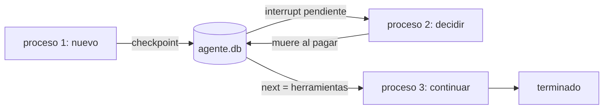

## Problema

Tu agente de soporte pide aprobación antes de reembolsar. La persona tarda una hora en contestar y, mientras, despliegas una versión nueva: el proceso se reinicia. O peor: el proceso muere justo después de pagar y antes de guardar que pagó. Quieres que **otro proceso** retome el agente donde estaba, sin repetir lo que ya hizo y sin perder la aprobación pendiente.

Es [[glosario/ejecucion-duradera|ejecución duradera]] a pequeña escala. En LangGraph se consigue con un [[glosario/checkpointer|checkpointer]] en disco, un `thread_id` estable y herramientas con idempotencia (repetirlas no repite el efecto).

## Ingredientes

- Python 3.10 o superior: `pip install langgraph langgraph-checkpoint-sqlite "langchain[anthropic]"`.
- `ANTHROPIC_API_KEY` para la versión real.
- Haber visto `interrupt()` y `Command(resume=…)` en [[recetas/aprobacion-humana-con-langgraph]].

## Pasos

1. **Entiende qué se guarda.** LangGraph avanza por superpasos y, al final de cada uno, el checkpointer escribe el estado completo (mensajes, nodo siguiente, interrupciones pendientes) bajo el `thread_id`. Reanudar es cargar el último checkpoint de ese hilo y seguir. No hay memoria del proceso que importe: todo está en la base de datos.



2. **Da idempotencia a las herramientas con efectos.** Si el proceso muere después de pagar y antes de que el checkpoint registre el `ToolMessage`, al reanudar el nodo `herramientas` se ejecuta otra vez. La herramienta debe reconocer que ya lo hizo. Una clave natural es el `tool_call_id`, que se conserva en el estado: la inyectas con `InjectedToolCallId` (el modelo no la ve ni la rellena) y la usas como clave única.

3. **Escribe el agente como una orden de línea de comandos.** Cada invocación es un proceso distinto que abre la misma base de datos: así compruebas de verdad que nada vive en memoria.

```python title="agente_persistente.py"
import json
import sqlite3
import sys
from typing import Annotated

from langchain.chat_models import init_chat_model
from langchain.messages import SystemMessage, ToolMessage
from langchain.tools import InjectedToolCallId, tool
from langgraph.checkpoint.sqlite import SqliteSaver
from langgraph.graph import END, START, MessagesState, StateGraph
from langgraph.prebuilt import ToolNode
from langgraph.types import Command, interrupt

MODEL = "anthropic:claude-sonnet-5-5"
DB = "agente.db"                      # checkpoints del grafo y registro de reembolsos, en el mismo archivo
SENSIBLES = {"reembolsar"}


@tool
def ver_pedido(pedido_id: str) -> str:
    """Devuelve estado e importe de un pedido por su id (formato P-NNNN)."""
    return json.dumps({"id": pedido_id, "estado": "entregado", "importe_eur": 49.90})


@tool
def reembolsar(pedido_id: str, importe_eur: float, tool_call_id: Annotated[str, InjectedToolCallId]) -> str:
    """Emite un reembolso. Acción irreversible: solo tras confirmar el pedido con ver_pedido."""
    # Idempotente: si el proceso muere después de pagar y el nodo se repite, no se paga dos veces.
    with sqlite3.connect(DB) as conn:
        conn.execute("CREATE TABLE IF NOT EXISTS reembolsos (tool_call_id TEXT PRIMARY KEY, pedido_id TEXT, importe REAL)")
        nuevo = conn.execute("INSERT OR IGNORE INTO reembolsos VALUES (?, ?, ?)",
                             (tool_call_id, pedido_id, importe_eur)).rowcount == 1
    return f"Reembolso de {importe_eur} € {'emitido' if nuevo else 'ya estaba emitido'} para {pedido_id}."


TOOLS = [ver_pedido, reembolsar]
SYSTEM = SystemMessage("Eres un agente de soporte. Antes de reembolsar, comprueba el pedido.")


def construir(checkpointer, modelo=None):
    llm = (modelo or init_chat_model(MODEL, max_tokens=2048)).bind_tools(TOOLS)

    def llamar_modelo(state: MessagesState):
        return {"messages": [llm.invoke([SYSTEM, *state["messages"]])]}

    def revisar(state: MessagesState):
        llamadas = state["messages"][-1].tool_calls
        pendientes = [{"name": c["name"], "args": c["args"]} for c in llamadas if c["name"] in SENSIBLES]
        if not pendientes:
            return Command(goto="herramientas")
        decision = interrupt({"pendientes": pendientes})       # aquí el proceso puede terminar o morir
        if decision == "aprobar":
            return Command(goto="herramientas")
        rechazos = [ToolMessage("Rechazado por un humano: no lo ejecutes otra vez.", tool_call_id=c["id"],
                                name=c["name"], status="error") for c in llamadas]
        return Command(goto="modelo", update={"messages": rechazos})

    g = StateGraph(MessagesState)
    g.add_node("modelo", llamar_modelo)
    g.add_node("revisar", revisar, destinations=("herramientas", "modelo"))
    g.add_node("herramientas", ToolNode(TOOLS))
    g.add_edge(START, "modelo")
    g.add_conditional_edges("modelo", lambda s: "revisar" if s["messages"][-1].tool_calls else END, ["revisar", END])
    g.add_edge("herramientas", "modelo")
    return g.compile(checkpointer=checkpointer)


def informar(grafo, config):
    estado = grafo.get_state(config)
    if estado.interrupts:
        print("PAUSADO, esperando decisión:", estado.interrupts[0].value)
    elif estado.next:
        print("A MEDIAS, siguiente nodo:", estado.next)            # murió entre dos checkpoints
    elif estado.values:
        print("TERMINADO:", estado.values["messages"][-1].content)
    else:
        print("No hay ningún hilo con ese thread_id.")


def main(argv, modelo=None):
    orden, hilo = argv[0], argv[1]
    config = {"configurable": {"thread_id": hilo}, "recursion_limit": 25}
    with SqliteSaver.from_conn_string(DB) as cp:               # es el gestor de contexto (no SqliteSaver(conn))
        grafo = construir(cp, modelo)
        if orden == "nuevo":
            grafo.invoke({"messages": [("user", argv[2])]}, config, durability="sync")
        elif orden == "decidir":                                 # aprobar | rechazar
            grafo.invoke(Command(resume=argv[2]), config, durability="sync")
        elif orden == "continuar":                               # reanuda desde el último checkpoint
            grafo.invoke(None, config, durability="sync")
        informar(grafo, config)


if __name__ == "__main__":
    main(sys.argv[1:])
```

4. **Elige la durabilidad.** `durability="sync"` escribe cada checkpoint antes de empezar el paso siguiente. El valor por defecto, `"async"`, lo escribe mientras se ejecuta el siguiente: es más rápido, pero si el proceso muere en ese instante puedes perder el último paso. `"exit"` solo guarda al terminar el grafo y no sirve para recuperarse de una caída. Para pasos lentos con efectos (pagos, emails), usa `"sync"`.

5. **Usa los tres verbos de reanudación.**
   - `invoke(Command(resume=valor), config)` cuando hay un `interrupt` pendiente: entrega la respuesta.
   - `invoke(None, config)` cuando el hilo quedó a medias sin interrupción (el proceso murió): sigue desde el nodo pendiente.
   - `get_state(config)` para saber en cuál de los dos casos estás. `.interrupts` y `.next` te lo dicen.

## Cómo comprobar que funciona

Lo probé con cinco procesos distintos sobre el mismo `agente.db`, cada uno con un [[glosario/modelo-simulado|modelo simulado]] que solo conoce las respuestas de su tramo. El tercero aprueba y, dentro de `reembolsar`, después de escribir el pago, termina con `os._exit(137)`, el equivalente a un `kill -9`. Salida real (langgraph 1.2.18, langgraph-checkpoint-sqlite 3.1.2):

```text
[pid 4983] nuevo ticket-123 Devolvedme P-1001, llegó roto.
PAUSADO, esperando decisión: {'pendientes': [{'name': 'reembolsar', 'args': {'pedido_id': 'P-1001', 'importe_eur': 49.9}}]}
[pid 4987] estado ticket-123
PAUSADO, esperando decisión: {'pendientes': [{'name': 'reembolsar', 'args': {'pedido_id': 'P-1001', 'importe_eur': 49.9}}]}
[pid 5000] decidir ticket-123 aprobar
   (pago hecho: Reembolso de 49.9 € emitido para P-1001. ) -> el proceso muere con kill -9
   código de salida: 137
[pid 5012] estado ticket-123
A MEDIAS, siguiente nodo: ('herramientas',)
[pid 5021] continuar ticket-123
TERMINADO: Reembolso de 49,90 € hecho.
filas en reembolsos: [('c2', 'P-1001', 49.9)]
```

Y el historial final del hilo muestra que la herramienta se ejecutó dos veces, pero el pago solo una:

```text
HumanMessage  Devolvedme P-1001, llegó roto.
AIMessage
ToolMessage success {"id": "P-1001", "estado": "entregado", "importe_eur": 49.9}
AIMessage
ToolMessage success Reembolso de 49.9 € ya estaba emitido para P-1001.
AIMessage  Reembolso de 49,90 € hecho.
```

Para reproducirlo con Claude: `python agente_persistente.py nuevo ticket-123 "Devolvedme P-1001"`, cierra la terminal, abre otra y ejecuta `python agente_persistente.py decidir ticket-123 aprobar`.

## Variaciones

- **PostgreSQL.** `from langgraph.checkpoint.postgres import PostgresSaver` (paquete `langgraph-checkpoint-postgres`) con `PostgresSaver.from_conn_string(dsn)`; la primera vez llama a `cp.setup()` para crear las tablas. Es lo que quieres con varias réplicas: SQLite es un archivo local.
- **Volver atrás.** `grafo.get_state_history(config)` lista todos los checkpoints del hilo; puedes reanudar desde uno anterior pasando su `checkpoint_id` en `config["configurable"]`.
- **Reanudar en arranque.** Al iniciar el servicio, recorre los hilos con `next` no vacío y sin interrupción, y relánzalos con `invoke(None, config)`. Los que tienen interrupción esperan a su persona.
- **Con `create_agent`.** Pásale `checkpointer=` y obtienes lo mismo sin escribir el grafo; la idempotencia de las herramientas sigue siendo tuya.
- **Motores de ejecución duradera.** Si tu sistema ya usa Temporal o DBOS, puedes delegar en ellos la durabilidad ([[sistemas/agente-de-larga-duracion]]).

## Errores típicos

- **`SqliteSaver(conn)` dentro de `with`.** El gestor de contexto es `SqliteSaver.from_conn_string("agente.db")`; con el constructor directo no funciona como `with` (da `TypeError`).
- **Un `thread_id` nuevo en cada arranque.** Si lo generas con `uuid4()` al iniciar, nunca encuentras el hilo anterior. Derívalo de algo estable: el id del ticket, de la conversación o del trabajo.
- **Herramientas sin idempotencia.** El checkpointer garantiza que el grafo retoma el paso; no que el mundo exterior no viera el efecto. Usa claves de idempotencia en pagos, emails y escrituras.
- **Código con efectos antes de `interrupt()`.** Al reanudar, el nodo se repite desde el principio.
- **Pensar que `InMemorySaver` persiste.** Sirve para pruebas; muere con el proceso.
- **Cambiar el grafo con hilos a medias.** Si renombras un nodo, un checkpoint que apunta al nombre viejo no sabe a dónde seguir. Termina o migra los hilos abiertos antes de desplegar. Más síntomas en [[problemas/langgraph-no-reanuda-tras-interrupt]].
