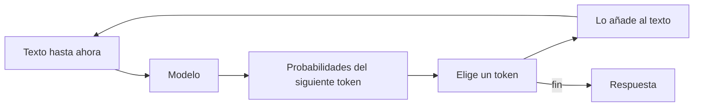

Al terminar esta lección sabrás qué hace realmente un modelo de lenguaje cuando le escribes, por qué a veces se inventa cosas con total seguridad y qué tipo de problemas merece la pena resolver con él. Es la base mental que usarás en cada decisión de diseño del roadmap.

## La idea

Un [[glosario/llm|LLM]] (*large language model*, modelo de lenguaje grande) es un programa que, dado un texto, calcula qué fragmento de texto es probable que venga a continuación. Ese fragmento se llama [[glosario/token|token]]: puede ser una palabra, parte de una palabra o un signo de puntuación.

Para generar una respuesta, el modelo repite un paso muy simple muchas veces:

1. Lee todo el texto que tiene delante (tu mensaje y lo que lleva escrito).
2. Calcula una probabilidad para cada token posible de su vocabulario.
3. Elige uno.
4. Lo añade al texto y vuelve al paso 1.

Se detiene cuando elige un token especial de fin, cuando llega al límite de longitud que tú fijas con [[glosario/max-tokens|max_tokens]] o cuando aparece una secuencia de parada que hayas definido.

Eso es todo el mecanismo visible. Lo que lo hace útil es la escala del entrenamiento: estos modelos han aprendido de cantidades enormes de texto y código, y para predecir bien el siguiente token han tenido que capturar gramática, hechos, estilos, patrones de razonamiento y convenciones de programación. Después se ajustan para seguir instrucciones y mantener una conversación.

## Qué hay dentro, en una página

La arquitectura que usan casi todos los LLM actuales es el [[glosario/transformer|transformer]], presentado en [Attention Is All You Need](https://arxiv.org/abs/1706.03762) (Vaswani et al., 2017). Su pieza central, la atención, permite que cada token «mire» a todos los anteriores para decidir qué es relevante. Por eso un modelo puede relacionar una pregunta del final con un dato que pusiste al principio.

No necesitas más detalle para construir con ellos. Lo que sí necesitas es entender tres consecuencias directas de este diseño.

### 1. El modelo no consulta nada: genera

Cuando le preguntas la capital de Francia, no busca en una base de datos. Genera «París» porque es, con mucho, el token más probable después de esa pregunta. Con preguntas muy repetidas en su entrenamiento, el resultado coincide con la realidad casi siempre. Con datos raros, recientes o privados (el precio de tu producto, el estado de un pedido, una ley aprobada el mes pasado) no tiene nada fiable en lo que apoyarse, pero el mecanismo sigue produciendo texto con la misma fluidez.

Eso es una [[glosario/alucinacion|alucinación]]: una respuesta plausible y bien escrita que no se corresponde con los hechos. Tampoco va a desaparecer en la próxima versión: nace del propio mecanismo. Lo que sí funciona es darle al modelo la información que necesita; con eso se reduce mucho.

### 2. El modelo no tiene memoria entre llamadas

Cada petición a la API es independiente. Si en la segunda llamada quieres que «recuerde» la primera, tienes que volver a enviarle la conversación entera. Lo verás con detalle en [[roadmap/00-fundamentos/03-ventana-de-contexto]]. Las aplicaciones de chat que conoces hacen exactamente eso por detrás.

### 3. La salida es probabilística

Con la misma entrada, dos llamadas pueden dar respuestas distintas. Parámetros como la [[glosario/temperatura|temperatura]] regulan cuánto se aleja el modelo de la opción más probable, pero no conviertas eso en tu mecanismo de fiabilidad. Si necesitas una salida estable, se consigue con instrucciones claras, ejemplos, formatos estrictos y validación en tu código, que es justo lo que trabaja el [[roadmap/10-prompting/index|nivel 10]].

## Qué hace bien y qué no

Con esas tres propiedades en mente, el reparto queda bastante claro.

| Funciona bien | Necesita ayuda | Mejor con código normal |
|---|---|---|
| Redactar, resumir, reformular | Responder sobre tus documentos (dale el texto o usa [[glosario/rag]]) | Sumar importes de una factura |
| Clasificar textos por intención o tema | Datos en tiempo real (dale herramientas, ver [[glosario/tool-use]]) | Validar un IBAN o un correo |
| Extraer campos de texto libre | Cálculos largos (que llame a una función) | Ordenar una lista |
| Traducir y adaptar tono | Hechos muy concretos o recientes | Cualquier regla exacta y conocida |
| Escribir y explicar código | Decisiones con consecuencias (añade revisión humana) | Comparar fechas |

La columna central es donde está casi todo el trabajo de este roadmap. Un modelo combinado con el contexto correcto y unas pocas herramientas resuelve problemas que antes requerían meses de desarrollo. Un modelo solo, al que se le pide que «sepa» cosas que no puede saber, produce errores difíciles de detectar.

> [!aviso] La fluidez no es una señal de verdad
> Una respuesta segura y bien redactada puede ser falsa. Cuando algo importa, verifica con código, con fuentes o con una persona. Las lecciones de [[roadmap/30-contexto-y-rag/05-respuestas-con-citas|respuestas con citas]] y de [[roadmap/80-evals/index|evals]] existen por esto.

## Qué no es un LLM

Ayuda a fijar algunas ideas erróneas habituales:

- **No es un buscador.** No sabe qué hay en internet hoy, salvo que le des una herramienta de búsqueda.
- **No es una base de datos.** No guarda lo que le cuentas; cada llamada empieza de cero.
- **No es una calculadora.** Puede razonar sobre números, pero para operaciones exactas dale una función.
- **No aprende de tus conversaciones** mientras lo usas por API. Cambiar su comportamiento de forma permanente requiere [[glosario/fine-tuning|fine-tuning]], y casi nunca es el primer paso: con buen prompt y buen contexto se llega mucho más lejos.
- **No es un agente por sí mismo.** Un [[glosario/agente|agente]] es un programa tuyo que llama al modelo en bucle y ejecuta las acciones que este propone. Llegarás ahí en el [[roadmap/40-primer-agente/index|nivel 40]].

## Errores frecuentes

- Pedirle datos que no puede tener («¿cuántos clientes tenemos?») en vez de pasárselos.
- Confiar en que dará la misma respuesta siempre y no validar la salida.
- Usarlo para lógica exacta que una línea de código resuelve mejor, más barato y sin errores.
- Culpar al modelo de un fallo que en realidad es falta de contexto en la petición.

## Ejercicio

> [!ejercicio] Reparte las tareas
> Toma estas ocho tareas y clasifica cada una en «el modelo solo», «el modelo con contexto o herramientas» o «código normal». Escribe una frase de justificación por tarea.
>
> 1. Resumir un correo largo en tres líneas.
> 2. Decir si un pedido concreto ya se ha enviado.
> 3. Calcular el IVA de 37 líneas de factura.
> 4. Detectar si una reseña es positiva, negativa o neutra.
> 5. Contestar dudas sobre el manual interno de tu empresa.
> 6. Comprobar que un NIF tiene la letra correcta.
> 7. Proponer tres títulos para un artículo.
> 8. Decir qué tiempo hace ahora en Bilbao.
>
> Está bien si cada justificación nombra la propiedad del modelo que aplica (genera sin consultar, no tiene memoria, salida probabilística) y si las tareas 2, 5 y 8 quedan en la columna de contexto o herramientas.

> [!ejercicio]- Pistas
> Pregúntate en cada caso: ¿la información necesaria está en el mensaje o en el entrenamiento general? ¿Hay una regla exacta que se pueda programar? La 3 y la 6 tienen una respuesta única y comprobable.

## Resumen

- Un LLM genera texto prediciendo el siguiente token, una y otra vez.
- No consulta fuentes ni recuerda entre llamadas: todo lo que necesita saber tiene que ir en la petición.
- Su salida es probabilística; la fiabilidad se construye con instrucciones, formato y validación.
- Las alucinaciones nacen del propio mecanismo y se reducen dándole el contexto correcto.
- Reparte el trabajo: el modelo para el lenguaje, el código para las reglas exactas.

## Para seguir

- [[roadmap/00-fundamentos/02-tokens]]: la unidad con la que se mide todo lo anterior.
- [[glosario/alucinacion]] y [[glosario/transformer]] para ampliar los conceptos.
- [[patrones/02-llamada-aumentada]]: el modelo combinado con recuperación, herramientas y memoria.
