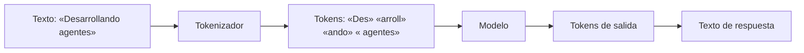

Al terminar esta lección sabrás qué es exactamente un token, por qué tu texto en español no ocupa lo que crees y cómo medirlo con una llamada a la API. Es la unidad con la que se cobra cada petición, con la que se limita lo que cabe en el contexto y con la que se explica buena parte de la latencia.

## La idea

Un modelo no lee letras ni palabras. Lee [[glosario/token|tokens]]: fragmentos de texto de un vocabulario fijo, que el modelo aprendió durante su construcción. Un token puede ser una palabra corta completa, un trozo de palabra, un espacio seguido de una palabra, un signo de puntuación o un fragmento de código.

El programa que corta el texto en tokens se llama [[glosario/tokenizador|tokenizador]]. Cada familia de modelos tiene el suyo, así que el mismo texto puede producir un número distinto de tokens con modelos distintos.



El corte del diagrama es ilustrativo: el real depende del tokenizador. Lo importante es la idea. Las palabras frecuentes suelen ocupar un token; las largas, raras o en idiomas menos representados se trocean en varios.

## Por qué se usan fragmentos y no palabras

Con un vocabulario de palabras completas, cualquier palabra nueva (un nombre propio, un término técnico, una errata) sería imposible de representar. Con letras sueltas, los textos serían larguísimos y el modelo tendría que trabajar mucho más para entenderlos. Los fragmentos son el punto intermedio: un vocabulario de tamaño manejable que puede representar cualquier texto.

La consecuencia práctica es que **el número de tokens no es el número de palabras**, y la relación cambia con:

- **El idioma.** Los tokenizadores suelen estar más optimizados para el inglés, así que el mismo contenido en español tiende a ocupar algo más. Mídelo con tus textos en vez de fiarte de una regla.
- **El formato.** JSON, tablas y código incluyen llaves, comillas, sangrías y nombres de campo que también son tokens. Un JSON con nombres de campo largos repetidos en mil registros pesa bastante.
- **El contenido.** Identificadores, hashes, URLs largas y números con muchos dígitos se trocean mucho.

## Todo se mide en tokens

Esta es la razón por la que la lección está tan al principio. Casi todos los números que te importan al construir con un modelo están expresados en tokens:

| Qué | Cómo depende de los tokens |
|---|---|
| Coste | Se paga por tokens de entrada y por tokens de salida, con precios distintos. Consulta los actuales en la [documentación oficial](https://platform.claude.com/docs). |
| Ventana de contexto | El máximo de tokens que caben entre entrada y salida en una petición. Lo verás en [[roadmap/00-fundamentos/03-ventana-de-contexto]]. |
| `max_tokens` | El límite de tokens de salida que fijas en cada llamada. Si se alcanza, la respuesta se corta. |
| Latencia | Generar cada token de salida lleva tiempo; respuestas más largas tardan más. |
| Límites de uso | Los proveedores limitan cuántos tokens por minuto puedes procesar. |

Retén una asimetría: **la entrada la pagas y la procesa el modelo de golpe; la salida la pagas y se genera token a token**. Por eso una respuesta larga suele pesar más en la latencia que un prompt largo, y por eso los tokens de salida suelen costar más por unidad.

## Contar tokens antes de enviar

No adivines: la API de Mensajes tiene un endpoint que cuenta los tokens de una petición sin generar respuesta. Cuenta todo lo que enviarías: [[glosario/prompt-de-sistema|prompt de sistema]], mensajes y definiciones de herramientas.

Si todavía no tienes el SDK instalado ni la clave configurada, hazlo con [[roadmap/00-fundamentos/04-primera-llamada-api]] y vuelve aquí.

```python tab="Python" title="contar_tokens.py"
import anthropic

MODEL = "claude-sonnet-5-5"
client = anthropic.Anthropic()  # lee ANTHROPIC_API_KEY del entorno

textos = {
    "es": "Necesito devolver el pedido porque llegó con la caja rota.",
    "en": "I need to return the order because it arrived with a broken box.",
    "json": '{"motivo_devolucion": "caja_rota", "estado_pedido": "entregado"}',
}

for nombre, texto in textos.items():
    r = client.messages.count_tokens(
        model=MODEL,
        messages=[{"role": "user", "content": texto}],
    )
    palabras = len(texto.split())
    print(f"{nombre:5} palabras={palabras:3}  tokens={r.input_tokens}")
```

```ts tab="TypeScript" title="contar_tokens.ts"
import Anthropic from "@anthropic-ai/sdk";

const MODEL = "claude-sonnet-5-5";
const client = new Anthropic(); // lee ANTHROPIC_API_KEY del entorno

const textos: Record<string, string> = {
  es: "Necesito devolver el pedido porque llegó con la caja rota.",
  en: "I need to return the order because it arrived with a broken box.",
  json: '{"motivo_devolucion": "caja_rota", "estado_pedido": "entregado"}',
};

for (const [nombre, texto] of Object.entries(textos)) {
  const r = await client.messages.countTokens({
    model: MODEL,
    messages: [{ role: "user", content: texto }],
  });
  console.log(nombre, "palabras:", texto.split(/\s+/).length, "tokens:", r.input_tokens);
}
```

El recuento incluye unos pocos tokens de estructura que la API añade para delimitar mensajes, así que un texto muy corto parecerá «caro» en proporción. Compara textos de tamaño parecido.

Contar no genera respuesta, pero es una llamada a la API: úsalo cuando la decisión lo merezca (por ejemplo, para saber si un documento cabe antes de enviarlo o para estimar el coste de un lote), no en cada mensaje de un chat.

> [!consejo] Los tokens reales vienen en la respuesta
> Cada respuesta de la API incluye `usage.input_tokens` y `usage.output_tokens`. Para registrar lo que ya has gastado, usa esos campos; `count_tokens` sirve para decidir antes de gastar.

## Cómo pensar en tokens al diseñar

Unas cuantas decisiones que cambian cuando piensas en tokens:

- **Nombres de campo.** En una salida JSON que vas a generar miles de veces, `"categoria"` y `"c"` no cuestan lo mismo. No sacrifiques legibilidad por unos pocos tokens; hazlo solo cuando el volumen lo justifique y lo hayas medido.
- **Instrucciones repetidas.** Un prompt de sistema largo se paga en cada llamada. Más adelante verás que el [[glosario/prompt-caching|prompt caching]] abarata mucho las partes que se repiten.
- **Historial.** En una conversación, cada turno reenvía los anteriores, así que el coste de entrada crece con la conversación.
- **Salida.** Pedir «responde en una frase» cuando una frase basta ahorra tokens de salida y latencia a la vez.

## Errores frecuentes

- Estimar tokens dividiendo caracteres o palabras entre una cifra fija y tomarlo como exacto.
- Comparar el coste de dos proveedores por «precio por token» sin tener en cuenta que sus tokenizadores cortan distinto el mismo texto.
- Olvidar que las definiciones de herramientas y el prompt de sistema también cuentan como entrada.
- Fijar `max_tokens` muy bajo «para ahorrar» y recibir respuestas cortadas a medias.

## Ejercicio

> [!ejercicio] Mide tu propio texto
> Elige un texto real de tu trabajo de unas 200 palabras (un correo, un fragmento de documentación). Con `count_tokens`, mide cuatro variantes: el texto en español, su traducción al inglés, el mismo contenido como JSON con campos descriptivos y como JSON con campos de una letra.
>
> Está bien si entregas una tabla con palabras y tokens de cada variante, la razón tokens por palabra de cada una y dos frases que expliquen qué variante ocupa más y por qué.

> [!ejercicio]- Pistas
> Usa siempre el mismo modelo en las cuatro mediciones. Para que la comparación sea justa, las cuatro variantes deben contener la misma información.

## Resumen

- Un token es un fragmento de texto del vocabulario del modelo; no equivale a una palabra.
- El idioma, el formato y el tokenizador cambian cuántos tokens ocupa un mismo contenido.
- Coste, contexto, `max_tokens`, latencia y límites de uso se miden en tokens.
- La salida suele ser más cara y más lenta por token que la entrada.
- Cuenta con `count_tokens` antes de enviar y registra `usage` después.

## Para seguir

- [[roadmap/00-fundamentos/03-ventana-de-contexto]]: cuántos tokens caben y qué los ocupa.
- [[roadmap/00-fundamentos/05-coste-y-latencia]]: convertir tokens en euros y milisegundos.
- [[glosario/tokenizador]] y [[docs/produccion/02-costes-y-limites]] como referencia.
