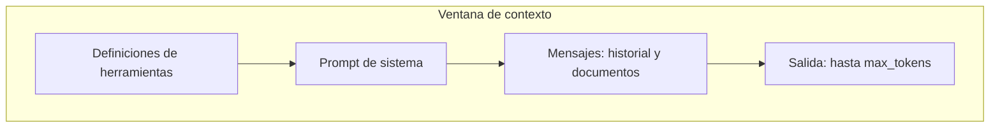

Al terminar esta lección entenderás por qué el modelo «olvida» lo que le dijiste hace dos mensajes si no se lo vuelves a enviar, qué ocupa espacio en cada petición y qué estrategias tienes cuando la conversación crece. Es el concepto que más decisiones de arquitectura condiciona en todo el roadmap.

## La idea

La [[glosario/ventana-de-contexto|ventana de contexto]] es la cantidad máxima de [[glosario/token|tokens]] que el modelo puede manejar en una sola petición, sumando lo que le envías y lo que genera. Todo lo que el modelo «sabe» sobre tu tarea en ese momento tiene que estar dentro de esa ventana. Lo que no está, no existe para él.

El tamaño exacto depende del modelo y cambia entre versiones, así que consúltalo en la [documentación oficial](https://platform.claude.com/docs) en vez de memorizarlo. Lo que no cambia es el principio: es finita y cada token que pones dentro tiene un coste.

## Qué ocupa la ventana

En una petición a la API de Mensajes, la ventana se reparte así:



- **Herramientas**: si defines [[glosario/tool-use|herramientas]], su nombre, descripción y esquema se envían en cada llamada.
- **[[glosario/prompt-de-sistema|Prompt de sistema]]**: las instrucciones fijas.
- **Mensajes**: todos los turnos de la conversación que envías, incluidos documentos pegados, resultados de herramientas e imágenes.
- **Salida**: lo que el modelo genera. Reservas espacio para ella con [[glosario/max-tokens|max_tokens]].

Si la entrada más la salida reservada superan la ventana, la API rechaza la petición con un error. Si la entrada cabe pero la respuesta llega a `max_tokens`, se corta y la respuesta trae `stop_reason: "max_tokens"`.

## La API no tiene memoria

Esto sorprende a casi todo el mundo la primera vez. La API de Mensajes no guarda la conversación. Cada llamada es independiente: si quieres que el modelo responda teniendo en cuenta lo anterior, **tú** envías la lista completa de mensajes otra vez.

Este chat mínimo lo deja claro. Fíjate en que `historial` crece en cada vuelta y se envía entero:

```python tab="Python" title="chat.py"
import anthropic

MODEL = "claude-sonnet-5-5"
client = anthropic.Anthropic()
historial = []

while True:
    texto = input("Tú: ").strip()
    if not texto:
        break
    historial.append({"role": "user", "content": texto})

    resp = client.messages.create(
        model=MODEL,
        max_tokens=1024,
        messages=historial,  # toda la conversación, cada vez
    )
    respuesta = "".join(b.text for b in resp.content if b.type == "text")
    historial.append({"role": "assistant", "content": respuesta})

    print(f"Modelo: {respuesta}")
    print(f"  [entrada: {resp.usage.input_tokens} tokens]")
```

```ts tab="TypeScript" title="chat.ts"
import Anthropic from "@anthropic-ai/sdk";
import * as readline from "node:readline/promises";

const MODEL = "claude-sonnet-5-5";
const client = new Anthropic();
const rl = readline.createInterface({ input: process.stdin, output: process.stdout });
const historial: Anthropic.MessageParam[] = [];

while (true) {
  const texto = (await rl.question("Tú: ")).trim();
  if (!texto) break;
  historial.push({ role: "user", content: texto });

  const resp = await client.messages.create({ model: MODEL, max_tokens: 1024, messages: historial });
  const respuesta = resp.content.map((b) => (b.type === "text" ? b.text : "")).join("");
  historial.push({ role: "assistant", content: respuesta });

  console.log(`Modelo: ${respuesta}\n  [entrada: ${resp.usage.input_tokens} tokens]`);
}
rl.close();
```

Si lo ejecutas, verás que `input_tokens` sube con cada turno. Prueba a vaciar `historial` antes de cada llamada: el modelo dejará de saber cómo te llamas aunque se lo hayas dicho hace un mensaje.

Los mensajes alternan `user` y `assistant`, y el primero es de `user`. Los detalles de roles y bloques están en [[docs/fundamentos/03-api-de-mensajes]].

## Más contexto no siempre es mejor

Que algo quepa no significa que convenga meterlo. Cada token extra tiene tres costes:

1. **Dinero**: pagas cada token de entrada en cada llamada.
2. **Latencia**: el modelo tarda más en procesar entradas largas antes de empezar a responder.
3. **Atención**: con mucho texto irrelevante, el modelo puede pasar por alto lo importante. El estudio [Lost in the Middle](https://arxiv.org/abs/2307.03172) (Liu et al., 2023) observó que los modelos de entonces aprovechaban peor la información situada en mitad de contextos largos que la del principio o el final.

Por eso conviene cambiar la pregunta «¿cuánto cabe?» por «¿qué necesita el modelo para esta tarea concreta?». A esa forma de pensar se le llama [[disciplinas/context-engineering|context engineering]], y tiene curso propio en [[cursos/context-engineering/index]].

> [!consejo] Coloca bien los documentos largos
> Cuando pases un documento largo, ponlo al principio del mensaje y la pregunta o la instrucción al final. Tiene más detalle en [[modelos/07-documentos-largos]].

## Qué hacer cuando la conversación crece

Tarde o temprano el historial deja de caber, o se vuelve tan caro que no compensa. Tienes tres estrategias básicas, de menos a más elaboradas:

| Estrategia | Cómo funciona | Cuándo encaja |
|---|---|---|
| Ventana deslizante | Envías solo los últimos N turnos. | Chats donde lo antiguo deja de importar. |
| Resumen ([[glosario/compactacion]]) | Sustituyes los turnos antiguos por un resumen que genera el propio modelo. | Conversaciones largas con decisiones que hay que conservar. |
| Recuperación | Guardas la información fuera y metes en cada llamada solo lo relevante. | Mucho material de consulta: documentos, manuales, historial de cliente. |

La tercera es la base del [[glosario/rag|RAG]], que trabajarás en el [[roadmap/30-contexto-y-rag/index|nivel 30]]. Las tres se combinan: muchos sistemas reales recortan, resumen y recuperan a la vez.

Al recortar, respeta la estructura: la lista debe seguir empezando por un mensaje de `user` y alternando roles. Y cuando lleguen las herramientas, nunca separes un `tool_use` de su `tool_result`.

## Errores frecuentes

- Creer que el modelo recuerda la conversación y enviar solo el último mensaje.
- Llenar el contexto «por si acaso» con documentos enteros cuando bastaba un fragmento.
- Olvidar que `max_tokens` también ocupa ventana y fijar un valor que no cabe junto a una entrada larga.
- Recortar el historial por el principio y dejar un mensaje de `assistant` como primero de la lista.

## Ejercicio

> [!ejercicio] Un chat que no revienta
> Parte de `chat.py` y añade una ventana deslizante: envía solo los últimos 6 mensajes. Imprime en cada turno los tokens de entrada. Después cuéntale al modelo tu nombre en el primer mensaje, charla durante 8 turnos y pregúntale cómo te llamas.
>
> Está bien si los tokens de entrada dejan de crecer a partir del cuarto turno aproximadamente, si la lista enviada siempre empieza por un mensaje `user` y si puedes explicar por qué el modelo ya no sabe tu nombre al final.

> [!ejercicio]- Pistas
> Como cada turno añade dos mensajes, 6 mensajes son 3 turnos completos. Si cortas por un número impar, comprueba el rol del primero. Para conservar el nombre, piensa qué estrategia de la tabla lo resolvería.

## Resumen

- La ventana de contexto es el máximo de tokens por petición, sumando entrada y salida.
- La ocupan herramientas, prompt de sistema, mensajes y la salida reservada con `max_tokens`.
- La API no guarda nada: tú reenvías el historial en cada llamada.
- Más contexto cuesta dinero, latencia y atención; mete lo que la tarea necesita.
- Cuando crece: recorta, resume o recupera.

## Para seguir

- [[roadmap/00-fundamentos/04-primera-llamada-api]]: la llamada paso a paso.
- [[docs/contexto/01-ventana-de-contexto]] como referencia.
- [[modelos/02-ingenieria-de-contexto]]: qué meter, en qué orden y con qué etiquetas.
