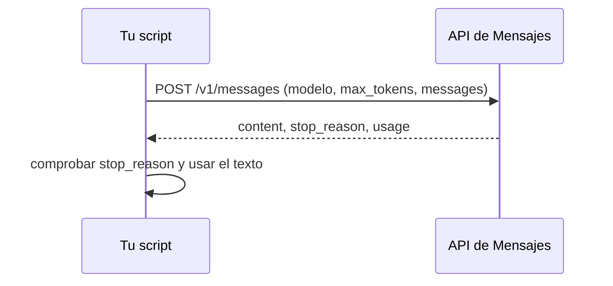

Al terminar esta lección tendrás un entorno funcionando, una clave guardada de forma segura y un script que llama al modelo y entiende lo que recibe. Parece poco, pero leer bien la respuesta (en especial `stop_reason` y `usage`) es lo que separa un prototipo frágil de algo en lo que puedes apoyarte.

## La idea

Llamar a un modelo es hacer una petición HTTP: envías un JSON con el modelo, el límite de salida y los mensajes, y recibes otro JSON con la respuesta. El SDK oficial te ahorra montar cabeceras, serializar y reintentar errores transitorios, pero conviene saber que por debajo no hay nada más.



## Paso 1: consigue una clave

Crea una cuenta en la consola del proveedor y genera una clave de API. El proceso y la página exacta pueden cambiar; sigue la [documentación oficial](https://platform.claude.com/docs). La clave es un secreto: quien la tenga puede gastar a tu cargo.

> [!peligro] La clave nunca va en el código
> No la pegues en un archivo del repositorio, ni en un notebook que compartas, ni en el código del navegador. Si se te escapa a un repositorio público, revócala en la consola y genera otra; borrar el commit no basta.

## Paso 2: guarda la clave en una variable de entorno

El SDK busca la clave en la variable `ANTHROPIC_API_KEY`. Defínela en tu terminal:

```bash title="Linux y macOS"
export ANTHROPIC_API_KEY="sk-ant-..."
```

```bash title="Windows (PowerShell)"
$env:ANTHROPIC_API_KEY="sk-ant-..."
```

Así solo dura la sesión de la terminal. Para no repetirlo, añádela al perfil de tu shell o usa un archivo `.env` que esté en `.gitignore` y cárgalo con una librería como `python-dotenv`.

## Paso 3: instala el SDK

Trabaja en un entorno aislado para no mezclar dependencias entre proyectos.

```bash tab="Python" title="terminal"
python -m venv .venv
source .venv/bin/activate        # en Windows: .venv\Scripts\activate
pip install anthropic
```

```bash tab="TypeScript" title="terminal"
npm init -y
npm pkg set type=module          # permite usar await en el nivel superior
npm install @anthropic-ai/sdk
npm install -D tsx typescript    # tsx ejecuta archivos .ts directamente
```

## Paso 4: la primera llamada

```python tab="Python" title="primera.py"
import anthropic

MODEL = "claude-sonnet-5-5"
client = anthropic.Anthropic()  # lee ANTHROPIC_API_KEY del entorno

resp = client.messages.create(
    model=MODEL,
    max_tokens=512,
    messages=[
        {"role": "user", "content": "Explica en dos frases qué es un token."}
    ],
)

texto = "".join(b.text for b in resp.content if b.type == "text")
print(texto)
print("stop_reason:", resp.stop_reason)
print("tokens:", resp.usage.input_tokens, "entrada /", resp.usage.output_tokens, "salida")
```

```ts tab="TypeScript" title="primera.ts"
import Anthropic from "@anthropic-ai/sdk";

const MODEL = "claude-sonnet-5-5";
const client = new Anthropic(); // lee ANTHROPIC_API_KEY del entorno

const resp = await client.messages.create({
  model: MODEL,
  max_tokens: 512,
  messages: [{ role: "user", content: "Explica en dos frases qué es un token." }],
});

const texto = resp.content.map((b) => (b.type === "text" ? b.text : "")).join("");
console.log(texto);
console.log("stop_reason:", resp.stop_reason);
console.log("tokens:", resp.usage.input_tokens, "entrada /", resp.usage.output_tokens, "salida");
```

Ejecútalo con `python primera.py` o `npx tsx primera.ts`.

Los tres parámetros obligatorios son `model`, `max_tokens` y `messages`. El nombre del modelo va en una constante arriba: cuando cambies de modelo, lo cambias en un solo sitio. Los modelos disponibles y sus diferencias están en la documentación oficial y en [[modelos/05-elegir-modelo-por-tarea]].

## Paso 5: lee la respuesta entera

Imprime la respuesta completa una vez para ver su forma (`print(resp.model_dump_json(indent=2))` en Python). Tendrá este aspecto:

```text
# salida de ejemplo
{
  "id": "msg_01...",
  "type": "message",
  "role": "assistant",
  "model": "claude-sonnet-5-5",
  "content": [
    {"type": "text", "text": "Un token es un fragmento de texto..."}
  ],
  "stop_reason": "end_turn",
  "usage": {"input_tokens": 18, "output_tokens": 61, ...}
}
```

Tres campos importan desde el primer día:

- **`content`** es una **lista de bloques**, no un texto. Hoy solo verás bloques `text`, pero cuando uses [[glosario/tool-use|herramientas]] aparecerán bloques `tool_use`, y con razonamiento, bloques `thinking`. Por eso el código filtra por `type` en lugar de leer `content[0].text` a ciegas.
- **`stop_reason`** dice por qué paró el modelo. Lo explica [[glosario/stop-reason]].
- **`usage`** trae los tokens reales que has pagado. Lo usarás en [[roadmap/00-fundamentos/05-coste-y-latencia]].

## Comprueba siempre `stop_reason`

| Valor | Qué significa | Qué hacer |
|---|---|---|
| `end_turn` | El modelo terminó con normalidad. | Usar la respuesta. |
| `max_tokens` | Llegó al límite que fijaste. La respuesta está cortada. | Subir `max_tokens`, pedir algo más corto o avisar. |
| `stop_sequence` | Encontró una secuencia de parada que definiste. | Lo esperado si las usas. |
| `tool_use` | Pide ejecutar una herramienta. | Lo verás en [[roadmap/20-herramientas/index]]. |
| `pause_turn` | La API pausó un turno largo. | Reenviar para que continúe; aparece con herramientas del servidor. |
| `refusal` | El modelo se negó a responder. | Mostrar un mensaje adecuado, no reintentar en bucle. |

El caso que más daño hace en silencio es `max_tokens`: un JSON cortado a la mitad o un resumen que se queda sin conclusión. Añade esto a tu script:

```python title="primera.py"
if resp.stop_reason == "max_tokens":
    print("[aviso] Respuesta incompleta: se alcanzó max_tokens.")
```

## Cuando algo falla

El SDK lanza excepciones con tipo. Las tres que verás antes son estas:

```python title="errores.py"
import anthropic

MODEL = "claude-sonnet-5-5"
client = anthropic.Anthropic()

try:
    resp = client.messages.create(
        model=MODEL, max_tokens=256,
        messages=[{"role": "user", "content": "Hola"}],
    )
except anthropic.AuthenticationError:
    print("Clave inválida o ausente: revisa ANTHROPIC_API_KEY.")
except anthropic.RateLimitError:
    print("Límite de uso alcanzado: espera y reintenta más despacio.")
except anthropic.APIConnectionError:
    print("No hay conexión con la API.")
except anthropic.APIStatusError as e:
    print(f"Error {e.status_code}: {e.message}")
```

El SDK ya reintenta algunos errores transitorios por su cuenta, y puedes ajustar cuántas veces con `anthropic.Anthropic(max_retries=...)`. Para estrategias completas de reintento, mira [[recetas/reintentos-y-limites-de-tasa]].

## Lo mismo sin SDK

Para que veas lo que el SDK hace por debajo, esta es la misma petición con `curl`. Te servirá para depurar:

```bash title="terminal"
curl https://api.anthropic.com/v1/messages \
  -H "x-api-key: $ANTHROPIC_API_KEY" \
  -H "anthropic-version: 2023-06-01" \
  -H "content-type: application/json" \
  -d '{"model": "claude-sonnet-5-5", "max_tokens": 256,
       "messages": [{"role": "user", "content": "Hola"}]}'
```

## Errores frecuentes

- Leer `resp.content[0].text` sin comprobar el tipo del bloque.
- No mirar `stop_reason` y dar por buena una respuesta cortada.
- Escribir el nombre del modelo en varios sitios del código.
- Poner la clave en el código «solo para probar» y acabar subiéndola.

## Ejercicio

> [!ejercicio] Tu primera llamada, bien hecha
> Escribe `primera.py` (o `.ts`) que reciba la pregunta como argumento de línea de comandos, llame a la API y muestre el texto, `stop_reason` y los tokens. Pruébalo dos veces: una normal y otra con `max_tokens=20` y una pregunta que exija una respuesta larga.
>
> Está bien si la clave no aparece en ningún archivo, si el texto se extrae filtrando bloques por `type`, si la segunda ejecución muestra el aviso de respuesta incompleta y si una clave falsa produce un mensaje claro en lugar de una traza de error.

> [!ejercicio]- Pistas
> En Python, la pregunta está en `sys.argv[1]`; en Node, en `process.argv[2]`. Para probar la clave falsa sin perder la buena, define la variable solo para ese comando: `ANTHROPIC_API_KEY=falsa python primera.py "hola"`.

## Resumen

- Una llamada es un POST con modelo, `max_tokens` y mensajes; el SDK lo simplifica.
- La clave va en `ANTHROPIC_API_KEY`, nunca en el código.
- `content` es una lista de bloques: filtra por tipo.
- Comprueba `stop_reason` en cada respuesta; `max_tokens` significa texto cortado.
- Captura los errores del SDK por tipo para dar mensajes útiles.

## Para seguir

- [[roadmap/00-fundamentos/05-coste-y-latencia]]: medir lo que cuesta y tarda esta llamada.
- [[docs/fundamentos/03-api-de-mensajes]]: roles, bloques y parámetros en detalle.
- [[docs/fundamentos/04-streaming]]: recibir la respuesta a medida que se genera.
