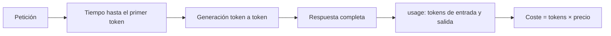

Al terminar esta lección sabrás cuánto cuesta y cuánto tarda cada llamada que haces, con números tuyos y no con impresiones. Es el último paso del nivel y el núcleo del proyecto: un script que registra cada petición para que cualquier optimización posterior se pueda comprobar.

## La idea

Antes de intentar abaratar o acelerar algo, mídelo. Las intuiciones sobre coste y [[glosario/latencia|latencia]] fallan mucho: el prompt de sistema que parecía enorme pesa poco, y la respuesta «un poco larga» es la que se come el tiempo. Con tres números por llamada (tokens, tiempo y coste) puedes tomar casi todas las decisiones que importan.



## Dos latencias distintas

Hay dos tiempos que medir y responden a preguntas diferentes:

- **Latencia total**: desde que envías la petición hasta que tienes la respuesta completa. Es la que importa en procesos por lotes y cuando necesitas la respuesta entera para continuar, como al parsear un JSON.
- **Tiempo hasta el primer token** (TTFT, *time to first token*): desde que envías hasta que llega el primer fragmento de texto. Es la que percibe una persona en un chat, porque con [[glosario/streaming|streaming]] empieza a leer en cuanto llega algo.

La latencia total crece sobre todo con los **tokens de salida**, porque se generan uno detrás de otro. La entrada influye más en el tiempo hasta el primer token, porque el modelo la procesa antes de empezar a escribir.

## Medir la latencia total

```python title="medir.py"
import time
import anthropic

MODEL = "claude-sonnet-5-5"
client = anthropic.Anthropic()

inicio = time.perf_counter()
resp = client.messages.create(
    model=MODEL,
    max_tokens=512,
    messages=[{"role": "user", "content": "Dame tres ideas de nombre para una cafetería."}],
)
ms = (time.perf_counter() - inicio) * 1000

print(f"latencia total: {ms:.0f} ms")
print(f"entrada: {resp.usage.input_tokens}  salida: {resp.usage.output_tokens}")
```

Usa `time.perf_counter()` y no `time.time()`: está pensado para medir intervalos. Mide alrededor de la llamada y nada más, para no mezclar el tiempo de tu propio código.

## Medir el tiempo hasta el primer token

Para ver cuándo llega el primer fragmento necesitas streaming. El SDK te da el texto a trozos y, al final, el mensaje completo con su `usage`:

```python tab="Python" title="ttft.py"
import time
import anthropic

MODEL = "claude-sonnet-5-5"
client = anthropic.Anthropic()

inicio = time.perf_counter()
primer = None
with client.messages.stream(
    model=MODEL,
    max_tokens=512,
    messages=[{"role": "user", "content": "Dame tres ideas de nombre para una cafetería."}],
) as stream:
    for texto in stream.text_stream:
        if primer is None:
            primer = time.perf_counter()
        print(texto, end="", flush=True)
    final = stream.get_final_message()
fin = time.perf_counter()

print(f"\nTTFT: {((primer or fin) - inicio) * 1000:.0f} ms · total: {(fin - inicio) * 1000:.0f} ms")
print(f"salida: {final.usage.output_tokens} tokens · stop_reason: {final.stop_reason}")
```

```ts tab="TypeScript" title="ttft.ts"
import Anthropic from "@anthropic-ai/sdk";

const MODEL = "claude-sonnet-5-5";
const client = new Anthropic();

const inicio = performance.now();
let primer: number | null = null;

const stream = client.messages.stream({
  model: MODEL,
  max_tokens: 512,
  messages: [{ role: "user", content: "Dame tres ideas de nombre para una cafetería." }],
});
stream.on("text", (texto) => {
  if (primer === null) primer = performance.now();
  process.stdout.write(texto);
});
const final = await stream.finalMessage();
const fin = performance.now();

console.log(`\nTTFT: ${((primer ?? fin) - inicio).toFixed(0)} ms · total: ${(fin - inicio).toFixed(0)} ms`);
console.log(`salida: ${final.usage.output_tokens} tokens · stop_reason: ${final.stop_reason}`);
```

Tienes más detalle sobre streaming en [[docs/fundamentos/04-streaming]] y una receta lista en [[recetas/streaming-de-respuestas]].

## Calcular el coste

El coste de una llamada sale de `usage` y de los precios del modelo, que se expresan por millón de tokens y son distintos para entrada y salida. Los precios cambian y dependen del modelo, así que **no los escribas en mitad del código**: ponlos en un archivo de configuración que rellenas consultando la [página oficial de precios](https://platform.claude.com/docs).

```json title="precios.json"
{
  "claude-sonnet-5-5": {
    "entrada_por_mtok": null,
    "salida_por_mtok": null,
    "escritura_cache_por_mtok": null,
    "lectura_cache_por_mtok": null
  }
}
```

```python title="coste.py"
import json

def coste_llamada(modelo: str, usage, precios_path: str = "precios.json") -> float:
    p = json.load(open(precios_path))[modelo]
    if p["entrada_por_mtok"] is None or p["salida_por_mtok"] is None:
        raise ValueError(f"Rellena los precios de {modelo} en {precios_path}")
    partes = [
        (usage.input_tokens, p["entrada_por_mtok"]),
        (usage.output_tokens, p["salida_por_mtok"]),
        (getattr(usage, "cache_creation_input_tokens", 0) or 0, p.get("escritura_cache_por_mtok") or 0),
        (getattr(usage, "cache_read_input_tokens", 0) or 0, p.get("lectura_cache_por_mtok") or 0),
    ]
    return sum(tokens * precio / 1_000_000 for tokens, precio in partes)
```

Los dos campos de caché aparecen cuando usas [[glosario/prompt-caching|prompt caching]]; mientras no lo uses valdrán cero. Los incluimos desde ya para que el cálculo siga siendo correcto cuando llegues a [[roadmap/100-produccion/02-costes-y-prompt-caching]]. La moneda del archivo es la que use la página de precios; si conviertes, hazlo en un solo sitio.

> [!aviso] Una llamada no es una muestra
> La latencia varía bastante de una llamada a otra por carga del servicio, red y longitud de la respuesta. Nunca concluyas nada con una sola ejecución: repite al menos diez y mira la mediana y el percentil alto.

## Registrar y resumir

Guardar cada llamada en un CSV te da un historial que puedes abrir en una hoja de cálculo o analizar con unas líneas de Python:

```python title="registro.py"
import csv, datetime, os, statistics

CAMPOS = ["fecha", "modelo", "entrada", "salida", "ms", "stop_reason", "coste"]

def registrar(fila: dict, ruta: str = "llamadas.csv") -> None:
    nuevo = not os.path.exists(ruta)
    with open(ruta, "a", newline="") as f:
        w = csv.DictWriter(f, fieldnames=CAMPOS)
        if nuevo:
            w.writeheader()
        w.writerow({"fecha": datetime.datetime.now().isoformat(timespec="seconds"), **fila})

def resumen(ruta: str = "llamadas.csv") -> None:
    ms = sorted(float(r["ms"]) for r in csv.DictReader(open(ruta)))
    p90 = ms[int(0.9 * (len(ms) - 1))]
    print(f"n={len(ms)}  mediana={statistics.median(ms):.0f} ms  p90={p90:.0f} ms")
```

La mediana dice cómo es una llamada típica; el percentil 90 dice cómo son las lentas, que son las que generan quejas. Con pocas muestras el p90 es orientativo.

## Qué hacer con los números

Cuando tengas datos, las palancas habituales son pocas y conviene probarlas de una en una, midiendo antes y después:

| Si el problema es… | Prueba primero |
|---|---|
| Respuestas lentas | Pedir salidas más cortas, ajustar `max_tokens`, usar streaming en interfaces. |
| Coste de entrada alto | Quitar contexto que no aporta; [[glosario/prompt-caching]] para lo que se repite. |
| Coste de salida alto | Formatos más compactos, instrucciones de brevedad. |
| Todo a la vez | Un modelo más pequeño para esa tarea concreta ([[modelos/05-elegir-modelo-por-tarea]]). |

Cambiar de modelo puede afectar a la calidad. Por eso en el [[roadmap/10-prompting/05-iterar-con-casos-de-prueba|nivel 10]] aprenderás a comprobar con casos de prueba que una optimización no rompe nada.

## Errores frecuentes

- Medir una vez y sacar conclusiones.
- Medir incluyendo el tiempo de imports, lectura de archivos o impresión por pantalla.
- Escribir los precios sueltos por el código y olvidar actualizarlos.
- Optimizar la entrada cuando lo que dominaba era la salida.

## Ejercicio

> [!ejercicio] Mide y compara
> Ejecuta la misma pregunta diez veces con dos variantes del prompt: una que pida «responde en una frase» y otra sin límite de longitud. Registra cada llamada en `llamadas.csv` con tokens, latencia, `stop_reason` y coste.
>
> Está bien si el CSV tiene veinte filas, si calculas mediana y p90 de latencia y el coste medio por variante, y si escribes dos frases explicando la diferencia usando los tokens de salida como argumento.

> [!ejercicio]- Pistas
> Añade una columna `variante` al CSV para separar los grupos. Si los precios aún no están rellenos, el cálculo de coste lanzará un error a propósito: rellénalos desde la página oficial antes de empezar.

## Resumen

- Mide antes de optimizar: tokens, tiempo y coste en cada llamada.
- La latencia total depende sobre todo de los tokens de salida; el TTFT, más de la entrada.
- El coste sale de `usage` por los precios del modelo, que van en configuración.
- Repite las mediciones y mira mediana y percentil alto.
- Cambia una palanca cada vez y vuelve a medir.

## Para seguir

- [[roadmap/00-fundamentos/index]]: con esto tienes todo lo necesario para el proyecto del nivel.
- [[roadmap/10-prompting/index]]: el siguiente nivel.
- [[docs/produccion/03-latencia]] y [[docs/produccion/02-costes-y-limites]] como referencia.
