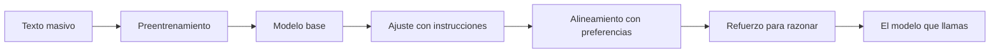

Al terminar esta lección sabrás qué le ha pasado a un modelo antes de que tú le envíes la primera petición, y podrás explicar con esa historia comportamientos que verás a diario: por qué sigue instrucciones, por qué no sabe lo que pasó el mes pasado, por qué a veces es demasiado prolijo o se niega a algo razonable.

## La idea

El modelo que llamas por API es el resultado de varias fases de entrenamiento que hace el proveedor. Cada fase parte del modelo que dejó la anterior y le añade algo distinto.



El orden y la mezcla de fases cambian entre laboratorios y no siempre se publican, pero la estructura general es estable. Las matemáticas de fondo están en [[cursos/la-ia-por-dentro/05-como-aprende-una-red]]; aquí no hacen falta.

## Los parámetros

Los [[glosario/parametros|parámetros]] son los números internos de la red que el entrenamiento va ajustando. Un modelo es una función enorme: entran tokens, pasan por esos parámetros y sale una probabilidad para cada posible siguiente token. Verás modelos de pesos abiertos etiquetados como «7B» o «70B»: miles de millones de parámetros.

Dos ideas para no equivocarte con ellos:

- **No son una base de datos.** El conocimiento está repartido entre miles de millones de números. No puedes buscar un dato dentro del modelo ni borrarlo, y el modelo tampoco puede «consultarlo»: lo regenera, a veces bien y a veces no.
- **Más parámetros dan más capacidad y cuestan más.** Cada token generado pasa por la red entera (o por la parte activa, en arquitecturas de [[glosario/mezcla-de-expertos|mezcla de expertos]]), así que un modelo mayor necesita más memoria y más cómputo por token: más coste y más [[glosario/latencia|latencia]]. Por eso los proveedores ofrecen familias en varios tamaños.

El número, sin embargo, no lo es todo. [Kaplan et al. (2020)](https://arxiv.org/abs/2001.08361) describieron cómo mejora un modelo al crecer en parámetros, datos y cómputo ([[glosario/leyes-de-escalado|leyes de escalado]]), y [Hoffmann et al. (2022)](https://arxiv.org/abs/2203.15556) mostraron que, con el mismo cómputo, conviene escalar datos y parámetros a la par: su modelo Chinchilla, más pequeño y entrenado con más datos, rendía mejor que otros mayores. Las fases posteriores también pesan mucho, y los proveedores comerciales no siempre publican el tamaño. Para tu tarea, la única comparación que vale es la de tus [[glosario/evals|evals]].

## Fase 1: preentrenamiento

En el [[glosario/preentrenamiento|preentrenamiento]] el modelo lee cantidades enormes de texto (web, libros, código, documentación) y aprende una sola tarea: **predecir el siguiente token**. Es aprendizaje autosupervisado: la respuesta correcta de cada paso es el token que de verdad viene después en el propio texto, así que nadie tiene que etiquetar nada. Por eso escala a volúmenes que ninguna anotación humana podría cubrir.

El bucle es siempre el mismo: el modelo predice, se mide el error frente al token real con una [[glosario/funcion-de-perdida|función de pérdida]] y se ajustan los parámetros un poco en la dirección que lo reduce ([[glosario/descenso-del-gradiente|descenso del gradiente]]), un número enorme de veces. La idea de preentrenar un modelo generativo y adaptarlo después a cada tarea la popularizó el primer GPT ([Radford et al., 2018](https://cdn.openai.com/research-covers/language-unsupervised/language_understanding_paper.pdf)).

Puedes ver la mecánica en miniatura con un modelo que solo cuenta qué palabra sigue a cuál:

```python title="bigramas.py"
import math
from collections import Counter, defaultdict

corpus = (
    "el cliente pide una devolución . el cliente pide una factura . "
    "el técnico revisa el pedido . el técnico cierra la incidencia ."
).split()

# La «etiqueta» de cada palabra es la siguiente del propio texto: nadie anota nada
siguientes: dict[str, Counter] = defaultdict(Counter)
for actual, siguiente in zip(corpus, corpus[1:]):
    siguientes[actual][siguiente] += 1

def probabilidades(palabra: str) -> dict[str, float]:
    total = sum(siguientes[palabra].values())
    return {s: round(n / total, 2) for s, n in siguientes[palabra].most_common()}

def perdida(frase: str) -> float:
    """Entropía cruzada media: cuánto «sorprende» al modelo cada palabra real."""
    tokens = frase.split()
    sorpresas = []
    for actual, real in zip(tokens, tokens[1:]):
        p = siguientes[actual][real] / max(sum(siguientes[actual].values()), 1)
        sorpresas.append(-math.log(max(p, 1e-6)))   # lo nunca visto casi no tiene probabilidad
    return round(sum(sorpresas) / len(sorpresas), 2)

print(probabilidades("el"))
print(probabilidades("técnico"))
print(perdida("el cliente pide una factura"))
print(perdida("el cliente cierra la incidencia"))
```

```text title="Salida"
{'cliente': 0.4, 'técnico': 0.4, 'pedido': 0.2}
{'revisa': 0.5, 'cierra': 0.5}
0.4
3.68
```

La segunda frase es perfectamente correcta en español, pero en este corpus el cliente nunca cierra incidencias, así que al modelo le «sorprende» mucho. Ahí tienes en pequeño el origen de los sesgos: un modelo reproduce lo que era frecuente en sus datos. Un LLM real sustituye el recuento por un [[glosario/transformer|transformer]] con miles de millones de parámetros y mira miles de tokens hacia atrás, no una palabra, pero aprende con la misma señal.

El resultado de esta fase es un **modelo base**: sabe muchísimo, pero se limita a continuar texto. Si le escribes una pregunta, puede seguir con otras preguntas, como si completara la lista de un examen. Aun así, ya sabe aprender de lo que tiene delante: [Brown et al. (2020)](https://arxiv.org/abs/2005.14165) mostraron que un modelo preentrenado grande resuelve tareas nuevas a partir de unos pocos ejemplos en el prompt ([[glosario/few-shot|few-shot]]), sin cambiar ningún parámetro. Esa es la raíz de por qué el prompt importa tanto.

## Fase 2: ajuste con instrucciones

Para convertir el modelo base en un asistente, se sigue entrenando con ejemplos de conversación: una instrucción y la respuesta que esperas, escritas o revisadas por personas (y, cada vez más, generadas por otros modelos y filtradas). Es un [[glosario/fine-tuning|fine-tuning]] supervisado. Un ejemplo, en un formato ilustrativo (cada proveedor y cada biblioteca usan el suyo):

```json title="ejemplo-instrucciones.json"
{
  "messages": [
    {"role": "system", "content": "Eres el asistente de soporte de una tienda. Responde en dos frases."},
    {"role": "user", "content": "¿Cómo cambio la contraseña?"},
    {"role": "assistant", "content": "Entra en Ajustes, Seguridad, y pulsa «Cambiar contraseña». Te llegará un correo para confirmarlo."}
  ]
}
```

Aquí aprende el formato de una conversación: roles, turnos, responder en vez de continuar. Los roles `system`, `user` y `assistant` que usas en la API ([[docs/fundamentos/03-api-de-mensajes]]) existen porque el modelo se entrenó con ellos.

## Fase 3: alineamiento con preferencias

Que siga instrucciones no basta: también tiene que dar respuestas útiles, honestas y seguras. Para eso se usa [[glosario/rlhf|RLHF]] (*reinforcement learning from human feedback*). Personas comparan dos respuestas a la misma petición y eligen la mejor; con miles de comparaciones se entrena un modelo de recompensa que aprende esas preferencias; y el modelo principal se optimiza con [[glosario/aprendizaje-por-refuerzo|aprendizaje por refuerzo]] para producir respuestas que ese juez puntúe alto. Es la receta de InstructGPT ([Ouyang et al., 2022](https://arxiv.org/abs/2203.02155)), donde las personas preferían las respuestas de un modelo ajustado de 1.300 millones de parámetros a las del modelo base de 175.000 millones: otra prueba de que el tamaño no lo es todo.

```json title="ejemplo-preferencia.json"
{
  "peticion": "Resume en una línea: «La reunión del jueves pasa al viernes a las 10; trae el informe de ventas».",
  "elegida": "La reunión se mueve al viernes a las 10 y hay que llevar el informe de ventas.",
  "rechazada": "¡Claro! La reunión del jueves, clave para el trimestre, pasa al viernes; prepara el informe de ventas y las previsiones."
}
```

La rechazada inventa dos cosas («clave para el trimestre», «las previsiones»): comparaciones así enseñan a no añadir lo que no está. Hay variantes que optimizan directamente con los pares sin un modelo de recompensa aparte, o que sustituyen parte de las valoraciones humanas por las de otro modelo guiado por principios escritos, como *Constitutional AI* ([Bai et al., 2022](https://arxiv.org/abs/2212.08073)).

De esta fase salen los rasgos de «personalidad» que notas: cortesía, prudencia, rechazos ante peticiones dañinas. Y también sus efectos secundarios: respuestas más largas de lo necesario, tendencia a darte la razón o rechazos en peticiones legítimas.

## Modelos de razonamiento

La última pieza es más reciente. Un [[glosario/modelo-de-razonamiento|modelo de razonamiento]] se entrena con aprendizaje por refuerzo en tareas cuya respuesta se puede comprobar (un problema de matemáticas con solución conocida, código que tiene que pasar unos tests) para que genere un razonamiento largo antes de responder. La recompensa va al resultado final, y el modelo aprende por su cuenta estrategias como descomponer el problema, comprobar pasos o volver atrás. Lo describieron OpenAI ([Learning to reason with LLMs, 2024](https://openai.com/index/learning-to-reason-with-llms/)) y DeepSeek ([DeepSeek-R1, 2025](https://arxiv.org/abs/2501.12948)).

Antes, ese razonamiento se pedía en el prompt: con ejemplos que mostraban los pasos intermedios, la [[glosario/cadena-de-pensamiento|cadena de pensamiento]] de [Wei et al., 2022](https://arxiv.org/abs/2201.11903), o con un simple «piensa paso a paso». Ahora el modelo viene entrenado para hacerlo y en la API es un parámetro: en los modelos actuales de Claude el razonamiento adaptativo (`thinking={"type": "adaptive"}`) viene activado por defecto y lo regulas con `output_config={"effort": …}`, de `low` a `max`. Los tokens de razonamiento se cobran como salida, cuentan para `max_tokens` y añaden latencia, así que el esfuerzo es una palanca de coste ([[docs/prompting/04-razonamiento]], [[modelos/04-dejar-pensar-al-modelo]]).

## Qué significa para quien construye

| Viene del entrenamiento | Consecuencia | Qué haces |
|---|---|---|
| Los datos se recogen hasta una fecha | **Corte de conocimiento**: no sabe lo posterior, y a veces no sabe que no lo sabe | Pasa los datos actuales en el contexto, con [[glosario/rag\|RAG]] o con herramientas; da la fecha de hoy si importa |
| Reproduce lo frecuente en el corpus y lo preferido por los evaluadores | **Sesgos**: trata peor idiomas, sectores o normativas poco representados | Evalúa con tus casos y en tu idioma; aporta las fuentes de tu dominio |
| Se entrenó para seguir instrucciones y aprende de lo que tiene delante | **El prompt importa**: instrucciones, ejemplos y datos cambian la distribución del siguiente token | Trátalo como código: claro, versionado y probado ([[roadmap/10-prompting/index]]) |
| El alineamiento fija rasgos por defecto | Prolijo, prudente, complaciente | Pide el formato y la longitud; dale contexto legítimo cuando rechace algo razonable |
| El proveedor publica versiones nuevas | El comportamiento cambia entre versiones | Fija el modelo en una constante y repite tus evals antes de cambiar |

Para los modelos actuales de Claude, la documentación da junio de 2026 como fecha de corte de conocimiento fiable. Si hoy le preguntas por algo de septiembre, no lo sabe, salvo que se lo des.

Y lo más tranquilizador: no necesitas entrenar nada. Tus palancas son el prompt, el contexto, las herramientas y, rara vez, un fine-tuning ([[modelos/10-prompting-rag-o-fine-tuning]]).

## Errores frecuentes

- Comparar modelos por su número de parámetros en vez de por tus evals.
- Esperar que el modelo sepa algo reciente porque «es el último modelo».
- Usar un modelo base de pesos abiertos para chatear y sorprenderse de que no siga instrucciones: busca la versión ajustada (*instruct* o *chat*).

## Ejercicio

> [!ejercicio] ¿De qué fase viene?
> Para cada comportamiento, di qué fase del entrenamiento lo explica y qué harías en tu aplicación.
>
> 1. El modelo no sabe que tu producto cambió de nombre en septiembre.
> 2. Contesta con tres párrafos educados cuando querías una línea.
> 3. Un modelo base de pesos abiertos responde a tu pregunta con otras cinco preguntas.
> 4. Acierta un problema de fechas y festivos que fallaba, al subir el esfuerzo.
> 5. Conoce mejor la normativa laboral de otros países que la española.
>
> Después, cambia el corpus de `bigramas.py` por diez frases de tu dominio y comprueba cómo cambian las probabilidades.
>
> Está bien si cada respuesta nombra una fase (preentrenamiento y corte, ajuste con instrucciones, alineamiento o razonamiento) y propone una medida concreta en el prompt, el contexto, las herramientas o la elección de modelo, y si en `bigramas.py` encuentras una frase correcta que tu corpus hace «sorprendente».

> [!ejercicio]- Pistas
> La 1 y la 5 vienen de los datos del preentrenamiento y se resuelven aportando información. La 2 es un rasgo del alineamiento que se corrige con instrucciones. La 3 indica que falta el ajuste con instrucciones. La 4 es el entrenamiento para razonar en acción.

## Resumen

- Un LLM pasa por preentrenamiento (predecir el siguiente token), ajuste con instrucciones, alineamiento con preferencias y, en los modelos de razonamiento, refuerzo sobre respuestas comprobables.
- Los parámetros dan capacidad y cuestan cómputo, pero los datos y el postentrenamiento pesan tanto como el tamaño.
- Del entrenamiento salen el corte de conocimiento, los sesgos y el peso del prompt: se gestionan con contexto, evals e instrucciones.
- No necesitas entrenar: tus palancas son prompt, contexto y herramientas.

## Para seguir

- [[roadmap/00-fundamentos/07-empresa-modelo-herramienta]]: quién hace cada pieza del ecosistema.
- [[modelos/10-prompting-rag-o-fine-tuning]]: cuándo tiene sentido entrenar tú.
- [[cursos/la-ia-por-dentro/index]]: redes neuronales y transformers por dentro.
