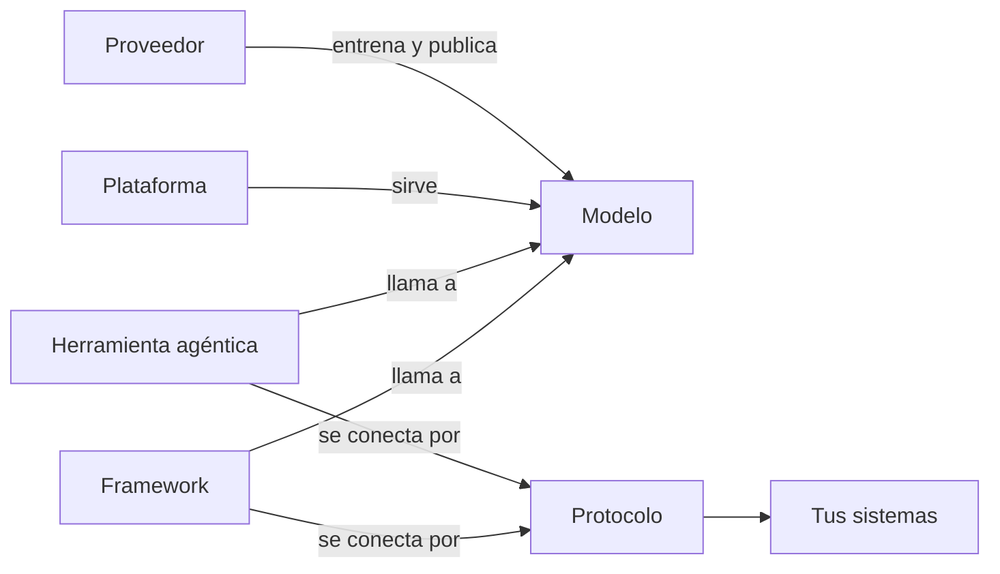

Al terminar esta lección podrás colocar cualquier nombre que leas en noticias o documentación en su sitio del mapa, y sabrás qué te afecta de verdad cuando algo «sale». La mitad de la confusión del sector viene de mezclar capas: comparar una herramienta con un modelo, o un protocolo con un framework.

## La idea

«Sale un modelo nuevo», «lanzan un agente», «ya soporta MCP». Son frases sobre cosas de naturaleza distinta. Hay siete categorías, y casi todo lo que leas cae en una (o en dos, si es un producto que agrupa varias piezas):



Los conceptos (token, contexto, herramienta, agente) no aparecen en el diagrama porque están en todas partes: son el vocabulario que vale para cualquier proveedor.

## Las siete categorías

| Categoría | Qué es | Ejemplos reales | Pregunta para reconocerla |
|---|---|---|---|
| Proveedor | Empresa o laboratorio que entrena y publica modelos | Anthropic, OpenAI, Google, Meta, Mistral AI, Alibaba, DeepSeek | ¿Quién lo entrena? |
| Modelo | El sistema que recibe tokens y devuelve tokens | Claude (Opus, Sonnet, Haiku, Fable), GPT, Gemini, Llama, Mistral, Qwen | ¿Le mandas un prompt y te devuelve texto? |
| Concepto | Una idea que existe con cualquier proveedor | [[glosario/token\|Token]], [[glosario/ventana-de-contexto\|ventana de contexto]], [[glosario/tool-use\|tool use]], [[glosario/agente\|agente]], [[glosario/rag\|RAG]] | ¿Sobrevive si cambias de proveedor? |
| Herramienta agéntica | Una aplicación que ejecuta un bucle de agente con herramientas para hacer tareas | Claude Code, Codex, Cursor, OpenCode, Cline, Aider, goose | ¿La usas tú para que haga trabajo? |
| Framework | Una biblioteca que importas para construir tus propias aplicaciones con modelos | LangChain, LangGraph, LlamaIndex, Pydantic AI, OpenAI Agents SDK | ¿Lo instalas con `pip` o `npm` y lo importas? |
| Protocolo | Una especificación que otros implementan para entenderse | [[glosario/mcp\|MCP]], [[glosario/a2a\|A2A]] | ¿Es un documento que define mensajes, no un programa? |
| Plataforma | Donde se consume, se aloja o se despliega un modelo o un agente | API de Anthropic, Amazon Bedrock, Google Cloud Vertex AI, Microsoft Foundry, Hugging Face Hub, LangSmith | ¿Es donde se ejecuta o se factura? |

## Proveedor y modelo

Un proveedor publica **familias** de modelos en varios tamaños y versiones. En la API, el modelo es solo un identificador que envías en cada petición: los actuales de Anthropic son `claude-opus-5-5`, `claude-sonnet-5-5`, `claude-haiku-5-5` y `claude-fable-5-1`. Cambiar de modelo es cambiar esa cadena y repetir tus evals ([[modelos/05-elegir-modelo-por-tarea]]).

Algunos laboratorios publican los pesos para que los descargues y los ejecutes tú: son modelos de [[glosario/pesos-abiertos|pesos abiertos]], como Llama, Mistral, Qwen o DeepSeek. Pesos abiertos no significa open source: puedes tener los pesos sin el código de entrenamiento ni los datos, y con una licencia que limite ciertos usos ([[cursos/agentes-con-modelos-abiertos/01-pesos-abiertos-y-licencias]]). Un mismo proveedor puede tener las dos cosas: Google publica Gemini como servicio y Gemma como familia de pesos abiertos.

Ojo con las aplicaciones de chat: ChatGPT es la aplicación de OpenAI; los modelos que usa son de la familia GPT. Claude es a la vez el nombre de la familia de modelos y el de la aplicación de Anthropic.

## Herramienta agéntica no es lo mismo que modelo

Claude Code es una aplicación que ejecuta el [[glosario/bucle-agentico|bucle agéntico]] (piensa con un modelo, usa herramientas para leer archivos o lanzar comandos, observa el resultado y repite) y que llama a modelos de Claude por debajo; el modelo es otra pieza. Codex es la herramienta equivalente de OpenAI, cuyo *harness* publicó OpenAI en abierto en 2026 ([Codex as a platform](https://developers.openai.com/blog/codex-as-a-platform)). Cursor es un editor comercial con un agente integrado que te deja elegir modelos de varios proveedores. OpenCode es un agente de terminal open source que trabaja con muchos proveedores y también con modelos locales ([[herramientas/opencode]]).

La calidad de una herramienta agéntica sale del modelo **y** del [[glosario/harness|harness]]: qué herramientas le da, qué permisos aplica, cómo gestiona el contexto ([[roadmap/90-harness/01-que-es-un-harness]]). Por eso «Claude Code contra GPT» compara cosas de categorías distintas. Compara herramienta con herramienta y modelo con modelo.

## Framework, SDK y herramienta

Las tres cosas se confunden porque todas «sirven para hacer agentes»:

- El **SDK del proveedor** (el paquete `anthropic`, el de `openai`) es un cliente fino de su API: envías mensajes y recibes bloques.
- Un **framework** (LangChain, LangGraph, LlamaIndex, Pydantic AI, OpenAI Agents SDK) añade abstracciones encima: interfaz común para varios proveedores, bucles de agente, estado, memoria. Los cinco son open source con licencia MIT. Ojo con lo que los rodea: LangSmith, la plataforma de observabilidad y despliegue de LangChain, es comercial.
- Una **herramienta agéntica** es un producto terminado que usas, no una biblioteca que importas.

El mismo modelo, a través de dos capas distintas:

```python tab="Python" title="capas.py"
import anthropic                         # SDK del proveedor: un cliente fino de su API

MODEL = "claude-sonnet-5-5"              # modelo: un identificador que envías en cada petición
client = anthropic.Anthropic()           # plataforma: la API de Anthropic, con tu clave

resp = client.messages.create(
    model=MODEL, max_tokens=200,
    messages=[{"role": "user", "content": "Define «token» en una frase."}],
)
print(resp.content[0].text)
print(resp.usage.input_tokens, resp.usage.output_tokens)   # concepto: todo se mide en tokens
```

```python tab="LangChain" title="capas_langchain.py"
from langchain.chat_models import init_chat_model   # framework: LangChain (MIT)

MODEL = "anthropic:claude-sonnet-5-5"    # proveedor:modelo; otro proveedor es otro prefijo
llm = init_chat_model(MODEL, max_tokens=200)   # por debajo, LangChain usa el SDK de ese proveedor

resp = llm.invoke("Define «token» en una frase.")
print(resp.content)
print(resp.usage_metadata["input_tokens"], resp.usage_metadata["output_tokens"])
```

El framework no cambia el modelo ni los conceptos: los envuelve. Cuándo compensa esa capa lo tienes en [[docs/frameworks/01-elegir-framework]] y en [[blog/2026-10-28-sdk-o-framework]].

## Protocolos

Un protocolo no hace nada por sí solo: define cómo se hablan dos programas. [[glosario/mcp|MCP]] (*Model Context Protocol*) es el estándar abierto para conectar aplicaciones de IA con herramientas y datos: tu herramienta agéntica actúa de cliente y un [[glosario/servidor-mcp|servidor MCP]] expone, por ejemplo, tu base de datos o tu gestor de tareas ([[docs/herramientas/02-mcp]]). [[glosario/a2a|A2A]] (*Agent2Agent*) define cómo se comunican agentes de sistemas distintos entre sí. Son complementarios: MCP conecta un agente con herramientas; A2A, agentes con agentes.

Ambos están hoy en la Agentic AI Foundation, de la Linux Foundation, junto con otros formatos abiertos como AGENTS.md (instrucciones para agentes de código en un repositorio, que Claude Code lee de forma nativa) y Agent Skills (el formato de las [[glosario/skill|skills]]). Cuando leas «X soporta MCP», tradúcelo: X puede conectarse a servidores MCP, o publica uno.

## Plataformas

Una plataforma es donde se ejecuta y se factura. El mismo modelo puede llegarte por varias: los modelos de Claude se consumen en la API de Anthropic y también en Amazon Bedrock, Google Cloud Vertex AI y Microsoft Foundry. Cambian la facturación, las regiones, los límites y, a veces, qué funciones están disponibles y cuándo; consulta la documentación de cada una. Los modelos de pesos abiertos se publican en Hugging Face Hub y se ejecutan con herramientas de inferencia como [[herramientas/ollama]] o [[herramientas/vllm]]. Y hay plataformas para desplegar y observar agentes, como LangSmith (comercial) o los agentes alojados de Anthropic, Claude Managed Agents (en beta).

## Cómo leer un titular

1. **Encuentra el sustantivo.** ¿De qué categoría es lo que «sale», «cambia» o «llega»?
2. **Pregúntate qué cambia para ti.** Un modelo nuevo: repite tus evals antes de cambiar la constante. Una herramienta: pruébala en un proyecto pequeño. Un framework: lee las notas de versión antes de actualizar. Un protocolo: compatibilidad de tus clientes y servidores. Una plataforma: disponibilidad, precio o región.
3. **Desconfía de las etiquetas.** «Agente» en un anuncio puede ser un chat con un botón. Pregunta qué bucle ejecuta, con qué herramientas y con qué permisos.

Debajo de todo, recuerda que cualquier agente decide con un modelo, y un modelo da la respuesta más probable, no necesariamente la correcta ([[blog/2026-10-15-la-respuesta-mas-probable]]).

## Errores frecuentes

- Decir que Claude Code o ChatGPT son modelos.
- Llamar a MCP «una herramienta» o «un framework».
- Confundir pesos abiertos con open source.
- Pensar que un framework te ata a un proveedor: LangChain y LlamaIndex funcionan con muchos.
- Cambiar de modelo por un titular sin repetir tus evals.

## Ejercicio

> [!ejercicio] Clasifica los titulares
> Estos titulares son inventados para el ejercicio. Para cada uno, di la categoría o categorías implicadas y qué harías tú, si algo, al leerlo.
>
> 1. «Anthropic publica una nueva versión de Claude Haiku, más rápida.»
> 2. «OpenCode añade soporte para modelos locales servidos con Ollama.»
> 3. «LangGraph incorpora una forma nueva de guardar el estado entre ejecuciones.»
> 4. «Un fabricante de software de tickets lanza su servidor MCP oficial.»
> 5. «Vertex AI amplía las regiones en las que ofrece modelos de terceros.»
> 6. «Meta publica los pesos de un nuevo modelo Llama.»
> 7. «Un estudio muestra que los modelos usan peor la información situada en mitad de contextos muy largos.»
> 8. «Cursor permite elegir entre modelos de varios proveedores en su agente.»
>
> Está bien si clasificas al menos siete correctamente, si en los titulares con dos categorías nombras ambas (por ejemplo, proveedor y modelo en el 1 y el 6) y si cada «qué harías» es una acción concreta: repetir evals, probar, leer notas de versión, revisar compatibilidad o no hacer nada.

> [!ejercicio]- Pistas
> El 4 es un protocolo y una pieza que lo implementa. El 7 trata de un concepto ([[glosario/lost-in-the-middle]]): no cambia ninguna herramienta, pero sí cómo colocas la información en el prompt. El 2 junta una herramienta agéntica con una herramienta de inferencia local.

## Resumen

- Siete categorías: proveedor, modelo, concepto, herramienta agéntica, framework, protocolo y plataforma.
- Un modelo es un identificador en tu código; una herramienta agéntica es modelo más harness.
- SDK, framework y herramienta son capas distintas; los frameworks citados son open source y algunas plataformas a su alrededor, comerciales.
- MCP conecta agentes con herramientas; A2A, agentes entre sí.
- Ante un titular: categoría, qué cambia para ti y qué hay detrás de la etiqueta.

## Para seguir

- [[roadmap/10-prompting/index]]: el siguiente nivel del roadmap.
- [[docs/frameworks/02-equivalencias]]: la misma pieza en el SDK y en cada framework.
- [[cursos/mcp-de-cero-a-servidor/01-que-resuelve-mcp]] para entender el protocolo a fondo.
