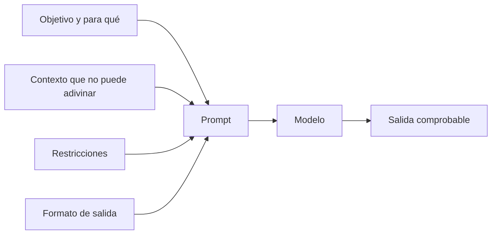

Al terminar esta lección sabrás detectar por qué un prompt da respuestas vagas o inconsistentes y reescribirlo para que no deje margen a interpretaciones. Es la habilidad con más retorno de todo el roadmap: la mayoría de los «fallos del modelo» que verás son instrucciones incompletas.

## La idea

Imagina que le pasas la tarea a una persona muy capaz que acaba de llegar a tu empresa. Sabe redactar, programar y razonar, pero no conoce a tus clientes, tu producto ni lo que vas a hacer con su trabajo. Si le dices «resume este correo», te devolverá un resumen razonable. Si le dices para quién es, para qué se usará y qué longitud necesitas, te devolverá el que necesitas.

El modelo está en esa misma situación en cada llamada. No sabe nada que no esté en la petición (lo viste en [[roadmap/00-fundamentos/01-que-es-un-llm]]), así que todo lo que das por supuesto, él lo rellena con lo más probable en general. Lo más probable en general rara vez coincide con lo que tú necesitas.

## Las cuatro piezas de una instrucción

Una instrucción completa responde a cuatro preguntas. No hace falta que tengan un título cada una, pero sí que estén:

1. **Objetivo**: qué tiene que hacer y para qué. «Resume este correo para que el responsable de cuentas decida en un minuto si tiene que llamar al cliente».
2. **Contexto**: lo que el modelo necesita saber y no puede adivinar. Quién es el cliente, qué producto usa, qué ha pasado antes.
3. **Restricciones**: lo que debe y no debe hacer. «No inventes fechas; si no aparecen, dilo».
4. **Formato**: la forma exacta de la salida. Longitud, estructura, idioma, tono.



### Antes y después

```text title="Antes"
Resume este correo.

Hola, os escribo porque el pedido 4471 sigue sin llegar y ya es la
tercera vez que pregunto. Si el viernes no está, cancelo la cuenta.
```

```text title="Después"
Eres parte del equipo de atención al cliente de una tienda online.
Resume el correo de abajo para el responsable de cuentas, que tiene
que decidir en un minuto si llama hoy al cliente.

Incluye, en este orden:
1. Qué pide el cliente, en una frase.
2. Plazos o amenazas que mencione, con la fecha si aparece.
3. Si es un caso repetido, según lo que diga el propio correo.

No añadas información que no esté en el correo. Máximo 60 palabras.

<correo>
Hola, os escribo porque el pedido 4471 sigue sin llegar y ya es la
tercera vez que pregunto. Si el viernes no está, cancelo la cuenta.
</correo>
```

El segundo prompt es más largo, pero cada línea elimina una decisión que el modelo tendría que tomar a ciegas.

## Explica el porqué de las reglas

Una regla sin motivo se aplica de forma literal y frágil. Con el motivo, el modelo puede generalizar a casos que no previste.

```text title="Antes"
No uses listas.
```

```text title="Después"
Escribe en párrafos, sin listas: el texto se lee en voz alta en una
llamada telefónica y las viñetas no se entienden al oído.
```

Con la segunda versión, el modelo también evitará tablas, abreviaturas y símbolos, aunque no se lo hayas dicho, porque entiende el objetivo.

## Separa las instrucciones de los datos

Cuando el prompt mezcla órdenes y contenido (un correo, un documento, la entrada del usuario), el modelo puede confundir dónde acaba uno y empieza el otro. La forma más fiable de separarlos son **etiquetas XML** con nombres descriptivos: `<correo>`, `<documento>`, `<datos_cliente>`. No hay etiquetas especiales: el nombre que elijas sirve si es claro y lo usas de forma coherente.

Esto tiene dos ventajas. La primera, que puedes referirte a ellas en las instrucciones («usa solo la información de `<documento>`»). La segunda, que reduce el riesgo de que un texto con frases tipo «ignora lo anterior» se tome como una orden. Contra la [[glosario/inyeccion-de-prompt|inyección de prompt]] no basta, aunque es un primer paso.

En código, construye el prompt con una plantilla y mete los datos en su sitio:

```python tab="Python" title="resumir.py"
import anthropic

MODEL = "claude-sonnet-5-5"
client = anthropic.Anthropic()

INSTRUCCIONES = """Eres parte del equipo de atención al cliente de una tienda online.
Resume el correo de <correo> para el responsable de cuentas, que tiene que decidir
en un minuto si llama hoy al cliente.

Incluye, en este orden:
1. Qué pide el cliente, en una frase.
2. Plazos o amenazas que mencione, con la fecha si aparece.
3. Si es un caso repetido, según lo que diga el propio correo.

No añadas información que no esté en el correo. Máximo 60 palabras."""

def resumir(correo: str) -> str:
    prompt = f"{INSTRUCCIONES}\n\n<correo>\n{correo}\n</correo>"
    resp = client.messages.create(
        model=MODEL,
        max_tokens=300,
        messages=[{"role": "user", "content": prompt}],
    )
    if resp.stop_reason == "max_tokens":
        raise RuntimeError("Resumen cortado: sube max_tokens o acorta la instrucción.")
    return "".join(b.text for b in resp.content if b.type == "text")

print(resumir("Hola, el pedido 4471 sigue sin llegar. Si el viernes no está, cancelo."))
```

```ts tab="TypeScript" title="resumir.ts"
import Anthropic from "@anthropic-ai/sdk";

const MODEL = "claude-sonnet-5-5";
const client = new Anthropic();

const INSTRUCCIONES = `Eres parte del equipo de atención al cliente de una tienda online.
Resume el correo de <correo> para el responsable de cuentas, que tiene que decidir
en un minuto si llama hoy al cliente.

Incluye, en este orden:
1. Qué pide el cliente, en una frase.
2. Plazos o amenazas que mencione, con la fecha si aparece.
3. Si es un caso repetido, según lo que diga el propio correo.

No añadas información que no esté en el correo. Máximo 60 palabras.`;

async function resumir(correo: string): Promise<string> {
  const resp = await client.messages.create({
    model: MODEL,
    max_tokens: 300,
    messages: [{ role: "user", content: `${INSTRUCCIONES}\n\n<correo>\n${correo}\n</correo>` }],
  });
  if (resp.stop_reason === "max_tokens") throw new Error("Resumen cortado");
  return resp.content.map((b) => (b.type === "text" ? b.text : "")).join("");
}

console.log(await resumir("Hola, el pedido 4471 sigue sin llegar. Si el viernes no está, cancelo."));
```

Con documentos largos, pon el documento primero y las instrucciones y la pregunta al final; lo verás en [[modelos/07-documentos-largos]].

## Pide lo que quieres, no lo que no quieres

«No seas muy técnico» deja abierto qué debe hacer. «Explícalo para alguien que nunca ha programado, sin términos como API o servidor» describe el resultado. Las instrucciones en positivo y concretas funcionan mejor que una lista de prohibiciones. Mantén las prohibiciones para límites reales («no prometas fechas de entrega»).

## Errores frecuentes

- Suponer que el modelo conoce tu producto, tu público o tu objetivo.
- Pegar los datos sin delimitar, mezclados con las instrucciones.
- Pedir «breve» o «detallado» sin cifra ni referencia.
- Acumular reglas sin explicar por qué, hasta que se contradicen.
- Cambiar cinco cosas del prompt a la vez y no saber cuál arregló el problema.

## Ejercicio

> [!ejercicio] Reescribe un prompt vago
> Toma este prompt: «Escribe una descripción del producto». El producto es una botella térmica de 500 ml, de acero, que mantiene el frío 24 horas, a 29 euros. Reescríbelo con las cuatro piezas (objetivo, contexto, restricciones, formato) para la ficha de una tienda online dirigida a ciclistas, con los datos del producto dentro de etiquetas `<producto>`. Ejecuta las dos versiones tres veces cada una.
>
> Está bien si la versión nueva produce en las tres ejecuciones textos con la longitud que pediste, sin datos inventados (ni capacidades ni precios que no diste) y con el mismo orden de contenido, y si puedes señalar qué línea del prompt evita cada problema que tenía la versión vaga.

> [!ejercicio]- Pistas
> Fíjate en qué inventa la versión vaga en las tres ejecuciones: suele haber datos que no le diste. Eso te dice qué restricción falta. Para el formato, decide antes cuántas frases o palabras quieres y si va un título.

## Resumen

- El modelo solo sabe lo que hay en la petición: escribe como para alguien capaz que no conoce tu proyecto.
- Una instrucción completa tiene objetivo, contexto, restricciones y formato.
- Explica el porqué de las reglas para que el modelo generalice bien.
- Separa instrucciones y datos con etiquetas XML descriptivas.
- Describe lo que quieres en positivo y con concreción.

## Para seguir

- [[roadmap/10-prompting/02-ejemplos-few-shot]]: cuando las instrucciones no bastan, enseña con casos.
- [[modelos/01-principios-de-prompting]]: los principios con más ejemplos de antes y después.
- [[modelos/02-ingenieria-de-contexto]]: qué meter en el contexto y en qué orden.
