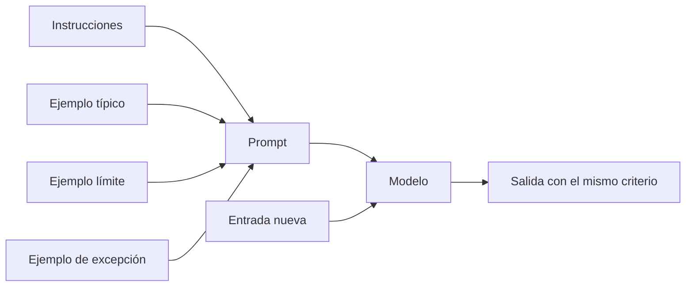

Al terminar esta lección sabrás cuándo merece la pena añadir ejemplos a un prompt, cómo elegirlos para que enseñen lo difícil y cómo comprobar que el modelo aprende el criterio y no solo la forma. Los ejemplos son la herramienta más directa para conseguir un formato y un tono estables.

## La idea

Hay cosas que cuestan mucho describir y se entienden enseguida con un caso. «Usa un tono cercano pero profesional» admite mil interpretaciones; dos respuestas de muestra fijan una. A esta técnica se le llama *few-shot*: incluir unos pocos ejemplos de entrada y salida para que el modelo infiera el patrón. Sin ejemplos, se habla de [[glosario/zero-shot|zero-shot]].

La capacidad de aprender de ejemplos dentro del propio prompt, sin reentrenar el modelo, se documentó a gran escala en [Language Models are Few-Shot Learners](https://arxiv.org/abs/2005.14165) (Brown et al., 2020). Desde entonces es una de las técnicas más usadas, porque funciona y no cuesta más que unos tokens.



## Cuándo usar ejemplos

Los ejemplos encajan especialmente en tres situaciones:

- **Formato o estilo**: quieres que todas las salidas tengan la misma estructura, longitud o tono.
- **Criterios difíciles de verbalizar**: dónde está la frontera entre «queja» y «sugerencia», o qué cuenta como urgente.
- **Casos límite**: entradas ambiguas en las que el modelo, por sí solo, decide de forma inconsistente.

Si la tarea se explica bien en dos frases y el modelo ya la hace bien, no los necesitas. Empieza siempre por instrucciones claras ([[roadmap/10-prompting/01-instrucciones-claras]]) y añade ejemplos cuando veas fallos concretos.

## Cómo elegir buenos ejemplos

El modelo aprende de todo lo que tienen en común tus ejemplos, incluido lo que no querías enseñarle. Si los tres ejemplos tienen dos frases, las respuestas tendrán dos frases. Si los tres son de la categoría «envío», tenderá a responder «envío». De ahí salen las reglas prácticas:

- **Variedad**: cambia longitud, tema, tono y estructura de las entradas.
- **Cubre lo difícil**: dedica al menos un ejemplo a un caso ambiguo y muestra cómo se resuelve.
- **Equilibrio**: si clasificas, no pongas todos los ejemplos de la misma clase.
- **Relevancia**: que se parezcan a las entradas reales, no a casos de manual.
- **Pocos y buenos**: suele bastar con tres a cinco. Más ejemplos cuestan tokens en cada llamada y no siempre mejoran.

> [!aviso] El modelo copia detalles
> Si un ejemplo contiene un nombre, un número o una frase concreta, puede aparecer en respuestas que no tienen nada que ver. Usa datos claramente ficticios y variados, y revisa las salidas buscando restos de tus ejemplos.

## Dónde poner los ejemplos

Hay dos formas habituales y las dos funcionan.

### Dentro del prompt, con etiquetas

La más sencilla y legible. Cada ejemplo va en su etiqueta, separado de la entrada real:

```python tab="Python" title="clasificar_opinion.py"
import anthropic

MODEL = "claude-sonnet-5-5"
client = anthropic.Anthropic()

PROMPT = """Clasifica la opinión de un usuario de una app de reservas de pistas deportivas.
Etiquetas posibles: queja, sugerencia, elogio, pregunta.
Si mezcla varias, elige la que pide una acción a nuestro equipo.
Responde solo con la etiqueta, en minúsculas.

<ejemplos>
<ejemplo>
<opinion>No me deja pagar con tarjeta desde ayer.</opinion>
<etiqueta>queja</etiqueta>
</ejemplo>
<ejemplo>
<opinion>Me encanta la app, aunque estaría bien poder reservar para un grupo de 8.</opinion>
<etiqueta>sugerencia</etiqueta>
</ejemplo>
<ejemplo>
<opinion>¿Se puede cancelar una reserva sin perder el dinero si llueve?</opinion>
<etiqueta>pregunta</etiqueta>
</ejemplo>
<ejemplo>
<opinion>Todo perfecto, la pista estaba impecable y el acceso con QR va genial.</opinion>
<etiqueta>elogio</etiqueta>
</ejemplo>
</ejemplos>

<opinion>{opinion}</opinion>"""

def clasificar(opinion: str) -> str:
    resp = client.messages.create(
        model=MODEL,
        max_tokens=10,
        messages=[{"role": "user", "content": PROMPT.format(opinion=opinion)}],
    )
    return "".join(b.text for b in resp.content if b.type == "text").strip()

print(clasificar("Genial todo, pero el horario de los sábados debería ampliarse."))
```

```ts tab="TypeScript" title="clasificar_opinion.ts"
import Anthropic from "@anthropic-ai/sdk";

const MODEL = "claude-sonnet-5-5";
const client = new Anthropic();

const prompt = (opinion: string) => `Clasifica la opinión de un usuario de una app de reservas de pistas deportivas.
Etiquetas posibles: queja, sugerencia, elogio, pregunta.
Si mezcla varias, elige la que pide una acción a nuestro equipo.
Responde solo con la etiqueta, en minúsculas.

<ejemplos>
<ejemplo><opinion>No me deja pagar con tarjeta desde ayer.</opinion><etiqueta>queja</etiqueta></ejemplo>
<ejemplo><opinion>Me encanta la app, aunque estaría bien poder reservar para un grupo de 8.</opinion><etiqueta>sugerencia</etiqueta></ejemplo>
<ejemplo><opinion>¿Se puede cancelar una reserva sin perder el dinero si llueve?</opinion><etiqueta>pregunta</etiqueta></ejemplo>
<ejemplo><opinion>Todo perfecto, la pista estaba impecable y el acceso con QR va genial.</opinion><etiqueta>elogio</etiqueta></ejemplo>
</ejemplos>

<opinion>${opinion}</opinion>`;

const resp = await client.messages.create({
  model: MODEL,
  max_tokens: 10,
  messages: [{ role: "user", content: prompt("Genial todo, pero el horario de los sábados debería ampliarse.") }],
});
console.log(resp.content.map((b) => (b.type === "text" ? b.text : "")).join("").trim());
```

Fíjate en el segundo ejemplo: mezcla elogio y sugerencia, y muestra cómo se aplica la regla de desempate. Ese ejemplo enseña más que los otros tres juntos.

El `max_tokens=10` funciona como red de seguridad: si el modelo empieza a explicar en vez de dar la etiqueta, se corta pronto y lo detectas. Comprueba igualmente que la salida está entre las etiquetas permitidas; en [[roadmap/10-prompting/03-formato-de-salida]] verás cómo validarlo de forma sistemática.

### Como turnos de conversación

La alternativa es simular conversaciones previas: cada ejemplo es un par de mensajes `user` y `assistant`, y la entrada real va en el último `user`.

```python title="como_turnos.py"
ejemplos = [
    ("No me deja pagar con tarjeta desde ayer.", "queja"),
    ("Me encanta la app, aunque estaría bien reservar para 8.", "sugerencia"),
]
messages = []
for entrada, salida in ejemplos:
    messages.append({"role": "user", "content": entrada})
    messages.append({"role": "assistant", "content": salida})
messages.append({"role": "user", "content": "¿Abrís en festivos?"})
```

Este formato marca bien qué es respuesta y qué es entrada, y es cómodo cuando generas los ejemplos desde una base de datos. Las instrucciones generales irían en el [[glosario/prompt-de-sistema|prompt de sistema]], que verás en [[roadmap/10-prompting/04-prompt-de-sistema]].

## Ejemplos con razonamiento

Para tareas que requieren pensar (decidir una prioridad, detectar una incoherencia), puedes incluir en cada ejemplo una breve justificación antes de la respuesta. El modelo imitará el razonamiento además del resultado. Es una forma de [[glosario/cadena-de-pensamiento|cadena de pensamiento]] guiada por ejemplos, en la línea de [Wei et al., 2022](https://arxiv.org/abs/2201.11903). Si luego necesitas solo la respuesta, pide que la ponga en una etiqueta aparte (`<respuesta>`) y extráela en tu código.

## Errores frecuentes

- Ejemplos todos parecidos, que enseñan la forma pero no el criterio.
- Ningún ejemplo de los casos ambiguos, que son justo donde falla el modelo.
- Ejemplos con datos reales de clientes que luego reaparecen en otras respuestas.
- Ejemplos que contradicen las instrucciones: el modelo suele hacer más caso al ejemplo.
- Añadir ejemplos sin medir si mejoran algo.

## Ejercicio

> [!ejercicio] Ejemplos para el clasificador de tickets
> Prepara el primer borrador del proyecto del nivel: un prompt que clasifica tickets de soporte en `facturacion`, `envio`, `cuenta` o `producto`. Escribe primero diez tickets de prueba con su categoría correcta, incluidos al menos tres ambiguos. Ejecuta el prompt sin ejemplos y anota los aciertos. Después añade cuatro ejemplos elegidos para cubrir los fallos y vuelve a ejecutar.
>
> Está bien si ninguno de los cuatro ejemplos coincide con un ticket de prueba, si hay al menos un ejemplo por categoría, si al menos uno muestra cómo resolver un caso ambiguo y si anotas el número de aciertos antes y después.

> [!ejercicio]- Pistas
> Un ticket ambiguo típico: «No puedo entrar a mi cuenta para descargar la factura». ¿Es `cuenta` o `facturacion`? Decide la regla, escríbela en las instrucciones y ponla también en un ejemplo.

## Resumen

- Los ejemplos fijan formato, tono y criterio mejor que muchas palabras.
- Elígelos variados, equilibrados y centrados en los casos difíciles.
- Tres a cinco suelen bastar; más cuestan tokens en cada llamada.
- Ponlos en etiquetas XML o como turnos de conversación previos.
- Revisa que el modelo no copie detalles de los ejemplos y mide si mejoran.

## Para seguir

- [[roadmap/10-prompting/03-formato-de-salida]]: de etiquetas sueltas a JSON validado.
- [[docs/prompting/02-ejemplos-few-shot]] como referencia.
- [[recetas/clasificar-y-enrutar-tickets]]: el clasificador completo como receta.
