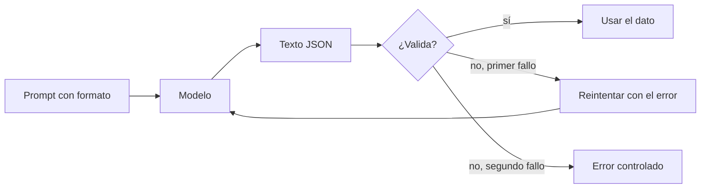

Al terminar esta lección sabrás conseguir que el modelo devuelva JSON que tu código puede usar sin miedo: pedido con claridad, validado con un esquema y, cuando la API lo permite, garantizado por construcción. Es el paso que convierte un modelo que escribe texto en un componente que se integra con el resto de tu sistema.

## La idea

Tu código no lee prosa: lee estructuras. Si el modelo va a alimentar una base de datos, un enrutador de tickets o una interfaz, necesitas que devuelva siempre la misma forma, con los mismos campos y tipos. Eso se consigue en tres capas, y conviene usar las tres:

1. **Pedirlo bien**: describir el formato en el prompt, con un ejemplo.
2. **Garantizarlo cuando se pueda**: usar [[glosario/salida-estructurada|salidas estructuradas]], que obligan a que la respuesta cumpla un esquema.
3. **Validarlo siempre**: comprobar en tu código tipos, valores permitidos y reglas de negocio.



## Define el esquema en tu código

Empieza por el contrato. Con Pydantic en Python (o Zod en TypeScript) defines los campos una vez y te sirven para validar, documentar y generar el JSON Schema.

```python title="esquema.py"
from typing import Literal
from pydantic import BaseModel

class Ticket(BaseModel):
    categoria: Literal["facturacion", "envio", "cuenta", "producto"]
    prioridad: Literal["baja", "media", "alta"]
    resumen: str
```

`Literal` restringe los valores: si el modelo devuelve `"facturación"` con tilde o `"urgente"`, la validación falla y te enteras.

## Capa 1: pedirlo en el prompt

Describe el formato con precisión, da un ejemplo y pide que no haya nada más alrededor:

```python title="clasificar.py"
import json
import anthropic
from pydantic import ValidationError
from esquema import Ticket

MODEL = "claude-sonnet-5-5"
client = anthropic.Anthropic()

PROMPT = """Clasifica el ticket de soporte de <ticket>.

Devuelve únicamente un objeto JSON, sin texto antes ni después y sin bloque de código,
con estos campos:
- "categoria": una de "facturacion", "envio", "cuenta", "producto"
- "prioridad": una de "baja", "media", "alta" (alta si hay dinero cobrado de más,
  amenaza de baja o el servicio no funciona)
- "resumen": una frase de menos de 15 palabras

Ejemplo de salida:
{{"categoria": "envio", "prioridad": "media", "resumen": "Pedido retrasado una semana"}}

<ticket>
{ticket}
</ticket>"""

def pedir(messages: list) -> str:
    resp = client.messages.create(model=MODEL, max_tokens=300, messages=messages)
    if resp.stop_reason == "max_tokens":
        raise RuntimeError("JSON cortado por max_tokens")
    return "".join(b.text for b in resp.content if b.type == "text")

def clasificar(ticket: str) -> Ticket:
    messages = [{"role": "user", "content": PROMPT.format(ticket=ticket)}]
    texto = pedir(messages)
    try:
        return Ticket.model_validate_json(texto)
    except ValidationError as e:
        # un reintento: le enseñamos su respuesta y el error concreto
        messages += [
            {"role": "assistant", "content": texto},
            {"role": "user", "content": f"Tu JSON no es válido:\n{e}\nDevuelve solo el JSON corregido."},
        ]
        return Ticket.model_validate_json(pedir(messages))  # si falla otra vez, que suba

print(clasificar("Me habéis cobrado dos veces la suscripción de octubre."))
```

Las llaves dobles `{{ }}` del ejemplo son para que `str.format` no las confunda con el hueco `{ticket}`.

El reintento con el error es muy eficaz porque el mensaje de Pydantic dice exactamente qué campo falló y por qué. Limítalo a uno o dos: si el modelo falla repetidamente, el problema está en el prompt o en el esquema, y reintentar más solo gasta.

## Capa 2: salidas estructuradas garantizadas

La API de Mensajes puede obligar a que la respuesta cumpla un JSON Schema. Se activa con `output_config`, y el JSON llega en el bloque de texto:

```python tab="Python" title="estructurada.py"
import anthropic
from esquema import Ticket

MODEL = "claude-sonnet-5-5"
client = anthropic.Anthropic()

ESQUEMA = {
    "type": "object",
    "properties": {
        "categoria": {"type": "string", "enum": ["facturacion", "envio", "cuenta", "producto"]},
        "prioridad": {"type": "string", "enum": ["baja", "media", "alta"]},
        "resumen": {"type": "string"},
    },
    "required": ["categoria", "prioridad", "resumen"],
    "additionalProperties": False,
}

resp = client.messages.create(
    model=MODEL,
    max_tokens=300,
    messages=[{"role": "user", "content": "Clasifica este ticket: Me habéis cobrado dos veces octubre."}],
    output_config={"format": {"type": "json_schema", "schema": ESQUEMA}},
)
texto = "".join(b.text for b in resp.content if b.type == "text")
ticket = Ticket.model_validate_json(texto)  # sigue validando
```

```ts tab="TypeScript" title="estructurada.ts"
import Anthropic from "@anthropic-ai/sdk";
import { z } from "zod";

const MODEL = "claude-sonnet-5-5";
const client = new Anthropic();

const Ticket = z.object({
  categoria: z.enum(["facturacion", "envio", "cuenta", "producto"]),
  prioridad: z.enum(["baja", "media", "alta"]),
  resumen: z.string(),
});

const resp = await client.messages.create({
  model: MODEL,
  max_tokens: 300,
  messages: [{ role: "user", content: "Clasifica este ticket: Me habéis cobrado dos veces octubre." }],
  output_config: {
    format: {
      type: "json_schema",
      schema: {
        type: "object",
        properties: {
          categoria: { type: "string", enum: ["facturacion", "envio", "cuenta", "producto"] },
          prioridad: { type: "string", enum: ["baja", "media", "alta"] },
          resumen: { type: "string" },
        },
        required: ["categoria", "prioridad", "resumen"],
        additionalProperties: false,
      },
    },
  },
});
const texto = resp.content.map((b) => (b.type === "text" ? b.text : "")).join("");
const ticket = Ticket.parse(JSON.parse(texto)); // sigue validando
console.log(ticket);
```

En Python, el SDK te ahorra escribir el esquema a mano: `client.messages.parse(..., output_format=Ticket)` lo genera desde el modelo Pydantic y devuelve el objeto ya validado en `.parsed_output`.

```python title="parse.py"
resp = client.messages.parse(
    model=MODEL,
    max_tokens=300,
    messages=[{"role": "user", "content": "Clasifica este ticket: Me habéis cobrado dos veces octubre."}],
    output_format=Ticket,
)
ticket = resp.parsed_output
```

Tiene limitaciones que conviene conocer: no admite esquemas recursivos ni restricciones numéricas o de longitud (mínimos, máximos, longitud de cadena), y `additionalProperties` debe ser `false`. Comprueba en la [documentación oficial](https://platform.claude.com/docs) qué modelos la soportan.

> [!aviso] Garantizar el formato no garantiza el contenido
> Un JSON perfectamente válido puede tener la categoría equivocada o un resumen inventado. Las salidas estructuradas resuelven el parseo; la corrección se mide con casos de prueba, como verás en [[roadmap/10-prompting/05-iterar-con-casos-de-prueba]].

## Capa 3: reglas de negocio en tu código

Lo que el esquema no puede expresar, lo compruebas tú después de validar: que el resumen no supere 15 palabras, que una fecha no sea futura, que un importe cuadre con la suma de líneas. Con Pydantic puedes añadirlo como validadores al modelo que usas para comprobar, aunque no lo envíes como esquema a la API.

```python title="reglas.py"
def comprobar(t: Ticket) -> list[str]:
    problemas = []
    if len(t.resumen.split()) > 15:
        problemas.append("resumen demasiado largo")
    return problemas
```

## Errores frecuentes

- Hacer `json.loads` sobre la respuesta sin capturar el error.
- No comprobar `stop_reason`: un JSON cortado por `max_tokens` nunca valida.
- Aceptar cualquier cadena en campos que deberían ser un conjunto cerrado de valores.
- Reintentar en bucle sin límite cuando la validación falla.
- Confiar en las salidas estructuradas como prueba de que el contenido es correcto.

## Ejercicio

> [!ejercicio] JSON que nunca rompe
> Completa `clasificar.py` del proyecto del nivel con el modelo `Ticket`, la validación y un reintento. Pruébalo con diez tickets, incluidos uno vacío, uno en inglés y uno de más de 300 palabras. Después crea una segunda versión con `output_config` (o `messages.parse`) y compara.
>
> Está bien si ninguna ejecución termina con una excepción no controlada, si el programa distingue en su salida entre «válido», «válido tras reintento» y «error», si las dos versiones devuelven objetos `Ticket` y si compruebas aparte la regla de longitud del resumen.

> [!ejercicio]- Pistas
> Para forzar un fallo de validación y probar el reintento, cambia temporalmente una categoría del prompt por otra que no esté en el `Literal`. Para el ticket vacío, decide qué debe pasar antes de escribir el código: quizá no merezca la pena llamar al modelo.

## Resumen

- Define el esquema una vez en tu código (Pydantic o Zod) y úsalo para validar.
- Pide el formato con precisión y un ejemplo; comprueba `stop_reason`.
- Si falla la validación, reintenta una vez enseñando el error concreto.
- `output_config` con `json_schema` o `messages.parse` garantizan el formato, con limitaciones.
- Valida siempre las reglas de negocio que el esquema no cubre.

## Para seguir

- [[roadmap/10-prompting/04-prompt-de-sistema]]: dónde poner las reglas fijas del clasificador.
- [[modelos/03-formato-y-salidas-estructuradas]] y [[docs/prompting/03-salida-estructurada]] como referencia.
- [[sistemas/extraccion-documental]]: extracción a JSON a escala, con revisión humana.
