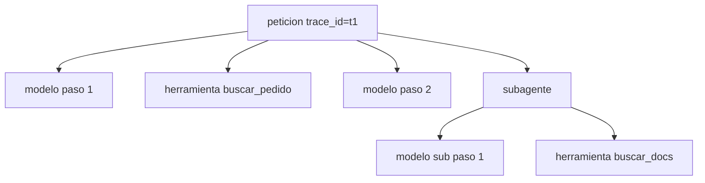

Al terminar esta lección cada petición a tu agente dejará una traza completa: qué preguntó el usuario, qué llamadas al modelo hubo, qué herramientas se ejecutaron, cuánto tardó y cuánto costó cada paso. Sabrás qué métricas sacar de ahí y qué alertas poner.

## La idea

La [[glosario/observabilidad]] es la capacidad de responder preguntas sobre tu sistema en producción sin tener que desplegar código nuevo para averiguarlo. En un agente las preguntas típicas son: ¿por qué respondió esto?, ¿por qué tardó veinte segundos?, ¿por qué esta conversación costó diez veces más que la media?, ¿desde cuándo falla esta herramienta?

Para responderlas necesitas **trazas**: un registro estructurado de cada petición como un árbol de tramos (*spans*). La raíz es la petición del usuario. Debajo cuelgan las llamadas al modelo y las herramientas. En un sistema multiagente, cada subagente es una rama con sus propios tramos.



Todos los tramos comparten `trace_id`. Cada uno tiene su `span_id` y el `parent_id` de quien lo creó. Con esos tres campos reconstruyes el árbol en cualquier herramienta de análisis.

## Qué registrar

| Nivel | Campos |
|---|---|
| Petición | `trace_id`, usuario (seudonimizado), canal, versión del prompt y del agente, resultado final, duración total, coste total |
| Llamada al modelo | `span_id`, `parent_id`, modelo, `stop_reason`, `usage` completo, duración, ID de la respuesta, ID de la petición del proveedor, número de paso |
| Herramienta | `span_id`, `parent_id`, nombre, argumentos (redactados), tamaño del resultado, `is_error`, mensaje de error, duración |
| Decisiones humanas | quién aprobó o rechazó, cuándo, qué se le mostró ([[roadmap/100-produccion/05-humano-en-el-bucle]]) |

Tres campos se olvidan a menudo y luego se echan de menos:

- **`stop_reason`**. Un aumento de `max_tokens` indica respuestas cortadas; uno de `refusal`, peticiones que el modelo rechaza. Ninguno lanza una excepción, así que solo los ves si los registras.
- **El ID de la petición del proveedor.** Si tienes que abrir una incidencia con el proveedor, es lo que te pedirán. El SDK de Python lo expone en la respuesta como `_request_id`.
- **La versión del prompt.** Sin ella no puedes relacionar un cambio de comportamiento con un despliegue ([[roadmap/100-produccion/06-despliegue]]).

## Trazas con contextvars

No necesitas una plataforma para empezar. Una línea JSON por tramo, escrita en la salida estándar o en un archivo, se puede enviar después a cualquier sistema de registros. `contextvars` propaga el tramo actual a través de funciones y de tareas de `asyncio` sin pasarlo como argumento.

```python title="trazas.py"
import contextvars, json, sys, time, uuid
from contextlib import contextmanager

_traza = contextvars.ContextVar("traza", default=None)
_tramo = contextvars.ContextVar("tramo", default=None)

def emitir(registro: dict) -> None:
    sys.stdout.write(json.dumps(registro, ensure_ascii=False, default=str) + "\n")

@contextmanager
def tramo(tipo: str, **atributos):
    trace_id = _traza.get() or uuid.uuid4().hex
    span_id, parent_id = uuid.uuid4().hex[:16], _tramo.get()
    t_traza, t_tramo = _traza.set(trace_id), _tramo.set(span_id)
    datos = {"tipo": tipo, **atributos}
    inicio = time.perf_counter()
    try:
        yield datos            # quien usa el tramo añade campos a este diccionario
    except Exception as e:
        datos["error"] = repr(e)
        raise
    finally:
        emitir({"trace_id": trace_id, "span_id": span_id, "parent_id": parent_id,
                "ms": round((time.perf_counter() - inicio) * 1000), **datos})
        _tramo.reset(t_tramo); _traza.reset(t_traza)
```

Y así se usa dentro del bucle del agente:

```python title="agente.py"
import anthropic
from trazas import tramo

MODEL = "claude-sonnet-5-5"
PROMPT_VERSION = "soporte-v14"
client = anthropic.Anthropic()

def llamar_modelo(paso: int, **kwargs):
    with tramo("modelo", modelo=MODEL, paso=paso) as t:
        resp = client.messages.create(model=MODEL, **kwargs)
        u = resp.usage
        t.update(stop_reason=resp.stop_reason, message_id=resp.id,
                 request_id=getattr(resp, "_request_id", None),
                 input_tokens=u.input_tokens, output_tokens=u.output_tokens,
                 cache_creation=u.cache_creation_input_tokens or 0,
                 cache_read=u.cache_read_input_tokens or 0)
        return resp

def llamar_herramienta(nombre: str, entrada: dict, ejecutar) -> tuple[str, bool]:
    with tramo("herramienta", nombre=nombre, entrada=redactar(entrada)) as t:
        try:
            salida, error = ejecutar(nombre, entrada), False
        except Exception as e:
            salida, error = f"Error: {e}", True
        t.update(is_error=error, bytes_resultado=len(salida))
        return salida, error

def atender(usuario_id: str, pregunta: str) -> str:
    with tramo("peticion", usuario=seudonimo(usuario_id), prompt=PROMPT_VERSION) as t:
        respuesta = bucle_agente(pregunta)  # usa llamar_modelo y llamar_herramienta
        t["resultado"] = "ok"
        return respuesta
```

`redactar` y `seudonimo` son tuyas: la primera quita o enmascara datos personales de los argumentos; la segunda convierte el ID del usuario en un hash con sal para poder agrupar sin identificar. Con subagentes en paralelo, cada tarea de `asyncio` hereda una copia del contexto, así que sus tramos cuelgan del tramo que las lanzó sin hacer nada más.

```text
# salida de ejemplo
{"trace_id": "9f2c…", "span_id": "a1b2…", "parent_id": "77de…", "ms": 2140, "tipo": "modelo", "modelo": "claude-sonnet-5-5", "paso": 1, "stop_reason": "tool_use", "input_tokens": 3120, "output_tokens": 88, "cache_creation": 0, "cache_read": 2900}
{"trace_id": "9f2c…", "span_id": "c3d4…", "parent_id": "77de…", "ms": 180, "tipo": "herramienta", "nombre": "buscar_pedido", "entrada": {"pedido_id": "4512"}, "is_error": false, "bytes_resultado": 412}
```

## Las mismas trazas con OpenTelemetry

Cuando el volumen crezca, no mantengas tu propio formato: [OpenTelemetry](https://opentelemetry.io) es el estándar abierto para trazas y casi todas las plataformas de observabilidad lo aceptan. El modelo de datos es el mismo (tramos con IDs y atributos) y, para sistemas con modelos, existen las [[glosario/convenciones-genai-otel|convenciones semánticas GenAI]]: nombres comunes para que cualquier herramienta entienda qué es una llamada al modelo y qué es una herramienta.

| Tu tramo | Span GenAI | Atributos principales |
|---|---|---|
| `peticion` | `invoke_agent` | `gen_ai.operation.name`, `gen_ai.agent.name`, `gen_ai.conversation.id` |
| `modelo` | `chat` | `gen_ai.provider.name`, `gen_ai.request.model`, `gen_ai.usage.input_tokens`, `gen_ai.usage.output_tokens`, `gen_ai.usage.cache_read.input_tokens`, `gen_ai.response.finish_reasons` |
| `herramienta` | `execute_tool` | `gen_ai.tool.name`, `gen_ai.tool.call.id`, `error.type` |

El mismo `llamar_modelo` con el SDK de OpenTelemetry:

```python title="trazas_otel.py"
import anthropic
from opentelemetry import trace
from opentelemetry.sdk.trace import TracerProvider
from opentelemetry.sdk.trace.export import BatchSpanProcessor, ConsoleSpanExporter

MODEL = "claude-sonnet-5-5"
proveedor = TracerProvider()
proveedor.add_span_processor(BatchSpanProcessor(ConsoleSpanExporter()))  # en producción, un exportador OTLP
trace.set_tracer_provider(proveedor)
tracer = trace.get_tracer("agente-soporte")
client = anthropic.Anthropic(open_telemetry=False)   # el SDK ya emite su propio span: aquí lo emitimos nosotros

def llamar_modelo(**kwargs):
    with tracer.start_as_current_span(f"chat {MODEL}") as span:
        span.set_attributes({"gen_ai.operation.name": "chat", "gen_ai.provider.name": "anthropic",
                             "gen_ai.request.model": MODEL})
        resp = client.messages.create(model=MODEL, **kwargs)
        span.set_attributes({"gen_ai.response.id": resp.id,
                             "gen_ai.response.finish_reasons": [resp.stop_reason],
                             "gen_ai.usage.input_tokens": resp.usage.input_tokens,
                             "gen_ai.usage.output_tokens": resp.usage.output_tokens,
                             "gen_ai.usage.cache_read.input_tokens": resp.usage.cache_read_input_tokens or 0})
        return resp

def atender(pregunta: str) -> str:
    with tracer.start_as_current_span("invoke_agent soporte") as span:
        span.set_attributes({"gen_ai.operation.name": "invoke_agent", "gen_ai.agent.name": "soporte"})
        resp = llamar_modelo(max_tokens=1024, messages=[{"role": "user", "content": pregunta}])
        return "".join(b.text for b in resp.content if b.type == "text")
```

OpenTelemetry propaga el contexto como tus `contextvars`: el span `chat` cuelga solo del `invoke_agent` que lo contiene. Cuatro cosas que conviene saber antes de copiar nombres:

- **Están en estado *Development*.** Desde junio de 2026 viven en su propio repositorio, [open-telemetry/semantic-conventions-genai](https://github.com/open-telemetry/semantic-conventions-genai), y cambian entre versiones: `gen_ai.system` pasó a llamarse `gen_ai.provider.name`. Fija la versión de tu instrumentación y lee el registro de cambios antes de actualizar.
- **El contenido es *opt-in*.** Los mensajes completos van en `gen_ai.input.messages` y `gen_ai.output.messages` solo si los activas, por la misma razón que el aviso de abajo.
- **El SDK `anthropic` 2.x ya emite un span por llamada** si hay un `TracerProvider` registrado, con sus propios nombres en algunos campos. O lo usas y añades tú solo `invoke_agent` y `execute_tool`, o lo apagas (`open_telemetry=False`, como arriba) y emites el tuyo. Con los dos a la vez contarías los tokens dos veces.
- **Lo que no esté en la convención, en tu espacio de nombres** (`app.version_prompt`, `app.coste_usd`), nunca inventando `gen_ai.*`.

Para ver las trazas no hace falta una plataforma comercial. [[herramientas/langfuse|Langfuse]] (SDK con licencia MIT basado en OpenTelemetry; la plataforma se autoaloja o se usa en la nube) recibe OTLP y añade decoradores `@observe` para agentes y herramientas ([[recetas/trazas-con-langfuse]]). [[herramientas/arize-phoenix|Phoenix]] se arranca en local con un comando y muestra el árbol de spans; ojo, su licencia es Elastic 2.0, código disponible pero no open source según la OSI. Si tu agente usa LangChain o LangGraph, los instrumentadores de OpenInference o el *callback* de Langfuse capturan cada nodo sin tocar tu código. El detalle de atributos y el bucle completo instrumentado están en [[docs/produccion/04-opentelemetry-genai]] y [[docs/modelos-abiertos/07-observabilidad-abierta]].

> [!peligro] Las trazas también son datos personales
> Si registras prompts y respuestas completas, guardas lo que escriben tus usuarios. Redacta antes de escribir, limita quién puede leerlas y fija un plazo de retención. Guarda el texto completo solo si lo necesitas y durante el tiempo justo.

## Métricas que salen de las trazas

Agregando los tramos obtienes lo necesario para operar:

- **Coste por petición** (media y percentil alto), por versión de prompt y por tipo de petición. Sale de `usage` y de tus precios ([[roadmap/100-produccion/02-costes-y-prompt-caching]]).
- **Latencia** total y del primer token, percentiles 50 y 95. Los usuarios recuerdan las esperas largas, y la media las esconde ([[roadmap/100-produccion/03-latencia]]).
- **Pasos por petición** y su distribución. Una cola larga indica bucles que no convergen.
- **Errores de herramienta** por nombre. Un salto repentino suele ser un cambio en un sistema externo.
- **Distribución de `stop_reason`**, con atención a `max_tokens` y `refusal`.
- **Tasa de caché**: `cache_read` frente al total de entrada.

Pon alertas sobre pocas cosas y bien elegidas: coste por hora por encima de un presupuesto, tasa de errores de una herramienta, percentil 95 de latencia y aumento de `max_tokens`. Cada alerta debe llevar a una acción concreta; si nadie sabe qué hacer cuando salta, sobra.

## De la traza a la eval

Las trazas cierran el círculo con [[roadmap/80-evals/index]]. Cuando un usuario se queja o una alerta salta, buscas la traza, entiendes el fallo y la conviertes en un caso de tu conjunto de prueba. Si tu formato de trazas coincide con el de la trayectoria de tus evals ([[roadmap/80-evals/04-evals-de-trayectoria]]), el paso es casi automático.

## Errores frecuentes

- Registrar solo errores y no poder explicar una respuesta que no falló pero estaba mal.
- No registrar `usage` y estimar el coste con la factura mensual.
- Usar IDs distintos en cada servicio y no poder unir los tramos de una misma petición.
- Guardar prompts completos con datos personales sin redacción ni retención.
- Mirar solo medias de latencia y coste.
- Mezclar el span automático del SDK con uno propio y contar los tokens dos veces.

## Ejercicio

> [!ejercicio] Una traza que responda preguntas
> Instrumenta tu agente con `tramo` en petición, modelo y herramientas. Ejecuta 20 peticiones variadas, incluidas dos que provoquen un error de herramienta. Con un script que lea las líneas JSON, calcula por petición: pasos, coste en tokens, duración y si hubo errores. Después responde, solo con las trazas: ¿cuál fue la petición más cara y por qué?
>
> Está bien si todos los tramos de una petición comparten `trace_id`, si los de herramienta tienen como `parent_id` el de la petición, si ningún argumento registrado contiene un correo o un teléfono sin enmascarar y si la respuesta a la pregunta cita los tramos concretos.

> [!ejercicio]- Pistas
> Agrupa con `itertools.groupby` tras ordenar por `trace_id`, o carga las líneas en un DataFrame. Para `redactar`, empieza por expresiones regulares de correos y teléfonos y amplía según tus datos.

## Resumen

- Una traza es un árbol de tramos con `trace_id`, `span_id` y `parent_id`.
- Registra por llamada al modelo `stop_reason`, `usage`, duración e IDs; por herramienta, nombre, argumentos redactados, error y duración.
- `contextvars` propaga la traza por funciones y tareas de `asyncio` sin tocar firmas.
- Saca de las trazas coste, latencia, pasos, errores y `stop_reason`, y alerta solo sobre lo accionable.
- Redacta datos personales y fija una retención.
- Para crecer, emite spans OpenTelemetry con las convenciones GenAI (`invoke_agent`, `chat`, `execute_tool`), con la versión fijada.

## Para seguir

- [[roadmap/100-produccion/02-costes-y-prompt-caching]]
- [[docs/produccion/01-observabilidad]]
- [[docs/produccion/04-opentelemetry-genai]]
- [[blog/2026-07-15-como-leer-una-traza]]
