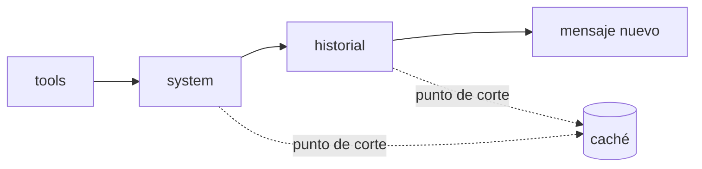

Al terminar esta lección sabrás leer en tus trazas en qué se va el dinero de tu agente, tendrás el [[glosario/prompt-caching]] configurado en el prefijo que se repite en cada paso y podrás demostrar con `usage` que funciona. También pondrás límites para que una petición no pueda gastar sin freno.

## La idea

En [[roadmap/60-multiagente/05-coste-de-multiplicar-agentes]] viste que cada paso del bucle vuelve a enviar todo: herramientas, sistema e historial. En un agente típico, la mayor parte de los tokens de entrada de cada paso son exactamente los mismos que en el paso anterior. **El prompt caching guarda ese prefijo repetido para que las siguientes peticiones lo lean de caché**, que es mucho más barato y además más rápido que procesarlo de nuevo.

Funciona por prefijo. El proveedor compara el comienzo de tu petición, en el orden `tools` → `system` → `messages`, con lo que tiene en caché. Si coincide hasta el punto de corte, reutiliza esa parte. Si cambias algo, se invalida esa parte y todo lo que va detrás.



## Dónde se va el dinero

Antes de optimizar, mide. Con las trazas de [[roadmap/100-produccion/01-observabilidad-y-trazas]] agrupa los tokens de una petición típica en cuatro partes:

| Parte | Cómo estimarla | Palanca principal |
|---|---|---|
| Prefijo fijo (herramientas y sistema) | `client.messages.count_tokens` con solo esa parte | Caché |
| Historial y resultados de herramientas | Entrada total menos prefijo, paso a paso | Resultados más cortos, [[glosario/compactacion]], caché del historial |
| Salida | `output_tokens` | `max_tokens`, [[glosario/esfuerzo]], pedir respuestas concisas |
| Número de pasos | Tramos de modelo por petición | Mejores herramientas, criterio de parada |

Si el prefijo fijo pesa poco frente a los resultados de herramientas, la caché del sistema ayuda poco y la palanca está en recortar lo que devuelven las herramientas. Si pesa mucho, la caché es lo primero que debes hacer.

## Poner la caché: `cache_control`

Marca un bloque con `"cache_control": {"type": "ephemeral"}` y se cachea todo el prefijo hasta ese bloque inclusive. Puedes poner hasta 4 puntos de corte por petición.

```python tab="Python" title="cache.py"
import anthropic

MODEL = "claude-sonnet-5-5"
client = anthropic.Anthropic()

TOOLS = [
    {"name": "buscar_pedido", "description": "Busca un pedido por su ID.",
     "input_schema": {"type": "object", "properties": {"pedido_id": {"type": "string"}},
                      "required": ["pedido_id"]}},
    {"name": "buscar_docs", "description": "Busca en la política y la documentación de soporte.",
     "input_schema": {"type": "object", "properties": {"consulta": {"type": "string"}},
                      "required": ["consulta"]},
     "cache_control": {"type": "ephemeral"}},       # corte 1: todas las herramientas
]

SYSTEM = [
    {"type": "text", "text": open("prompts/soporte.md", encoding="utf-8").read(),
     "cache_control": {"type": "ephemeral"}},       # corte 2: herramientas + sistema
]

def paso(mensajes: list) -> anthropic.types.Message:
    # corte 3: el último bloque del último mensaje, para cachear el historial
    ultimo = mensajes[-1]
    if isinstance(ultimo["content"], str):
        ultimo["content"] = [{"type": "text", "text": ultimo["content"]}]
    ultimo["content"][-1]["cache_control"] = {"type": "ephemeral"}
    try:
        return client.messages.create(model=MODEL, max_tokens=1024, tools=TOOLS,
                                      system=SYSTEM, messages=mensajes)
    finally:
        del ultimo["content"][-1]["cache_control"]  # no acumules marcas en pasos siguientes
```

```ts tab="TypeScript" title="cache.ts"
import Anthropic from "@anthropic-ai/sdk";
import { readFileSync } from "node:fs";

const MODEL = "claude-sonnet-5-5";
const client = new Anthropic();

// Mismas definiciones que en Python; la última herramienta lleva cache_control.
declare const TOOLS: Anthropic.Tool[];

const SYSTEM: Anthropic.TextBlockParam[] = [{
  type: "text",
  text: readFileSync("prompts/soporte.md", "utf-8"),
  cache_control: { type: "ephemeral" },
}];

const resp = await client.messages.create({
  model: MODEL, max_tokens: 1024, system: SYSTEM, tools: TOOLS,
  messages: [{ role: "user", content: "¿Dónde está mi pedido 4512?" }],
});
console.log(resp.usage);
```

Con el corte en el último mensaje, cada paso del bucle escribe en caché el historial hasta ese punto y el paso siguiente lo lee. Quitar la marca después evita superar el límite de 4 puntos de corte cuando el historial crece.

Si no quieres gestionar los puntos de corte a mano, también puedes poner `cache_control` en el nivel superior de la petición y dejar que la caché sea automática. Es la forma más simple de empezar; pasa a puntos de corte explícitos cuando quieras controlar exactamente qué se cachea.

### Duración y mínimos

- La entrada en caché dura 5 minutos por defecto y el plazo se renueva cada vez que se lee. Para tráfico espaciado existe `{"type": "ephemeral", "ttl": "1h"}`.
- Hay un mínimo de tokens para cachear que depende del modelo. Por debajo, la petición funciona igual pero no se cachea nada. Consulta el mínimo de tu modelo en la [documentación oficial](https://platform.claude.com/docs).
- Escribir en caché cuesta algo más que la entrada normal y leer cuesta mucho menos. Los multiplicadores exactos están en la página de precios: úsalos en tu cálculo en lugar de copiarlos de memoria.

## Comprobar que funciona

Nunca des la caché por buena sin mirarla. Haz dos llamadas seguidas con el mismo prefijo y lee `usage`:

```python title="comprobar_cache.py"
for i in range(2):
    r = paso([{"role": "user", "content": "¿Dónde está mi pedido 4512?"}])
    u = r.usage
    print(i, "escrito:", u.cache_creation_input_tokens, "leído:", u.cache_read_input_tokens,
          "sin caché:", u.input_tokens)
```

```text
# salida de ejemplo
0 escrito: 4210 leído: 0 sin caché: 18
1 escrito: 0 leído: 4210 sin caché: 18
```

Lo esperado: en la primera, `cache_creation_input_tokens` mayor que cero; en la segunda, `cache_read_input_tokens` con ese mismo tamaño. Si ambas salen a cero, el prefijo no llega al mínimo o algo cambia entre llamadas. En producción, sigue la tasa de lectura de caché en tus métricas: una caída brusca suele coincidir con un despliegue que tocó el prefijo.

> [!aviso] Lo que rompe la caché sin que te enteres
> Una fecha u hora en el prompt de sistema, un ID de petición en las instrucciones, herramientas en distinto orden entre llamadas o un JSON de herramientas generado con claves en orden variable. Todo lo que cambia va al final, en el mensaje del usuario, nunca en el prefijo.

## Otras palancas de coste

La caché ataca el prefijo. El resto se controla así:

1. **Resultados de herramientas cortos.** Devuelve campos útiles y fragmentos, no documentos enteros. Suele ser la mayor ganancia después de la caché.
2. **`max_tokens` como límite duro** de salida por llamada y [[glosario/esfuerzo|`effort`]] como orientación en modelos con razonamiento. Ajusta cada uno a lo que el paso necesita.
3. **El modelo adecuado por paso.** Clasificar o extraer no suele necesitar el modelo más capaz. Mide con tus evals antes de cambiar ([[modelos/05-elegir-modelo-por-tarea]]).
4. **Menos pasos.** Cada paso evitado ahorra un historial entero de entrada.
5. **Procesamiento por lotes** para trabajo que no necesita respuesta inmediata, si tu proveedor lo ofrece: consulta condiciones y descuentos en su documentación.

## Límites de gasto

Optimizar reduce la media. Los límites cortan los extremos: el bucle que no converge o el usuario que abusa.

```python title="presupuesto.py"
class PresupuestoAgotado(Exception):
    pass

class Presupuesto:
    def __init__(self, max_tokens_entrada: int, max_pasos: int):
        self.restante, self.pasos_restantes = max_tokens_entrada, max_pasos

    def cargar(self, usage) -> None:
        self.restante -= (usage.input_tokens + (usage.cache_creation_input_tokens or 0)
                          + (usage.cache_read_input_tokens or 0))
        self.pasos_restantes -= 1
        if self.restante <= 0 or self.pasos_restantes <= 0:
            raise PresupuestoAgotado()
```

Crea un `Presupuesto` por petición y llama a `cargar(resp.usage)` tras cada paso. Cuando salte, responde al usuario con lo que tengas y regístralo en la traza. Añade un contador por usuario y día en tu almacén para cortar el abuso. Por encima de todo, configura en la consola de tu proveedor un límite de gasto de la cuenta.

## Errores frecuentes

- Poner `cache_control` sin comprobar `usage` y suponer que funciona.
- Meter datos variables (fecha, nombre del usuario) en el prompt de sistema.
- Cachear un prefijo por debajo del mínimo del modelo.
- Optimizar el coste sin ejecutar las evals y perder calidad sin saberlo.
- No tener límite de pasos ni de tokens por petición.

## Ejercicio

> [!ejercicio] Caché medida
> Añade los tres puntos de corte a tu agente. Ejecuta 10 conversaciones de 3 a 5 pasos y calcula, con las trazas, el porcentaje de tokens de entrada leídos de caché y el coste total con y sin caché usando los precios oficiales actuales de tu modelo (anota la fecha). Después mete a propósito la hora actual en el prompt de sistema y repite.
>
> Está bien si demuestras con `usage` que la caché se escribe y se lee, si el coste con caché es menor, si la versión con la hora en el sistema muestra que la caché deja de leerse y si tu suite de evals da el mismo resultado con y sin caché.

> [!ejercicio]- Pistas
> El coste sin caché se calcula sumando las tres columnas de entrada al precio normal. Si las lecturas son cero desde el principio, comprueba con `count_tokens` que tu prefijo supera el mínimo del modelo.

## Resumen

- En un agente, casi toda la entrada de cada paso repite el paso anterior: es lo que se cachea.
- `cache_control: {"type": "ephemeral"}` en un bloque cachea el prefijo hasta ahí, en orden `tools` → `system` → `messages`, con hasta 4 cortes.
- Comprueba siempre con `cache_creation_input_tokens` y `cache_read_input_tokens`.
- Todo lo variable va al final; cualquier cambio en el prefijo invalida la caché desde ese punto.
- Pon límites de tokens y pasos por petición, por usuario y en la cuenta.

## Para seguir

- [[roadmap/100-produccion/03-latencia]]
- [[recetas/recortar-costes-con-prompt-caching]]
- [[radar/2026-07-21-prompt-caching-palanca-de-coste]]
