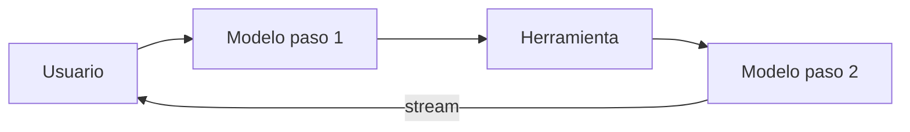

Al terminar esta lección sabrás dónde se va el tiempo de tu agente, harás que el usuario vea algo útil en cuanto el modelo empieza a responder y aplicarás, midiendo, las palancas que reducen la espera total.

## La idea

La [[glosario/latencia]] de un agente tiene dos caras. La **real** es el tiempo desde que el usuario envía hasta que tiene la respuesta completa. La **percibida** es cuánto tiempo pasa sin ver nada útil. Se atacan con herramientas distintas: el [[glosario/streaming]] mejora la percibida; menos pasos, modelos más rápidos y paralelismo mejoran la real.

En una llamada al modelo, el tiempo se reparte entre procesar la entrada hasta el primer token y generar la salida. Lo segundo crece con el número de tokens de salida, que se generan uno tras otro. En un agente, eso se repite por cada paso del bucle y se suma el tiempo de cada herramienta.



**Latencia del agente ≈ suma de los pasos del modelo + suma de las herramientas.** Las dos palancas más grandes casi siempre son quitar pasos y acortar salidas.

## Medir primero

Usa las trazas de [[roadmap/100-produccion/01-observabilidad-y-trazas]]. Para cada petición necesitas la duración de cada tramo de modelo y de herramienta. Para la respuesta final, añade el tiempo hasta el primer token (TTFT, por sus siglas en inglés). Mira percentiles, no medias: el percentil 95 es la experiencia de los usuarios con peor suerte.

Haz una tabla con una petición típica y una lenta. Casi siempre aparece una de estas causas:

- Muchos pasos, varios de ellos búsquedas repetidas.
- Una herramienta lenta (una API externa, una consulta sin índice).
- Una salida larga en un paso intermedio que nadie lee, como un razonamiento extenso para decidir qué herramienta llamar.
- Un modelo grande en pasos triviales.

## Streaming de la respuesta final

Con streaming recibes la respuesta a trozos según se genera. No reduce el tiempo total, pero el usuario empieza a leer mucho antes.

```python tab="Python" title="stream.py"
import time
import anthropic

MODEL = "claude-sonnet-5-5"
client = anthropic.Anthropic()

def responder_en_stream(mensajes: list, enviar) -> anthropic.types.Message:
    inicio, primero = time.perf_counter(), None
    with client.messages.stream(model=MODEL, max_tokens=1024, messages=mensajes) as stream:
        for texto in stream.text_stream:
            if primero is None:
                primero = time.perf_counter() - inicio
            enviar(texto)                 # a tu interfaz: SSE, websocket, terminal
        final = stream.get_final_message()
    print(f"TTFT {(primero or 0):.2f}s · total {time.perf_counter() - inicio:.2f}s · "
          f"stop_reason={final.stop_reason}")
    return final
```

```ts tab="TypeScript" title="stream.ts"
import Anthropic from "@anthropic-ai/sdk";

const MODEL = "claude-sonnet-5-5";
const client = new Anthropic();

export async function responderEnStream(
  mensajes: Anthropic.MessageParam[],
  enviar: (t: string) => void,
): Promise<Anthropic.Message> {
  const stream = client.messages.stream({ model: MODEL, max_tokens: 1024, messages: mensajes });
  stream.on("text", (texto) => enviar(texto));
  return await stream.finalMessage();
}
```

`get_final_message()` devuelve el mensaje completo con `stop_reason` y `usage`, igual que una llamada normal. Así sigues registrando la traza y, si el modelo pide una herramienta en este paso, tienes los bloques `tool_use` completos para ejecutarla. Los detalles de eventos están en [[docs/fundamentos/04-streaming]].

En un agente, el streaming tiene más sentido en el último paso, el que produce el texto para el usuario. En los pasos intermedios puedes enseñar progreso con algo más simple (si usas LangGraph, `stream_mode="updates"` te da un evento por nodo terminado y `stream_mode="messages"` los tokens del modelo según salen): «Buscando el pedido…», «Consultando la política de devoluciones…», a partir de los nombres de las herramientas que se están ejecutando. Es un patrón de [[disciplinas/ux-de-agentes]] que reduce mucho la sensación de espera.

> [!aviso] Streaming y validación
> Si la respuesta tiene que pasar una comprobación antes de llegar al usuario (formato, datos personales, políticas), no puedes enseñarla mientras se genera sin más. Valida por frases o párrafos, o haz streaming solo de las partes que no necesitan revisión.

## Las palancas de la latencia real

Ordenadas por el efecto habitual:

1. **Menos pasos.** Cada paso evitado ahorra una llamada entera. Herramientas que devuelven lo necesario a la primera ([[disciplinas/diseno-de-herramientas]]), una herramienta que combine dos consultas que siempre van juntas, o un [[glosario/workflow]] con pasos fijos donde no hace falta que el modelo decida.
2. **Salidas más cortas.** La generación es secuencial. Pide respuestas concisas, ajusta `max_tokens` a cada paso y baja el [[glosario/esfuerzo]] en los pasos sencillos (`output_config={"effort": "low"}`). En los modelos 5.x el razonamiento adaptativo está activo por defecto, y en Opus 5.5 y Sonnet 5.5 no se puede apagar del todo: el esfuerzo es la forma de que piense menos donde no hace falta. Sus tokens no se ven (por defecto el bloque `thinking` llega vacío), pero se generan y se esperan.
3. **El modelo adecuado para cada paso.** Un modelo pequeño y rápido para enrutar, clasificar o extraer (la documentación de Anthropic sitúa a Haiku 5.5 ahí); el más capaz solo donde lo necesitas. Decídelo con evals, como explica [[modelos/05-elegir-modelo-por-tarea]]. Si el paso lento necesita el modelo grande, Opus 5.5 tiene un modo rápido (`speed="fast"`, GA desde octubre de 2026) que genera la salida más deprisa a un precio más alto; no funciona en lotes.
4. **Paralelizar lo independiente.** Varias herramientas que no dependen entre sí se ejecutan a la vez, igual que los subagentes de [[roadmap/60-multiagente/04-paralelismo]]. Si el modelo pide varias en una respuesta, ejecútalas con `asyncio.gather`.
5. **Caché del prefijo.** Leer de caché acelera también el procesamiento de la entrada ([[roadmap/100-produccion/02-costes-y-prompt-caching]]).
6. **Herramientas más rápidas.** Índices en la base de datos, caché de respuestas de APIs externas, tiempos de espera cortos con un mensaje de error claro.

Una forma práctica de decidir el modelo por paso es esta tabla, rellenada con tus medidas:

| Paso | Necesita | Modelo candidato | Comprueba |
|---|---|---|---|
| Clasificar la intención | Precisión en pocas categorías | Rápido | Tasa de acierto en tus casos de enrutado |
| Decidir herramientas | Seguir instrucciones, elegir bien | Mediano | Evals de trayectoria |
| Redactar la respuesta | Calidad y fidelidad a los datos | El más capaz que puedas pagar | Juez calibrado |

## Comprueba que no rompes nada

Cada palanca de latencia es un cambio de comportamiento. Quitar pasos puede hacer que el agente responda sin consultar; un modelo más rápido puede elegir peor la herramienta; una salida más corta puede omitir un dato. Ejecuta tu suite de [[roadmap/80-evals/index|evals]], incluidas las de trayectoria, después de cada cambio y compara latencia y calidad juntas.

## Errores frecuentes

- Mirar la latencia media y no el percentil 95.
- Hacer streaming de pasos intermedios que el usuario no necesita leer.
- Cambiar a un modelo más rápido en todos los pasos sin evals.
- Ejecutar en serie herramientas independientes.
- Dejar que un paso intermedio genere razonamientos largos que no aportan, con el esfuerzo por defecto en todos los pasos.

## Ejercicio

> [!ejercicio] Un agente más rápido
> Mide 20 peticiones de tu agente y anota TTFT, tiempo total en percentiles 50 y 95, pasos medios y el tramo más lento de cada petición. Aplica dos palancas: streaming en la respuesta final y una más elegida según tus datos (menos pasos, modelo por paso o paralelizar herramientas). Vuelve a medir y ejecuta las evals.
>
> Está bien si el TTFT de la respuesta final baja claramente, si la palanca elegida está justificada por la medida inicial, si presentas una tabla antes y después con percentiles y si la tasa de las evals no baja más que tu tolerancia.

> [!ejercicio]- Pistas
> Para el percentil 95 con pocas muestras: `statistics.quantiles(datos, n=20)[-1]`. Si un paso intermedio tiene `output_tokens` altos, mira qué escribe: a veces basta con decirle en el prompt que no explique antes de llamar a la herramienta.

## Resumen

- La latencia percibida se mejora con streaming y mensajes de progreso; la real, con menos pasos, salidas cortas, modelos adecuados y paralelismo.
- En un agente, la latencia es la suma de pasos del modelo y herramientas: mide cada tramo.
- Usa streaming en la respuesta final y conserva el mensaje completo para trazas y herramientas.
- Mira percentiles, no medias.
- Cada palanca de latencia cambia el comportamiento: ejecuta las evals.

## Para seguir

- [[roadmap/100-produccion/04-seguridad-y-prompt-injection]]
- [[recetas/streaming-de-respuestas]]
- [[docs/produccion/03-latencia]]
