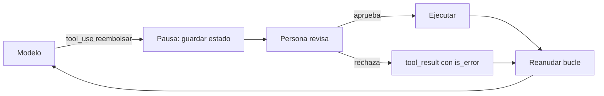

Al terminar esta lección tu agente se detendrá antes de reembolsar, borrar o enviar algo, guardará dónde estaba, pedirá a una persona que decida con la información justa y continuará con esa decisión, aunque pasen horas. Sabrás también qué acciones merecen esa pausa y cuáles no.

## La idea

[[glosario/humano-en-el-bucle|Humano en el bucle]] significa que una persona revisa y decide en un punto concreto del flujo del agente. El lugar más importante es **antes de una acción irreversible o de alto impacto**: mover dinero, borrar datos, enviar algo a un tercero, cambiar permisos. Es la última capa de defensa cuando todo lo demás falla, incluida una inyección de prompt que superó tus otras defensas ([[roadmap/100-produccion/04-seguridad-y-prompt-injection]]).

Técnicamente, la pausa encaja de forma natural en el ciclo de herramientas. Cuando el modelo emite un `tool_use` para una herramienta sensible, tu código no la ejecuta. Guarda la conversación, avisa a una persona y termina la petición. Cuando la persona decide, cargas la conversación, construyes el [[glosario/tool-result]] con el resultado de la decisión y sigues el bucle.



## Qué acciones necesitan aprobación

Pedir aprobación para todo es casi tan malo como no pedirla: la gente aprende a pulsar «Aprobar» sin leer. Clasifica tus herramientas con dos preguntas: ¿se puede deshacer? y ¿cuánto daño hace si sale mal?

| | Impacto bajo | Impacto alto |
|---|---|---|
| **Reversible** | Ejecuta y registra (crear un borrador, etiquetar un ticket) | Ejecuta, registra y permite deshacer (cambiar una dirección de envío) |
| **Irreversible** | Aprobación por umbral (reembolso bajo un importe) | Aprobación siempre (reembolso alto, borrar una cuenta, enviar un correo a un cliente) |

Los umbrales se definen en código, no en el prompt. Revísalos con datos: si el 100 % de las aprobaciones de una categoría se aceptan sin cambios durante meses, quizá ese umbral pueda subir. Si se rechazan muchas, el agente tiene un problema que hay que arreglar antes.

## La pausa en código

El estado tiene que sobrevivir entre peticiones: la persona puede tardar minutos o un día. Guarda en tu base de datos el historial de mensajes, los `tool_use` pendientes y los resultados de las herramientas que sí se ejecutaron en ese mismo turno.

```python title="aprobacion.py"
import uuid
from dataclasses import dataclass, field
from datetime import datetime, timedelta, timezone
import anthropic

MODEL = "claude-sonnet-5-5"
client = anthropic.Anthropic()
SENSIBLES = {"reembolsar", "borrar_cuenta", "enviar_correo"}

@dataclass
class Pendiente:
    id: str
    mensajes: list                 # historial hasta la respuesta con el tool_use
    resultados: list               # tool_result ya resueltos de ese mismo turno
    acciones: list                 # [{"tool_use_id", "nombre", "entrada", "clave"}]
    caduca: str = field(default_factory=lambda: (
        datetime.now(timezone.utc) + timedelta(hours=24)).isoformat())

def avanzar(sesion, mensajes: list, max_pasos: int = 10) -> dict:
    for _ in range(max_pasos):
        resp = client.messages.create(model=MODEL, max_tokens=1024, system=SYSTEM,
                                      tools=TOOLS, messages=mensajes)
        mensajes.append({"role": "assistant", "content": [b.model_dump(exclude_none=True) for b in resp.content]})
        if resp.stop_reason != "tool_use":
            return {"estado": "respondido",
                    "texto": "".join(b.text for b in resp.content if b.type == "text")}
        resultados, acciones = [], []
        for b in resp.content:
            if b.type != "tool_use":
                continue
            if b.name in SENSIBLES:
                acciones.append({"tool_use_id": b.id, "nombre": b.name, "entrada": b.input,
                                 "clave": uuid.uuid4().hex})   # clave de idempotencia
            else:
                salida, error = ejecutar(sesion, b.name, b.input)
                resultados.append({"type": "tool_result", "tool_use_id": b.id,
                                   "content": salida, "is_error": error})
        if acciones:
            p = Pendiente(uuid.uuid4().hex, mensajes, resultados, acciones)
            guardar_pendiente(p)                  # tu base de datos
            notificar_revisor(p)                  # cola, correo, panel interno
            return {"estado": "pendiente", "id": p.id}
        mensajes.append({"role": "user", "content": resultados})
    return {"estado": "limite_de_pasos"}
```

Guardar el contenido con `model_dump(exclude_none=True)` convierte los bloques en diccionarios que puedes serializar a JSON y volver a enviar tal cual.

Cuando la persona decide, se completa el turno: un `tool_result` por cada `tool_use`, los de las herramientas ya ejecutadas y los de las sensibles, todos en el mismo mensaje.

```python title="reanudar.py"
def resolver(sesion, pendiente_id: str, decisiones: dict[str, dict]) -> dict:
    p = cargar_pendiente(pendiente_id)
    if datetime.fromisoformat(p.caduca) < datetime.now(timezone.utc):
        decisiones = {a["tool_use_id"]: {"aprobada": False, "motivo": "caducada"} for a in p.acciones}
    resultados = list(p.resultados)
    for a in p.acciones:
        d = decisiones[a["tool_use_id"]]
        if d["aprobada"]:
            salida, error = ejecutar(sesion, a["nombre"], a["entrada"], clave=a["clave"])
        else:
            salida, error = f"Rechazada por revisión humana: {d.get('motivo', 'sin motivo')}", True
        registrar_decision(p.id, a, d, revisor=d.get("revisor"))
        resultados.append({"type": "tool_result", "tool_use_id": a["tool_use_id"],
                           "content": salida, "is_error": error})
    p.mensajes.append({"role": "user", "content": resultados})
    marcar_resuelto(p.id)
    return avanzar(sesion, p.mensajes)
```

Tres detalles de robustez:

- **Idempotencia.** La clave se genera al pausar y se pasa a la herramienta. Si el revisor pulsa dos veces o tu servicio reintenta, la API de pagos reconoce la clave y no cobra ni reembolsa dos veces.
- **Caducidad.** Una aprobación de hace una semana puede estar basada en datos que ya no son ciertos. Al caducar, se rechaza y el agente lo explica.
- **Rechazo como resultado.** Un `tool_result` con `is_error: True` y el motivo permite que el modelo siga: explicar al usuario, ofrecer una alternativa o escalar.

> [!peligro] Enseña lo que se va a ejecutar
> El revisor tiene que ver los argumentos reales del `tool_use` (importe, destinatario, ID), sacados por tu código del bloque, no un resumen redactado por el modelo. Si una inyección ha manipulado al agente, su resumen también puede estar manipulado.

## Diseñar la petición de aprobación

La pausa solo protege si la persona puede decidir bien en poco tiempo. Una buena petición de aprobación incluye:

1. **Qué**: la acción con sus argumentos exactos. «Reembolsar 89,90 € al pedido 4512 a la tarjeta terminada en 1234.»
2. **Por qué**: lo que pidió el usuario, en sus palabras, y los datos que usó el agente (el pedido, la política aplicada).
3. **Consecuencias**: si se puede deshacer y cómo.
4. **Opciones**: aprobar, rechazar con motivo y, si tiene sentido, editar un argumento dentro de límites (por ejemplo, un importe menor).
5. **Plazo**: cuándo caduca.

Evita la fatiga: agrupa en una sola revisión varias acciones del mismo caso, pide aprobación solo donde la tabla de arriba lo indica y mide cuánto tardan las revisiones y cuántas se rechazan. Los patrones de interfaz para estas pantallas están en [[disciplinas/ux-de-agentes]] y la práctica del día a día en [[disciplinas/humano-en-el-bucle]].

## La misma pausa con LangChain y LangGraph

Lo que acabas de escribir (guardar el estado, devolver el control, reanudar con la decisión) es exactamente lo que hace `interrupt` en [[herramientas/langgraph|LangGraph]]. La pausa guarda el estado del grafo en un [[glosario/checkpointer|checkpointer]], la ejecución termina devolviendo lo que pasaste a `interrupt`, y `Command(resume=…)` con el mismo `thread_id` la reanuda, aunque sea en otro proceso. En [[herramientas/langchain|LangChain]], `HumanInTheLoopMiddleware` lo empaqueta para `create_agent`.

```python tab="LangChain" title="aprobacion_langchain.py"
from langchain.agents import create_agent
from langchain.agents.middleware import HumanInTheLoopMiddleware
from langchain.chat_models import init_chat_model
from langchain.tools import tool
from langgraph.checkpoint.sqlite import SqliteSaver
from langgraph.types import Command

MODEL = "anthropic:claude-sonnet-5-5"

@tool
def ver_pedido(pedido_id: str) -> str:
    """Devuelve estado e importe de un pedido por su id (formato P-NNNN)."""
    return '{"id": "%s", "estado": "entregado", "importe_eur": 49.90}' % pedido_id

@tool
def reembolsar(pedido_id: str, importe_eur: float) -> str:
    """Emite un reembolso. Acción irreversible: solo tras confirmar el pedido con ver_pedido."""
    return f"Reembolso de {importe_eur} € emitido para {pedido_id}."

def crear_agente(checkpointer):
    return create_agent(
        model=init_chat_model(MODEL, max_tokens=2048),
        tools=[ver_pedido, reembolsar],
        system_prompt="Eres un agente de soporte. Antes de reembolsar, comprueba el pedido.",
        middleware=[HumanInTheLoopMiddleware(interrupt_on={
            "reembolsar": {"allowed_decisions": ["approve", "edit", "reject"]},
            "ver_pedido": False,                       # solo lectura: sin pausa
        })],
        checkpointer=checkpointer,                     # sin checkpointer no hay pausa
    )

if __name__ == "__main__":
    with SqliteSaver.from_conn_string("agente.db") as cp:   # el estado sobrevive a reinicios
        agente, config = crear_agente(cp), {"configurable": {"thread_id": "ticket-123"}}
        out = agente.invoke({"messages": [("user", "Devolvedme el pedido P-1001, llegó roto.")]},
                            config, version="v2")
        while out.interrupts:                          # en pausa: aquí iría tu panel de revisión
            peticion = out.interrupts[0].value         # action_requests con los argumentos reales
            decisiones = [{"type": "approve"} if input(f"¿{a['name']} {a['args']}? [s/n] ") == "s"
                          else {"type": "reject", "message": "El supervisor no lo aprueba."}
                          for a in peticion["action_requests"]]
            out = agente.invoke(Command(resume={"decisions": decisiones}), config, version="v2")
        print(out.value["messages"][-1].text)
```

```python tab="LangGraph" title="aprobacion_langgraph.py"
from langchain.chat_models import init_chat_model
from langchain.messages import SystemMessage, ToolMessage
from langgraph.graph import END, START, MessagesState, StateGraph
from langgraph.prebuilt import ToolNode
from langgraph.types import Command, interrupt

from aprobacion_langchain import MODEL, reembolsar, ver_pedido

TOOLS, SENSIBLES = [ver_pedido, reembolsar], {"reembolsar"}
SYSTEM = SystemMessage("Eres un agente de soporte. Antes de reembolsar, comprueba el pedido.")

def construir(checkpointer, modelo=None):
    llm = (modelo or init_chat_model(MODEL, max_tokens=2048)).bind_tools(TOOLS)

    def llamar_modelo(state: MessagesState):
        return {"messages": [llm.invoke([SYSTEM, *state["messages"]])]}

    def decidir(state: MessagesState):
        return "aprobar" if state["messages"][-1].tool_calls else END

    def aprobar(state: MessagesState):
        llamadas = state["messages"][-1].tool_calls
        pendientes = [{"name": c["name"], "args": c["args"]} for c in llamadas if c["name"] in SENSIBLES]
        if not pendientes:
            return Command(goto="herramientas")
        decision = interrupt({"pendientes": pendientes})   # pausa; al reanudar, el nodo se repite
        if decision == "aprobar":
            return Command(goto="herramientas")
        rechazos = [ToolMessage("Rechazado por un humano: no lo ejecutes otra vez.", tool_call_id=c["id"],
                                name=c["name"], status="error") for c in llamadas]  # uno por tool_call
        return Command(goto="modelo", update={"messages": rechazos})

    g = StateGraph(MessagesState)
    g.add_node("modelo", llamar_modelo)
    g.add_node("aprobar", aprobar, destinations=("herramientas", "modelo"))
    g.add_node("herramientas", ToolNode(TOOLS))
    g.add_edge(START, "modelo")
    g.add_conditional_edges("modelo", decidir, ["aprobar", END])
    g.add_edge("herramientas", "modelo")
    return g.compile(checkpointer=checkpointer)

# out = grafo.invoke({"messages": [...]}, config, version="v2")    → out.interrupts[0].value
# out = grafo.invoke(Command(resume="aprobar"), config, version="v2")
```

Lo que esconden: el `Pendiente` y su tabla son el checkpointer, `guardar_pendiente` es `interrupt` y `resolver` es `Command(resume=…)`. Lo que **no** hacen por ti: la caducidad, la clave de idempotencia y el registro de quién decidió siguen siendo tu código. Y un detalle que confunde al principio: al reanudar, el nodo que llamó a `interrupt` se ejecuta otra vez desde el principio, así que no pongas antes de `interrupt` nada con efectos. Si la reanudación no hace nada, revisa [[problemas/langgraph-no-reanuda-tras-interrupt]]; el recorrido completo está en [[recetas/aprobacion-humana-con-langgraph]] y [[cursos/langchain-y-langgraph/07-humano-en-el-bucle-con-interrupt]].

## Aprobar acciones o aprobar un plan

Esta lección pone la persona delante de cada acción irreversible. En [[roadmap/70-flujos-con-especificacion/05-una-sola-puerta-humana]] viste la otra mitad: en un flujo de construcción con agentes, una sola [[glosario/puerta-humana|puerta humana]] antes de construir, sobre una especificación que luego se congela, controla mejor que muchas aprobaciones pequeñas, porque con muchas preguntas aprobar se vuelve un reflejo. Las dos se combinan bien: una puerta atenta sobre **qué** se va a hacer y, durante la ejecución, aprobaciones solo para lo que no se puede deshacer.

## Errores frecuentes

- Pedir confirmación al modelo («¿Estás seguro?») en lugar de a una persona.
- Ejecutar la acción y pedir aprobación después.
- Guardar el estado solo en memoria y perderlo al reiniciar el servicio.
- Olvidar los `tool_result` de las herramientas no sensibles del mismo turno al reanudar.
- No tener claves de idempotencia y ejecutar dos veces una acción aprobada.
- Pedir aprobación para todo y entrenar a los revisores a no leer.
- Poner efectos (un cobro, un correo) antes de `interrupt` en un nodo de LangGraph: se repiten al reanudar.

## Ejercicio

> [!ejercicio] Un reembolso que espera
> Clasifica las herramientas de tu agente con la tabla de reversibilidad e impacto. Implementa `avanzar` y `resolver` con estado en SQLite o en archivos JSON. Prueba tres recorridos: una aprobación, un rechazo con motivo y una aprobación caducada. Simula también un doble clic en «Aprobar».
>
> Está bien si la acción sensible nunca se ejecuta antes de la decisión, si el estado sobrevive a reiniciar el proceso entre la pausa y la decisión, si cada recorrido termina con una respuesta coherente del agente al usuario, si el doble clic no provoca una segunda ejecución y si cada decisión queda registrada con revisor y hora.

> [!ejercicio]- Pistas
> Para la idempotencia en tu stub, guarda en un conjunto las claves ya usadas y devuelve el resultado anterior si llega una repetida. Para la caducidad, crea el `Pendiente` con una fecha ya pasada.

## Resumen

- Pide aprobación antes de lo irreversible o de alto impacto, según una tabla de reversibilidad e impacto en código.
- La pausa es no ejecutar el `tool_use`, guardar el estado y reanudar con un `tool_result` por cada `tool_use`.
- Usa claves de idempotencia, caducidad y registro de cada decisión.
- Enseña al revisor los argumentos reales, el porqué y las consecuencias.
- Pide pocas aprobaciones y buenas para evitar la fatiga.
- En LangGraph, `interrupt` + checkpointer + `Command(resume=…)` es la misma pausa; caducidad e idempotencia siguen siendo tuyas.

## Para seguir

- [[roadmap/100-produccion/06-despliegue]]
- [[recetas/aprobacion-humana-antes-de-actuar]]
- [[sistemas/soporte-con-aprobacion-humana]]
- [[recetas/aprobacion-humana-con-langgraph]]
